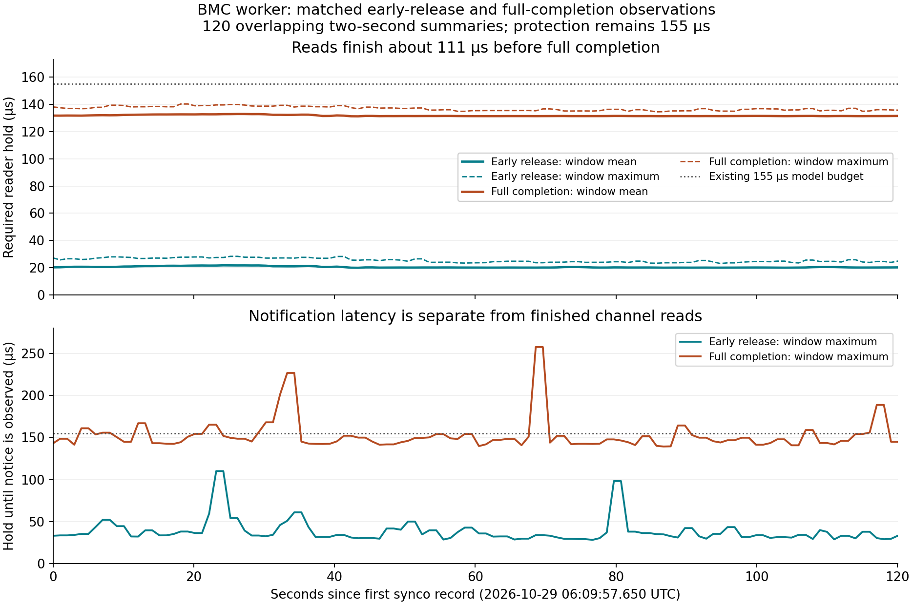
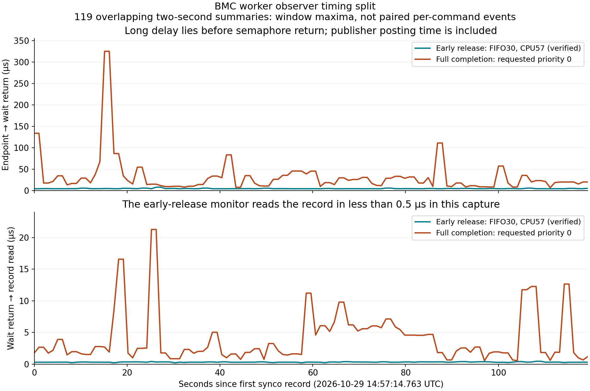

# BMC SDK worker and early channel-reader release

## Objective and evaluation

Requested on 2026-10-27, following the
[first reader-protection measurement](dm-reader-protection-measurement.md#2026-10-27-first-operator-capture-044834z):
move `BMCSetArray()` to a worker, signaled at the present call site in
`bmcCtrl::commandDM()`, while the shmimMonitor thread finishes the remaining
DM processing. Prevent another command from reusing the worker's data before
the SDK returns. Record the design in a separate plan before implementation.

**The approach is workable.** The SDK consumes an actuator vector already
copied out of the combined command. The later `makeDelta()` channel reads can
run concurrently with the SDK call. A dedicated reader-release endpoint can
therefore precede SDK return, while a separate submission result retains the
actual hardware-interface outcome.

Recommendation: start with **one immutable command in flight and a wait at
the tail of the same monitor callback**. Publish reader release before that
wait. The callback returns only after collecting the matching SDK result and
finishing success-dependent publication. This achieves earlier input clearance
without allowing overlapping command preparation or introducing a command FIFO.

Status: implementation authorized on 2026-10-28 and completed on the workstation,
with local verification recorded below. Worker mode remains disabled by default.
The live scheduler, its protection budget, instrument configuration and CPU
placement remain unchanged. Instrument actions and qualification remain operator
tasks.

## 1. Current path and expected benefit

Relevant source locations at the time of this review:

- [`bmcCtrl::commandDM()`](../../../apps/bmcCtrl/bmcCtrl.hpp): actuator mapping,
  conversion/clipping and output-shape publication; `BMCSetArray()` at line
  587; then instantaneous saturation processing.
- [`dev::dm::processImage()` and `makeDelta()`](../../../libMagAOX/app/dev/dm.hpp):
  completion/timing bookkeeping, controller call, additional reads of the
  individual dmcomb channels, output-delta/difference publication and
  saturation-worker notification.
- [`dmCompletion`](../../../libMagAOX/app/dev/doc/dmCompletion.md): the current
  `dmtweeter_done` endpoint follows SDK return and all of that callback work.

The latest capture reports a typical reader requirement near **125 us** and
a retained maximum of **133.372 us**, including approximately **101 us** in
the SDK. Approximate stage means provide this comparison:

```text
Current, all in the monitor callback:

  prepare ~7 us -> SDK ~101 us -> saturation ~5 us -> delta ~10 us -> finish
  |<----------------------- channel reader hold ~125 us ----------------->|

Proposed, with separate physical cores:

  monitor: prepare -> dispatch -> stage saturation/channel reads -> RELEASE
                                                                    |
                                  wait for matching SDK result <-----+
                                    -> publish staged outputs -> finish

  worker:              wake -> BMCSetArray ---------------------> result

  RELEASE: input/channel reads finished; SDK may still be running
  result:  actual SDK return; needed before the next command can be admitted
```

This suggests reader clearance on the order of **20–30 us from callback
entry**, plus the new buffer-copy, handoff and scheduling costs. It is an
estimate, not a measured bound. The shadow test must also retain its matched
primary/combined-observation basis for a comparable reader-hold measurement.
SDK completion would still be around 108 us from callback entry plus the new
copy/dispatch overhead; physical DM response is not measured by either
endpoint. Output publication after the join adds its own tail work.

The existing **155 us** shadow protection budget remains unchanged until the
new endpoint has been measured and qualified. Separating readers from SDK
submission does not remove the independent physical cadence/keepout limits.

## 2. SDK evidence and its limits

A local vendor source archive is available at:

```text
/home/jrmales/Documents/MyPapers/Projects/MagAOX/Electronics/DMs/BMC/2K/Software/dm-sdk-3.5.3
```

In that **3.5.3 archive**:

- `include/BMC/BMCApi.h:260` declares a const input array. A null mapping
  argument selects the previously loaded LUT.
- `BMC/BMC.cpp:211` converts that input synchronously into mutable per-handle
  storage before dispatching to the PCIe/USB backend.
- `BMC_PCIeAPI/BMC_PCIeApi.cpp:401` uses further mutable per-handle frame
  buffers. A driver-side lock does not protect these userspace buffers from
  concurrent SDK calls.
- `BMCVersionString()` is declared at `include/BMC/BMCApi.h:592`.

This supports immutable input ownership through SDK return and serialization
of **all operations on a handle**. It supplies no general reentrancy,
cross-thread affinity, cancellation or physical-settling guarantee. The SDK's
internal work and allocations are not eliminated by moving it to a worker.

The installed instrument library/version and active transport branch have not
been established by this review. Log the actual SDK version and relevant
device/transport identification during qualification; verify its input-lifetime
contract before sharing an input array between threads. Do not infer those
contracts from the repository's SDK test stub or timings in another SDK branch.

## 3. Command ownership and sequencing

The proposed callback sequence is:

1. Admit the attempt only when no earlier command or control operation owns
   the slot. Capture its session/epoch/sequence and combined inode, counter and
   raw publication timestamp, with the existing qualification rules.
2. Map/convert/clamp into preallocated owned storage. Publish `m_outputShape`
   at its existing point; it already precedes SDK success today.
3. Freeze the worker request and signal it at the current `BMCSetArray()`
   location. A request contains the command identity, buffer and configuration
   generation. Acceptance of a request is not successful submission.
4. On the monitor thread, stage instantaneous saturation results and snapshot
   the individual channels needed by `makeDelta()`. Once the final external
   pixel read is complete, publish the qualified reader-release record.
5. Wait for the matching worker result. An already completed result requires
   no blocking. Stale, duplicate or interrupted notifications do not satisfy
   the sequence/generation predicate.
6. Import actual SDK start/end timestamps and outcome. On SDK success, commit
   the staged saturation results and publish the delta/difference products,
   notify the saturation worker, and finish the callback. On failure, discard
   staged success-dependent products, report failure and latch a fault that
   inhibits new admissions pending an explicit recovery transition.

The worker performs SDK operations and fixed timestamp/result handoff. It does
not read command streams, alter saturation/delta state, call the monitor's
timing collector, or perform ordinary INDI/logging work. Error codes return to
the controller thread for reporting. No application allocation is introduced
in the per-command handoff or staging path.

| Resource | Owner and lifetime |
| --- | --- |
| Combined image pixels | Monitor reads only during preparation; never passed to the worker |
| Individual dmcomb channel pixels | Monitor reads during staging; no access after reader release |
| Prepared actuator vector | Monitor prepares it; immutable until both SDK and monitor processing finish |
| SDK request buffer | Worker owns its use through actual SDK return; never reused by a later attempt |
| Saturation/channel-sum staging | Monitor-owned preallocated storage, committed on SDK success |
| SDK result/timestamps | Worker publishes once for its job; monitor consumes by exact identity |
| SDK handle, mapping and configuration | Serialized SDK owner; no close, reallocation or reconfiguration during an operation |

Initially use a **separate preallocated SDK command buffer** so the worker's
input and the monitor's saturation input have independent storage. Measure
the extra copy. Sharing the immutable prepared vector is a later optimization
if the installed SDK contract supports it. Neither approach requires a queue
of future commands or a second active monitor callback. Request/result
visibility must use an explicit release/acquire handoff; semaphore counts alone
do not establish the matching job or authorize buffer reuse.

## 4. Preserve existing products and errors

Today an SDK failure returns before saturation updates, `makeDelta()` and its
output publications. Simply running the existing `makeDelta()` early would
publish products for a command that may subsequently fail.

Split channel snapshot/sum staging from delta/difference publication:

- Read the configured non-delta and delta channels into the existing owned
  sums, `m_totalFlat` and `m_totalDelta`, before releasing readers.
- After SDK success, calculate/publish the current formulas using those sums
  and the prepared output shape: output delta is shape minus total flat;
  output difference is total delta minus output delta. Do not reread channels.
- Stage saturation flags and their count privately, and commit/post only on
  success. A worker result alone must not mutate those monitor-owned products.
- Keep a synchronous wrapper preserving the current order and failure behavior
  for other DM controllers and for BMC with the worker disabled.

The generic `dev::dm` integration needs an explicit opt-in preparation,
staging/release and submission-finalization path. Its intermediate success
means preparation succeeded; only finalization qualifies SDK submission.
Other controllers retain their existing synchronous interface. Reuse optional
helper interfaces and existing base-class patterns rather than introducing a
general task scheduler.

### 2026-10-28 refinement: optional callback-tail interface

The user's proposed `prePostCleanup()` interface is a suitable location for
the normal-path SDK join, immediately ahead of final output publication and
`m_satSemaphore` notification. A name such as `finalizeCommand()` would make
its submission/result role clearer; the final name remains an implementation
choice. Keep the default implementation a no-op for synchronous controllers.

For worker-enabled BMC, use this order:

```text
commandDM: prepare and dispatch SDK work; stage saturation
  -> makeDelta deferred variant: read channels and calculate private results
  -> publish reader release: no further command-channel reads
  -> prePostCleanup/finalizeCommand: wait for matching SDK result, import outcome
  -> on success: commit saturation and publish deferred delta/difference
  -> post m_satSemaphore
  -> finish timing and existing full completion
```

Both current assignments to `m_outputDelta` and `m_outputDiff` publish shared
products. The deferred path must calculate into preallocated private storage;
merely withholding a semaphore post after modifying shared pixels/counters
would not preserve failure behavior. Common `dev::dm` code owns the deferred
delta/difference publication after the hook succeeds; BMC need not publish
those generic products. Keep the current synchronous `makeDelta()` wrapper
and ordering for controllers without deferred work. No-delta commands still
need reader release and finalization.

Calculate `stagedDelta = preparedShape - totalFlat` and
`stagedDiff = totalDelta - stagedDelta`. The deferred calculation must not read
the previous public `m_outputDelta()` as though the new delta were published.

The hook is also needed on failure paths: a staging error, exception or stop
after dispatch cannot bypass draining the worker. Use unified finalization or
a scoped drain guarantee, rather than appending a normal-path-only call before
the existing semaphore post. Preserve actual SDK success independently if
subsequent software processing fails.

Any software error after dispatch must still collect/drain the job before
returning or releasing its storage. If the SDK succeeded but later publication
failed, retain successful submission independently of the failed callback.

## 5. Reader release and submission are different interfaces

Keep `dm.completionStream=dmtweeter_done` and its **version-1 meaning** intact.
A qualified complete record currently requires SDK success, callback success
and stable combined identity through callback completion. It cannot be
published early with a fabricated successful outcome.

Add a separate optional reader-release stream; proposed configuration/name:

```ini
[dm]
readerReleaseStream=dmtweeter_read_done
```

Its protocol must distinguish unavailable, busy, released and unqualified
attempts, and carry the frozen job identity, callback entry and last-read
monotonic endpoint. Reuse the existing completion publisher's coherent fixed
records, exclusive ownership and lifecycle conventions where possible, with
an explicitly distinct protocol identifier/meaning. Release does not require
an SDK success that has not yet occurred. Synthetic/duplicate/incoherent
attempts cannot grant qualified permission.

The result still belongs to that frozen job if the combined stream legitimately
advances after reader release. Do not relabel a new live image as the completed
job. Leave the old version-1 live-stability predicate conservative: such an
advance may make its completion unqualified, which is **not** an SDK failure.
Actual submission success/failure remains recorded against the immutable job
in timing/result state. A future phase-aware completion protocol can expose
both endpoints together if needed; it must not silently change version 1.

A late SDK error does not undo the fact that external reads already finished.
It instead invalidates further command admissions. Reader-release availability
alone must never be interpreted as backend readiness or successful DM action.

For synco, a matching release could eventually shorten protection of actual
destination channels such as `dm01disp07` and `dm01disp08`. Producer-owned
`*_aux` streams are already independent. Synco must also retain dmcomb's own
consumption checks, protection against a newer main command, freshness/liveness,
copy budgets and physical trigger spacing. A release for an earlier command
cannot authorize writes while a newer command is reading. Semaphore posts
remain hints to inspect the latest exact record, not per-command tokens.

First extend the **shadow measurement** to measure qualified read releases
independently, joining full completion opportunistically for the same job.
Report release-only, qualified-version-1 and immutable-SDK-result coverage
separately. Requiring a qualified version-1 peer would censor valid releases
followed by a permitted input advance. Expose the frozen identity with the
new SDK-result diagnostics so actual submission can be associated even when
version 1 is unqualified. Do not change the live scheduler as part of the
initial worker implementation.

## 6. Timing with overlapping stages

[`dev::dmTiming`](../../../libMagAOX/app/dev/dmTiming.hpp) has one active event
owned by the monitor. Its current `markAt()` rejects timestamps earlier than
any already recorded marker. Importing an SDK-start timestamp after recording
the monitor's later channel-read markers would therefore be rejected even
when the new overlap is correct.

Return fixed SDK timestamps and outcome through the worker result. Add a
deliberate single-owner import/finalization mechanism that validates causal
ordering, including:

```text
receipt <= entry <= preparation end <= SDK start <= SDK end <= callback finish
                         |
                         +-> staged reads -> reader release <= callback finish

SDK and staged reads may overlap; SDK end need not precede saturation start.
```

Preserve existing sequential validation for unchanged controllers. Existing
`fgtimes` meanings remain receipt interval, actual successful SDK-return
interval, and receipt-to-SDK-return latency. Keep stage durations independent;
their sum is no longer callback duration. In worker mode, the delta operation's
start-to-end wall interval spans staging, the SDK-result wait and final delta
publication; document that changed composition explicitly. Add separate
channel-staging and delta-publication durations plus the last-read endpoint,
so the existing delta span is not mistaken for CPU time spent reading channels.
Synchronous delta timing retains its current meaning.

Add measurements for dispatch-to-SDK-entry, callback-entry-to-reader-release,
release-notification delay, SDK-result wait and total callback duration.
Record busy/overrun/coalesced attempts, SDK failures, invalid identities,
stale results and dropped observations. Statistics and serialization remain
outside the realtime threads. Extend telemetry compatibly and document which
durations include output publication or wait time.

## 7. SDK lifecycle, waits and overload

In worker-enabled mode, make the **worker the sole caller of handle operations**,
including open, map loading, normal set, zero, clear and close. Control requests
are synchronous from the caller's perspective but use the same serialized
owner after stopping command admission. Return needed handle metadata through
owned results rather than inspecting mutable SDK internals concurrently.
Command requests and app/control requests have different calling threads:
serialize their access to the single slot explicitly. Do not treat those
multiple callers as a single-producer queue. Keep the admission lock out of
the SDK call and do not hold it while waiting for a result needed by another
thread to finish the current callback.

Admission closure for control operations also matters while no SDK command is
running. Reject receipts while admission is closed, or wait before input
selection and identity capture and select fresh input afterward. Waiting only
inside `commandDM()` would retain an obsolete pixel pointer/identity even with
the recommended tail join.

Shutdown, power transitions, reinitialization and calibration/mapping changes
must stop admissions, drain the in-flight SDK operation **and retire the whole
monitor callback**, including output publication and timing/completion finalization,
then perform the required zero/clear/close sequence. The worker can remain
idle across DM power cycles, with a new handle generation on reopen; stop/join
it before application teardown or worker reconfiguration and before freeing
its resources. `releaseDM()` currently signals the monitor and
sleeps one second; a sleep is not proof of quiescence and must not serve as the
new ownership barrier.

SDK idle and command-slot free are different states. SDK return makes the
backend operation idle; only callback retirement releases the command slot
and permits control operations or reallocation. Early reader release does
neither. Keep those state transitions explicit in the handoff and drain tests.

Use an explicit stop flag, blocking wake and join when idle. Do not send a
generic thread-stop signal into an active SDK call with unknown interruption
semantics. Startup failure after thread creation must also wake/join that
thread before releasing its resources. A worker must never require an app or
INDI mutex held by a caller waiting for its result.

A timeout reports a fault and stops new admissions; it does **not** authorize
buffer reuse, concurrent zero/close, thread cancellation or freeing a handle
still used by a blocked SDK call. Record operator recovery requirements if
the SDK cannot be drained. SDK exceptions must become a failed result while
still respecting resource ownership.

The current monitor logs callback errors and can continue; that is not the
new fault latch. Add an explicit worker-path fault/admission state and select
the reinitialization/release transition that clears it only after successful
drain and recovery. Do not automatically retry an uncertain submission.

There is one in-flight command and no SDK backlog. The tail wait prevents
reentry into preparation. Explicitly handle accumulated semaphore posts and
counter advances: after readiness, select a coherent current input, count
skipped/coalesced advances and reject duplicate counters; never replay old
posts as a burst of identical SDK commands. Scope this admission behavior to
the opted-in path and retain the existing generic monitor behavior elsewhere.

Waiting only at the beginning of the next `commandDM()` is insufficient:
`dev::dm::processImage()` has already captured attempt identity and the monitor
has selected its pixel pointer by then. A fully asynchronous callback return
would need a gate before those operations and fresh input selection after
waiting. Defer that more disruptive design unless the tail join proves inadequate.

## 8. Realtime placement and configuration

Use existing `MagAOXApp::threadStart`/thread readback conventions for priority
and cpuset setup. Provisional startup-only settings are `sdk.workerEnabled`
(default false), `sdk.threadPrio` and `sdk.cpuset`; final names can follow the
local controller convention during implementation. Changing execution mode
requires a restart/drain, not an online toggle.

The workstation config assigns the command monitor to `tweeter`, CPU40,
FIFO55. Synco uses CPU41. The
[RTC cpuset plan](rtc-cpuset-restructuring.md) retains `spare30`, `spare31`,
`spare56` and `spare57` as development reserves. Confirm current ownership and
topology before choosing one for the SDK worker; no core is assigned here.

Use a **different physical core** from the monitor for the intended overlap.
On one core a higher-priority worker can hold off the monitor during the SDK
call, while a lower/equal-priority FIFO worker can delay SDK entry until the
monitor blocks. Neither establishes the intended timing. Measure placement,
wakeup and SDK-entry costs and retain RTC latency tuning. A requested priority
or cpuset must not be mistaken for verified runtime placement: `threadStart()`
can log a scheduling-policy failure without returning failure. Verify actual
policy, priority and affinity before accepting a worker-enabled setup.

## 9. Implementation and qualification sequence

1. **Ownership and baseline tests.** Establish SDK version/transport reporting,
   reusable single-slot handoff and lifecycle drain tests. Keep worker mode
   disabled by default and preserve the synchronous baseline.
2. **Staged DM processing.** Separate channel snapshots from output publication
   with synchronous regression coverage. Add opt-in callback finalization so
   every post-dispatch error path drains the matching job.
3. **Worker and endpoints.** Dispatch at the current SDK call site, stage reads
   concurrently, publish the distinct release endpoint, join at callback tail
   and merge actual submission timing/outcome. Add lifecycle/control operations
   to the same SDK owner and preserve version-1 completion behavior.
4. **Shadow observation and documentation.** Measure release independently and
   match available completion/result endpoints by job identity in the
   reader-protection test, retaining separate coverage counts. Document
   configuration, diagnostics, expected counter/semaphore behavior and
   failure/recovery semantics. Update this plan
   with implemented decisions and verification results.
5. **Operator hardware comparison.** Run paired synchronous/worker captures
   with identical camera, loop, dmcomb, CPU/IRQ, latency and GPU workload settings.
   Compare primary/combined publication, camera timing, DM send cadence and all
   quality counters as well as earlier reader clearance. Retain the current
   shadow budget and do not enable extra real triggers in this qualification.

Deterministic workstation tests use a stub SDK with entry/return barriers,
not sleeps as ordering evidence:

- Hold `BMCSetArray()` in flight and prove the last channel reads and release
  occur before permitting SDK return; prove the callback cannot admit another
  command or overwrite its buffers meanwhile.
- Change shared pixels after release and verify the worker receives the frozen
  vector and staged delta products use the earlier channel sums.
- Exercise SDK return before/after staging, failure, exception and delayed
  return; preserve clipping/mapping/output-shape and success-dependent products.
- Assert at most one SDK operation, including zero/open/map/clear/close, is
  active. Exercise stop, power, reconfiguration and startup failures at each
  handoff phase without releasing live buffers or deadlocking.
- Exercise stale/duplicate/coalesced notifications, EINTR, source replacement,
  counter rollback, generation changes, backlog and older results after reset.
- Validate overlapping timing, actual submission independent of callback error,
  release qualification and version-1 compatibility. Test other controller
  regressions and default-off BMC behavior.

Hardware acceptance requires earlier qualified reader clearance **and** no
unexplained new SDK errors, stale/duplicate sends, counter gaps or camera/loop
timing degradation. Retain missing/dropped/unqualified coverage alongside
observed extrema. A useful short capture is followed by a longer unchanged
run; neither observed maximum is a hard realtime guarantee.

## 10. Alternatives and remaining review choices

A no-worker alternative is to snapshot the channels before the synchronous
SDK call and publish their release then. It avoids the extra thread but moves
roughly 10–16 us of work in front of SDK submission. Moving the existing
`makeDelta()` wholesale before `commandDM()` would also use the previous output
shape, so preparation and publication would still need separation. The worker
approach better preserves early SDK launch if handoff latency is small.

Before enabling the worker on hardware, resolve:

- Installed SDK version/transport and supported input/handle lifecycle contract.
- Dedicated worker core and priority, supported by measured dispatch latency.
- Final release-stream/configuration names and visibility of actual submission
  status when the old full-completion record is conservatively unqualified.
- Explicit overload/fault recovery behavior and acceptable measured overhead.

Selecting a smaller reader budget, an early-main reserve or a revised live
syncopation policy is subsequent work, based on the separated measurements.

## 11. 2026-10-28 implementation record

### Interfaces, ownership and lifecycle

Implemented the generic opt-in callback-tail path using inherited default
interfaces `admitCommand()`, `deferredCommand()`, `finalizeCommand(result)` and
`retireCommand()`. Synchronous owners admit normally and use a no-op finalizer.
Deferred owners stage delta/difference in preallocated private arrays, release
readers, finalize the actual submission, then publish products and notify the
saturation worker. A callback scope guard drains an unexpectedly unfinished
submission before retiring its storage. Ordinary processing exceptions follow
the same finalization path. No-delta callbacks also finalize and release readers.

The BMC implementation uses a single fixed request/result slot with mutex and
condition-variable predicates. All handle operations run on the sole worker
when enabled, including initialization, map loading, zero, clear and close.
An immutable SDK vector is copied separately from monitor saturation input.
Control requests close admission and wait for whole-callback retirement before
using the SDK slot or changing buffers. The worker initialization barrier is
mutex-protected, and startup checks actual policy/priority and requested cpuset
affinity before accepting work; the existing generic startup boolean is not
read concurrently by this worker.

Worker-mode admission rejects stale/duplicate counters and coalesces advances
without replaying semaphore backlog. The first same-inode counter rollback is
rejected and clears the progression baseline so a subsequent genuine receipt
can establish a new epoch. SDK, processing and late publication/notification
failures close admission; successful submission remains independent of a later
failed callback. Only release followed by successful reinitialization clears
the worker fault. Saturation reporting now uses an atomic exchange to retain
increments across the ordinary reporting thread.

The implementation waits for actual SDK return while enforcing a diagnostic
command deadline, `sdk.timeoutSec` (default **1 second**, finite and positive).
Ordinary app logic observes pending normal-command age; finalization also
checks actual elapsed time if the call returned between observations. A
violation is counted once per job and closes admission without releasing the
in-flight buffer/handle. Control/initialization operations are exempt. An SDK
success after the deadline retains its actual outcome/code but fails the
callback and suppresses success-dependent products. A hung call can still
block drain: there is no cancellation, concurrent close or fabricated
completion. This watchdog is not the scheduler's microsecond timing reserve.

### Release protocol, diagnostics and compatibility

`dm.readerReleaseStream` is independent of `dm.completionStream`. Both use
16-word records with distinct magic values. The new reader kind adds a
`released` state and uses word 15 for raw backend result (`INT64_MIN` when no
raw return code is available, including SDK exceptions). Read qualification
is independent of backend outcome. A later result update preserves the exact
read identity and last-read timestamp. Full version-1 encoding/qualification
remains unchanged. If the two publishers observe different admitted input
identities, the early record is conservatively unqualified.

The worker never mutates `dev::dmTiming`. Its result returns actual SDK
timestamps/code to the monitor for causal import. New metric IDs 13–17 are
`sdkDispatch`, `readerRelease`, `staging`, `publication` and `sdkWait`;
historical IDs and `fgtimes` meanings remain intact. The detailed logger accepts
complete 12-, 13- and 18-row metric sets. Updated controllers emit 18 rows even
in synchronous mode, so `logdump` must also be rebuilt for the baseline run.
Dispatch-object dependencies include the changed timing and reader-result
headers, preventing stale verifiers/accessors after a header-only change.

Synco's optional ordinary-priority `readerReleaseMonitor` feeds an independent
protocol-aware reader collector. Its `reader_release_timing` INDI/telemetry
population uses the same frozen budget and source observations as the existing
full-completion measurement. Valid release evidence requires no full-completion
peer. SDK enrichment is counted once per observed attempt and never creates
a second reader sample; an explicit outcome can be counted even when an
exception supplies no raw code. Missing/coalesced observations remain visible
in the independent quality counts. Scheduler decisions and the 155 us budget
are unchanged.

The [BMC worker guide](../../../apps/bmcCtrl/doc/sdk-worker.md), common
[completion protocol guide](../../../libMagAOX/app/dev/doc/dmCompletion.md),
[timing guide](../../../libMagAOX/app/dev/doc/dmTiming.md) and expanded
[shadow procedure](../../../apps/dmSyncopation/doc/reader-protection-test.md)
describe configuration and interpretation. No worker core or instrument config
has been selected by this implementation.

### Local verification

Deterministic SDK barriers establish early release while `BMCSetArray()` is
held, immutable command/delta capture after shared input changes, no SDK overlap,
and control-operation exclusion through callback retirement. Fault tests cover
SDK errors/exceptions, processing exceptions, counter resets, stale notifications,
startup rollback and a real saturation `sem_post` overflow after SDK success.
The last case must close admission while preserving the successful immutable
SDK result.

Final workstation verification:

| Suite | Assertions | Cases |
| --- | ---: | ---: |
| BMC controller/worker | 583 | 15 |
| Generic DM | 274 | 5 |
| Callback/finalization/completion integration | 293 | 9 |
| Timing integration | 153 | 8 |
| Completion/release protocol and publisher | 539 | 15 |
| Timing collector | 380 | 18 |
| Reader-protection collector | 347 | 18 |
| Synco application integration | 8,383 | 65 |
| DM timing telemetry | 1,218 | 7 |
| Synco telemetry | 4,283 | 25 |
| Existing ALPAO/IrisAO/PI controller regressions | 109 | 6 |
| **Total** | **16,562** | **191** |

The library/PCH, normal `dmSyncopation` and normal `logdump` builds pass with
fresh dispatch and binary schemas. Final BMC source also passes compilation
against the real archived **3.5.3 SDK headers**, independently of the offline
test declarations. A normal BMC vendor-library link was not performed: that
runtime installation is absent on the workstation. No SDK or controller was
run against hardware. Full changed C/C++ files pass `clang-format`, whitespace
checks pass, and new/updated guide paths and Markdown anchors resolve.

Affected implementation files are the BMC app/test SDK adapter, generic DM
base, shared completion/timing/reader collectors, synco observer, detailed
telemetry/schema types, and their existing test suites. The library Makefile
adds dispatch dependencies for timing headers. The existing test registry and
Doxygen group structure cover the expanded suites without new test binaries.

Hardware timing, installed SDK/transport and dedicated-core qualification
remain pending. Rebuild/install `bmcCtrl`, `dmSyncopation` and `logdump` together
before a synchronous-baseline/worker comparison. Keep operational syncopation
disabled and the existing shadow protection budget unchanged for that test.

## 12. 2026-10-28 initial hardware check

The operator reports the installed worker is running with the loop closed at
**2 kHz**. `dmtweeter_read_done` advances at **6 kHz**, consistent with three
counter increments per command: callback begin, reader release and SDK-result
enrichment. This is one command and one reader-release endpoint per attempt;
the two latter updates post notifications.

The operator also confirms `sdk_worker.completed` increases while `fault`,
`admissionClosed`, `failures` and `timeouts` remain zero. `sdk_worker.active`
alternates between one and zero as individual callbacks start and retire.
It reports instantaneous callback ownership, not whether worker mode is enabled;
the property itself is registered only when worker mode is enabled.

This passes the initial functional check. Quantitative early-release timing,
coverage, dispatch overhead and camera/loop timing comparison remain pending.
The next measurement uses the existing simultaneous bounded 120-second capture
with both completion observers configured, operational syncopation disabled and
the **155 us** shadow protection budget unchanged. Record worker CPU/priority
and installed SDK/transport alongside the capture before drawing conclusions
about a smaller reader-protection interval.

## 13. First worker capture: 20261029T055816Z

Source: `synco-sim-20261029T055816Z.tgz`, extracted on the workstation at
`/home/jrmales/tmp/home/jrmales/tmp/synco-sim-20261029T055816Z`.
The controller contributes 120 records from **2026-10-29 05:58:16.781538770
to 06:00:16.002307805 UTC**, or October 28, 22:58:16–23:00:16 Phoenix time.
All saved INDI requests succeed with empty error files; the three bounded
collectors return expected timeout status 124. The saved checkout is
`f6f14f1c483a4cf2a55e8a116efc911120b379dd`, not independently established
running-binary provenance.

### Controller separation is visible

The eighteen-metric controller records show early channel release while the
monitor still waits for the SDK result. Numbers below are medians of reported
overlapping two-second means and sigmas, with extrema retained in those
windows; they are not pooled capture statistics or per-command medians.

| Controller metric | Median window mean, us | Median window sigma, us | Retained minimum–maximum, us |
| --- | ---: | ---: | ---: |
| Callback entry to reader release | 19.548729 | 0.529944 | 17.813–25.308 |
| SDK dispatch to actual SDK start | 2.926281 | 0.148003 | 2.455–4.068 |
| Actual SDK call | 104.085655 | 0.113787 | 103.656–109.657 |
| Monitor result wait | 100.054007 | 0.392135 | 98.406–105.980 |
| Private delta staging | 4.636447 | 0.221475 | 4.228–5.901 |
| Deferred product publication | 6.738440 | 0.199183 | 5.671–13.746 |
| Receipt to SDK return | 117.892160 | 0.517016 | 116.009–124.816 |
| Callback entry to finish | 129.797147 | 0.650153 | 127.571–137.810 |

The typical separation between entry-relative release and callback completion
is about **110 us**. These same-origin controller endpoints demonstrate the
intended overlap. They do not supply the independently matched release offset
from synco's primary/combined observation baseline. Worker `delta` wall time
(about 114 us) includes staging, SDK-result wait and publication; it is not
the old delta calculation cost, and overlapping durations must not be summed.

Controller totals add **238,441** receipts and submissions between the first
and last records, with no added failed, partial, no-send, rejected, duplicate,
counter-gap, invalid or dropped events. The three rejected and two synthetic
events predate the capture. Controller INDI was not saved, so worker timeout,
admission and actual scheduling readbacks are not independently retained here.

### Early observer missing; repeat the matched measurement

All **119** synco records report `reader_release_timing=unavailable`; both
INDI snapshots lack the early observer's properties and thread. The operator
subsequently confirms synco was not set up correctly. This run is a controller
check, not a completed early-reader protection qualification. Add
`[readerReleaseMonitor] shmimName=dmtweeter_read_done` to the existing synco
configuration, retain `completionMonitor.shmimName=dmtweeter_done`, restart
synco, and verify enabled/advancing early matches before the repeat capture.

The full-completion observer remains useful. Its median window mean required
hold is **130.240831 us**; the retained maximum is **138.261 us**. It adds
237,575 matches from 237,576 completion observations, with one added busy
observation, sequence gap and counter gap. No queue drops, missing peers,
errors, unqualified records or over-budget samples are added. Lifetime maxima
245.083 us required / 487.531 us observed and 540,007 over-budget samples are
unchanged prehistory, not current-run excursions. The stored worst event
predates the capture by about 14.5 hours.

### Camera, shadow model and comparison limits

Camera telemetry adds 236,512 published frames between its first/last stage
records, with no new frame/counter gaps, failures or queue drops. Median window
acquisition-interval sigma is **0.300491 us** and publication-interval sigma
**0.827865 us**. Retained acquisition intervals are 480–520 us; publication
intervals are 477.902–521.495 us. There is no observed return of the earlier
roughly 80 us camera excursions.

Operational synco remains Off, simulation stays valid, and RTC latency is On.
The unchanged 155 us model considers 237,577 opportunities per step: all
step-0 opportunities would run; step 1 would run 237,575 and skip two for its
fixed reader hold. Neither step adds overlaps. These decisions do not use the
early signal. Combiner diagnostics add no new gap/drop/invalid observations.

Saved scalar loop gain is **0.05** and camera target **+20 C**, compared with
gain 1 and target -45 C in the preceding reader capture. The operator reports
no other changes. Modal arrays and actual CPU/IRQ placement are not included
in these snapshots. Compared with that earlier run, typical callback time is
5.307 us greater, receipt-to-SDK return 9.389 us greater and actual SDK call
3.288 us greater. These are cross-run differences, not an isolated estimate
of worker overhead. A same-configuration synchronous/worker comparison and
the corrected early observer remain pending. Keep the shadow protection
budget at 155 us and operational syncopation disabled for the repeat.

## 14. Corrected observer capture: 20261029T060958Z

Source: `synco-sim-20261029T060958Z.tgz`, extracted on the workstation at
`/home/jrmales/tmp/home/jrmales/tmp/synco-sim-20261029T060958Z`.
There are **120 synco records**, from **2026-10-29 06:09:57.650460360 to
06:11:57.741749796 UTC**, spanning **120.091289 seconds**; Phoenix local time
is October 28, 23:09:57–23:11:57. The saved checkout remains
`f6f14f1c483a4cf2a55e8a116efc911120b379dd`. All snapshots succeed, error files
are empty, and the bounded collectors return expected timeout status 124.

The operator confirms correcting/restarting synco was the only change since
055816Z, with settings, CPU/IRQ placement and workload unchanged throughout.
Saved camera/loop settings match: bin2, 2 kHz, EM gain 1, synchronization On,
shutter SHUT, temperature target +20 C, closed loop and scalar gain 0.05.
Modal arrays are not saved. Operational synco remains Off, the simulation
retains its 155 us model budget and 20 us early reserve, and RTC latency is On.
Both completion observers are now attached; the new release monitor requests
ordinary priority zero. Controller and camera telemetry sessions are unchanged.

### Independently matched release removes the SDK wait

With B = max(primary observation, combined observation), F the selected
controller endpoint and R its observer receipt, the new observer measures
`max(0, F - B)` independently of full completion. Medians below summarize
overlapping two-second means; maxima are observed in those rolling windows,
not hard operating bounds or a pooled per-frame distribution.

| Matched metric | Early release: median window mean, us | Early retained maximum, us | Full completion: median window mean, us | Full retained maximum, us |
| --- | ---: | ---: | ---: | ---: |
| Required hold from model baseline | 20.134308 | **28.303** | 131.453837 | **140.285** |
| Controller processing to endpoint | 19.902783 | 27.952 | 131.381810 | 140.084 |
| Hold until notice observation | 24.336999 | 109.978 | 135.406618 | 257.536 |
| Endpoint-to-observation delay | 4.177800 | 85.131 | 3.972132 | 151.165 |

The typical reader requirement is about **111.320 us lower** than full
completion in this same run. This difference of summary statistics is not
a paired per-command distribution. Minimum matched slack against the unchanged
155 us model is **126.697 us** for release versus **14.715 us** for full
completion; neither observer adds an over-budget event.



The ordinary-priority notice can arrive well after the reads finish: the early
observer's retained observed-hold maximum is 109.978 us even though the required
hold stays below 28.303 us. The full observer reaches 257.536 us until notice,
while its actual required hold stays below 140.285 us. A future scheduler must
distinguish the endpoint from observer-delivery latency; these measurements do
not justify treating the ordinary observer's notification as an instantaneous
release. Required/notification/observed maxima need not belong to the same event.

### Coverage and worst-event provenance

| First-to-last synco telemetry difference | Early release | Full completion |
| --- | ---: | ---: |
| Primary observations | 240,182 | 240,181 |
| Combined observations | 240,182 | 240,181 |
| Endpoint notices | 480,364 | 240,181 |
| Matched commands | **240,182** | **240,181** |
| Observed SDK results / successes | 240,182 / 240,182 | Not counted by this protocol |
| Observed SDK failures | 0 | Not counted by this protocol |

Both observers add **zero** busy, unavailable, error, unqualified, invalid,
incoherent or duplicate observations, sequence/counter gaps, missing peers,
identity mismatches, resets, stale epochs, evictions or queue drops. Their
before/after INDI differences agree with these telemetry differences. Normal
retained-source expiry adds one per matched command. The early observer's
startup duplicate and reset/stale-epoch counts predate the capture. Its two
notices per matched command are release plus SDK-result enrichment, not two
submissions; per-summary results can trail matches by one or two in-flight
updates, while capture differences retain one successful result per command.

Both required-hold lifetime maxima increase within this capture. The early
maximum first appears at **06:10:22.859653654 UTC**:

```text
Primary inode 4676 / counter 138928000
Combined inode 4685 / counter 169636774
Release session 2120408464588493 / epoch 7 / sequence 2430868
Publisher PID 788488; kind readers; state released; processing result 0

P = 2122061013114011 ns
C = B = 2122061013131724 ns
S = 2122061013132075 ns
F = 2122061013160027 ns
R = 2122061013164516 ns

S - B = 0.351 us
F - S = 27.952 us
F - B = 28.303 us
R - F = 4.489 us
R - B = 32.792 us
155 us - (F - B) = 126.697 us
```

The recorded release precedes SDK enrichment (outcome unknown and raw code
unavailable), which is valid for read qualification. The full-completion
maximum first appears at **06:10:15.799992673 UTC**, for combined counter
169621974: processing 140.084 us plus 0.201 us from baseline to start gives
140.285 us required, with 14.715 us slack and a successful SDK outcome.
These are different commands and must not be subtracted as a per-command gain.

Signed offsets reach -242.077 us early and -131.067 us full around 06:11:07,
when synco's observation baseline is late relative to controller work.
Clamped zero required holds therefore do not mean zero-time reads. The
processing population remains positive (at least 17.964 us early and 129.134 us
full); keep signed offsets alongside any future gating analysis.

### Controller, camera and unchanged shadow policy

The controller adds **236,422 successful submissions** between its own first
and last records, with no added failures, partial/no-send/rejected commands,
duplicates, counter gaps, invalid events or queue drops. Direct controller
telemetry reports entry-to-release mean **19.727457 us**, maximum **27.762 us**;
the dedicated publisher starts before the timing `entry` marker, explaining
the slightly different processing population above. SDK dispatch is typically
2.994569 us, the SDK call 104.006628 us, receipt-to-SDK return 118.120096 us,
and the full callback 130.979665 us. Compared with 055816Z, typical release
is 0.179 us later and callback completion 1.183 us later. These are descriptive
run-to-run differences, not an isolated observer-overhead experiment.

Camera stage totals add **238,571 frames**, with no new failures, frame/counter
gaps, invalid records or queue drops. Acquisition-interval sigma is typically
**0.300283 us** and publication-interval sigma **0.843026 us**, similar to the
preceding run. Retained intervals are 480–519 us acquisition and
478.643–518.519 us publication. Combiner/primary/pipeline quality remains clean.
No controller INDI snapshots are included, so actual SDK worker affinity,
priority and timeout/admission counts are still not independently saved here.

The fixed shadow model considers 240,183 opportunities per step. Step 0 would
run all of them. Step 1 would run 240,180 and skip three: two reader holds and
one missing output at its modeled deadline. Neither step adds overlaps.
The missing-output decision alone is not evidence of a lost physical command.
These decisions still use the fixed 155 us hold, not the early signal.

This establishes the intended earlier software clearance with clean observed
coverage in the short run. A smaller fixed reader hold or release-aware gating
is a separate policy change; SDK readiness, dmcomb consumption, newer callbacks,
copy protection and early-main reserves remain separate constraints. Longer
unchanged coverage and any same-configuration synchronous/worker comparison
remain useful before selecting an operational bound. No runtime policy or
configuration is changed by this analysis.

## 15. 2026-10-29 notification-waiter comparison implemented

The operator questioned whether the ordinary observer explains the 85 us
notification tail, compared with optimized loop semaphore consumers, and
authorized the split measurements and isolated real-time waiter comparison.
Source review confirms the existing release observer blocks directly on
`sem_timedwait`, but defaults to `SCHED_OTHER` priority zero and no dedicated
cpuset. The primary monitor's FIFO30 / CPU41 configuration does not apply to
this separate thread. No capture of its actual previous affinity was saved,
so scheduling is a hypothesis for the tail, not an established attribution.

### Endpoints and qualification

Both observer callbacks now retain their already captured semaphore-return
timestamp **W** in the fixed `Completed` handoff. **R** remains the timestamp
after the coherent stream-record read. There is no added hot-path clock call,
allocation, lock or wait; the only new producer payload is one int64 timestamp.
Consumer-side populations append `wake = W - F` and `capture = R - W` to the
six existing metrics. They require `0 < F <= W <= R`; the original match,
notification and hold populations remain valid when that split is unavailable.
`wake` includes record publication/posting before semaphore return and is not
a pure kernel semaphore latency.

The early stream posts a later SDK-result update while retaining the original
release endpoint F. If an attempt is first observed after enrichment, the
original `R - F` remains meaningful as observation delay but cannot establish
an early-release wakeup. `firstEnriched` counts that first retained observation
and both split metrics omit it. Subsequent enrichment of an already observed
release does not repeat the receipt counters or replace its original sample.
Full-completion success remains eligible for the split normally.

`receiptUnavailable` counts zero/missing W and `receiptInvalid` counts nonzero
W outside the causal interval. These are diagnostic first-retained-completion
counts and can precede or outnumber successful joins. In particular, a leftover
semaphore token followed by a newer coherent record can yield W < F; it must
not become a negative wake duration or invalidate the genuine completion.

An independent lifetime `worstNotification` sample retains the largest matched
R - F with its exact F/W/R, identities and initial SDK outcome, in addition to
the existing worst-required sample. It survives ordinary window expiry and
source resets and resets on reconfiguration. This allows attribution of one
actual notification tail, including an invalid receipt or enriched-first case,
without combining maxima from different commands.

### Interface, compatibility and test setup

Both reader INDI metric properties gain `wake` and `capture` (seconds with
mean/jitter/min/max/count/span). Their quality properties gain the three
diagnostic counters. Telemetry appends optional paired stats, raw receipt
provenance, counters and a separate worst-notification record. Legacy records
without those fields remain readable; a partial split pair is rejected.
Current writers serialize both new populations even when empty. Invalid raw
receipt provenance is retained without invalidating a qualified original join.
The controller publisher protocol and BMC implementation are unchanged.

The [operator procedure](../../../apps/dmSyncopation/doc/reader-protection-test.md#compare-an-ordinary-and-an-isolated-real-time-release-waiter)
requests a new ordinary-observer baseline with the split fields, followed by
the same test with reader-release priority 30 on a dedicated available physical
core. The additive
[`dmtweeter_synco_reader_rt.conf`](../../../apps/dmSyncopation/dmtweeter_synco_reader_rt.conf)
uses the operator-confirmed **spare57 / CPU57**, at priority 30. On October 29
the operator confirmed the SDK worker uses **spare56 / CPU56** and spare57 is
available for this observer. The primary monitor's and command monitor's
dedicated cores remain separate.
Production defaults remain ordinary priority zero with no dedicated cpuset.

Rebuild/install **dmSyncopation and logdump**; this change does not require a
BMC controller rebuild/restart. The expanded common capture block saves
controller INDI before/after to retain SDK-worker diagnostics. The procedure
also requests actual scheduler/affinity checks using the current observer TID,
since requested INDI priority is not proof of actual policy or placement.
Keep real syncopation Off, the 155 us model budget, RTC latency On and all
camera/loop settings unchanged. No hardware action was executed by the agents.

### Workstation verification

| Suite | Assertions | Cases |
| --- | ---: | ---: |
| Reader collector | 518 | 23 |
| Synco application | 8,657 | 68 |
| Synco telemetry and compatibility | 5,407 | 29 |
| **Total** | **14,582** | **120** |

Deterministic tests cover causal boundaries, absent and unordered receipts,
legacy captures, first-enriched release success/failure, delayed peer matching,
subsequent enrichment without timestamp replacement, independent tail retention,
expiry/reset/reconfigure behavior, real app receipt hooks and independent
per-monitor configuration. Telemetry tests cover binary/JSON/text round trips,
legacy omission, malformed partial pairs, quality bounds and invalid raw
receipt preservation. No change to live/shadow scheduler decisions is made.

Fresh library/PCH and schema generation, normal dmSyncopation and logdump
builds pass. All seven changed C/C++ files pass full-file clang-format checks;
whitespace, operator-guide local links and all documented Bash blocks pass
validation. The operator has confirmed the RT core assignment; applying the
profile and verifying the running thread's policy/affinity remain operator
actions. No instrument commands were run by the agents.

## 16. FIFO30 / CPU57 capture: 20261029T145715Z

Source: `synco-sim-20261029T145715Z.tgz`, extracted on the workstation at
`/home/jrmales/tmp/home/jrmales/tmp/synco-sim-20261029T145715Z`.
The 119 synco records span **2026-10-29 14:57:14.763206540 to
14:59:14.021664285 UTC**, **119.258458 seconds**, or October 29,
07:57:14–07:59:14 Phoenix time. All snapshots succeed, error files are empty
and the three bounded collectors return expected timeout status 124. Saved
checkout is `ed98cf8a2a0997bfb65a49b285d4904215587167`.

The operator reports no changes other than dmtweeter-synco. The release
observer requests priority 30; the full-completion observer remains at requested
priority zero. A subsequent operator check confirms the same release-monitor
TID's actual policy and affinity:

```text
PID     TID      CLS RTPRIO PSR COMMAND
1015912 1015922  FF      30  57 dmSyncopation
pid 1015922's current affinity list: 57
```

This verifies **FIFO30 on CPU57 / spare57**. The SDK worker remains separate
on operator-confirmed spare56; its saved readbacks verify actual FIFO policy 1,
priority 55 and one allowed CPU. That allowed-CPU readback is a count, not a CPU
number. Operational synco stays Off, RTC latency stays On, and the two-step
shadow model retains its 155 us protection and 20 us early reserve.

### The split localizes the long tail before semaphore return

The following typical values are medians of overlapping two-second means;
maxima are retained in those windows. They are not pooled capture statistics
or an operating guarantee.

| Metric | FIFO30 release: typical, us | Release maximum, us | Full completion: typical, us | Full maximum, us |
| --- | ---: | ---: | ---: | ---: |
| Required reader hold | 20.248687 | **25.708** | 131.384777 | 140.144 |
| Controller processing to endpoint | 19.793095 | 25.248 | 131.078102 | 139.844 |
| Hold until notice observation | 23.933678 | **29.425** | 135.390741 | 431.364 |
| Notification, R - F | **3.680820** | **8.086** | 4.016485 | **326.256** |
| Endpoint to wait return, W - F | **3.486370** | **7.885** | 3.763184 | **325.044** |
| Wait return to record read, R - W | **0.194378** | **0.461** | 0.244091 | 21.260 |



The FIFO30 release observer's current notification maximum is 8.086 us,
compared with 85.131 us in 060958Z. The ordinary full-completion observer in
this same capture retains a 326.256 us notification event. Its independent
worst-notification record, first reported at **14:57:29.914789947 UTC**,
provides an exact same-event decomposition:

```text
Primary inode 4676 / counter 143446471
Combined inode 4685 / counter 174155268
Completion session 2120408464557324 / epoch 12 / sequence 4754842
Publisher PID 788488; state complete; SDK success; callback result 0

S = 2153687906454522 ns
F = 2153687906586732 ns
W = 2153687906911776 ns
R = 2153687906912988 ns

F - S = 132.210 us
W - F = 325.044 us
R - W =   1.212 us
R - F = 326.256 us
```

About **99.63%** of that event's notification delay precedes semaphore return.
It is not a 431 us controller operation: the synco baseline is already
27.102 us after controller start for this command, giving 105.108 us required
hold and 431.364 us hold until observation. The new timestamps therefore
separate observer delay from controller work rather than relabeling the latter.

This strongly supports scheduling/placement as the explanation for much of
the previous observer tail and demonstrates the optimized waiter's measured
behavior. W - F still includes producer record publication/posting before
wakeup; no producer-post timestamp exists to assign every microsecond to
scheduling. The test changes both priority and placement, so their separate
individual contributions are not measured. The measurements give no reason to
treat 85 us as an unavoidable cost of this semaphore-observation path.

### Coverage and lifetime boundaries

Early first-to-last telemetry differences add **238,516 matched commands**,
**477,032 notices**, and **238,516 SDK results, all successful**. Full completion
adds **238,515** observations and matches. Both observers add no invalid,
incoherent, busy, unqualified/error, duplicate, missing-peer, sequence/counter
gap, reset or queue-drop events. `receiptUnavailable`, `receiptInvalid` and
`firstEnriched` stay **zero for the entire observer lifetime**, so every current
match participates in the paired split. Normal retained-source expiry is
not missing-command evidence. One-event before/after snapshot differences
are accompanied by pending/in-flight boundary state rather than loss counters.

The early lifetime maxima are unchanged prehistory: required hold **27.582 us**
predates the first summary by 55.573 seconds, and observed hold **42.090 us** /
notification **22.172 us** predate it by 82.878 seconds. The exact historical
notification split is **21.981 us before wait return + 0.191 us afterward**,
with SDK outcome still unknown, so it is a genuine early view. Current-run
maxima must not be replaced by those older values or omitted from a lifetime
latency assessment. The current 8.086 us notification and 7.885 us wake maxima
share a reported window but lack exact event provenance because neither beats
the lifetime worst; do not subtract their separate maxima as one event.

Both required-hold over-budget counts remain zero. Full required-hold maximum
increases to 140.144 us inside the capture. Its 326.256 us notification event
is also inside the capture; old full-observer invalid/gap/missing-peer counts
remain unchanged.

### Controller, camera and shadow checks

Controller snapshots add **240,427 completed commands**; SDK failures, fault,
timeouts, admission-closed and coalesced counts stay zero. Rejected receipts
stay at four. All 119 controller telemetry records are valid and add 236,421
successful submissions between their own first/last records, with no new
command gaps or dropped events. Typical direct entry-to-release time is
19.611442 us (maximum 25.057 us), SDK time 103.993841 us and full callback
130.662795 us, similar to 060958Z. The dedicated publisher and timing-entry
markers start at slightly different points, so these are distinct populations
from the matched processing row above.

Camera stage telemetry adds 236,512 frames and 11 successful serial controls,
with no new failures, frame/counter gaps, invalid or dropped events. Typical
acquisition-interval sigma is 0.300907 us and publication-interval sigma
0.869486 us; retained intervals are 479–525 us acquisition and
479.134–525.962 us publication. Saved current temperature target is -45 C,
whereas 060958Z saved +20 C, and the camera/controller timing sessions advanced
before this run. Preserve that recorded difference when comparing archived
runs despite the operator's report of only a synco change; the same-capture
ordinary/RT observer comparison does not depend on equal temperatures across
those two archives. No setting change within this capture is reported.

Both shadow steps would run all **238,517** new opportunities, with **no new
skips or overlaps**, and primary/combiner/pipeline quality stays clean.
Historical step-0 skips 2331, step-1 skips 2554 / overlap 1 and large lifetime
phase extrema are already present in the first summary and remain unchanged;
they cannot be attributed to this steady capture. Sampled phase is
-5.897 to +6.421 us, with a stable near-500 us cadence. The historical
state needs separate provenance before treating the app's whole lifetime as
overlap-free. No live/shadow policy or instrument configuration is changed by
this analysis.

## 17. 2026-10-29 release-qualified three-step shadow direction

The operator selected `dmtweeter_read_done` for reader readiness and asked about
6 kHz total cadence. The selected next milestone is **shadow at three steps
first**. The separate [readiness shadow plan](dm-syncopation-release-readiness-shadow.md)
captures the implementation and assumptions. It separates exact observed-main
release, explicitly modeled virtual auxiliary readers and independent whole
backend occupancy, preserving the fixed grid and existing reserves.

The approximately 100 us earlier reader clearance does not shorten SDK service.
At three steps in 500 us, the final active target has only about 141.667 us
before the currently modeled early main. The conservative 155 us backend
assumption therefore remains a distinct limiting condition and is reported as
a backend skip, not hidden by lowering reader keepout or the early reserve.
