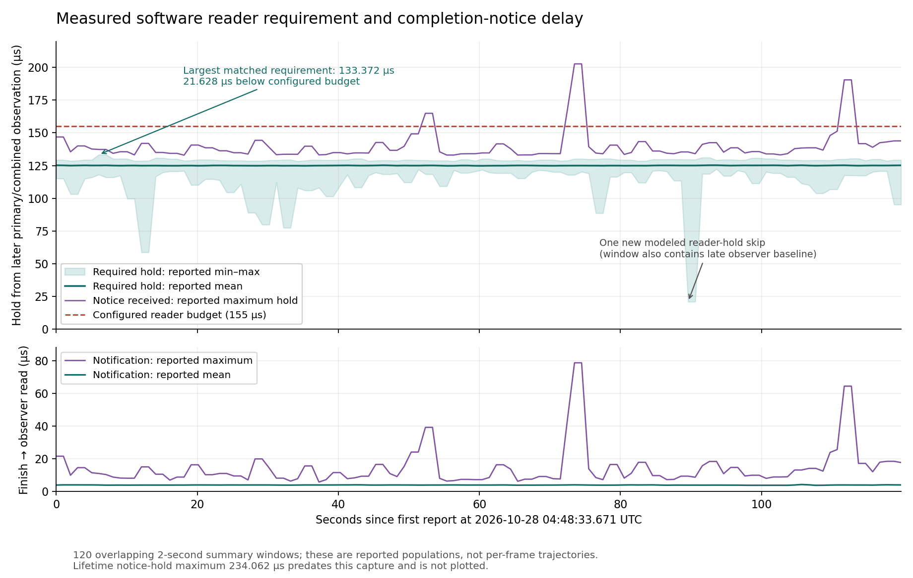

# DM reader-protection shadow measurement

## Authorized objective

On 2026-10-27 the user requested a test using the new controller completion
signal to quantify the required reader protection while testing the publisher
on the instrument. This follows the
[controller completion implementation](dm-controller-completion.md). All agent
work remains on the workstation; the operator performs instrument actions.

The measurement must preserve current operational and simulated decisions.
Actual main-command software completion is observed; virtual extra commands
do not have physical completion events. Replacing any protection budget or
selecting a physical/early-main reserve is outside this change.

## Design and endpoints

Three independent fixed-record SPSC handoffs capture:

1. The primary identity and exact monotonic observation used by
   `readSimulationPrimary()`.
2. The combined identity, named primary trace linkage and exact monotonic
   observation used by `readSimulationCombined()`, together with the current
   modeled budget `delivery + keepout + guard`.
3. A coherent dedicated controller completion record and its monotonic read
   time, captured by an optional ordinary-priority `completionMonitor`.

The first two reuse existing metadata snapshots while the simulation already
owns its cycle mutex. The completion callback acquires no simulation lock.
Callbacks perform fixed captures only; joining, allocation, statistics, INDI
and telemetry serialization run in ordinary app logic.

The consumer joins the exact combined inode/counter/raw writetime against the
controller record, then the named primary inode/counter against retained
coherent primary evidence. Primary publication must precede the combiner trace
start in the producer clock; producer timestamps are never subtracted from
local monotonic timestamps. Captured historical identities, rather than the
live stream's latest counter, are matched. Bounded pending storage supports
either capture arrival order, with expiry after the captured queues have all
received a bounded drain.

For primary observation P, combined observation C, controller entry S, controller
completion F and completion observation R, define B = max(P, C). Retain:

| Population | Definition |
| --- | --- |
| completionOffset | F − B, signed |
| requiredHold | max(0, F − B) |
| observedHold | max(0, R − B) |
| processing | F − S |
| notification | R − F |
| modelSlack | frozen budget − (F − B), signed |

The signed offset is essential: a negative result exposes a combined/primary
observation delayed until after controller completion. Clamping all evidence
to zero would hide that behavior. `requiredHold` describes actual remaining
software reads; `observedHold` includes delivery of the new notification and
is relevant to a future gate that waits to inspect it. Neither includes a new
qualified safety reserve.

All populations use seconds and independent count/variance/coverage semantics
from the existing shared timing accumulator. Latest INDI scalar maxima use
explicit `Us` suffixes. Lifetime maxima and exact provenance for the sample
with the greatest required hold survive rolling-window expiry and join resets.
`overBudget` counts observed signed offsets greater than their own frozen
budget. The default comparison budget is 155 us, not an optimized setting.

## Lifecycle, loss and configuration

Each source has its own queue. A global join generation conservatively revokes
old queued/pending identities after attachment or publisher/session/epoch
changes. Quality separately records source resets, stale generations, busy,
unavailable, error and unqualified records; incoherent/invalid captures,
identity mismatches, duplicate/gapped observations, pending eviction/expiry,
missing peers and per-source queue drops are visible. Completion age is
qualified at capture (R − F), independently of ordinary consumer queue delay.

The feature is off by default. A nonempty `completionMonitor.shmimName` enables
it only with `simulation.enabled=true` and enabled simulation diagnostics.
The optional monitor uses standard helper macros, ordinary priority zero and
no initial-existing-image callback. The dedicated completion input must be a
16-word uint64 CPU stream. Configured names remain distinct from DM inputs,
destinations, auxiliary sources and synco's schedule output.

Read-only `reader_timing`/`reader_timing_quality` expose rolling populations and
quality. A trailing optional `reader_timing` table extends `telem_dmsynco`,
retaining old-record compatibility and adding exact integer worst-case
identities/timestamps. The publisher itself still has no new telemetry schema;
this consumer test requires rebuilding synco and `logdump`.

## Implementation and verification record

Implementation includes common result types, the shared diagnostic collector,
the optional synco observer, read-only INDI, compatible telemetry, focused
collector/app/logger tests and standard build/test registration. The example
[`dmtweeter_synco_reader.conf`](../../../apps/dmSyncopation/dmtweeter_synco_reader.conf)
and [operator procedure](../../../apps/dmSyncopation/doc/reader-protection-test.md)
describe setup and paired capture.

The collector suite is registered in `tests/tests.list` and grouped under
`app_dev_unit_tests` in `tests/groups.dox`.

Local verification:

- Collector: **287 assertions / 15 cases**, including all arrival orders across
  updates, signed negative offsets, capture freshness versus delayed consumer
  update, errors/replay/reset/gaps, loss/retention, one primary with multiple
  combined outputs, and 512 exact joins from three concurrent producers.
- Full app integration: **8,301 assertions / 62 cases**, including **940
  assertions / 6 new cases**. Real callbacks match coherent records and publish
  read-only INDI. Serialized shadow state, command pixels/counters and semaphore
  populations remain unchanged by completion processing. A completion callback
  returns while the simulation mutex is held. Configuration, bad layouts,
  synthetic/busy/stale/error input and lifecycle changes are covered.
- Telemetry: **3,669 assertions / 23 cases**, including legacy compatibility,
  binary/JSON/text round trips with exact 64-bit evidence, malformed metrics and
  provenance, expired windows and lifetime extrema across source epochs.
- Existing pure shadow-model regression: **53,563 assertions / 37 cases**.
- Combined tested populations total **65,820 assertions / 137 cases**. Full
  touched C++ files pass clang-format and whitespace checks. New guide/plan
  local links resolve.

Normal library/PCH, `dmSyncopation` and `utils/logdump` builds all pass. The
library dispatch objects now explicitly depend on the changed `dmsynco` and
reader-result headers: updating a verifier/formatter after schema generation
must rebuild `logMeta.o`/`logMap.o`, not just the PCH. Fresh dispatch and binary
schema objects are used by the telemetry tests. No instrument commands,
installation, runtime configuration changes or hardware qualification were
performed by the agents.

## Interpretation and follow-up

Preserve operating settings and compare simulation with the completion
publisher enabled both with and without this observer, then make a longer
capture to retain rare extrema. Existing camera, primary, combined and DM
populations help identify added observer load. Missing notices can bias maxima
downward, so report the change in all quality counters alongside timing.

This is observed software read completion, with best-effort identity association
under existing ImageStreamIO/dmcomb publication conventions. It does not prove
atomic token/pixel provenance or physical mirror settling. A measured maximum
does not establish a hard bound under incomplete coverage. Any subsequent
replacement of a fixed hold must retain dmcomb-consumption, copy, early-main
and configuration/FSM protection, with its own instrument qualification.

## 2026-10-27 first operator capture: 044834Z

Source: `synco-sim-20261028T044834Z.tgz`, available on the workstation under
`/home/jrmales/tmp/home/jrmales/tmp/synco-sim-20261028T044834Z`.
There are 120 synco records from **2026-10-28 04:48:33.671135881 to
04:50:33.468837858 UTC**, covering 119.798 seconds; Phoenix local time is
October 27, 21:48:33–21:50:33. All six INDI snapshots succeed with empty error
files; the three collectors return expected timeout status 124. The saved
checkout is `ed255d7b4222caf522f63f23a333f29b4920bd2c`, not an independent
running-binary startup hash.

The operator confirms settings, dmcomb mode/delay, CPU/IRQ placement and GPU
workload stayed unchanged during the run, with modal gains all zero. The saved
scalar gain is 1, so the effective AO gain remains zero. Camera readbacks are
bin2, 2 kHz, EM gain 1, synchronization On, shutter On and target −45 C. RTC
latency is On before and after. Operational synco enable stays Off. The new
observer is attached to `dmtweeter_done`, 16×1, requested priority zero.

### Measured reader requirement

The software reader requirement is typically **125 us**, with a newly observed
lifetime maximum **133.372 us**. No matched sample exceeds its configured
**155 us** budget; the worst matched sample retains **21.628 us** slack.

| Population | Median reported mean, us | Median reported sigma, us | Retained minimum–maximum, us |
| --- | ---: | ---: | ---: |
| Signed completion offset | 124.984882 | 0.832921 | 20.829–133.372 |
| Nonnegative required hold | 124.984882 | 0.832921 | 20.829–133.372 |
| Hold until notice is observed | 128.871915 | 0.943927 | 24.767–202.763 |
| Controller callback processing | 124.702423 | 0.727134 | 122.661–132.350 |
| Completion notification delay | 3.897293 | 0.380612 | 2.896–78.689 |
| Slack against frozen model budget | 30.015118 | 0.832921 | 21.628–134.171 |

These are summaries of **overlapping two-second populations**, not per-frame
medians or a pooled capture RMS. Every row retains 3,999–4,001 joined samples;
their coverage overlaps continuously. No reported offset is negative. Notice
delay and observed-hold maxima occur in the same reported window, first visible
at 04:49:47.155678991 UTC, but aggregates do not prove they belong to one event.



Purple excursions above 155 us in the figure describe **late notice observation**,
not software reads continuing past that budget. Actual matched requirements
remain below 133.372 us. A future policy waiting for this ordinary-priority
observer can therefore wait longer than the existing fixed budget on some
events, even though the controller has finished. The lifetime maximum observed
hold of **234.062 us** predates the first row and both snapshots and remains
unchanged. Its exact event is not retained, because worst-case provenance is
selected by required hold, not notification delay.

The new required maximum first appears at **04:48:39.711754601 UTC**. Its
monotonic endpoints place it inside the capture. The old required maximum of
130.947 us is already present in the first row and belongs to pre-capture
history. The new worst record is fully qualified:

```text
Primary:  inode 4676, counter 104788440
Combined: inode 4685, counter 127365593
Completion: session 2029104494338887, epoch 2, sequence 3056711
Publisher PID 239604; state complete; outcome success; callback result 0

P = 2030758183749036 ns
C = 2030758183761009 ns
S = 2030758183762031 ns
F = 2030758183894381 ns
R = 2030758183898318 ns

C - P =  11.973 us
S - C =   1.022 us
F - S = 132.350 us
F - C = 133.372 us
R - F =   3.937 us
R - C = 137.309 us
155 us - (F - C) = 21.628 us
```

All endpoints above are same-host monotonic values. The combined raw identity
`publication_sec=1793162919, publication_nsec=593631584` exactly matches the
completion input. Primary publication precedes combiner trace start in their
producer clock. Raw producer stamps are retained as identity and are not used
to assign an absolute event UTC time.

### Coverage and the one rejected association

Reader session stays 4 and summary sequence advances 107→226.

| Boundary | Primary | Combined | Completion | Matched |
| --- | ---: | ---: | ---: | ---: |
| First telemetry | 211,936 | 211,936 | 211,535 | 211,535 |
| Last telemetry | 451,531 | 451,531 | 451,130 | 451,129 |
| Telemetry difference | 239,595 | 239,595 | 239,595 | **239,594** |
| Before INDI, sequence 108 | 213,954 | 213,954 | 213,552 | 213,552 |
| After INDI, sequence 227 | 453,547 | 453,547 | 453,146 | 453,145 |
| INDI difference | 239,593 | 239,593 | 239,594 | **239,593** |

Matching covers **99.999582629%** of the completion observations between first
and last telemetry. `invalid` increases once at 04:49:43.129585248, then
`counterGaps` once at 04:49:44.136369128 and `missingCombined` once at
04:49:45.142882768 after expiry. No reader queue drops, sequence gaps,
incoherence, duplicates, identity mismatches, backend errors, busy/unavailable/
unqualified records or source resets are added. Independent combiner and
simulation quality remain clean. This is consistent with one reader-specific
rejected combined observation; it is not evidence of a missed physical command.
The exact rejection reason is not encoded.

One possible collection edge is a capture queued just after the consumer's
`update(now)` timestamp: the future-observation check can reject such a sample.
This is an implementation hypothesis from source review, not attribution of
this particular event. A targeted reason counter or event record is needed to
settle it. The measured maximum remains a qualified observation, not a complete
hard bound that accounts for the unmatched command.

Startup `sourceResets=3` and `staleEpoch=802` predate the capture and do not
change. The 401 excess primary and 401 excess combined observations align with
those revoked startup peers. Normal retained-source `expired` increases by
239,596; primary evidence remains around 4,000 entries, with combined/completion
pending between zero and one and no capacity eviction. These retention counts
are not physical frame-loss counts.

### Shadow policy and the late-observation case

The simulation stays valid/feasible in session 3, full cadence epoch 3, with
64 anchors, zero cadence rejections and unchanged bounds/phase filtering. All
recorded Q32 cadence endpoint calculations reproduce exactly. Selected period
ranges **499999.899725–500000.933917 ns**, with sampled standard deviation
**0.226355 ns**. This is a sampling of the rate estimator, not frame jitter.

Between first/last telemetry, both steps have 239,596 opportunities. Step 0
would run all of them; step 1 would run 239,595 and skips **one reader hold**.
There are no new overlaps. The skip first appears at **04:50:03.267640626 UTC**.
The INDI boundaries instead contain 239,593 step-0 and 239,594 step-1
opportunities, reflecting independent evaluation/snapshot boundaries.

That skip's reporting window contains combined receipt intervals
**388.554–620.461 us**, while combined publication intervals remain
**479.856–519.941 us**. The same window contains the reader offset minimum
**20.829 us**, with every matched controller duration at least **123.072 us**.
Thus the later primary/combined observation for that low-offset event occurs
at least **102.243 us after controller entry**. This is a late observation
baseline, not a 20 us controller callback. It supports the suspected observer
contribution to conservative holds, but aggregate windows cannot identify that
event as the exact skipped frame. No overlap triggered per-event history.

Sparse latest-per-report primary phase ranges −7.718/+7.093 us, RMS 3.069 us;
this is not an all-frame RMS. The negative session extreme −15.226 us predates
the capture. A new positive extreme reaches +40.904 us. Primary, combiner and
pipeline diagnostic quality stays clean with contiguous summaries and stable
topology during the run. One row omits optional trace/estimator queue snapshots,
consistent with bounded try-lock export; neighboring lifetime counters show no
export loss.

### Camera/DM context and next decision

Camera and DM collectors retain 113 and 120 valid consecutive detailed records,
covering 118.255 and 119.163 seconds respectively. Their different event totals
reflect different capture/report boundaries. There are no new failed commands,
frame/counter gaps or collector drops. The camera adds **67 wide timestamp
brackets** around 04:50:03–04:50:13 UTC; those are attribution-quality events,
not reported frame loss. Historical camera trace drops already exist at the
first row and remain unchanged.

The BMC SDK still dominates: median reported duration is **100.797 us**,
delta calculation **10.463 us**, and synchronous saturation work **4.935 us**.
Differences of window means give approximately **15.45 us from SDK return
through the last channel reads** and **16.36 us through callback finish**;
these are not paired duration distributions or variance measurements. Existing
DM timing finishes before completion publication/posting, so it does not measure
the full new publisher cost. Notification delay also includes observer wakeup.

Against `185754Z`, median reported acquisition sigma is essentially unchanged
(0.286→0.284 us), while primary publication sigma increases 2.477→5.169 us and
combined publication sigma 5.905→6.840 us. Upstream process instances and camera
attachment identity changed between captures; scalar loop gain changed 0.8→1
with effective gain still zero. These captures do not isolate publisher/observer
overhead. The completion observer is useful and nearly complete, but a matched
publisher-on observer-off/on comparison remains the cleaner overhead test.

**Outcome:** retain the current 155 us protection setting while collecting a
longer run and resolving the rejected-observation cause. The first capture
quantifies approximately 125 us typical software protection with 133.372 us
largest matched requirement, plus an independent notification tail. Any
completion-aware shadow policy should account for notice availability and
preserve the existing copy, other-reader and early-main checks. No scheduler,
configuration or protection budget is changed by this analysis.
