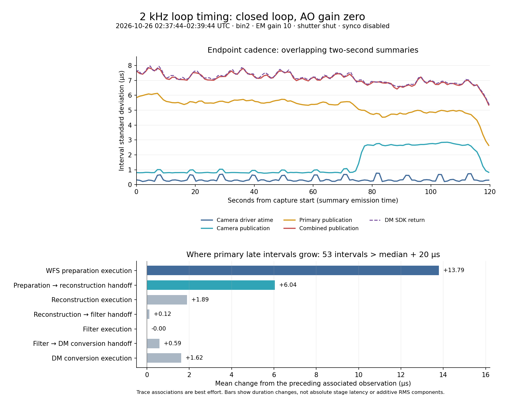

# Full-loop timing baseline — 2026-10-25

The later [mode-3 comparison](full-loop-trigger-modes-20261025.md) records two
otherwise unchanged repeats. It supersedes this capture as the steadier
measured command-cadence baseline, while retaining this file's mode-4 evidence.

## Capture and operating conditions

Local input directory: `/home/jrmales/tmp/full-loop-20261026T023744Z`.
The capture command records 2026-10-26 **02:37:44–02:39:44 UTC**, or
2026-10-25 **19:37:44–19:39:44 America/Phoenix**. The readers retain a first
summary/window that can predate their launch.

The operator confirms **closed AO loop, loop gain zero**, no illumination and
unaligned optics, with no camera/loop, CPU/IRQ or GPU-workload changes during
the capture. Camera telemetry shows bin2, 2 kHz, EM gain 10, shutter SHUT,
synchronization ON, and cooling ON TARGET at −45 C. All four represented AO
stages advance. This establishes a computational timing baseline; it does not
test optical loop stability at nonzero gain.

The operator subsequently confirms **dmcomb trigger mode 4**, restored for
regular operations. This is the DELAY sleep-and-counter-scan configuration;
the earlier mode-3 semaphore-triggered tests are separate operating conditions.
The current requested delay is not established by this capture.

`dmSyncopation` scheduling is disabled throughout: no auxiliary deliveries,
misses or scheduler faults. Its independent timing observers remain enabled.
No hardware actions or instrument commands are performed by an agent.

## Result

Camera acquisition stamps are steady between serial exchanges. The largest
primary-command excursions mainly arise in the first represented WFS
preparation stage and its handoff to reconstruction. Combined-command cadence
has about **7.1 us interval standard deviation**, already present before the
DM controller processes the command. The controller's receipt-to-SDK-return
duration is **108.840 +/- 0.531 us**, with no new controller errors or gaps.



The upper plot shows overlapping two-second rolling summaries, not independent
samples. The lower plot uses 59 disjoint populations and shows signed duration
changes associated with late primary intervals. The bars are neither absolute
stage latency nor independent components of an RMS budget.

## Coverage and statistical method

Files contain 114 `fgstage`/`fgtimes` camera summaries, 120 `dmsynco` summaries,
and 121 `dmtimes`/`fgtimes` controller summaries. Sessions, sequences and source
topology remain stable. Two-second windows update about once per second; adding
all their counts would double-count observations.

Pooled means and sample variances use nonoverlapping interior populations:

- Camera: **55 windows**, sequences 14443, 14445, ..., 14551; 219,945 intervals
  and 220,000 frame durations. Counter ranges verify disjointness. The first
  two alternating populations are excluded to avoid pre-capture history.
- Synco observers: **59 windows**, record indices 2, 4, ..., 118, emitted
  02:37:46.140–02:39:42.623 UTC. All relevant monotonic evaluation separations
  exceed two seconds; 235,941 qualified pipeline intervals.
- DM controller: **59 windows**, sequences 138, 140, ..., 254, with roughly
  236,000 observations per metric. Sequence 136 is also excluded because its
  window partly predates reader launch.

For populations with count `n_i`, mean `m_i`, sample deviation `s_i`, overall
count `N` and weighted mean `M`, pooled sample variance is
`sum((n_i-1)*s_i^2 + n_i*(m_i-M)^2)/(N-1)`.
These selections have small gaps and different endpoints, so their totals are
not exact whole-capture counts or perfectly matched frame populations. Extrema
below scan every retained summary, including unselected windows. No percentiles
are inferred from mean/deviation/min/max telemetry.

## Endpoint cadence

All means are within 0.001 us of the expected **500 us** period. Values below
are intervals between successive endpoints, not end-to-end loop latency.

| Endpoint | Pooled interval SD (us) | Retained interval minimum–maximum (us) |
| --- | ---: | ---: |
| Camera driver-provided `atime` | 0.387 | 480.000–520.000 |
| Camera SDK return | 0.707 | 479.195–519.351 |
| Camera publication | 1.724 | 479.165–518.309 |
| Oldest represented AO stage start | 1.996 | 477.712–518.169 |
| Primary command publication | 5.273 | 467.253–531.684 |
| Combined command publication, synco observer | 7.099 | 466.331–537.576 |
| Combined command publication, DM collector | 7.080 | 466.331–537.576 |
| DM controller receipt | 7.092 | 465.760–537.365 |
| DM SDK return | 7.137 | 465.749–537.646 |

The two combined-publication estimates use different populations but agree
closely. Their larger variation is already upstream of controller receipt.
Do not subtract marginal variances to assign a jitter budget: covariance and
sample association matter.

## Primary excursions and the AO processing chain

Using the retained-window median +/-20 us threshold, the selected pipeline
populations contain **53 late and 62 early** primary intervals. **48/53 late
intervals (90.6%) are immediately followed by early intervals**; none of the
62 early intervals is immediately followed by a late interval. The 48 qualified
late/early pairs sum to **1000.479 us on average**. This supports the predicted
late-then-early pattern without establishing that it always occurs; thresholds
and window boundaries affect the counts.

Trace rows count from the primary writer upstream. The recorded PIDs/inodes
are stable; their roles follow the established AO chain:

| Row | PID / input inode | Established role | Execution mean +/- SD (us) |
| --- | --- | --- | ---: |
| 3 | 3494545 / 3586 | `acquWFS-1`: WFS preparation | 64.773 +/- 1.914 |
| 2 | 3494689 / 1589 | `wfs2cmodeval-1`: reconstruction | 56.236 +/- 0.935 |
| 1 | 3494839 / 1600 | `mfilt-1`: filtering | 6.190 +/- 0.074 |
| 0 | 3495031 / 1614 | `mvalC2dm-1`: DM conversion | 53.003 +/- 0.872 |

For those same 53 late intervals, the mean signed change from the preceding
associated observation is **+13.794 us in WFS preparation execution** and
**+6.045 us in the preparation-to-reconstruction handoff**. Reconstruction and
DM-conversion execution contribute smaller changes, +1.895 and +1.617 us.
Early intervals reverse the main changes: −12.432 and −5.112 us respectively.
The late cohort's oldest-stage start interval averages 501.097 us.

One isolated pair in the 02:37:58.190 UTC summary makes the association clear:
primary intervals **531.053 / 467.253 us**, oldest-stage start intervals
**499.844 / 499.223 us**, preparation execution changes
**+17.924 / −17.873 us**, and next-handoff changes
**+8.526 / −8.557 us**. Smaller chain changes complete the arithmetic.
The maximum primary interval, 531.684 us in the 02:38:53.416 summary, also has
a 505.255 us oldest-stage start interval: some variation enters before the
represented work.

These are best-effort trace associations. Input counters are sampled at update
rather than proving the exact pixels/frame consumed, and the file supplies
PIDs/inodes rather than process names. Row numbers are AO trace positions,
not syncopation step numbers.

## Combiner and DM controller

Combiner PID 2339611 links primary input inode 1525. Execution is
**4.875 +/- 0.147 us**. Primary trace update to combiner start is
**6.399 +/- 3.469 us**, and to combined publication **11.589 +/- 3.404 us**.
The execution is repeatable; the linked start/handoff interval still varies.
The operator confirms mode 4 for this capture; the telemetry does not
independently report the trigger mode. Variable polling/wakeup latency in this
mode is consistent with the measured primary-to-combiner-start spread and
the larger combined-publication interval deviation. This does not isolate
polling as the sole cause or establish the actual requested sleep interval.
The upstream WFS-preparation/handoff findings remain unchanged. A mode-3
comparison would need a separate matched capture.

At the DM controller, receipt-to-SDK-return is **108.840 +/- 0.531 us**,
including an SDK call of **101.315 +/- 0.085 us**. Receipt-to-callback completion
is **125.275 +/- 0.596 us**. First-to-last totals gain **240,307** events,
receipts and submissions, corresponding to approximately 2 kHz. There are no
new failed, partial, no-send, rejected, duplicate, counter-gap, invalid or dropped
events. The historical synthetic event remains one throughout.

SDK return is a software endpoint, not measured physical mirror response or
settling. These summaries do not yet establish absolute camera-to-DM latency.

## Camera housekeeping and independent conversion variation

There are **11 successful serial exchanges**, spaced **10.567–10.570 s** apart,
each with a **530.747–533.856 ms transaction envelope**. Temperature/stdcam
updates accompany them. This is consistent with the new idle temperature
policy; command names are not encoded in these control records. Each envelope
spans many frames; its duration measures the serial transaction rather than
per-frame acquisition overhead.

Among the selected camera populations, 44 quiet windows have `atime` interval
SD **0.279 us**, range **499–501 us**. Eleven serial-containing windows have
SD **0.662 us**, range **480–520 us**. All retained large acquisition-stamp tails
occur in serial-containing windows. Four complete raw early contexts
(10917–10920) overlap serial exchanges and show driver intervals **480–483 us**,
SDK intervals **479.195–481.680 us**, and ordinary center-frame conversion
durations **24.977–25.829 us**. The excursions are present before conversion.

Three rolling-summary early flags versus four raw contexts reflect different
online/summary medians at the 20 us boundary. Historical raw-context loss
counters do not increase across the retained contexts.

A separate conversion change occurs around **02:38:59–02:39:36 UTC**, despite
unchanged operator settings. Earlier 34 selected windows have publication SD
**0.850 us**, conversion **26.113 +/- 0.526 us**. Thirteen later quiet windows
(02:39:01.792–02:39:33.497) have publication SD **2.692 us**, conversion
**27.430 +/- 1.433 us**, while SDK-return interval SD is **0.367 us** and `atime`
SD **0.282 us**. This broadening occurs after SDK return and persists between
serial exchanges. Its cause remains unassigned.

The oldest represented AO-stage start broadens earlier, about 02:38:52–56,
while primary-publication deviation decreases over the later portion of the
capture. These marginal distributions do not demonstrate one common cause.
Earlier housekeeping comparisons used EM gain 595, shutter OPEN and different
AO conditions; this is not a matched before/after timing qualification.

## Collector quality and limits

The direct camera collector gains **238,517** events/publications with no new
failures, rejection, duplicates, counter/frame gaps, invalid or dropped events.
It records 73 new wide clock brackets, producing 146 ambiguous intervals in
the selected populations; aggregate distributions retain those observations,
while excursion attribution requires qualification.

Primary, combined and pipeline observers have no new gaps, duplicates or
dropped events. Pipeline `invalidTrace=1` is preexisting. Synco's separate
camera acquisition/publication observers each accumulate **20 duplicate and
five counter-gap observations**, with receipt stalls up to **2.806 ms** followed
by immediate receipts. Direct camera counters remain clean: these are observer
coverage problems, not evidence of physical camera frame loss. The observations
cannot support complete camera-to-pipeline frame matching. Three snapshots have
`schedule_valid=0`; their schedule placeholders do not invalidate independent
timing measurements or establish configuration changes.

## Next investigation

Prioritize `acquWFS-1` execution and its handoff to `wfs2cmodeval-1` for the
largest primary excursions. Verify current process/thread placement before
changing configuration, then distinguish execution variation from wakeup/GPU
completion scheduling using a short matched capture. Treat the camera's later
conversion regime as a separate follow-up, ideally with timing on both sides
of the conversion work. Keep the new production housekeeping policy in place.

No syncopation scheduling rule, early-arrival reserve, camera configuration or
application code is changed by this analysis. The reserve remains undecided.

## Input identity

SHA-256 values for the locally analyzed files:

```text
camwfs.txt
da86cea729592c73ef7cdb58584c7a87a0cbfb1394e9a1c53cd7c635e1654c6a
dmtweeter-synco.txt
f3bda28bfe039e862ff9dbc58f1d957ceb17d997e98f1db3eb08fe68c9d59f6f
dmtweeter.txt
68a84faed68d00e69bfd0f5dba6891fc0aac886a609d8b23c0702921bd118681
capture-info.txt
50fb511b5b7c12b700cef57838b11af665a7f0c92be0dd9ced6c54e826f4f4ee
```
