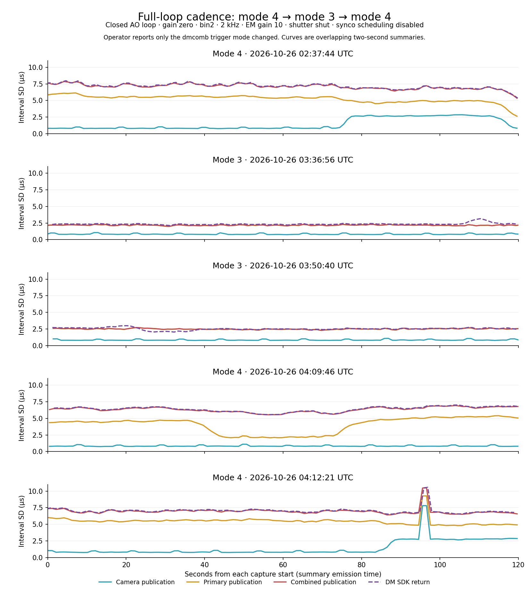

# Full-loop trigger-mode comparison — 2026-10-25

## Conditions and inputs

The operator supplied two further local captures and confirms **only dmcomb's
trigger mode changed** relative to the [mode-4 baseline](full-loop-timing-20261025.md).
No camera/loop settings, CPU/IRQ placement or GPU workload changed between or
during these captures. Both use **trigger mode 3**, closed AO loop at **gain
zero**, dark/unaligned optics as before, and disabled syncopation scheduling.
Camera telemetry retains bin2, 2 kHz, EM gain 10, shutter SHUT, synchronization
ON and on-target cooling at −45 C.

| Label | Local directory under `/home/jrmales/tmp` | UTC capture window on October 26 | Phoenix window on October 25 |
| --- | --- | --- | --- |
| Mode 4 | `full-loop-20261026T023744Z` | 02:37:44–02:39:44 | 19:37:44–19:39:44 |
| Mode 3 A | `full-loop-20261026T033656Z` | 03:36:56–03:38:56 | 20:36:56–20:38:56 |
| Mode 3 B | `full-loop-20261026T035040Z` | 03:50:40–03:52:40 | 20:50:40–20:52:40 |
| Return mode 4 A | `full-loop-20261026T040946Z` | 04:09:46–04:11:46 | 21:09:46–21:11:46 |
| Return mode 4 B | `full-loop-20261026T041221Z` | 04:12:21–04:14:21 | 21:12:21–21:14:21 |

For both return captures the operator again confirms closed loop at gain zero
and **only the trigger mode changed**, with no other settings, CPU/IRQ or
workload changes between or during captures.

Each contains `camwfs.txt`, `dmtweeter-synco.txt`, `dmtweeter.txt` and
`capture-info.txt`. All analysis is performed on copied local files; no agent
commands run on the instrument.

## Result

Both mode-3 runs reproduce substantially lower command-cadence variation.
Combined publication now closely follows primary publication. Primary-to-combined
delay deviation falls from **3.404 us to 0.164 us**, about twentyfold, while
the combiner's mean execution duration remains about 4.875 us. Primary timing
also improves upstream, so the overall improvement includes more than a steadier
combiner wakeup. WFS preparation and its incoming cadence are steadier, and the
camera's earlier broad conversion-variation period is absent from both repeats.

The subsequent return to mode 4 restores **3.39–3.40 us** linked delay deviation
and **6.40–7.05 us** DM SDK-return interval deviation. This reversal strengthens
the attribution of regular combiner-path variation to polling. The second
return also captures a separate large camera SDK-wait event, producing a
**+390.813 us** downstream interval departure. The earlier 28 us observation
therefore cannot serve as a general timing bound.



The plot uses a common vertical scale. Curves are overlapping two-second
summaries plotted at their emission times; pooled values below use disjoint
interior windows, not all plotted summaries.

## Cadence and excursion comparison

All interval means remain within 0.001 us of **500 us**. Pooled sample standard
deviations, in microseconds:

| Endpoint | Mode 4 | Mode 3 A | Mode 3 B |
| --- | ---: | ---: | ---: |
| Camera driver `atime` | 0.387 | 0.394 | 0.384 |
| Camera SDK return | 0.707 | 0.482 | 0.477 |
| Camera publication, direct camera collector | 1.724 | 0.842 | 0.856 |
| Oldest represented AO stage start | 1.996 | 0.858 | 0.887 |
| Primary command publication | 5.273 | 2.168 | 2.496 |
| Combined publication, synco observer | 7.099 | 2.180 | 2.509 |
| Combined publication, DM collector | 7.080 | 2.181 | 2.508 |
| DM controller receipt | 7.092 | 2.202 | 2.526 |
| DM SDK return | 7.137 | 2.359 | 2.531 |

DM SDK-return interval deviation is **67% / 65% lower** than mode 4.
Different observers have slightly different selected populations. These are
marginal deviations; their differences are not independent jitter components.

Observed extrema across retained summaries:

| Endpoint | Mode 4 interval range (us) | Mode 3 A interval range (us) | Mode 3 B interval range (us) |
| --- | ---: | ---: | ---: |
| Primary publication | 467.253–531.684 | 473.925–526.385 | 476.390–524.410 |
| Combined publication | 466.331–537.576 | 473.825–526.294 | 474.046–525.011 |
| DM SDK return | 465.749–537.646 | 474.106–526.725 | 471.660–527.306 |

Thus the largest absolute departure from 500 us at SDK return is
**37.646 / 26.725 / 28.340 us**. The earlier approximately 80 us excursions
do not recur in these two mode-3 files. These finite captures establish observed
extrema, not a guaranteed timing bound or qualification of active syncopation.

## Combiner linkage

The combiner is PID **3514836** in both mode-3 files, versus PID 2339611 in the
baseline. Its primary input inode stays **1525**. The operator supplies the
trigger-mode setting; trace metadata does not independently verify the mode.

| Duration, mean +/- sample SD (us) | Mode 4 | Mode 3 A | Mode 3 B |
| --- | ---: | ---: | ---: |
| Primary trace update to combiner start | 6.399 +/- 3.469 | 3.771 +/- 0.141 | 3.776 +/- 0.142 |
| Combiner execution | 4.875 +/- 0.147 | 4.875 +/- 0.077 | 4.874 +/- 0.075 |
| Primary trace update to combined publication | 11.589 +/- 3.404 | 9.233 +/- 0.164 | 9.236 +/- 0.164 |

The repeatable collapse in linked delay variation supports eliminating
DELAY-mode polling as a useful change. Mean linked primary-to-publication
delay also improves by about **2.35 us**. In mode 3, combined cadence tracks
the primary closely rather than showing the large additional spread seen in
mode 4. This does not establish an additive RMS budget or a physical latency
from exposure to mirror motion.

## Remaining primary excursions

All four AO writer PIDs/input inodes remain the same as the baseline. WFS
preparation execution is **63.727 +/- 0.819 us** and **63.706 +/- 0.806 us**,
versus **64.773 +/- 1.914 us** in mode 4. Reconstruction execution deviation
is 0.674 / 0.903 us; filter and DM-conversion execution remain of similar scale
to the baseline. The unchanged topology and operator-reported settings make
these useful comparisons; the records do not identify the resource/scheduling
mechanism connecting the trigger change to the upstream improvement.

Using the same retained-window median +/-20 us threshold:

| Pipeline population | Mode 4 | Mode 3 A | Mode 3 B |
| --- | ---: | ---: | ---: |
| Qualified intervals | 235,941 | 235,941 | 235,941 |
| Late / early intervals | 53 / 62 | 32 / 37 | 26 / 20 |
| Late immediately followed by early | 48 / 53 | 24 / 32 | 14 / 26 |
| Early immediately followed by late | 0 / 62 | 0 / 36 | 0 / 20 |
| Mean interval after a late interval (us) | 475.550 | 478.314 | 479.651 |
| Mean qualified late/early pair sum (us) | 1000.479 | 999.903 | 999.957 |

Successor eligibility can exclude the last interval in a window, explaining
36 eligible early successors versus 37 early pipeline intervals in run A.
The 20 us classification boundary matters more when tails are only about
20–26 us: many successors shorten without crossing that threshold. The results
retain catch-up behavior and do not establish an always-late-then-early rule.

Late-primary cohorts still have their largest mean signed duration changes in
WFS preparation (**+11.584 / +10.239 us**) and the following reconstruction
handoff (**+6.750 / +5.621 us**). Their oldest-stage start intervals average
500.876 / 502.918 us, so some residual excursions enter upstream as well.
These are best-effort trace associations and changes from preceding associated
observations, not absolute per-frame latency proofs.

## Camera and controller behavior

Each new camera file records **12 successful serial exchanges**, roughly
10.568 s apart, accompanying temperature updates. Quiet acquisition windows
retain **499–501 us** intervals. Serial-containing windows retain acquisition
tails of **480–520 us** in A and **480–525 us** in B. All four qualified raw
contexts in each file overlap serial work. Run B includes an acquisition
**525 us then 480 us** pair. The sparse serial-associated tails remain even
though combined-command cadence improves.

Camera conversion is **26.024 +/- 0.481 us** and **26.047 +/- 0.510 us**. Neither
file shows the sustained high-variation conversion period from the mode-4
baseline. Acquisition-to-write is **48.401 +/- 0.623 us** and
**48.440 +/- 0.637 us**. This is a measured difference within the controlled
operating comparison, but the files do not explain why the conversion regime
occurred in the earlier capture.

Controller receipt-to-SDK-return is **109.120 +/- 0.720 us** and
**109.250 +/- 0.750 us**. SDK duration is **101.379 +/- 0.398 us** and
**101.469 +/- 0.445 us**. These service-time deviations are larger than the
baseline's 0.531 / 0.085 us even though command cadence is much steadier.
Controller components change timing regimes within both unchanged runs:
delta, saturation and SDK durations broaden successively near the end of A
and early in B. Pooled controller service is therefore not fully stationary.
SDK-return interval deviation briefly rises above incoming publication
deviation during some of these periods. No cause is assigned from summaries.

## Coverage, quality and method

Mode-3 A / B contain **121 / 119** synco summaries, **114 / 113** camera stage
summaries, and **119 / 120** DM summaries. Select populations wholly inside
the metadata capture window, with nonoverlapping two-second windows:

- Synco: 59 populations each, sequences **3688..3804** and **4508..4624**,
  stepping by two. Relevant monotonic evaluation separations exceed 2.008 s.
- Camera: 56 populations each, sequences **17801..17911** and **18581..18691**,
  stepping by two; 223,944 intervals and 224,000 frame durations each. Counter
  ranges verify disjointness, with clock/counter checks excluding prehistory.
- Controller: 59 populations each, sequences **3684..3800** and **4507..4623**,
  stepping by two. Window bounds use emitted UTC minus age/span because this
  telemetry does not contain an explicit monotonic snapshot anchor.

Use pooled sample variance including between-window mean changes, as in the
baseline record. Avoid summing overlapping windows or combining different
metrics' deviations. Boundary gaps and observers' different populations remain.

Both direct camera and controller collectors show **no new failures, gaps,
duplicates, invalid samples or event drops**. Camera brackets all meet the
qualification limit in the selected populations. Camera collector session is
14 in both new files versus 13 in the baseline; camera PID/TID and stream inode
remain the same. DM collector session is 3 versus 2 in the baseline. These
session changes precede the retained steady captures; settings remain as the
operator reports.

Primary, camera and pipeline synco observers have no new quality increments.
The combiner observer has **four new duplicates and one counter-gap observation
in each file**, at summaries 03:38:18.139 and 03:52:13.870 UTC. Direct DM
collection has no output counter gaps, so keep those observer coverage problems
separate from claims of missing delivered commands. Historical primary/pipeline
gaps, invalid traces and the one scheduler fault do not increase during the
captures. Invalid schedule snapshots carry placeholders, not setting changes.

## Return to mode 4 — reversal and a large wait excursion

Both return captures restore the combiner's mode-4 delay variation:

| Measurement (us) | Mode 3 A / B | Return mode 4 A | Return mode 4 B |
| --- | ---: | ---: | ---: |
| Primary publication interval SD | 2.168 / 2.496 | 4.195 | 5.489 |
| Combined publication interval SD, synco | 2.180 / 2.509 | 6.337 | 6.976 |
| DM SDK-return interval SD | 2.359 / 2.531 | 6.398 | 7.051 |
| Primary trace update to combiner start, mean +/- SD | 3.771 +/- 0.141 / 3.776 +/- 0.142 | 6.470 +/- 3.459 | 6.415 +/- 3.470 |
| Primary trace update to combined publication, mean +/- SD | 9.233 +/- 0.164 / 9.236 +/- 0.164 | 11.566 +/- 3.392 | 11.512 +/- 3.404 |

Combiner PID is **3523996** in both returns, input inode 1525. Execution remains
repeatable at **4.749 +/- 0.137 / 4.751 +/- 0.137 us**. The linked-delay reversal
is much larger than the change in execution variability.

Return A's middle 16 disjoint windows have primary-publication SD **2.266 us**,
similar to mode 3, but combined-publication SD **5.826 us**. This within-run
comparison reinforces the separate combiner-path effect. Upstream regimes
continue to change: return A's preparation deviation remains about 0.82 us while
reconstruction/filtering vary, whereas return B's preparation deviation changes
from about 2.11 to 0.85 us. The exact upstream resource/scheduling mechanisms
remain unassigned.

Observed interval extrema:

| Endpoint | Return mode 4 A (us) | Return mode 4 B (us) |
| --- | ---: | ---: |
| Camera driver acquisition stamp | 480–525 | 480–519 |
| Camera publication | 478.835–525.011 | 175.311–825.158 |
| Oldest represented AO stage start | 478.594–524.891 | 175.912–825.349 |
| Primary publication | 463.806–539.459 | 202.112–885.783 |
| Combined publication | 468.816–540.761 | 197.242–890.382 |
| DM controller receipt | 468.595–541.092 | 197.213–890.411 |
| DM SDK return | 467.282–541.453 | 196.491–890.813 |

### Localizing the large camera event

The raw camera context places the large publication pair at
**04:13:56.042843685 / 04:13:56.043018996 UTC**. It overlaps a serial-transaction
envelope and has contiguous frame/counter progression:

| Endpoint or duration | Late frame (us) | Following frame (us) |
| --- | ---: | ---: |
| Driver `atime` interval | 500.000 | 500.000 |
| Camera SDK-return interval | 825.058 | 174.550 |
| Raw publication-checkpoint interval | 825.168 | 175.301 |
| Current camera SDK-wait duration | 784.822 | 132.360 |
| Conversion duration | 27.271 | 28.043 |

The previous rearm is **5.360 us**, previous publication-to-wait-entry tail
**12.594 us**, and the new wait begins **0.281 us after rearm**. Wait-entry
interval is **501.658 us**. The long interval therefore grows inside the
**current camera SDK wait-entry to SDK-return marker** bracket after normal
entry. Validation, conversion and write-clock bracket remain ordinary at
**0.421 / 27.271 / 0.060 us** on the late frame. Qualified clock brackets place
driver stamp to SDK-return marker at about **347 us**, versus about **22 us**
on the preceding/following frames.

The measured driver-stamp cadence remains steady at the event, while software
delivery is delayed and catches up. Distinguishing driver/library waiting,
wakeup latency and userspace scheduling inside that bracket needs an
accompanying trace. Serial overlap establishes a contemporaneous transaction,
not its precise causal operation or a physical exposure/IRQ assertion time.

The first synco summary containing the event is **04:13:56.562 UTC**, and its
next overlapping window repeats it. Camera publication's ordered-pair telemetry
supports **825.158 then 175.311 us**, sum **1000.469 us**. The primary's ordered
pair is **885.783 then 202.112 us**, sum **1087.895 us**; catch-up is not an exact
two-period repayment downstream. The same qualified late-primary population
contains DM-conversion execution up to **113.013 us**, with a signed execution
increase up to **59.051 us**. Additional downstream processing variation is
visible alongside the incoming camera excursion. Best-effort trace associations
still do not prove an exact end-to-end pixel/frame identity.

DM summaries at **04:13:56.886 / 04:13:57.887 UTC** contain the large combined
and SDK-return intervals. Controller receipt-to-SDK-return remains about
108.74 us with 0.52 us deviation, and SDK duration about 101.32 us with
0.09 us deviation in those windows. The large cadence excursion is already
present on controller input; its SDK service remains ordinary. No frame/counter
gap or delivery failure is reported by the direct camera or DM collectors.

Removing the entire selected outlier window leaves return B's primary/combined
interval SD at **5.401 / 6.900 us**. The regular mode-4 timing spread therefore
persists independently of that isolated event.

### Other camera behavior and coverage

Return A's camera conversion remains **26.045 +/- 0.509 us**, and serial-inclusive
publication interval SD is **0.848 us**, matching the steady portions of earlier
runs. Return B reproduces the broad conversion regime in windows logged from
**04:13:47.950 UTC** through the end: eleven later quiet windows have conversion
**27.394 +/- 1.435 us**, publication interval SD **2.761 us**, SDK-return interval
SD **0.363 us** and acquisition interval SD **0.272 us**. This recurring
post-return conversion variation is distinct from the large current-wait event.
It occurs in one return capture and not the other, so trigger mode alone does
not deterministically select that regime in the observed files.

Each return uses **59 disjoint interior synco windows**, sequences
**5649..5765 / 5803..5919**, stepping by two, and **59 controller windows**,
sequences **5652..5768 / 5807..5923**. Relevant synco monotonic evaluation
spacings exceed two seconds. Pool sample variance with between-window means
as above. Controller windows use emitted UTC minus age/span to project bounds.

For camera aggregates, the first alternating selection omits all serial windows
in these files. Use the complementary **55 counter-disjoint interior windows**,
sequences **19667..19775 / 19813..19921**, stepping by two, to include the serial
tails and large event once. Each has 219,945 intervals. Their acquisition / SDK
return / publication interval deviations are **0.376 / 0.469 / 0.848 us** and
**0.390 / 1.087 / 1.891 us**. Report extrema over all interior windows, and do
not combine the overlapping alternative selections as independent samples.

Direct camera/controller delivery counters show no new failures, gaps,
duplicates or queue drops. Camera collector
session 14, source process/thread and inode remain unchanged from mode 3; DM
collector session is now 4, with three historical synthetic events unchanged.
Return B has 97 new wide clock brackets and 194 ambiguous intervals in the
serial-inclusive population; aggregate timing retains those intervals, while
raw excursion attribution is qualified. Retained raw contexts are complete:
**3 / 9 contexts**, representing **11 / 37 unique frames**.

Synco primary/camera/pipeline observers show no new quality increments. Return
B's combiner observer has a separate coverage stall at **04:12:56.299 UTC**,
with four new duplicates and one counter-gap observation while publication
intervals remain ordinary. This precedes the real large publication excursion
by about one minute. The direct DM collector has no corresponding output gap;
keep observer coverage and actual publication timing separate.

## Frame freshness versus continuity

The operator reports that the camera can remain at least one frame behind
without a frame-number skip or another indication. Counter continuity and
500 us intervals establish ordering/cadence, not freshness. At 2 kHz a reader
can deliver consecutive frames at the expected rate with a constant extra
500 us of latency.

The reviewed SDK's `pdv_wait_last_image_timed_raw()` selects the newest completed
buffer at call entry, or requests the next buffer if none is ready.
`edt_wait_for_buffers()` returns that requested buffer without selecting the
newest one again at return. A frame can therefore age during waiting or
descheduling while remaining contiguous. OCAM's validity checks cover SDK
timeouts/results and camera-number continuity; there is no frame-age threshold
that automatically faults or recovers a contiguous stale frame. Existing gap
recovery requests reconfiguration, which reopens PDV and flushes/reallocates
its acquisition resources. These source facts support investigating silent
latency independently of skipped-frame detection.

For the particular large event retained here, same-frame driver-stamp to
publication ages are **49.527 -> 374.685 -> 49.996 -> 47.456 us**. Driver-stamp
to SDK-return-marker age similarly returns from about 347 us to about 22 us
on the immediate next frame. This records transient host-side lateness followed
by recovery in absolute age, rather than merely recovered cadence.

Across all five captures' retained interior camera populations, per-window
mean `acquisitionToWrite` remains **48.223–49.995 us**. The maximum individual
age is 374.685 us; no retained age reaches one 500 us period. A persistent extra
frame of buffering after the paired driver timestamp would instead move the
usual approximately 50 us age toward **550 us**. The existing
`acquisitionToWrite` population and legacy camera `fgtimes.wma` measure this
publication-minus-acquisition-stamp age, but do not currently impose a freshness
alarm or recovery rule.

These statements rely on correct per-buffer timestamp/image association. The
timestamp marks host DMA completion rather than exposure, so this evidence
does not exclude buffering before that stamp, later downstream buffering or an
incorrect timestamp/pixel association. Establishing physical camera freshness
needs camera/exposure identity relative to an independent synchronization
reference. No automatic recovery or queue policy is changed by this analysis.

## Follow-up

Mode 3 is the better measured baseline for subsequent timing work. The existing
plan still requires a compatible auxiliary-trigger route before mode 3 can
support active extra syncopation steps; the current captures have scheduling
disabled. No trigger-route code, timing reserve or instrument configuration is
changed by this analysis.

Further measurements can focus on the residual preparation/handoff excursions,
serial-associated camera tails and changing controller component durations.
The return captures establish a new priority: distinguish the current camera
SDK wait's driver/library waiting from OS scheduling after a recorded driver
stamp. An accompanying kernel/wakeup trace around a long wait would address
that question. The large event overlaps serial work, but its exact mechanism
and dependence on trigger mode remain unresolved. Optical loop performance
at nonzero gain remains a separate qualification.

The operator subsequently chooses to resume dmSyncopation rather than undertake
major additional EDT optimization now. The [scheduler plan](dm-syncopation.md)
records the next fixed-grid/skip work. These camera mechanisms remain documented
follow-ups rather than prerequisites for developing the predictor and skip
logic; their measured excursions must remain in its test coverage.

## Input identity

SHA-256 values:

```text
full-loop-20261026T033656Z/camwfs.txt
54e26fe4ba89968eb57ceb292aaef1a356dfc49c444724a0983ab69bdb3e5478
full-loop-20261026T033656Z/dmtweeter-synco.txt
aeac627ee13c97de89a965a8b8e75bde6a5f2587f002cada3490323db1f519c4
full-loop-20261026T033656Z/dmtweeter.txt
93e1fdd9d9c9e0931fd6b4c97a2c4ffb40661156bffc425ee2d987c28ed96102
full-loop-20261026T033656Z/capture-info.txt
526e590311acb3dc91e3c3d42ae56fd7c4458169924c41004cc6bfada2be3987

full-loop-20261026T035040Z/camwfs.txt
b639a66c2f64bd749b700a146379d4be0815235a5ecce92827010d050c1e70c5
full-loop-20261026T035040Z/dmtweeter-synco.txt
6269921ae18ec5552b8ac2f6fbd9f9e66484614cb40523f7cb052ad1afe2be40
full-loop-20261026T035040Z/dmtweeter.txt
0313eb713202c26cbbe0c17231bd4ee78505ba98186fd285ff28df2bac9ded54
full-loop-20261026T035040Z/capture-info.txt
407ef6f23f3ebd1ce5a2608565e237aff37e6c4a0f2535d4db250a50c1848ca1

full-loop-20261026T040946Z/camwfs.txt
0e1cd1cf66c9830118448b917522a49a0f05e41e6d125446268494097991c1fc
full-loop-20261026T040946Z/dmtweeter-synco.txt
45d962778e00b35126eee021969ed604a818e075eb8582293ff317f61207b184
full-loop-20261026T040946Z/dmtweeter.txt
1749fe6c580d9113e57cc81dba02a2fd52cf27a19fbb55751307d8885e5fcb78
full-loop-20261026T040946Z/capture-info.txt
a7fb673dfeeae18ef22d94793818d1fc7e001123ac75af968e3a77b8821569e5

full-loop-20261026T041221Z/camwfs.txt
1f5057b86052b21857e83188b77badbf2cf0c38a1ad58b34e71ae2167e40a603
full-loop-20261026T041221Z/dmtweeter-synco.txt
904b22bd9bacada81a2c8bfeda0b3aeeb9326a3b9d091f91a61b4a0a0792a0c0
full-loop-20261026T041221Z/dmtweeter.txt
f65dc0974601e6e23357869ef4f55cb33a7b8ba37169caa1edd90314588bc78d
full-loop-20261026T041221Z/capture-info.txt
40eccd5a91318d83a5cdc7c47f3a8422f694caf3dfe37a737ded82df31df01a4
```
