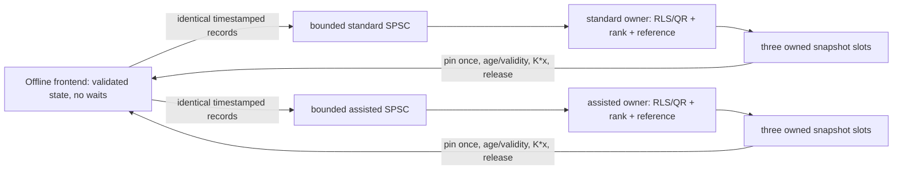

# Task Description

## Problem Statement
Extend the existing MagAO-X data-driven subspace predictive control (DDSPC) implementation to incorporate synchronized accelerometer measurements directly into the mathematical prediction and control framework described by Haffert et al. (2021).

The original DDSPC framework predicts future WFS residuals using histories of WFS measurements and DM commands. This project introduces an additional accelerometer history vector and learns its contribution to future WFS residuals through recursive least-squares identification.

The extended model is

[
\mathbf y_f =
A\mathbf y_p+
B\mathbf u_p+
D\mathbf a_p+
C\mathbf u_f.
]

The goal is to learn the extended prediction matrix

[
\Theta=[A\ B\ D\ C]
]

and derive the optimal DM controller using the original DDSPC quadratic cost function, including the additional accelerometer contribution.

The implementation must preserve the existing DDSPC architecture, online learning procedure, and WFS/DM control functionality wherever practical.

The primary research objective is to determine whether synchronized accelerometer telemetry improves predictive wavefront correction compared with the original DDSPC formulation.

The initial validation will use the accelSim application to generate synchronized accelerometer measurements and physical DM disturbances. Although the known 28–29 Hz telescope vibration provides a useful initial test, the extended DDSPC framework must support multiple vibration frequencies and broadband accelerometer telemetry without requiring a predetermined vibration frequency or analytical acceleration-to-displacement conversion.

The implementation should ultimately support real on-sky accelerometer measurements and adaptive vibration correction on MagAO-X.
## Discussion
Haffert et al. (2021) developed a data-driven subspace predictive control (DDSPC) framework for adaptive optics that predicts future wavefront sensor (WFS) residuals using historical WFS measurements and deformable mirror (DM) commands.

The original predictive model is

[
\mathbf{y}_f^i =
A\mathbf{y}_p^i +
B\mathbf{u}_p^i +
C\mathbf{u}_f^i,
]

where (\mathbf{y}_p^i) and (\mathbf{u}_p^i) represent past WFS residuals and DM commands, respectively, and (\mathbf{u}_f^i) represents future DM commands. The matrices (A), (B), and (C) are identified from telemetry using recursive least squares (RLS).

The proposed extension introduces an accelerometer history vector,

[
\mathbf{a}p^i =
\begin{bmatrix}
\mathbf{a}i^T &
\mathbf{a}{i-1}^T &
\cdots &
\mathbf{a}{i-N+1}^T
\end{bmatrix}^T,
]

where (\mathbf{a}_i) contains the synchronized accelerometer measurements at time index (i), and (N) is the number of historical samples.

The extended predictive model becomes

[
\mathbf{y}_f^i =
A\mathbf{y}_p^i +
B\mathbf{u}_p^i +
D\mathbf{a}_p^i +
C\mathbf{u}_f^i.
]

The extended regression vector and prediction matrix are

[
\boldsymbol{\phi}^i =
\begin{bmatrix}
\mathbf{y}_p^i\
\mathbf{u}_p^i\
\mathbf{a}_p^i\
\mathbf{u}_f^i
\end{bmatrix},
\qquad
\Theta =
\begin{bmatrix}
A & B & D & C
\end{bmatrix}.
]

The RLS identification framework should remain mathematically unchanged, except for the additional accelerometer regressors and the corresponding increase in model dimensions.

The quadratic cost function is

[
J =
\mathbf{y}_f^T\mathbf{y}_f+
\lambda\mathbf{u}_f^T\mathbf{u}_f,
]

where (\lambda) regularizes the magnitude of the DM commands.

Minimizing this cost function gives the extended optimal controller,

[
\boxed{
\mathbf{u}_f^* =
-\left(C^TC+\lambda I\right)^{-1}
\begin{bmatrix}
C^TA & C^TB & C^TD
\end{bmatrix}
\begin{bmatrix}
\mathbf{y}_p\
\mathbf{u}_p\
\mathbf{a}_p
\end{bmatrix}.
}
]

The primary software objective is to implement this additional accelerometer contribution while retaining the original DDSPC identification, prediction, and optimal-control architecture.

## Existing MagAO-X Implementation
Existing MagAO-X Implementation

The parkertjohnson1/accel_ddspc branch contains the loPredCtrlAcc application, which should be investigated as the primary starting point.

Relevant applications and software include:

1. apps/loPredCtrlAcc/ — existing accelerometer-related predictive controller.
2. apps/loPredCtrl/ — existing predictive-control implementation.
3. Existing RLS and DDSPC utilities.
4. Existing WFS telemetry and DM command interfaces.
5. MagAO-X shared-memory monitoring and synchronization infrastructure.
6. accelSim — independently developed accelerometer and physical DM disturbance simulator.

The agent should determine how closely the existing implementation follows the DDSPC formulation, whether accelerometer measurements are already incorporated correctly, and which components can be reused.


## Training and Closed-Loop Operation
The controller must distinguish between the WFS residual, the underlying wavefront disturbance, and the influence of previously applied DM commands.

Training data must be indexed so that each regression vector corresponds to the appropriate future WFS measurements and actual applied DM commands.

The model should support online RLS updates while ensuring that training and prediction use causally available measurements.

The agent should investigate the existing implementation's treatment of closed-loop identification, command latency, regularization, numerical conditioning, and model updates.

## Runtime DDSPC Mode Selection

Implement an INDI property, ddspc_mode, that allows the operator to select between:

Standard DDSPC: Uses historical WFS residuals and DM commands without accelerometer measurements.

Accelerometer-assisted DDSPC: Uses historical WFS residuals, DM commands, and synchronized accelerometer measurements.

Maintain separate RLS models and prediction matrices for the two configurations so that standard DDSPC remains a valid baseline rather than approximating the baseline by setting the accelerometer matrix (D) to zero.

Both models should be capable of training and producing diagnostic predictions using the same telemetry, even when only one model is selected for control.

Provide INDI status properties indicating the active mode, training state, model readiness, accelerometer stream health, and prediction error for each model.

Mode switching must not unexpectedly enable DM actuation. Initially, require correction to be disabled before switching between active controllers. Reject selection of an unready model and document the behavior when accelerometer telemetry becomes stale or unavailable.

Ensure the original DDSPC mathematical formulation and controller behavior remain available for direct comparison with the accelerometer-assisted implementation.

## Scientific Validation
The primary comparison is between the original DDSPC controller and the accelerometer-augmented DDSPC controller.

Both implementations should be evaluated using identical disturbance realizations, WFS telemetry, DM response models, prediction horizons, and control parameters wherever possible.

The initial experiments can use the known 28–29 Hz simulated vibration to verify the accelerometer contribution. Subsequent tests should include multiple vibration frequencies, broadband disturbances, changing vibration conditions, and realistic sensor noise.

The goal is to determine whether accelerometer telemetry improves prediction accuracy, vibration suppression, and total residual wavefront variance beyond what is achievable using WFS and DM telemetry alone.

## Requirements
1. Review existing DDSPC implementation. Investigate loPredCtrlAcc, loPredCtrl, and related predictive-control utilities to identify the existing model, RLS algorithm, history vectors, control law, and DM output architecture.

2. Preserve the original DDSPC framework. Retain the existing WFS residual and DM command histories, online learning procedure, and optimal-control formulation wherever practical.

3. Extend the regression vector. Incorporate an accelerometer history vector (\mathbf{a}_p) alongside the existing WFS and DM histories.

4. Extend the prediction matrix. Implement the additional learned matrix (D) so that the predictor follows

[
\mathbf{y}_f =
A\mathbf{y}_p+B\mathbf{u}_p+D\mathbf{a}_p+C\mathbf{u}_f.
]

5. Maintain RLS identification. Extend the existing recursive least-squares identification to accommodate accelerometer regressors without unnecessarily replacing the learning algorithm.

6. Implement the extended optimal controller. Include the learned accelerometer contribution (C^TD) in the optimal DM command calculation, with correct matrix dimensions, signs, and regularization.

7. Support raw accelerometer telemetry. Correctly decode the approximately 8-kHz, two-channel UINT16 acc000 stream, including calibration, channel ordering, timestamps, and stream counters.

8. Synchronize accelerometer and WFS measurements. Align accelerometer measurements with WFS integrations and preserve the temporal relationships required by the DDSPC history vectors.

9. Support configurable accelerometer history. Allow the accelerometer history length and representation to be configured independently where appropriate, while maintaining consistent prediction and control timing.

10. Handle multirate measurements. Determine whether to use one synchronized accelerometer measurement per WFS frame or multiple measurements per integration, and implement a documented strategy.

11. Preserve correct training targets. Account for historical DM commands, closed-loop WFS residuals, and measurement-to-actuation delays during model identification.

12. Support online model adaptation. Allow the learned accelerometer contribution to adapt to changes in vibration amplitude, frequency, phase, and accelerometer-to-WFS coupling.

13. Maintain original DDSPC functionality. Provide a mode that disables the accelerometer contribution and reproduces the original WFS/DM-only controller for baseline comparisons.

14. Provide configurable controls. Expose appropriate INDI controls for accelerometer enable/disable, history length, RLS parameters, prediction horizon, regularization, controller gain, training state, and correction state.

15. Preserve real-time performance. Avoid unnecessary allocations, blocking operations, and excessive logging in the control loop. Evaluate the additional computational cost introduced by accelerometer regressors.

16. Maintain DM output compatibility. Reuse the existing calibrated DM command architecture and ensure that the DDSPC controller uses a separately approved additive channel when tested with accelSim.

17. Support offline validation. Allow the extended predictor and controller to be tested using recorded or simulated accelerometer, WFS, and DM telemetry without physical DM actuation.

18. Maintain compatibility with real sensors. Avoid direct dependencies on accelSim internals so that the same DDSPC implementation can eventually use real on-sky accelerometer measurements.

19. Document mathematical and software changes. Clearly identify modifications to the original DDSPC formulation, history construction, identification, and control law.


## Tests and Metrics
1. Original DDSPC regression: Verify that disabling accelerometer inputs reproduces the original DDSPC predictions and controller behavior within numerical tolerance.

2. Matrix dimensions and control law: Validate the extended regression vector, learned prediction matrices, and optimal-controller calculation against an independent numerical implementation.

3. RLS identification: Test convergence of the extended prediction matrix using synthetic systems with known WFS, DM, and accelerometer relationships.

4. Accelerometer contribution: Verify that the learned (D) matrix captures known correlations between accelerometer history and future WFS disturbances.

5. Accelerometer decoding: Confirm correct conversion of raw acc000 measurements, channel ordering, timestamp handling, and sample-counter behavior.

6. Synchronization accuracy: Measure accelerometer-to-WFS timing offsets, jitter, dropped samples, and history alignment. Verify that the regressor contains only measurements available at the corresponding prediction time.

7. Multirate integration: Compare one synchronized accelerometer measurement per WFS frame against multiple accelerometer measurements per integration, evaluating prediction accuracy and computational cost.

8. Prediction accuracy: Compare original and accelerometer-augmented DDSPC using future WFS residual prediction error, RMS error, variance explained, and frequency-dependent prediction performance.

9. Vibration suppression: Compare the residual tip/tilt PSD and integrated variance with accelerometer inputs disabled and enabled. Initially evaluate the 28–29 Hz vibration, then multiple frequencies and broadband disturbances.

10. Model adaptation: Introduce changes in vibration amplitude, frequency, phase, and coupling. Measure the time required for RLS to adapt and recover prediction performance.

11. Sensor noise robustness: Evaluate performance under different accelerometer noise levels, ADC quantization, missing measurements, and additional uncorrelated vibrations.

12. Closed-loop identification: Verify that the training algorithm correctly accounts for previously applied DM commands and does not incorrectly identify controller-induced changes as uncontrolled disturbances.

13. Control stability: Evaluate gain, regularization, latency, and model-update sensitivity. Check for unintended amplification of vibrations or growth in DM command amplitudes.

14. Real-time performance: Measure prediction latency, RLS update time, memory consumption, and timing jitter at the intended WFS control cadence.

15. End-to-end simulation: Validate the controller using accelSim accelerometer measurements and the corresponding physical DM disturbances, with WFS telemetry used to measure correction performance.

16. Scientific comparison: Quantify the incremental improvement from accelerometer telemetry using matched baseline and extended-controller experiments, including uncertainty across multiple disturbance realizations.

## Scope and Caveats
The primary objective is to extend the original DDSPC mathematical framework, not develop a separate frequency-specific feedforward controller.

The 28–29 Hz vibration is an initial validation target, not a restriction on the predictor or controller.

Begin with the existing loPredCtrlAcc implementation and preserve working functionality wherever possible.

Do not assume the current loPredCtrlAcc implementation correctly incorporates accelerometer telemetry without verifying its mathematical formulation.

Do not replace the existing RLS learning procedure unless a demonstrated numerical or architectural issue requires modification.

The accelerometer history must be constructed from causally available measurements and correctly aligned with WFS and DM histories.

The 8-kHz accelerometer stream and 2-kHz WFS stream may require explicit multirate handling; do not assume that reading the latest accelerometer sample preserves all measurements.

Accelerometer measurements may contain useful predictive information at multiple frequencies, but not all accelerometer motion necessarily corresponds to observable WFS tip/tilt.

The accelerometer contribution may be correlated with WFS history. Investigate model conditioning, regularization, and whether the additional regressors provide independent predictive information.

Adding accelerometer regressors increases the RLS model dimension and may substantially increase computational and memory requirements.

Do not assume that a lower open-loop prediction error guarantees improved closed-loop correction.

Do not train using future measurements or future DM commands that would not have been available at the prediction time.

Distinguish commanded DM values from actual applied commands where latency, saturation, or other instrument behavior may introduce differences.

Do not enable physical DM correction before completing numerical, offline, and non-actuating real-time validation.

Do not overwrite dm01disp10, which is reserved for the simulated disturbance injection.

The separate accelSim worktree is being developed concurrently. Do not modify it, merge branches, or introduce dependencies without explicit approval.

Do not commit or push implementation changes automatically.

# Instructions to Agent
<!-- Specific instructions for the agent.  Below is our standard, but you can modify it as needed. -->

Analyze the above task and create a plan to implement a solution.  Document your findings below under "Agent Findings and Plan".  The comments under each heading provide guidance.  Keep this document up to date as you work.

Review AGENTS.md.  Do not alter any text above the "Agent Findings and Plan" below.  Do not begin implementation until the user has reviewed the plan and answered any questions.

# Agent Findings and Plan

## Task Summary
**Phase 11 stability/recovery (2026-11-06): conventional float RLS loses
covariance validity before feedback; held commands can prevent rank recovery.**
Starting committed Phase 10 is `2fcf61a108c8f3d9c3d237a053f4e0634f0f4e6f`,
branch `parkertjohnson1/accel_ddspc`, verified personal Mac `ASTR-LT-428.local`.
Only offline tests/documentation change. Original `loPredCtrl`, production sources,
Legacy defaults, original QR/RLS, rank gates, flags and output paths are unchanged.
No instrument/SSH, shared memory, physical commands, service, separate worktree,
commit/push/merge, production integration or deployment. No Linux is available.

Independent identical-record replay identifies covariance asymmetry/indefiniteness
during calibration. An isolated symmetry candidate brings assisted broadband
RMS 1.14049 → .04797 SU, 28/56-Hz suppression 16.23/12.66 → 35.58/30.81 dB.
Finite simulation retraining recovers 20/20 transient event trajectories per
compiler, versus 14 originally unrecovered. **Global acceptance fails:** it
unnecessarily resets an intact-queue short-stall QR model, worsening assisted RMS
.05203 → .09135. No recovery policy is recommended for production adoption.

GNU fast QR is traced to shared float reciprocal overflow in Givens normalization;
local division/wider-normalization experiments avoid it. Production code/flags
remain unchanged and the known default GNU-fast finite failure remains visible.
Strict Clang/GCC, ASan/UBSan and targeted TSan pass. Evidence and seven scientific
PNG/PDF plots: [Phase 11 report](../../../apps/loPredCtrlAcc/tests/results/phase11.md).
Stop after Phase 11. Recommend separately approved offline selective recovery and
numerical-portability qualification; earlier phase records below are historical.


**Phase 10 offline vibration suppression (2026-11-06): a causal closed-loop
numerical study now compares no control, a labeled future-truth oracle, Legacy
core, standard causal and accelerometer-assisted causal DDSPC.** Starting clean
HEAD is committed Phase 9 `e80c92851303585e055b7ecaff285f908c5be981`, branch
`parkertjohnson1/accel_ddspc`; host was verified as personal workstation
`ASTR-LT-428.local`, never `exao*`. All new implementation is under offline tests;
original `loPredCtrl`, application/production execution, Legacy defaults, control
laws, rank checks and compiler flags are unchanged. No instrument, physical DM,
stream, service, separate worktree, commit/push/merge or deployment occurs.

The study reuses actual Phase 9 bounded workers/snapshots through deterministic
virtual service and preserves actual synthetic applied-input histories for both
causal models. It has 26 cases per learner (52/260 controller rows per compiler),
including independent negative controls and faults. QR assistance improves the
coherent broadband and mixed-frequency cases; unrelated sensors provide no
meaningful gain. Conventional RLS failures and all invalid/held/unstable residuals
remain in the results. Finite/rank readiness is demonstrably not a closed-loop
stability certificate. Six scientific PNG/PDF comparisons, complete metrics,
configuration and source/trace hashes are in `tests/results/phase10*`.

Stop after Phase 10 validation. Results are simulated, not on-sky. Recovery after
reset/long sensor gaps, estimator stability, calibration, physical provenance and
native scheduling qualification remain blockers; the next phase needs approval.

**Phase 9 offline throughput investigation (2026-11-06): the dominant GCC
slowdown was the benchmark allocation probe, not a demonstrated production
estimator deficit.** Starting clean HEAD is committed Phase 8
`bbe9ffc0365b8f246371de5af2b8b015a3f01183`; host was verified as personal workstation
`ASTR-LT-428.local`, macOS 26.3.2 arm64. GCC retained runtime `strstr` searches in
the probe's generic Eigen-assert wrapper; Clang folded them away. A test-only
constexpr classifier retaining native ordinary assertions removes that overhead.
No estimator operation, rank cadence/threshold, readiness gate, production flag,
Legacy default or production execution changes. The original on-sky `loPredCtrl`
is unchanged. No instrument, service, physical stream, separate worktree,
commit/push/merge, deployment or actuation occurs.

Opt-in wall/thread-CPU phase profiling, exact committed Phase 8 replays, a native
assertion control and explicit probe-abort tests distinguish instrumentation from
algorithm changes. An independently bounded overflow policy is implemented only
in the offline prototype; **Common remains the default**. Per-lane admission
masks and contiguous-segment metadata make divergent histories explicit.
Full results, before/after and sustained tables are in
`apps/loPredCtrlAcc/tests/results/phase9.md`; commands are in `tests/README.md`.
The Phase 8 GCC throughput conclusion below is historical and superseded by the
Phase 9 probe investigation; its raw evidence is retained. Native Linux,
production fast-math QR and physical input provenance remain separate blockers.
Stop after offline Phase 9 validation; production integration requires approval.

**Phase 8 offline asynchronous prototype (2026-11-06): independently owned workers,
bounded common-record fanout and coherent pinned snapshots are implemented; no
production integration is performed.** Starting clean HEAD is committed Phase 7
`6ae20f859ce308d1d5734154a7c3e5c280a7efb4`. Host was checked before work:
`ASTR-LT-428.local`, personal macOS arm64, never an `exao*` host. The original
`loPredCtrl`, Legacy default, controller arithmetic, INDI, production loop,
configuration and output paths remain unchanged. A friend declaration permits
the offline worker to deep-copy only its own manager state. New code is built
only by offline test/benchmark Makefiles. No instrument command, physical stream,
separate worktree, commit, merge, push, deployment or actuator operation occurs.

The reproduced synchronous medians remain 39.666/48.750 us (two modes) and
504.000/572.042 us (ten modes), RLS/QR. The isolated Clang paced prototype moves
training/rank/solve work off the frontend: maximum observed full frontend time is
49.333 us across 16 normal/stress scenarios, with zero observed allocation
requests and frame deadline misses. It preserves exact Phase 7 coefficients,
proposals, readiness and frozen-origin diagnostics on matching ordered versions.
**GCC on this Mac does not sustain ten-mode worker throughput:** normal standard
p99 training is 1.196–1.265 ms; common overflow repeatedly invalidates both lanes,
and assistance has zero valid predictions in those normal runs. Its frontend
continues without waiting (maximum 80 us). The architecture isolates execution
latency but cannot manufacture training capacity. Linux compilation/runtime and
physical timing/provenance remain unverified; GNU fast-math QR remains unresolved.
Stop after this offline prototype. Production asynchronous integration needs
explicit approval and must not bypass those qualification/data gates.

**Phase 7 offline performance optimization (2026-11-05): causal model workspaces
and a lightweight cached-prediction seam are implemented; ten-mode synchronous
training still does not safely fit a 500-us frame.** Starting clean HEAD is
`352446f83737573023870096d2a5388859afcd3e`; Phases 1–6 are committed by the user.
The host was checked before work: `ASTR-LT-428.local`, personal macOS arm64.
Original `loPredCtrl`, application configuration/defaults, operational control
law, Phase 6 Givens kernels and publication routes remain unchanged. Both new
models remain strictly non-actuating. No thread, native transport, production
flag, instrument command, separate worktree, commit or deployment is introduced.

The strict Clang and GCC replays match the independently compiled committed
Phase 6 manager exactly: coefficients, proposals, readiness/status and frozen-
origin RMSE, for both learners, two/ten modes and gamma=1/0.99. Zero-tolerance
regressions remain intact. Preallocation removes observed Eigen/C++ allocations
from the managed gamma=1 benchmark and cached prediction, while preserving the
same rank rule and per-record evidence. Classical forgetting RLS retains one
Eigen temporary per update to preserve rounding. The builder still allocates.
The two-mode managed pair improves from 50.375/58.500 to 40.000/49.083 us median
(RLS/QR); ten-mode medians are 500.917/566.292 us with many deadline misses.
Native Linux build/runtime qualification, verified applied-command provenance
and physical timing remain blockers. Full evidence and proposed worker design
follow. **Stop after Phase 7; instrument integration needs explicit approval.**

**Phase 6 compatibility/build-tool review (2026-11-05): the two strict GCC QR
regressions are resolved without changing test tolerances or the original app.**
Starting HEAD is `cb88e09406cfc9806331390b7156bb000fdda8e6`; the working tree was
clean, and the user has committed Phases 1–5. Host remains `ASTR-LT-428.local`,
macOS 26.3.2 arm64, Apple Clang 21 and Homebrew GCC 15.2.0. The correction moves
the optional structural-zero choice outside the Givens loop into two compile-time,
non-inlined specializations. Legacy retains the original loop arithmetic; Causal
retains exact elimination zeros. Direct historical factor/gain/weight comparisons
and the existing 48-configuration/application replay pass bit-for-bit under
strict GCC, Clang and the tested contraction-off profile. The full strict suite
now passes **236,589 assertions / 46 cases**, also under Clang ASan+UBSan.
The hidden GCC drift replay now reports **zero command/coefficient drift**.

**A separate historical fast-math fault remains visible.** With GNU
`-O3 -ffast-math`, the application replay learns nonfinite coefficients at t=31
in the original and matching clone. Finite-only optimization hid this from the
old `allFinite()` check. An added exponent-bit oracle exposes it; all original
exact assertions remain. GCC computes tiny Givens ratios using `1/r`, which can
overflow even when the separate ratios are finite. A tiny-rotation reproduction
and the `-fno-reciprocal-math` experiment isolate this issue. That experimental
flag makes the GNU fast suite pass but **is not added to production defaults**.
The existing Legacy algorithm and its known defects are preserved.

**Neither native Linux build is verified.** No isolated Linux environment or
runtime was available, so the build helper rejects this Mac before compilation;
no remote/instrument host was contacted. The helper now freezes common source
and Git metadata once, confines output outside the working tree, records each
profile's failure independently and still attempts the other profile. Seven
mocked orchestration/guard tests pass; these are not Linux compilation evidence.
The real logger/PCH/library/app link still needs the supported Linux environment.

Phase 6 also adds isolated rank, reference-solve and history measurements to the
benchmark. Rank QR is the dominant measured cost; detailed results/recommendations
follow. No major real-time architecture, native input adapter, production flag,
configuration, INDI control, actuator route or separate worktree was changed.
Legacy remains default and both independent new models remain non-actuating.
Stop after Phase 6; native build and live-data/timing requirements remain open.

**Phase 5 offline build/validation work (2026-11-05): comparisons and benchmarks
are implemented; native Linux compilation remains unverified and blocks the
phase exit.** The working tree already contained the uncommitted Phase 4 review
and tests; these were retained. HEAD/branch remain unchanged. This session runs on
`ASTR-LT-428.local`, macOS 26.3.2 arm64, with Apple Clang 21 and Homebrew GCC
15.2.0. No Linux VM/container/runtime or approved development host was available.
No production application, dependency, original `loPredCtrl`, interface, service,
DM path, or separate worktree was modified or executed.

New deterministic comparisons fit three formulations on identical synthetic
applied histories and then freeze their parameters. Informative broadband and
multitone sensors improve one-step held-out RMSE from **0.286633 to 0.00596977**;
zero-coupling and unrelated-sensor controls show no fabricated benefit. At F=3,
independent future disturbance innovations remain unpredictable. Separate frozen-fit
numerical feedback comparisons explicitly retain different control costs and
synthetic clipping/holds; these are not on-sky suppression estimates.

The benchmark establishes a scaling problem in synchronous shadow processing:
with N=5,F=3,c=2,Ha=20, the synchronized builder plus model pair has median
**46.6/54.7 us for two modes**, but **553.7/619.2 us for ten modes**
(classic/QR). All 2,000 ten-mode records exceed the whole-frame 500-us budget in
this run. Hot-path allocations remain. This is an instrumented laptop benchmark,
not a target Linux deadline guarantee or permission to relax timing gates.

**Compatibility qualification:** Clang strict/sanitized suites pass
229,669 assertions / 43 cases; fast legacy suites pass 179,695 / 6. GCC builds the
stream-free application harness and all numerical sources, but two historical
bit-exact QR regressions fail. A separate diagnostic measures maximum clone
command drift **0.000216633** and coefficient drift **0.0323329** over the matched
48-configuration replay; original versus restored remains exact. Classic RLS is
exact. `-ffp-contract=off` does not restore all exact checks. The assertions and
operational QR implementation were not weakened or changed. Phase 4's exact
results below refer to its Apple Clang environment, not a universal compiler
compatibility claim.

`tests/native_linux_build.py` prepares two independent fresh source builds of the
real headers, logger generation, PCH, libraries and binary, preserving default
Legacy flags and separately rebuilding the strict shadow profile. It rejects
non-Linux and instrument hosts, never runs/installs the app, and records manifests
and logs. Its Linux build path is pending an approved environment. A local real-header
syntax attempt still stops at missing generated `logger/generated/logTypes.hpp`;
the test doubles are not a native compilation substitute. Stop before any live
integration/testing; remaining decisions and exact reproduction commands follow.

**Phase 4 compatibility review (2026-11-05): the original `apps/loPredCtrl/`
implementation is preserved byte-for-byte.** Starting HEAD is
`078a3932aa4a339cf873fff0eeb149e40cf08f34`, on the same feature branch and
`ASTR-LT-428.local`. Git identifies the unaugmented working lineage at
`f59d68be7311fb2d3138ef2a4ce269d091ee49e7`, including the earlier explicit
on-sky update. Its complete 15-file app tree equals both restored `loPredCtrl`
at HEAD and the working files. The new tests compile that Git snapshot separately
from the restored app and current accelerometer-disabled Legacy clone, rather
than substituting a reimplementation of the historical algorithm.

With matched configuration and defined initial state, 9,216 numerical frames
and 384 actual-app-header callbacks match **bit-for-bit** in calculated commands,
mock publications, histories and learned matrices, under strict and legacy
fast-math builds. The original path and both production controller sources are
untouched in Phase 4. New shadow selection cannot publish or change legacy
commands; rejected selection/training requests are included in the replay.

**The clone is not an unconditional replacement for the original app.** Existing
pre-Phase-1 changes include different app QR/copy defaults, larger history rings
(which change extreme-mode modulo aliasing), and feedback reconstruction on reset
after loading a different gain. Tests characterize these differences explicitly;
they are behavior differences, not floating-point drift. Thus the earlier broad
“unchanged legacy” wording applies to the preserved original and matched ordinary
replays, not every clone configuration/state transition. No defaults, timing gate,
control law, synchronization algorithm or runtime behavior is changed in this
review. Live accelerometer work remained deferred when Phase 4 ended.

**Completed Phase 3 status (2026-11-05): independently testable causal input integration is
implemented; live training remains gated.** Work began from clean committed
Phase 2 HEAD `fa0e51c5f097a289278c6274ebdd0aef70cd32ce` on
`parkertjohnson1/accel_ddspc`, host `ASTR-LT-428.local` (not an instrument host).
The new `CausalInputBuilder` accepts explicit WFS exposures and confirmed held
applied-input intervals, checks identity/clock/availability/coverage, and emits
one shared chronological record to the two existing independent learners.
Application integration is through protected, serialized timing APIs, with INDI
input-reason and provenance diagnostics. All live source, application and
exposure assertions remain unset: no endpoint or physical timing is guessed.

The repository identifies useful **candidate** telemetry, not the active
instrument route: WFS input is configurable, camera DMA timestamps are not
specified exposure boundaries, `_shape` is posted before SDK submission, and
`dmRecon` replaces source timing when projecting `_delta` into modes. Thus no
new live monitor/reader is attached. A native WFS-only callback disarms any timing
session and keeps applied/timing validity false. This satisfies the user's
fallback scope when verified telemetry is unavailable; it is not a claim that
live applied-DM history or 2-kHz operation has been achieved.

No `acc000` acquisition, ImageStreamIO interface, simulator worktree, physical
output, instrument command or Git history was changed. Legacy execution,
independent models, selection and the Phase 1 law remain intact. Stop after
Phase 3; requirements for a verified live adapter remain listed below.

Investigation and Phase 1 numerical implementation were completed on 2026-11-05 on
`ASTR-LT-428.local`, branch `parkertjohnson1/accel_ddspc`, based on
`b9648ec958ebe3401dc20deaa240e84a60f25d41`. That implementation was authorized
for Phase 1 only:
mathematical correctness and independent offline tests. No application was
started, instrument interrogated, physical command written, branch changed,
commit created, or change pushed. The separate `~/source/MagAOX` worktree was
not modified.

**Completed Phase 2 application integration (historical record):** the user's subsequent
instruction authorizes application/model management and INDI selection only,
starting from committed Phase 1 HEAD `e184a2a48d5de02cfa59723387bfdc7d110d30c4`.
`loPredCtrlAcc` now has an opt-in startup `parameters.shadow=true` path with
independently owned standard and assisted causal RLS models, readiness-gated
`ddspc_mode`, independent training requests, and prediction/validity diagnostics.
The legacy operational controller remains the startup default and retains its
historical law, histories, output dispatch, and limitations. Neither causal
model has an output publisher. No native app, driver, or stream was started;
no branch/history operation or separate-worktree modification was performed.

The application input seam accepts explicitly verified or synthetic synchronized
records. **It is deliberately not connected to live training:** no applied-DM
readback or WFS exposure/command correspondence is established by the current
app. The WFS-only shadow callback invalidates training rather than substituting
its local command candidates or zeros. Live `acc000` ingestion remains deferred.
Shadow execution skips accelerometer/output/telemetry helper startup and rejects
all output acquisition/copy entrypoints. Mode selection cannot attach them.

The existing `HistoryMode::Causal`, origin alignment, corrected QR invariant,
and literal-lambda reference law are reused without numerical-core changes.
`HistoryMode::Legacy` remains the constructor default. The original
`apps/loPredCtrl/` implementation is untouched. Phase 2 details and reproducible
validation appear below, followed by Phase 3 results; these are offline integration results, not instrument
or real-time results.

Numerical tests reproduced both reported history defects before the corrections,
verified conventional and QR RLS against independent batch least squares, and
recovered the learned `D` block of a known synthetic two-mode plant. They also
exposed a QR structural-zero defect; an opt-in correction is enabled only for
the causal offline path. Test results and reproducible commands are recorded
below. These are numerical results, not live prediction or correction results.

Original source line references in the investigation below refer to the
pre-implementation revision above. The new Phase 1 contract and implementation
record name the current functions explicitly; formatting and documentation
changes shifted the old numerical-helper line numbers. Phase 2 app references
use function names; the required full-file documentation/formatting pass also
shifted application line numbers.

The objective is a general DDSPC predictor with learned accelerometer coupling
`D`, followed by the optimal controller specified above. Accelerometer decoding,
causal alignment, and identification must be independent of vibration frequency
and simulator internals. Preserve a WFS/DM-only comparison using the same timing,
plant, and numerical conventions.

**Existing functionality:** `apps/loPredCtrl/` implements a dense CPU modal
predictor, conventional and QR-based RLS, rolling histories, finite-horizon
quadratic control, exploration sequences, optional command accumulation, and a
FLOAT modal output through `dev::frameGrabber`. `apps/loPredCtrlAcc/` copies this
architecture and adds a second `dev::shmimMonitor`, accelerometer history columns,
normalization, and startup disable/fallback options. These are implemented code
paths, not evidence that the present branch operates correctly on the instrument.
The RLS algebra is reusable; the history and integration contracts need correction
and tests before treating either app as a verified reference.

**Critical findings retained in the legacy path:** the accelerometer path reinterprets UINT16 payloads as
FLOAT, loses intermediate samples, cannot detect a stream that becomes stale
after its first sample, and trains with accelerometer histories from the wrong
prediction origin. A shared command-indexing defect affects multiple controlled
modes. The quadratic controller contains accelerometer cross terms implicitly,
but its applied law also includes scaled regularization and an extra feedback
term. Training records calculated commands rather than confirmed applied
commands. The historical path had no explicit non-actuating mode; the new
startup-only shadow path below supplies one without changing that path.

The mathematical reference is [Haffert et al. (2021), Section 2,
equations 3–15](https://arxiv.org/pdf/2103.07566). Its integral/incremental command
convention and receding-horizon selection need an explicit mapping to the app's
input/output conventions. The extension should retain RLS and add exogenous
accelerometer regressors; it does not require an acceleration-to-displacement
formula or a predetermined spectral line.

## Key Assumptions
**Phase 11:** retain Phase 10 SU/DU plant, causal timing, RNGs and 2400-frame
calibration. Standard uses WFS plus actual synthetic applied commands; assistance
adds sensor histories. Replays use identical recorded regressors to separate
estimation roundoff from feedback. Only the labeled oracle sees future truth.
Recovery confidence scores origin-frozen forecasts only after targets/actual
inputs arrive; reset epochs reject pending old evidence. Finite independent
probes are explicit simulation calibration actions, never invalid-model commands
or instrument excitation. Fresh publication differs from rank readiness.

Confidence uses an explicitly experimental .99 initial-calibration error quantile,
with full feature-count (24/34) validation/fade-in windows. Slew is learned from
actual bounded calibration increments, and total probes cannot exceed 2400 frames.
These policies are not stability certificates. Covariance symmetry does not prove
SPD for arbitrary conditioning; no Mac experiment qualifies Linux/physical timing.


**Phase 10 synthetic coordinate/timing contract:** two modes are arbitrary
synthetic tip/tilt, with explicitly defined SU/DU units, positive additive
`G=[[1,.08],[-.05,.9]]`, DM response `x_(i+1)=.1*x_i+.9*u_i`, and y_i=d_i+G*x_i.
Commands are absolute; nominal effect is one 500-us frame later. Extra command
transport, gain changes, exposure-origin WFS delivery delay, sample timestamp
jitter and publication delays are explicit experiment parameters, not callback-
order timing inferences or instrument calibration. WFS is a point sample, not a
validated finite exposure integral. The normalized acceleration follows present
force and state before integrating the next position; only the oracle reads
future disturbance truth.

All controllers share exogenous realization, noise, timing and initial calibration
inputs. Closed-loop histories differ because their commands differ. Standard
still uses WFS plus actual applied-DM history; assistance adds sensor history.
Legacy retains requested-command history, scaled cost and optional feedback
(gain explicitly zero here), with application accumulation absent from the
synthetic wrapper. Neither physical units nor optical-to-DM mapping is inferred.

**Phase 9 measurement scope:** inclusive wall and thread CPU timers are opt-in
(`training_profile.hpp`) and disappear in normal builds. The serial manual-service
profile isolates compute from worker scheduling; the paced benchmark measures
concurrent actual threads without RT priority, affinity or memory locking. CPU
usage includes polling/warmup/drain and is a percentage of one core. These Mac
measurements establish neither Linux scheduling bounds nor physical timing.
Instrumented historical QR traces may differ from native assertions due to
compiler code generation; those differences are measured explicitly, while all
strict committed-reference numerical tolerances remain unchanged.

**Independent overflow contract:** the same validated source records are offered
to both lanes; independent acceptance can create different fitted histories.
`submit_record()` returns the precise two-bit admission mask and snapshots carry
`m_segmentFirstSequence`. Common timing/provenance faults, gaps and restarts still
invalidate both. Only queue capacity rejection is isolated. Learned weights on
history breaks and full-reset behavior are unchanged. No fabricated input is
inserted, and no promise of equal fitted datasets is made after rejection.

**Phase 8 scope and clocks:** all WFS, held applied-command and sensor data are
explicitly synthetic. `u_i` is held over [i,i+1), beginning at the WFS exposure
end; its availability is supplied separately. This is not evidence that physical
DM application follows a callback or that zero synthetic latency exists on sky.
Sensor sample time and availability must precede the declared decision/input
availability; maximum sample age defaults to 500 us. All times share one monotonic
clock domain even across source restarts. The frontend supplies a truly causal
canonical state; numeric timestamps cannot independently certify physical inputs.

One serialized frontend owns submission/reset/prediction/diagnostic reads; one
exclusive worker owns each learner. The bounded snapshot protocol supports one
frontend reader, with no concurrent frontend calls. Startup/shutdown, coordinator
pacing/draining, synchronous oracle preparation and result formatting are outside
frame execution. These short macOS observations do not establish Linux WCET,
scheduling/affinity, transport, Legacy/INDI contention or physical latency.
Readiness belongs to the coherent snapshot's evidence window/version, not future
unseen data. A reader may finish a pinned version while a newer version is being
published; generation/reset and age checks still apply.

**Phase 7 qualification:** observations are instrumented workstation measurements,
not worst-case execution or native Linux verification. Original benchmark
configuration is unchanged (N=5, F=3, Ha=20, channels=2, gamma=1, prior=.1,
lambda=.3, 512 warmup + 2,000 timed frames); both strict learners and gamma=.99
are also covered by exact trace/allocation tests. A prepared causal example and
all workspaces have one serialized owner. Cached prediction readiness refers to
the last completed validation window; its explicit frame-age limit cannot prove
physical availability, exposure alignment or wall-clock freshness. The fit may
be intentionally frozen. No production caller uses the new cached API.

**Phase 6 qualification:** compiler-dependent bit preservation is established
only for the measured compiler/Eigen/flag combinations, not every future compiler
or target. GNU/Darwin AArch64 is not GNU/Linux verification. Explicit matching of
configuration and defined initial state is still required; Phase 4's preexisting
clone-default, high-mode-ring and loaded-gain/reset differences remain unchanged.
`standard` in shadow execution is the corrected independent model, not a rename
of the operational Legacy controller. No physical timing or applied-command
assumption is inferred from passing offline tests.

**Phase 5 assumptions and scope:** synthetic `u_i` is an absolute modal input
actually held for the transition to `y_(i+1)` by the numerical plant. No stream
counter, publication, callback, requested increment, SDK return or nominal rate
establishes that convention physically. Evaluation sensor samples are available
at the decision origin by construction, not by a measured instrument clock
mapping. Approximately 8 kHz / 2 kHz implies nominal 125-us / 500-us periods;
phase, jitter, per-channel skew, timestamp meaning and usable decision budget are
unknown until independently measured. All Phase 5 source additions are offline
test/build tools. Original operational defaults, reference law, INDI gates,
independent learners and non-actuation protections remain unchanged.

1. **Prediction origin:** define decision index `i` after WFS residual `y_i` is
   available. Nominally, command `u_i`, issued at that decision, affects `y_(i+1)`.
   Real exposure and actuation delays must replace this nominal convention once
   measured. An origin's state is frozen at its decision deadline; identification
   waits until its future WFS targets and actual command sequence have occurred.
   Those later observations are training labels/actions, never future information
   supplied to the originating prediction.

2. **Dimensions:** let `m_y` be the number of controlled residuals, `m_u` the
   number of independently commanded modes, `F` the future horizon, `N_y` and
   `N_u` the past history lengths, and `q_a` the total accelerometer feature count.
   For one `c`-channel vector per WFS step, `q_a=c*N_a`; for `s` phase bins per
   step, `q_a=c*s*N_a`. Define

   ```text
   r = m_y*N_y + m_u*N_u + q_a
   p = r + m_u*F
   y_f: (m_y*F) x 1             phi: p x 1
   A:   (m_y*F) x (m_y*N_y)     B: (m_y*F) x (m_u*N_u)
   D:   (m_y*F) x q_a           C: (m_y*F) x (m_u*F)
   Theta = [A B D C]: (m_y*F) x p
   P: p x p                    K_full: (m_u*F) x r
   ```

   The current app uses `m_y=m_u=m`. Its effective legacy convention is
   `N_y=N`, `N_u=N-1`, despite `get_command_past()` returning `N` blocks: one is
   absorbed into `C`. Phase 1 preserves this effective convention without adding
   or removing a command block. Independent history lengths can follow with
   approved explicit layouts and model-version changes.

3. **Ordering:** histories currently use newest time first and mode/channel index
   within each time block. Retaining newest-first future sequences means the last
   command block is the next action. Public mathematical ordering is `[A B D C]`;
   an internal permutation is acceptable only with named, tested block offsets.

4. **Signal semantics require confirmation:** the app stores incoming `m_modeval`
   values directly and stores `new_delta` as command history. It does not
   difference WFS inputs or read applied DM values. When `is_integrating=true`,
   output accumulates those deltas; otherwise output is replaced. The future
   implementation must choose absolute commands or increments consistently and
   derive the corresponding cost, histories, and actuator mapping. Do not add WFS
   differencing or a second integrator based on notation alone.

5. **Rates and clocks are measured, not inferred from nominal ratios.** The target
   experiment is approximately 8000-Hz accelerometry and 2000-Hz WFS, but the
   reviewed simulator defaults to 6000 Hz. Timestamp meaning, exposure boundaries,
   transport delays, and clock offsets must be established for the deployed WFS
   modal stream. A shared semaphore reference does not establish simultaneous
   acquisition or physical application of a DM command.

6. **Simulator evidence is read-only and provisional.** `accelSim` is absent from
   this worktree. References below to `~/source/MagAOX/apps/accelSim/` refer to the
   separate worktree inspected at HEAD
   `4e58786c9a4ac47266cbea6d8847e3a2663aa798`; that worktree has concurrent work.
   Its files were not changed, imported, or made build dependencies. Reconfirm
   the interface before integration.

7. **Phase 2 execution and input boundary:** `parameters.shadow` is a startup-only
   configuration, default false, with no runtime actuation-enable or execution
   transition. Both causal models use `u_i` held on `[i,i+1)` and the Phase 1
   newest-first ordering; the next hypothetical command is the last horizon
   block. `ShadowRecord` validity assertions are an explicit caller contract,
   not inferred hardware readback. Current application records in tests are
   labeled synthetic; live applied-command/timing validity remains false.

8. **Readiness means usable shadow diagnostics only.** It is not an acceptance
   criterion for correction, stability, suppression, or real-time performance.
   Selection does not change either learner's training request, coefficients,
   histories, or output policy. An unselected learner can train independently.
   Accelerometer loss stops the assisted history without rebuilding the standard
   model; no automatic switch or physical correction is introduced.

9. **Phase 3 exposure/input convention:** `y_i` is the residual from physical
   half-open exposure `[s_i,e_i)`, captured and available by its immutable decision
   deadline `d_i`. Let `L` be an independently established applied-input to optical
   response lag. `u_i` is the calibrated absolute modal input proven constant
   over `[s_(i+1)-L,e_(i+1)-L)`, expanded for WFS/clock/lag uncertainty. Both
   learners still use `u_i` for the next residual, newest-first histories and the
   same `F`-frame prediction horizon. No WFS differencing or additional integrator
   is introduced. Actual live units/sign/order/channel inclusion and latency
   remain unknown; the implementation does not set them from stream names.

10. **Assembly is delayed shadow/replay work:** to confirm `u_i`, the builder
    waits for the following exposure and a closed held-input certificate. It
    subsequently emits `(y_i,u_i,a_i)` in origin order, never appending the
    already observed `y_(i+1)` early to the manager. Phase 1 excludes current
    `u_i` from the origin prediction state, and its target maturation uses only
    previously emitted records, preserving virtual causal identification despite
    this additional processing delay. Origin features are frozen at `d_i`; later
    features cannot repair them. This API is not a next-frame correction path.

11. **Provenance and clock trust are explicit:** all times are signed integer
    nanoseconds in one externally established monotonic clock epoch. Producer
    `atime`/`writetime`, mapped availability, local receipt, exposure boundaries,
    request time and physical effective interval are distinct quantities. The
    builder does not infer offsets, application/settling delays or exposure time.
    Boundary uncertainty must conservatively include clock mapping, exposure and
    response-lag calibration error. An estimated latency without an established
    bound is insufficient for `m_timingVerified=true`. Every test trace is
    synthetic, including tests that simulate an externally verified certificate.
    A provenance enum/flag is a caller assertion, not physical authentication.

12. **Original versus corrected baseline:** `apps/loPredCtrl/` is the preserved
    historical standard DDSPC application. `loPredCtrlAcc` with shadow off and
    acceleration off uses the copied Legacy law; `ddspc_mode=standard` in shadow
    execution selects the separate corrected Causal standard learner. These are
    distinct comparisons. “Standard shadow” is not a renamed/replacement on-sky
    controller, and its literal-lambda law must not overwrite the historical law.

13. **Evidence scope:** Git proves source identity and documents on-sky intent,
    while the user supplies the premise that the original worked on sky. It does
    not identify an actual deployed binary/configuration/session. The replay uses
    the same local compiler/Eigen/flags for all variants, mocked native bases,
    known initial output zero and finite informative traces. It proves data-path
    equality under those conditions, not historical binary identity, thread
    scheduling, physical application or closed-loop behavior under changed
    libraries/hardware. Preserve the original as the operational reference.

## Requirements
### Phase 11 implemented offline numerical and recovery experiment

- `tests/prepare_stability.py` pins Phase 10 and creates an independent
  `DDSPCSymmetric` backend with exactly one extra causal covariance operation:
  `P=(.5*(P+P.transpose())).eval()`. Original numerical sources remain unchanged.
  `Makefile.stability-model` also compiles the verbatim pinned Phase 10 loop;
  default `vibration_run()` delegates to it. Custom fast-test subsets exclude
  simulation objects so their standalone Legacy linkage remains intact.
- `tests/rls_diagnostics.cpp` reconstructs actual WFS/applied/sensor histories and
  compares original/symmetric/Joseph float, double recursion and QR to independent
  weighted LS. Eigenvalues, asymmetry, condition, denominator and coefficient
  errors are diagnostic-only. No rank frequency/threshold is changed.
- `tests/stability.cpp::StabilityWorker` owns independent original/candidate
  workers and preserves all identities, age/reset/overflow/readiness and invalid
  mode protections. `RecoverySupervisor` has Tracking/Neutral/Waiting/Training/
  Ramping/Disabled states, calibrated slew/common authority, matured confidence,
  finite probe budget and validation before re-entry. Zero gain disables recovery;
  permanently stale publication authorizes neither probes nor model corrections.
- An explicit fourth simulator CLI argument selects baseline/symmetric/recovery
  variants and extends 52 original cases to 64: freeze of actual applied input,
  intact-queue short stall, prior=.1, gamma=1/.999 and lambda=.2, per learner.
  No calculated/requested command substitutes for an applied record.

**Root causes:** default assisted covariance is indefinite by sampled frame 480
(GCC 580), before calibration ends 2400. Forgetting amplifies antisymmetric roundoff
in subtractive covariance updates; correlated features/P0=1000 increase cancellation.
Rank/finite readiness does not check SPD or physical closed-loop stability. The
same numerical failure occurs on successful QR histories. Larger prior/less
forgetting postpone but do not eliminate it. Separately, constant held/clipped
commands make history columns dependent and can deadlock recovery. Neutral alone
does not restore persistent excitation. These independent failures are retained.

**GNU:** `fast_math_probe.cpp` plus disassembly isolates `a/h,-b/h` optimized to
shared `1.f/h` and multiplies. A tiny nonzero h can overflow its reciprocal while
both intended ratios are finite. Local no-reciprocal/wider normalization avoids
the failure; no-associative/no-finite-only controls do not. Production flags and
kernel are unchanged; whole-kernel normal-input/Linux qualification remains.

**Acceptance:** combined recovery overreacts to a short stale worker with intact
history and worsens successful QR. Lower variance than no control is insufficient
for adoption. Preserve the failed case and exact historical tests.


### Phase 10 closed-loop numerical experiment

- `tests/vibration.hpp/.cpp` provides a causal source/plant, timestamp/sample
  validation, independent canonical state builder, bounded command limiter,
  actual held-input recording and five separate trajectories. It reuses
  `OfflineAsyncShadow::{submit_record,manual_step,predict,reset}` and the existing
  Legacy calculation/identification/control APIs; no production route is added.
- m=2, N=5, F=3, Ha=5: standard Theta is 6x24, assisted 6x34; A=6x10, B=6x8,
  D=6x0/6x10, C=6x6. Canonical states are 18/28 rows and nearest actions are the
  existing gain's bottom two rows. Literal lambda=.02, prior=.001, gamma=.9995,
  rank threshold=1e-5. Both RLS methods retain their mathematics and guards.
- `vibration_main.cpp` declares all scenarios and exports full source, residual,
  request/applied command, validity, version/age/rank, coefficient norm and sample
  timing/provenance traces. It uses virtual manual worker service, not measured
  real-time threads. Public controls and production defaults are untouched.
- `vibration_report.py` exports pooled RMS/variance, line-band PSD suppression,
  origin-frozen conditional prediction errors, readiness/availability, command
  amplitudes/latency, convergence and coherence/latency sweeps. All residuals are
  scored, including invalid holds and poor behavior; only prediction-error counts
  require valid forecasts. Future inputs are used solely in post-hoc diagnostics.
- Invalid/stale predictions hold the prior request without new probes. Pending
  earlier accepted commands may still arrive. Missing/stale accelerometer data
  cannot be passed as a fabricated valid feature. Source/measurement/sample times
  remain explicit; no instrument state or simulator pointing truth is consumed.
- No gain, horizon, rank tolerance or penalty is retuned to conceal negative
  cases. Learner-dependent closed-loop failures and recovery deadlock under
  insufficient excitation are reported as limitations.

### Phase 9 profiling and bounded throughput experiment

- `shadow_controller.cpp::process/step`,
  `recursive_least_squares.cpp::update_preallocated` and
  `qrd_rls.cpp::update_preallocated` contain compile-out profiling scopes only;
  Phase 6 Givens kernels, exact estimator arithmetic and rank policy are intact.
- `tests/training_benchmark.cpp` profiles histories, weights/covariance, QR
  factor/solve, normalized pivoted-QR rank, reference solves, diagnostics, snapshot
  and queue phases. Thread CPU tracks wall compute; no hardware-cache explanation
  is asserted without counters. Reference/rank allocation-probe code generation
  explains the principal GCC penalty.
- `tests/allocation_probe.hpp` classifies assertion literals at compile time and
  preserves ordinary native assertions. `probe_test.cpp/.py` verifies detection,
  single evaluation and both failure guards under Clang/GCC. Raw numerical traces
  compare the old probe, corrected probe and native-assertion diagnostic separately.
- `tests/async_shadow.hpp/.cpp` add explicit `OfflineOverflowPolicy`, per-lane
  admissions/overflow counters, segment origin and worker CPU/wall telemetry.
  Common remains default. Independent invalidates only the saturated lane;
  ownership, bounded slots, generation barriers, age and readiness remain intact.
- `tests/async_benchmark.cpp` retains all original 16 profiles and seeds; adds
  bounded-duration/filter/no-oracle options and an isolated assisted-stall
  scenario. Sustained no-oracle captures explicitly report NaN comparison and
  `reference_enabled=0`. Synthetic accelerometer/applied records remain offline.
- Independent QR/covariance state is never shared to reduce cost: dimensions and
  potentially accepted history differ. No reduced rank cadence/threshold,
  estimator rewrite or production optimization is justified by the probe result.

### Phase 8 offline architecture and ownership

`tests/async_shadow.hpp/.cpp` defines `OfflineAsyncShadow`, `OfflineTrainingWorker`,
`OfflineRecord`, versioned `OfflineSnapshot`/`OfflineModelInfo`, and bounded
telemetry. The app does not construct or link the prototype. Each worker privately
owns a separate existing `ShadowController`, training only its standard or
assisted model. The dormant half copies histories but never fits/checks rank;
its bounded extra memory/work is included in benchmarks. This reuse preserves
`ShadowController::step()` readiness, QR/RLS, reference law and frozen-origin
forecast arithmetic without a new numerical implementation. Standard has no
accelerometer columns and is not made by zeroing an assisted fit.



- **Fanout:** `submit()` checks payload shape/finite/validity, exposure/applied
  hold timing, availability, source epoch, sequence and sample age/availability.
  It checks both queues before accepting, deep-copies into preallocated slots,
  and release-publishes each head. Only the consumer advances its tail, after
  processing/copying the entry; in-flight entries occupy capacity. Frontend
  operations never wait for worker progress or grow a container.
- **Discontinuities:** a common gap, malformed/missing timing or source restart
  immediately increments both lane generations. A source incarnation may restart
  sequence IDs but may not roll back the common monotonic clock. Bad/late/stale
  acceleration invalidates assistance alone. A full queue drops the newest record
  from both lanes, increments both generations and counts common overflow apart
  from invalid input. Workers discard old queued prefixes, retain fitted weights
  on history breaks and reacquire complete histories/training/excitation. They do
  not substitute proposals or calculated commands for applied-input records.
- **Reset:** frontend `reset()` invalidates one lane immediately and publishes its
  full-reset incarnation as the generation it belongs to. `step()` defers when
  it observes a reset ticket ahead of generation publication. This prevents a
  newly reset fit from consuming old queued records during the two-store control
  transition; multiple unserviced resets cannot cancel. Only its owner resets
  coefficients/history, and no old publication becomes valid under the new epoch.
- **Publication:** three fixed slots contain canonical theta, the full reference
  gain, origin state/proposal and coherent status, fit/publication/reset/source
  versions and timing. `publish()` claims only a free nonpublished slot. A reader
  tries one atomic pin and revalidates the index; a writer cannot reuse a pinned
  slot. Complete payload release/acquire precedes all reading. No seqlock retry,
  unbounded allocation, mutex, condition wait or shared mutable learner appears
  in prediction. Atomics are required to be natively lock-free. This bounds
  application operations, not target hardware/cache/OS worst-case latency.
- **Prediction:** `predict()` gates epoch/reset/fault, readiness, source/sequence,
  timing, finite canonical state/output and maximum evidence age. Late publication
  cannot refresh the evidence timestamp. A failed valid-shape/nonaliasing output
  is zeroed and must be ignored. Selection is diagnostic only; no output publisher,
  correction-enable or automatic Legacy write/fallback route is present.
- **Lifecycle/metrics:** `start()/stop()` create/join threads outside prediction;
  worker polling may sleep. `manual_step()` provides deterministic clock/service
  ordering without threads and cannot share a running consumer. Fixed trace
  buffers drop/count excess telemetry. Traces may be inspected only after stop
  or in serialized manual mode. Queued work left at stop is explicitly counted.

Existing `CausalInputBuilder` is not a concurrent fixed-storage queue and remains
unchanged. Native WFS/applied/sensor/INDI callbacks may be multiple producers;
a reviewed aggregation/control owner is required before connecting this single-
frontend design. Configuration is immutable; rebuilding/replacing a prototype
requires quiescence outside prediction. No common-library primitive is introduced.

The common fanout policy couples availability: a slow assisted queue can interrupt
standard training even when standard has space. This preserves admitted-record
identity and explicit barriers; it is not a claim that both workers fit identical
subsets before a barrier. Moving work to two threads does not cure sustained
throughput overload. A per-lane drop/segment policy, multiple readers, independent
learner types/cadences, buffer reclamation changes or production wiring need a
separate design/qualification review. No readiness/rank threshold, solve penalty,
Givens kernel, integration or floating-point association was changed.

### Phase 8 synchronous blocking review

`ShadowController::process()/step()` still perform full history assembly,
identification, normalized p-by-p pivoted rank QR, reference solve, finite checks,
forecast copies and scoring. Configuration fixes dimensions but not an OS/WCET
bound; classical forgetting RLS and the existing input builder may allocate.
`loPredCtrlAcc.hpp::processShadowRecord()/processShadowWfs()/processShadowApplied()/`
`expireShadowInputs()/consumeShadowInputs()` execute current builder/model work
under `m_shadowMutex`; INDI diagnostics/reset also use model/INDI locks. Builder
batch allocation, control/diagnostic contention, deferred state/file work, native
transport, scheduling/page faults and existing Legacy output handoff add costs.
None of those operational paths is changed by Phase 8. The prototype's fixed
state builders and queues consume declared synthetic records; they do not make
unverified native training functional. See Phase 4's existing concurrency risks.

### Phase 7 implemented bounded-storage numerical path

Existing Legacy APIs and arithmetic remain available. The new opt-in causal
workspaces are owned by each independent `ShadowController::Model`; no workspace
or learner state is shared between standard and assisted models.

- `ar_controller.hpp/.cpp`: `CausalWorkspace`, created only through
  `PredictiveController::make_workspace()`, preallocates phi/target/state,
  canonical theta, C/known blocks, Hessian/RHS/gain, LDLT and RLS outer-product
  workspaces. `prepare_training()` assembles one mature example;
  `update_system(CausalWorkspace&)` checks owner, current head and reset epoch
  and rejects stale/duplicate examples. A causal-only epoch is appended after
  preexisting members; operational member offsets and order are preserved.
  `get_training_example()` fills causal history directly into existing buffers;
  the internal [C B D A] regressor order and all indices remain Phase 6-equivalent.
  `get_prediction_state(Matrix&)` fills pre-sized [y_p;u_p;a_p] directly.
- `get_reference_controller(CausalWorkspace&,lambda)` uses the unchanged full
  `(C^T C+lambda I)K=-C^T[A B D]` LDLT solve, finite/positive checks and newest-first
  action row. No single-action RHS reassociation, literal penalty change or
  Legacy scaled-regularization/integrator change is made. `prediction_matrix_view()`
  allows serialized finite checking without copying theta. Value-returning
  compatibility APIs remain and may allocate.
- `recursive_least_squares.cpp::update_preallocated()` uses fixed normalization,
  weight and covariance outer products with the original update association.
  Gamma=1 has an exact identity-scaling specialization. Gamma!=1 deliberately
  retains `(_inverse_gamma*x).transpose()*P`: storing a pre-scaled vector changed
  rounding and failed the existing exact standalone/managed baseline test. That
  candidate was rejected, without changing any tolerance. The retained Eigen
  expression still requests one temporary per adapting learner update.
- `qrd_rls.cpp::update_preallocated()` reuses the existing A/R/solve storage and
  fixed outer-product scratch. Phase 6's two compile-time/non-inline Givens
  kernels and exact structural zeros are untouched. Fixed scratch prevents input
  and rank-one temporary allocations without replacing rotations or solves.
- `shadow_controller.cpp::initialize()/step()/break_history()/reset()` allocate
  all rank, error/context, proposal and F+1 frozen-forecast buffers up front.
  A persistent empty standard sensor argument avoids the conditional-expression
  sensor copy. No forecast is scored with newly fitted coefficients: frozen
  theta/state are copied into existing origin buffers. Missing data, discontinuity,
  fault and explicit reset retain storage while invalidating evidence/proposals.
  Training pause can reuse a gain only while coefficients and lambda are unchanged;
  fresh state and rank evidence are still processed each record.

### Phase 7 rank and readiness preservation

`ShadowController::step()` still column-normalizes the same p-by-p empirical
feature window and uses `ColPivHouseholderQR<Matrix>` with the identical threshold
and update cadence. The decomposition and scaled matrix are reused. Rank is
cached only when each newly overwritten row is **bit-identical** to its previous
contents (per-coefficient `memcmp`, since rows are strided); every actual window
change recomputes the original rule. History loss/reset invalidates the cache.
Tests cover repeated low-rank windows, resumed excitation, gaps, and near-collinear
features on both sides of the configured threshold. No lower-frequency checks,
prior-based rank substitution or relaxed thresholds are introduced.

Preallocation reduces measured ten-mode rank medians from 141.375/295.917 us to
130.416/278.209 us for standard/assisted in the RLS-profile component fixtures.
These fixtures use the same normalized matrices; independent QR-profile repeats
are similar. The cubic factorization remains dominant. Incremental downdates,
Gram/Cholesky tests, alternate decompositions or reduced validation frequency
would change numerical/policy behavior near threshold; none is substituted.
A fixed-size cache has no benefit on generic changing windows. Rank validation
alone still dominates frozen-training frames.

### Phase 7 offline prediction seam and proposed scheduling

`ShadowController::predict_cached()` is a caller-serialized, non-actuating
matrix-vector diagnostic using the cached full reference gain and a supplied
finite, causally synchronized canonical state. It validates readiness, dimensions,
nonaliasing output, origin order, explicit maximum validation-snapshot age and
reserved/invalid indices; correctly shaped output is cleared on failure. It
performs no training, rank factorization or solve. `status().m_updates` identifies
fit version; `m_lastIndex` identifies the latest completed validation record.
This API is **not a concurrent snapshot** or a live callback route. Future-state
readiness beyond that completed evidence window is not asserted. Tests verify
latest-frame equality to the managed proposal, stale/future limits, invalid
state/index, gap invalidation and no adaptation.

Recommended architecture, **not implemented**, for a separately approved phase:

1. Keep acquisition/state assembly bounded and preallocated; certify WFS/applied
   input alignment first. Publish identical immutable common records to both
   learners with stream epochs, exposure/availability metadata and sequence IDs.
2. Consider one exclusive worker per independent learner, or prove an approved
   target can sustain the entire pair on one worker. This laptop's pair exceeds
   500 us, so moving it onto one serial worker only moves the overload. No silent
   frame skipping or lower-rate fitting is permitted; changing fit cadence also
   requires an explicit forgetting-factor and identification contract.
3. Use bounded fanout queues/pools with a common acceptance/discontinuity policy.
   Queue overflow, missed inputs or restart must invalidate/reacquire the affected
   segment with explicit telemetry. Do not relabel delayed examples as current.
   Both models must keep identical WFS/applied-input identities. Prove queue
   occupancy/latency bounds and shutdown/ownership behavior offline before threading.
4. Publish immutable/versioned gain+fit+readiness snapshots with configuration
   and stream epoch, fit version, last trained example/target, last validated
   evidence record, physical availability time and finite checks. Use bounded
   double/triple buffers or an equivalent race-tested ownership scheme, not a
   partially updated shared Eigen matrix or unbounded shared-pointer allocation.
5. The prediction consumer must reject stale, wrong-epoch, incomplete or invalid
   snapshots and unavailable state. An invalid shadow diagnostic cannot select a
   new actuation route. Legacy selection/output remains under existing control;
   no automatic correction-enable or fallback write is introduced. Native Linux
   scheduling, actual sustained load and target p99.9/max measurements remain gates.

### Phase 1 implemented numerical contract

- At the Phase 1 commit, `apps/loPredCtrlAcc/ar_controller.hpp` added `HistoryMode` as an optional final
  constructor argument. Default construction and all existing app call sites
  select `Legacy`; no live mode selector or ImageStreamIO interface is changed.
  `Causal` must be selected explicitly by offline callers. The app lifecycle
  header and its physical output behavior were unchanged by Phase 1. Phase 2
  subsequently connected Causal only to the explicit shadow path.

- `PredictiveController::append_sample(index, measurement, applied_command,
  acceleration)` accepts exactly one already synchronized, finite record per
  zero-based decision step. It rejects duplicate/skipped indices, invalid shapes,
  and nonfinite values before mutation. The synthetic plant contract is
  `y_(i+1)` responding to the input `u_i` held over `[i,i+1)`. This is an explicit
  discrete plant-input convention; it does not establish whether the live route
  expects absolute DM commands or increments. No WFS differencing is introduced.
  Real sensor timestamps, missing-sample reconstruction, and latency estimation
  remain outside Phase 1.

- Effective history lengths remain `N_y=N`, `N_u=N-1`, independent accelerometer
  length `N_a`, and equal WFS/command mode count `m`. Let `a=c*N_a`:
  `d=F*m`, `r=(2*N-1)*m+a`, `p=r+F*m`. The learner is `d x p`, its information
  inverse is `p x p`, and the full reference controller is `F*m x r`.
  Internal order remains `[C B D A]`, with widths
  `[F*m, (N-1)*m, a, N*m]`. `get_reference_prediction_matrix()` explicitly
  permutes the same learned columns to `[A B D C]`. No new identification
  algorithm replaces RLS.

- `get_command_future()` skips **time rows**, independently of mode count, in
  Causal mode. At latest record `t`, `get_training_example()` uses origin
  `i=t-F`, target `[y_t,...,y_(i+1)]`, future inputs
  `[u_(t-1),...,u_i]`, past inputs `[u_(i-1),...,u_(i-N+1)]`, WFS history
  `[y_i,...,y_(i-N+1)]`, and acceleration history
  `[a_i,...,a_(i-N_a+1)]`. The newly recorded `u_t` is excluded from these targets.
  Before `F+max(N,N_a)` complete records exist, no training occurs; disabled
  accelerometers do not extend that warm-up. Repeated `update_system()` calls
  on the same record do not perform repeated RLS updates.

- `get_prediction_state()` returns a value snapshot `[y_p;u_p;a_p]` at the
  current origin, excluding that record's `u_i`. Tests save this snapshot and
  prove that the state reconstructed from its later matured training example is
  identical, including ring wrap. Single-record insertion keeps these discrete
  synthetic histories aligned; it is not the timestamp/deadline-based acquisition
  adapter proposed for later phases.

- `DDSPC::reference_controller(A,B,D,C,lambda)` solves
  `(C^T*C+lambda*I)*K=-C^T*[A B D]` using Eigen LDLT. It validates dimensions,
  finite inputs/products, positive literal lambda, and successful finite solves.
  `get_reference_controller(lambda)` extracts the learned blocks and returns
  the full gain. For newest-first future ordering, the last `m` rows produce
  the nearest action. Neither function adds `gain*y_i`, exploration, model-scaled
  regularization, nor output accumulation. The operational `calculate_command()`
  and `update_controller()` retain those legacy behaviors and reject use in
  Causal mode; they cannot implicitly turn a proposal into an applied record.

- `QRDRecursiveLeastSquares(..., enforce_triangular)` adds a final optional flag
  defaulting to false. When true, `apply_givens()` sets each eliminated
  `A_(i,j)` entry exactly to zero after its rotation. Without this invariant,
  tiny remnants can cause spurious rotations in later updates near unexcited
  columns. The causal controller enables the invariant; legacy construction
  retains the old arithmetic. Conventional RLS and both original `loPredCtrl`
  RLS implementations are unchanged. Public legacy RLS field names are retained
  for source compatibility; added private state uses `m_` names.

- Corrected standard and augmented models are separate instances with separate
  learner dimensions/state. Disabling channels or setting history length zero
  removes `D` columns rather than approximating the baseline by zeroing them.
  A supplementary zero-column experiment verifies numerical equivalence within
  FLOAT tolerance, not a replacement for the dimension-reduced baseline. The
  runtime `ddspc_mode` property and simultaneous diagnostic model management
  were deferred in Phase 1 and are now implemented under Phase 2 authorization
  through the independent shadow manager described next.

- Causal save/load is explicitly rejected before file I/O: the existing legacy
  artifact format lacks sufficient layout/timing/scaling metadata. Dimensional
  and RLS-prior validation is added only to the Causal constructor. Existing
  operational gain, regularization, accumulation, serialization, and startup
  behavior are not silently changed.

### Phase 2 implemented application/model contract

- **Independent models:** new `shadow_controller.hpp/.cpp`,
  `DDSPC::ShadowController::initialize()`, owns two separate
  `PredictiveController(HistoryMode::Causal)` instances. Each owns independent
  conventional and corrected-QR numerical state, histories, update counters,
  excitation evidence, proposals, and frozen-origin forecast snapshots. The
  configured `parameters.qrd` selects each model's update algorithm. Standard
  has zero accelerometer dimensions, not zeroed assisted coefficients:

  ```text
  d = F*m
  p_standard = (F+2*N-1)*m
  p_assisted = p_standard+c*N_a
  Theta_standard: d x p_standard; P_standard: p_standard x p_standard
  Theta_assisted: d x p_assisted; P_assisted: p_assisted x p_assisted
  internal training permutation [C B D A]; public coefficients [A B D C]
  ```

  Shared incoming observations do not imply shared fitted parameters or
  covariance. Reset/pause of one manager model leaves the other unchanged.
  `reset_model` in the app deliberately resets both, retaining their independent
  training requests and current diagnostic selection.

- **Input contract and failures:** `ShadowController::process()` checks explicit
  WFS/applied/timing flags plus column shapes and finite values before updates.
  Assisted additionally requires a finite, synchronized `c x 1` feature vector.
  Missing acceleration breaks only assisted histories/forecasts. Unknown common
  inputs break both; coefficients and requested training are retained, readiness
  and segment evidence are cleared. Forward index gaps start fresh contiguous
  local histories; duplicate/backward indices are rejected without a fabricated
  sample. Restart/generation handling is not inferred from counters: a future
  adapter must explicitly invalidate/reset at a producer generation change.
  Rewarming and at least `max(p,shadow_min_updates)` new updates per segment are
  required. No proposal, repeated accelerometer sample, or zero input fills gaps.
  Numeric faults latch until explicit reset. `invalidate()` retains validity flags
  only, not sample matrices.

- **Readiness and training:** `ShadowController::step()` appends every valid record
  independently of training selection. Both training flags start off. Adaptation
  occurs once per matured complete example only while that model is enabled;
  gamma is per actual update. Readiness requires complete causal histories,
  sufficient segment updates, full empirical regressor rank, finite coefficients,
  and a finite reference-law proposal. The rank test uses the last `p` actual
  regressors, normalizes nonzero columns, and uses Eigen column-pivoted QR with
  relative threshold `1e-5`; the RLS prior cannot supply excitation evidence.
  Zero/fixed/unidentifiable command data cannot become ready just by waiting.
  Pausing retains a ready fit while valid records and predictions continue.

- **Prediction diagnostics:** at a ready origin, save canonical coefficients and
  `[y_p;u_p;a_p]` before any future target is available. On horizon maturity,
  `step()` scores that frozen model with the actual subsequent `u_f` from the
  supplied record stream, before updating with the target. Per-model RMSE is
  cumulative within the uninterrupted segment, over all `F*m` residual values;
  `prediction_valid` indicates scored forecasts exist and distinguishes initial
  zero RMSE from a measured error. This is a **conditional future-input prediction
  score**, not an open-loop forecast with future inputs known in advance and not
  an in-sample error recomputed with today's fit. It does not use later `a` values.

- **Reference control law:** diagnostic proposals use the existing pure
  `get_reference_controller(lambda)` with literal positive
  `parameters.regularization`, then the last `m` rows times the causal state.
  No scaled regularization, WFS feedback addition, exploration, or accumulator
  is added. Proposals remain in the manager and are never appended as applied
  commands or copied into the application's legacy command buffer. Legacy
  `calculate_command()/update_controller()`, feedback, scaled lambda, and
  optional integration retain the compatibility behavior documented in Phase 1.

- **App integration:** `loPredCtrlAcc::configureShadow()` constructs the pair;
  protected `processShadowRecord()` is the synchronized-record integration seam,
  serialized by `m_shadowMutex`. It has no public live transport adapter yet.
  `allocate(shmimT)` validates FLOAT, single-column WFS geometry and resets both
  shadow histories/models without allocating legacy output buffers.
  `processImage(shmimT)` can report finite WFS payload validity but always leaves
  applied-command and timing validity false, invalidating both models. It never
  trains from `m_newCommand` or `m_fullCommand`. These locally computed commands
  still do not establish physical application, clipping, downstream integration,
  ownership, or response delay. No operational behavior is altered to guess them.

- **Output inhibition:** with `parameters.shadow=true`, config/startup/logic/
  shutdown omit `frameGrabber` and legacy telemetry helper dispatch; startup
  omits output semaphore initialization, and WFS processing returns before
  clock rewriting, legacy command generation, signaling, or publication.
  `configureAcquisition()/startAcquisition()/loadImageIntoStream()` reject;
  `acquireAndCheckValid()` returns no frame. The legacy accelerator monitor is
  never loaded/started/processed by shadow execution, regardless of
  `accel_enabled`. `learn`, `learn_std`, `predict`, `integrate`, exploration,
  legacy save, and legacy load requests reject in shadow execution. There is no
  correction-enable property, diagnostic stream, or raw `acc000` adapter.

- **INDI schema:** `setupShadowINDI()/updateShadowINDI()` register the properties
  below. Selection publishes a complete one-of-many vector atomically through
  the existing INDI utility. Callback validation rejects wrong device/property,
  wrong type, unknown elements/states, no selection, and multiple selections.
  A changed selection requires a ready, currently valid target model; an
  idempotent request is allowed while warming. Rejected requests retain current
  selection/training and publish Alert when the identity is valid. A selected
  model becoming invalid stays selected but unready; selection is not an output
  policy and no automatic fallback is guessed.

  | Property | Elements/meaning |
  | --- | --- |
  | `ddspc_mode` | OneOfMany `standard`, `accel_assisted`; default standard; read-only during legacy execution |
  | `ddspc_train` | AnyOfMany independent adaptation `standard`, `accel_assisted`; both initially off; read-only during legacy execution |
  | `ddspc_shadow` | Read-only `toggle`, startup execution choice; cannot enable correction |
  | `ddspc_standard`, `ddspc_accel_assisted` | Read-only numbers: `ready`, `training_enabled`, `training` (updated on latest record), `data_valid`, `prediction_valid`, `rmse`, lifetime `updates`, segment `predictions`/`samples`, `feature_rank`, `features` |
  | `ddspc_data` | Read-only `wfs_valid`, `applied_valid`, `timing_valid`, `accel_valid` |
  | `ddspc_status` | Read-only text `execution`, `output`, `selected`, `standard_reason`, `accel_assisted_reason` |

  Legacy execution explicitly reports `execution=legacy`,
  `output=legacy_compatibility`, and inactive causal-model reasons: a displayed
  standard diagnostic selection does not claim that corrected standard DDSPC is
  operating the instrument. Shadow reports `execution=shadow, output=inhibited`.
  INDI state publication takes `m_indiMutex` then snapshots `m_shadowMutex`;
  record processing takes only the model mutex. Reset releases its model lock
  before taking the INDI lock. The manager itself requires caller serialization.

- **Build and compatibility:** app `Makefile` links `shadow_controller.o` and
  offers `DDSPC_SHADOW_BUILD=yes`, exporting `OPTIMIZE=-fno-fast-math` into the
  recursive PCH build. A clean rebuild of app/numerical objects/PCH is required;
  `configureShadow()` rejects a fast/finite-only compiled application. The normal
  legacy build flags stay unchanged. Strict-build numerical objects are required
  for all finite checks. Full app-header documentation, member naming, out-of-class
  inline definitions, and formatting follow `AGENTS.md`; existing config/INDI
  names and legacy calculation expressions are retained. No common base class,
  ImageStreamIO interface, original `loPredCtrl`, or simulator source is changed.

### Phase 3 telemetry investigation: established facts and missing evidence

| Source/path | What the inspected code establishes | What it does not establish |
| --- | --- | --- |
| `loPredCtrlAcc::loadConfigImpl()`, `loPredCtrl::loadConfig()` and `dev::shmimMonitor::setupConfig()/loadConfig()` (`shmimMonitor.hpp:373–386`) | Input comes from `shmimMonitor.shmimName`; its default is the application config name. `parameters.fpsSource=camwfs` is only a nominal rate subscription. | No deployed DDSPC config, active stream name, WFS coordinate/calibration contract, or downstream output ownership is present in this checkout. `camwfs` must not be assumed to be the modal input. |
| `wooferTweeterRecon::loadConfigImpl()` (`apps/wooferTweeterRecon/wooferTweeterRecon.hpp:435–445`) | Defaults include `aol1_modevalWFS`, `aol0_modevalDMf_mon` and `aol1_modevalDMf_mon`. These identify plausible modal products. | These are defaults of another app, not proof of the DDSPC input route, deployed loop number, exposure identity or units. |
| `dev::shmimMonitor::smThreadExec()` (`shmimMonitor.hpp:638–779,805–827`) | Exposes `m_imageStream`, `m_inode`, shape/type, latest `cnt1` slot and pointer callback. Reconnect detects inode/file changes on timeout and calls allocation again. | It does not produce an immutable counter/timestamp/payload snapshot, deduplicate `cnt0`, drain all slots, map clocks, or determine exposures. Semaphore posts can repeat a latest frame. Inode alone is not a persistent generation token. |
| `dev::frameGrabber::fgThreadExec()` (`frameGrabber.hpp:1008–1047`) | Copies producer-selected `m_currImageTimestamp` into `atime`, records `CLOCK_REALTIME` publication time, increments publication `cnt0`, selects slot `cnt1`, and writes per-slot arrays for cubes. | `cnt1` is a slot, `cnt0` is publication identity, and `atime` is producer-defined. Neither timestamp nor counter implies exposure boundaries or DM application. A future adapter must copy/verify metadata and payload consistently and recover retained frames where possible. |
| `edtCamera::pdvAcquire()` (`edtCamera.hpp:549–560`), `ocam2KCtrl::acquireAndCheckValid()/loadImageIntoStream()/frameGrabberPostPublish()` (`ocam2KCtrl.hpp:1592–1655,1658,1716–1743`) | Camera acquisition uses `pdv_wait_last_image_timed()` DMA timestamps. Raw camera frame numbers detect missed/corrupt images. The optional `framegrabber.syncShmimName` (default output name + `_sync`) copies raw publication timestamps/counters to a 1x1 UINT8 sync product. | The code does not identify DMA timestamp as exposure start/end/center or give measured delay to modal reconstruction. Camera hardware frame number is not automatically the modal stream's `cnt0`; sync is publication metadata, not exposure or application proof. |
| `pwfsSlopeCalc::acquireAndCheckValid()` (`pwfsSlopeCalc.hpp:556–575`), `nnReconstructor::processImage()` (`nnReconstructor.hpp:697–705`), both legacy DDSPC WFS callbacks | These processing paths stamp output acquisition time with local `CLOCK_REALTIME` processing/arrival time. | Upstream exposure timing cannot be recovered simply by treating modal `atime` as camera exposure time. The active upstream pipeline is unconfirmed. |
| `alpaoCtrl::commandDM()` (`alpaoCtrl.hpp:417–505`) and `bmcCtrl::commandDM()` (`bmcCtrl.hpp:452–530`) | Apply actuator mapping/scaling and clipping (ALPAO also removes mean); write/post `m_outputShape` **before** `asdkSend()`/`BMCSetArray()`. BMC errors can occur after shape publication. | `_shape` is a prepared/desaturated drive shape, not a post-success application acknowledgment, command-ID-linked hold interval, or measured surface/settling time. A shape publication alone cannot set applied validity. |
| `dev::dm::loadConfig()/processImage()/makeDelta()` (`dm.hpp:1343–1353,1888–1923,2877–2905`) | Defaults `_shape`, `_delta`, `_diff`; after successful `commandDM`, `_delta=outputShape-totalFlat`, `_diff=totalDelta-outputDelta`, with channel reads at calculation time. | No original command counter, hardware effective timestamp, exposure correspondence, atomic combiner/channel snapshot or physical readback certificate is supplied. Other-loop channels, flats, saturation and disturbance inclusion require an explicit projection contract. |
| `dmRecon::loadConfigImpl()/processImage(dmCommandShmimT)/loadImageIntoStream()` (`dmRecon.hpp:432–460,1008–1082,1258–1264`) | Defaults `dmNNdisp_delta`, `dmNNdisp_actmask`, `aolN_CMmodesDM`, and output `aolN_modevalDMf`/`_mon`. Uses a masked modal pseudoinverse; sets output acquisition timestamp to **processing time**. | A plausible desaturated modal-command candidate, not a preserved WFS/driver application timeline. No stable cross-stream snapshot or physical hold proof is added by the projection. |
| `pi335Ctrl::getPos()/appLogic()/recordPI335()` (`pi335Ctrl.hpp:541–621,1342–1362,1613–1634`) | `POS?` queries exist, with sequential axis polling/sleeps in READY and position/setpoint telemetry. | No WFS-rate per-command application certificate. Polling/status timestamps and setpoint-tolerant INDI display cannot be treated as synchronized applied-modal history during OPERATING. |

The installed mxlib `improc/milkImage.hpp::post()` also stamps acquisition time
from publication time rather than preserving upstream exposure or SDK identity.
This dependency observation is local to this host, not a guarantee of the deployed
mxlib version. No driver, producer, shared-memory stream, or instrument command
was run during the investigation. No active telemetry endpoint was queried. The conventional local
`/opt/MagAOX/config` directory is absent on this workstation, so it supplies no
additional deployment evidence.

**Physical-application limit:** a successful SDK call would at most establish
that a particular drive request was accepted according to that SDK's contract.
It does not itself measure physical surface application or optical settling.
Current `_shape` publication occurs even earlier. Obtaining verified input needs
an independently justified source/recorder for the post-limit combined drive,
original identity, success/hold/drop behavior and effective-time bounds, plus a
validated modal projection. A publication-plus-estimated-delay alternative must
remain explicitly labeled and separately approved; the implemented builder
rejects Requested, DriverPrepared, DriverAccepted and Unverified evidence.

### Phase 3 implemented causal record builder and application seam

- **Types and ownership:** new `causal_input.hpp/.cpp` implements
  `CausalInputBuilder`, `InputConfig`, `InputStamp`, `TimedWfsRecord`,
  `AppliedInputRecord`, `PairedInputRecord`, and `InputBuildResult`. It has no
  ImageStreamIO, SDK, INDI driver, clock read, stream name, output sink or hardware
  access. Caller serialization is required. Two bounded owning deques deep-copy
  immutable matrices and metadata; there is no pointer to a mutable producer
  frame. `m_capacity` bounds each queue; overflow clears pending evidence and
  reports a common discontinuity rather than overwriting old samples.

- **Evidence contract:** constructor validates numerical timing/dimensions.
  Every operation checks established timing and modal mapping, nonzero source
  generation/clock/layout IDs, consistent snapshot flags, shape and finite data,
  and explicit `SyntheticApplied` or `VerifiedApplied` session provenance.
  Command records must match that provenance exactly; switching evidence classes
  requires a newly established session. The positive verified branch is tested
  with synthetic certificates simulating an external assertion, not hardware.
  Nothing in native configuration or INDI sets these verification flags or
  fabricates such certificates. `input_evidence()` labels synthetic data plainly.

- **Physical chronology:** `push_wfs()` requires nonempty exposures of the
  configured duration, monotonic deadlines and availability, receipt no later
  than the origin deadline, and finalization no earlier than that deadline.
  Publication/receipt cannot precede the latest possible exposure end. Consecutive
  WFS counters must correspond to expected physical spacing within configured
  jitter. This detects a skipped physical tick even if published `cnt0` merely
  advances by one. `push_command()` requires a nonempty closed held-input interval,
  nonnegative request time at/before effective start, and confirmation available
  only after the latest possible interval end. Requested time is retained only
  for validation/diagnostics; it never determines matching or shifts a request
  forward by an assumed delay.

- **Alignment and uncertainty:** `drain()` matches the next exposure's expanded
  response-aligned interval
  `[s_(i+1)-L-epsilon_w, e_(i+1)-L+epsilon_w)` against the certified command's
  shrunken interval `[start+epsilon_u,end-epsilon_u)`. A **single** confirmed
  constant value must cover the entire exposure. It never interpolates or
  averages two commands, chooses the nearest timestamp, pairs equal counters
  across streams, or assumes equal stream rates. Uncertain boundaries, transitions
  within exposure, or missing coverage reject the pair and break both histories.
  Multiple exposures may use the same long, explicitly confirmed hold interval.
  This conservative implementation also breaks on gaps between command
  certificates, even if they fall outside a WFS exposure; it does not infer holds.

- **Latency eligibility:** before pairing, the earliest response-aligned input
  window must occur no earlier than `d_i+m_minCommandDelayNs`. This is a necessary
  lead-time condition only, not permission for correction or a measured live
  delay budget. Longer pipelines that leave the next `u_i` already committed
  report `UnsupportedLatency` (`latency_requires_committed_input_prefix`), rather
  than silently reindex commands or change the verified control law. Supporting
  a committed input prefix, exposure-weighted multiple inputs or fractional
  latency models requires separately derived/tested prediction/control changes.
  Neither live `L` nor this lead time is known; tests use declared synthetic
  50-us response lag and 100-us minimum lead time with 150-us request-to-effective
  latency at 2-kHz cadence. There is no frequency-specific assumption.

- **Record and audit:** after confirmation, emit `(y_i,u_i,a_i)` with original WFS
  counter as external index, flags for the verified common input contract, and
  origin/next-target/command metadata, source provenance, frozen deadline and
  response-aligned interval. The original WFS and command counters remain
  independent. `ShadowController::process()` receives that same record once and
  owns the separate standard/assisted histories and fits. The new tests compare
  both fits against manually assembled histories rather than taking the builder
  as their oracle. No calculated controller proposal appears in input history.
  Optional accelerometer features are already-built API inputs only; they must
  have finite correct shape and acquisition/availability before the frozen
  origin deadline. Late/absent features disable assistance for that record while
  preserving the identical WFS/applied input for standard. No raw ingestion or
  resampling is implemented.

- **Discontinuities and silence:** out-of-order/duplicate source counters,
  overlapping intervals, backward timestamps, ambiguous snapshots, identity
  changes, malformed payloads, missing coverage and overflows reject and clear
  pending records. Counter/physical timing gaps clear histories but can accept a
  fresh anchor without compressing omitted time steps. Per-source high-water
  metadata persists through `invalidate()` to reject replay. A different stream
  generation/clock/layout requires a newly constructed session; clock reversal
  latches until then. `advance(nowNs)` checks pending and latest source age during
  silence; an adapter must schedule ticks in the established clock. Fresh events
  can rewarm after a stale-data break; no missing sample is synthesized. Partial
  records from a drain operation that subsequently faults are discarded together,
  not returned across the fault boundary.

- **Application integration:** `loPredCtrlAcc::configureShadowInputs()` establishes
  the explicit source/timing session only in shadow execution, checking mode and
  optional-feature dimensions. It resets both independent fits for any new
  contract (units/timing/layout may have changed), retaining their training flags
  and selection, then invalidates histories. `processShadowWfs()`,
  `processShadowApplied()` and `expireShadowInputs()` serialize through the
  existing model mutex. `consumeShadowInputs()` invalidates both models before
  consuming any returned records when a common discontinuity is reported.
  `processShadowRecord()` remains the Phase 2 pre-synchronized test seam only
  while no timing builder exists, preventing mixed seams. Native WFS allocation
  disarms the timing session even on invalid geometry; the WFS-only raw callback
  also disarms/inhibits, preserving false applied/timing flags. Operator reset
  clears pending records while retaining source high-water protection; shutdown
  releases the builder. The actual raw callback still cannot supply a valid
  record, and no applied-input monitor is added.

- **Diagnostics and compatibility:** `ddspc_status` adds read-only `input_reason`
  and `input_provenance`, including `unverified_input_contract`, waiting,
  paired-input, stale, ambiguity and restart reasons, plus `synthetic_applied`
  versus `externally_verified_applied`. These describe the caller's input contract,
  not a physical validation performed by this app. Default native execution has
  no configured timing builder. Existing independent training/mode selection,
  output inhibition, legacy default, legacy calculation and stream interfaces
  remain unchanged. A new source contract resets shadow fits explicitly; ordinary
  data gaps retain coefficients while clearing readiness/segment histories.
  New builder objects link through the app and standalone test Makefiles.

### Phase 4 historical identity and compatibility findings

**Pinned source and provenance.** `f59d68be7311fb2d3138ef2a4ce269d091ee49e7`
(by syhaffert, author date 2026-05-22, rebased commit date 2026-05-24) is the
latest unaugmented `add_lopredctrl` source restored by
`54b6fa0bec701d09fdc61c212deeda683400fe33` (2026-05-25, “Revert loPredCtrl back
to original version from add_lopredctrl”). Earlier ancestry includes
`e5686991780f713867941c0f5029df57ee84d0e3` (author date 2026-04-10, “small
updates for on-sky usage”) and `9cccca4c26439c81de07b8af0a3a2985ee618dac`
(author date 2026-04-20, QR RLS addition). Rebased commit dates are not evidence
that acceleration was present in the original tree: inspect source and ancestry,
not date ordering alone. The first acceleration edits and copied-app history
are separate from this unaugmented reference.

The app directory tree object is exactly
`d37d0a7e416204b4ab844fb8caf1ba83e0ebff4a` at `f59d68be` and current HEAD.
`git diff f59d68be HEAD -- apps/loPredCtrl` is empty. New
`tests/prepare_legacy.py` verifies both tree IDs and every one of the 15 working
files against the pinned Git blobs on each check, without fetching, switching
branches or editing source. Snapshot compilation occurs only in ignored build
fixtures, with namespace/class renaming and guarded offline base/version includes.
No historical arithmetic, history construction, or app callback body is rewritten.
The exact deployed on-sky binary/configuration remains unknown, rather than being
inferred from an “on-sky” commit message.

| Area | Original `loPredCtrl` and restored current app | `loPredCtrlAcc` Legacy with acceleration disabled | Corrected shadow models |
| --- | --- | --- | --- |
| WFS processing | `loPredCtrl.hpp::processImage(shmimT)` (`499–639`) reads first `m` FLOAT modes directly; no differencing or timestamp-based history alignment. `calculate_command()` alone appends measurements. | Same operational sequence and residual values on the matched trace; shadow/input-builder branches return before legacy work only when startup shadow is explicitly enabled. | Explicit Causal records, contiguous data/warm-up/validity requirements; both models receive the same common record. |
| Command history | `ar_controller.cpp::calculate_command()` (`243–279`) appends the calculated **delta/candidate**, before app accumulation and publication; no applied-command reader. | Same candidate history. Larger copied ring capacity is a genuine compatibility limit at extreme mode counts. No applied telemetry is silently substituted. | Explicit supplied input, Phase 3 builder presently specifies absolute held modal input; this is not automatically the legacy incremental command convention. |
| Indexing | Newest-first rows; original `get_command_future(1)` skips `m` rows, retaining the multimode indexing defect (`137–156`). | Legacy keeps the row skip, including its defect; matched ordinary histories are exact. | Causal skips one frame independent of mode count. This intentional mathematical correction is not applied to the on-sky implementation. |
| Identification | Conventional and legacy QR RLS update once when `learn` is set, after generating/publishing the request; zero-filled startup histories have no app readiness gate. | Conventional algebra unchanged; QR structural-zero correction defaults **off** for Legacy. Exact coefficients through resets/regularization changes in the replay. | Independent standard/assisted fits; corrected QR invariant, complete-history/readiness gates and one update per matured record. |
| Operational gain | `update_controller()` (`223–240`) forms `H=Theta^T Theta`, uses `lambda_effective=maxCoeff(C^T C)*configured_regularization`, explicit inverse, and takes the last `m` rows of the horizon gain. | Same scaled inverse-based law, not the new literal-lambda helper. | Separate LDLT reference law with literal positive lambda. |
| Feedback/integration | `calculate_command()` uses `(controller+integrator)*[u_p;y_p]+noise`; the matrix named `integrator` adds fixed current-WFS feedback. App `is_integrating` separately accumulates the output buffer. Clipping remains disabled by `if(false)`. | Same feedback/accumulation expressions. Reset after loading a different feedback gain is a preexisting clone difference, described below. | No added feedback, exploration or accumulation in reference proposals; no proposal becomes a training command or physical output. |
| Generation/publication | `processImage()` sets `m_updated`, posts the output semaphore, then updates learner/gain. `loadImageIntoStream()` (`690–697`) copies the shared full buffer and clears `m_updated`. | Same behavior when shadow is off, with extra guards that inhibit output only in shadow execution. Test publication sinks are host matrices, not streams. | Startup skips the output helper/semaphore; direct output methods reject. Mode changes cannot start a publisher. |
| Defaults/config/INDI | App gain=0, lambda=100, gamma=1, information prior=1, modes=1, N=5, F=3; prediction/learning/integration off, own output true, **app QR true**. Native names include learn/learn_std/predict/integrate/reset/save/load/exploration/filename/fps. | Same main dimensions/gains, but app QR=false and copy gain=1 if `parameters.gain` is absent. `copy_gain` is declared but reads `parameters.gain` instead. Acceleration and shadow default off. New selector/training properties are read-only/rejected in legacy execution. | Startup-only shadow opt-in; diagnostic selector defaults standard, independent training initially off; no correction-enable property. |

**Confirmed clone differences (not introduced by Phases 1–3):**

1. `539f2bb52e7ea167255bebe6b66dc8dc82254027` (2026-05-26) changed the clone's
   app QR default true -> false, introduced `m_copygainCtrl=1`, used it in the
   nonpredictive output path, and loaded it from `parameters.gain` even though
   `parameters.copy_gain` was declared. With gain and qrd explicitly set to the
   same values the replay is exact. Without those keys the member-default
   characterization gives original output `0` versus clone output `0.25` for a
   `0.25` residual; this test does not certify a missing-required-key configuration
   as deployable. Both numerical classes still default `use_qrd=false`; distinguish
   library default from the original app's true default.
2. The old ring is `next_power(2*(N+F))`; the copied ring is
   `next_power(2*(N+F+N_a+1))`, even when acceleration is disabled. This is already
   present before Phase 1. Ordinary retained windows match exactly. With
   `m=17,N=5,F=2`, old/new capacities 16/32 change how the inherited `skip=m`
   alias wraps: after commands `100..147`, original/restored future history reads
   `146` but clone reads `130`. No tolerance can equate these histories. This
   case is characterized without training or actuation, not silently fixed.
3. The clone already rebuilt its feedback matrix in `reset()` by the copied-app
   creation (`4a14b17d`; the preceding acceleration/rebase edits supply its
   lineage), while original reset leaves the existing feedback matrix intact.
   This behavior exists at pre-Phase-1 `b9648ec9`. A same-dimension artifact with
   stored gain `-0.5` loaded into models constructed at `+0.125` initially produces
   `+0.125*y` in all variants. After reset, original/restored still produce
   `+0.125*y`, clone produces `-0.5*y`. A temporary-artifact regression proves it.
   No persistence/reset behavior is modified in this review. Other dimensional
   artifact migration and legacy persistence defects are outside the equivalence
   claim; ordinary resets with unchanged gain match bit-for-bit.

Original library/app files, `loPredCtrlAcc` production sources and helpers, all
Phase 1–3 code, base interfaces and build flags are unchanged in Phase 4. This
review adds tests/build support and updates this plan only. Source identity of
`loPredCtrl` is stronger than saying the copied legacy mode is universally equal.

### Phase 4 original synchronization and timing reuse

Let `k` count calls to **`calculate_command()`**, not hardware or WFS publication
counters. At original `processImage()` entry a local `CLOCK_REALTIME` arrival
stamp is assigned to the output timestamp. There is no input `cnt0/cnt1` matching,
no exposure interval, no input timestamp copied into histories, no DM readback,
no command application acknowledgment, and no measured/configured latency in the
numerical class. The generic monitor hands over the latest payload on semaphore
wake. Dropped frames can compress history time and repeated payloads can advance
it again; the numerical model cannot detect either from the values alone.

The exact original ordering is:

1. Handle deferred reset/load/save and exploration-stage changes; read `y_k`.
2. If prediction is enabled, append `y_k`, form current `[v_(k-1)..; y_k..]`,
   calculate candidate `v_k` with the previously learned gain plus feedback/noise,
   and append that candidate to the model's command ring.
3. If prediction is disabled, generate copy/gain output; **neither model history
   advances**. The general app frame counter still advances at the end.
4. Replace or accumulate `v_k` into full output and copy uncontrolled input modes
   through. Set `m_updated` and post the frameGrabber semaphore unconditionally.
5. If learning is enabled, build the legacy regressor from its current histories,
   update RLS, and recompute the operational gain for the next command call.
   Learning with prediction disabled can repeatedly update from frozen histories.
6. The independent frameGrabber thread may copy the latest full buffer before or
   after learning; there is no per-command immutable handoff. Multiple callbacks
   can overwrite the buffer before a copy. The regression's skipped mock copies
   demonstrate that the ring records candidates even when publication holds an
   older value. That is a software-order observation, not a hardware drop test.

For F future steps and N WFS history steps after command call k:

```text
Y_future = [y_k, ..., y_(k-F+1)]
Y_past   = [y_(k-F), ..., y_(k-F-N+1)]
V_future(skip=1) = [v_(k-m), ..., v_(k-m-(F-2))]    # F-1 blocks, old multimode skip
V_past   = [v_(k-F), ..., v_(k-F-N+1)]            # N blocks
phi      = [V_future; V_past; Y_past]
```

For `m=1`, the first F command blocks become `[v_(k-1),...,v_(k-F)]`: the intended
one-step convention is that `v_i` influences `y_(i+1)`, with nominal origin
`i=k-F`. The current `v_k` is excluded from that target. For `m>1,F>1`, the old
skip can omit and duplicate frames; for example `m=2,F=3` selects
`[v_(k-2),v_(k-3)]` then starts past commands at `v_(k-3)`. For F=1 the skipped
future vector is empty and that particular defect does not arise. These facts
are preserved independently of whether a specific on-sky configuration suffered
from them. In integrating operation `v_i` is an increment, while the published
full command is accumulated; it is not interchangeable with a measured absolute
DM shape or the absolute-input Phase 3 certificate.

**Recommendation: reuse the software clock and capture point, not an unproven
physical guarantee.** There is no mathematical need to invent a second WFS
scheduler. A future shared, read-only capture adapter can freeze the original
WFS callback identity/order and the corresponding calculated delta, accumulated
request and eventual publication/acceptance identity, without changing its
control law. Both shadow learners should consume the same immutable records and
origin deadlines. For requested-command compatibility studies, a clearly labeled
legacy software-order replay is appropriate; the new regressions supply that
reference. It must not be described as measured applied-command history.

If later evidence establishes one publication/accepted command per WFS step,
fixed latency, command units and no unknown clipping/hold/drop, that ordinal
convention can drive a shared shadow adapter with a validated delay map; an
independently paced WFS/DM timestamp matcher would not be necessary just for
those two signals. Accelerometer features still need causal availability at the
same origin. If commands are coalesced or latency varies, actual publication/
acceptance metadata and a richer timing model remain necessary. Physical surface
readback is distinct from a validated delivered-drive convention; decide the
scientific input contract explicitly. Phase 3's full held-interval certificate is
one conservative supported contract, **not a requirement of the original DDSPC
algorithm**. No such gate is relaxed or alternate live adapter implemented here.

The corrected Causal command indexing and literal-lambda/no-feedback law differ
intentionally from the original even if callback timing is reused. Preserve
both named comparisons: original legacy working controller, and corrected
standard versus assisted shadows on identical declared inputs. Do not call the
latter a bit-identical replacement for the former.

### Phase 4 interference and execution review

| State/resource | Ownership and possible interference |
| --- | --- |
| Original `apps/loPredCtrl` | No new model/selector/data-builder references at all; directory unchanged. It is the safest preserved source reference for operator-run baseline work. |
| Legacy `m_controller` versus `m_shadowController`/`m_shadowInputs` | Separate owned objects and buffers. Default `shadow=false, accel_enabled=false` allocates only the legacy model; timing/model processing APIs reject in that execution. No coefficient, history or output-buffer alias with the new models. |
| New INDI mode/training requests | Read-only and rejected in legacy execution, including forced callback requests in replay. Shadow execution never starts or uses the output helper. Selection/training do not change legacy gain, integration, exploration, model or published buffer. |
| WFS producer versus frameGrabber | Shared legacy full-command buffer, `m_updated` and arrival timestamp have no complete immutable/mutex handoff; coalescing/races predate the new models. This review does not fix them or claim physical publication equivalence under concurrent scheduling. |
| Existing INDI flags/reset/save/load | Legacy flags are written under the INDI mutex and read by WFS processing without a complete synchronization protocol; deferred state/file work remains in the WFS callback. These are inherited risks, not new model buffers. |
| `m_indiMutex`/`m_shadowMutex` | New diagnostics share the existing INDI lock, then take the model lock for a snapshot. Model record processing uses the model lock only. Reset releases its model lock before taking INDI. Legacy WFS does not take the shadow lock. New diagnostics can still add CPU/INDI contention; source separation does not prove identical native latency. |
| Accelerometer monitor | No live monitor is started for disabled acceleration or for shadow execution. Enabling the historical legacy accelerometer path is outside standard compatibility; its fallback can rebuild state across threads and its decoding/timing limits remain. New selection cannot enable that config-only path. |
| External endpoints/dependencies | Running two operational apps against an aliased configured output could interfere independently of model isolation. No native app/stream is opened in tests. Current generic base/OS/dependency builds are not historical binaries; deployment/configuration still determines ownership and timing. |

`git diff b9648ec9 HEAD -- apps/loPredCtrl libMagAOX Make/common.mk` is empty:
Phases 1–3 did not change the original application, generic bases or common flags.
Compared with May `f59d68be`, the repository's unrelated dev merges include
frameGrabber atomic reconfiguration handling, MagAOXApp updates and a DEBUG flag
addition; shmimMonitor changes here remove old comments only. Thus a byte-identical
app tree cannot certify an identical historical executable or real-time behavior.
The stream-free tests deliberately do not start these native worker threads.
Native Linux/PCH build and deployment traces remain required for that evidence.

### Phase 6 exact GCC diagnosis, minimal correction and build review

**Strict QR root cause.** This is a compiler-dependent arithmetic regression in
the accelerometer-disabled clone, not a different regressor, origin, RLS formula,
Eigen matrix dimension or update cadence. The failing example can be reduced to
`QRDRecursiveLeastSquares::apply_givens()` alone. In the Phase 5 source the inner
`if (m_enforceTriangular)` is false for Legacy, but its presence changes GCC 15.2
AArch64's loop-vectorized complex multiplication in the fourth unrolled column.
`-fopt-info-vec-optimized` identifies this loop (8-byte vectors); assembly shows
`FCMLA` operand commutation. For the lower rotated value `s*r1+c*r2`, the two
instruction sequences round different products first:

```text
historical:       fma(c, r2, rounded_float(s*r1))
old clone:        fma(s, r1, rounded_float(c*r2))
```

With upper/lower first-column entries `.731f,-.27f`, and fourth-column entries
`-.578f,.382f`, the historical result is `0x1.43bc22p-3` and the old clone gives
`0x1.43bc24p-3`, one ULP apart. The same explicit feature/target stream first
changes R at t=4, before a coefficient difference. The retained Legacy
elimination remnants can amplify such rounding differences across later updates;
the prior full replay reached command error 0.000216633 and coefficient error
0.0323329. Original versus restored source remains exact throughout.

The direct pre-fix probe is exact at `-O0` and with
`-fno-tree-loop-vectorize`/`-fno-tree-vectorize`, but not with
`-fno-tree-slp-vectorize`. `-ffp-contract=off` alone still differs, and its
assembly still contains `FCMLA`. This distinguishes compiler loop-vectorization
from Eigen's packet arithmetic and scalar contraction alone. Source/public-field
comparisons and identical hand-built regressors exclude the causal-history fixes
as the cause of these two strict failures. No claim of universal bit identity
across architectures or compiler upgrades is made.

**Implemented correction:** `qrd_rls.hpp/.cpp` adds private
`apply_givens_impl<enforceTriangular>()`; public `apply_givens()` dispatches once.
`if constexpr` removes the structural-zero operation entirely from the false
specialization, and `EIGEN_DONT_INLINE` keeps the two loops separate under the
available compilers. The original loop order, unrolling, arithmetic, forgetting,
solves and update equations are unchanged. The true specialization retains the
Phase 1 exact-zero invariant. Default constructor flag remains false; app Legacy
selection, histories, scaled penalty/inverse and extra feedback are unchanged.
There is no global no-vectorization/FP-contract workaround or change to the
original `apps/loPredCtrl` source. Numerical tests validate the causal branch
against the independent batch/reference oracles as before.

`tests/ddspc_qr_compatibility_test.cpp` executes the actual pinned historical QR
learner via an added public-field adapter in `legacy_replay.hpp` and
`legacy_original_adapter.cpp`. It compares a single rotation and 1,536 explicit
updates over p=4/10, gamma=1/.97, prior=1/.02, including sparse startup and dense
regressors. R, the augmented workspace, gain and weights must match every float
bit. Linking the Phase 5 QR object into the new tests makes **both cases fail**;
the corrected object passes them. The existing controller/application exact
assertions remain intact. The hidden drift diagnostic again measures all 48
configurations and now returns zero drift.

**Separate GNU fast-math fault.** The old application finite checks can be
optimized away under `-ffinite-math-only`, so an exact match alone does not prove
a useful finite controller. `ddspc_legacy_test.cpp::finite_bits()` inspects IEEE
exponent bits, with an injected infinity/NaN self-test, and adds checks without
removing the original assertions. The original and clone QR application replay
both have nonfinite coefficients at t=31 under GCC `-O3 -ffast-math`; before the
new oracle, differing integrated NaN payloads eventually caused a bit mismatch
at t=126. This is not a meaningful finite command-error tolerance issue.

The historical loop keeps tiny below-diagonal elimination remnants. A subsequent
Givens rotation can see a nonzero subnormal norm. Assembly of the unmodified
original shows `hypotf`, then `1/r`, then multiplication by `a`/`b`, rather than
two separate ratios. A reciprocal can overflow even though `a/r` and `b/r` are
bounded. The hidden `.legacy-tiny-rotation` case uses `1e-40f,-2e-40f` to isolate
this fault in the actual historical kernel. Strict compilation and a separate
GNU `-ffast-math -fno-reciprocal-math` build keep that case finite; the latter
also restores the full GNU fast regression suite. Production flags are not
changed, and Legacy is not silently switched to causal zeroing. Decide the
supported native compiler/flag policy with target evidence before commissioning
QR. Clang's ordinary fast replay passes with the stronger oracle; this does not
prove arbitrary tiny-input robustness or validate the target Linux toolchain.

**Native build helper review/changes.** `native_linux_build.py` previously copied
working files separately for each profile and regenerated live Git metadata;
source edits during a long first build could give the second different inputs.
A failure also stopped before the second attempt. It now materializes one source
snapshot and one real Git-version header, records their hashes, and copies those
frozen inputs to separate Legacy/shadow trees. Output inside the original source
tree is refused. Symlinks/submodules require an explicit staging rule rather than
being silently omitted. Metadata wrappers only copy the captured real header to
confined staged output paths. Each profile has its own failure/status/log; a
failure does not skip the other attempt, and a zero make exit without a binary
cannot become a successful link record. App build remains serial around phony
Git-header generation; prerequisite/profile flags are separate and unchanged:
Legacy `-ffast-math`, shadow `-fno-fast-math` from fresh objects/PCH. No application
install/run target or instrument command is used.

`native_linux_build_test.py` has seven offline tests covering host/output guards,
source changes between profiles, per-profile failure propagation, missing
binaries, symlink refusal and real metadata-wrapper confinement. Compiler/Git/make
steps are mocked and marker files are not executables; only the pure file-copy
wrapper actually runs. `Makefile.offline::check-build-tool` is now part of
`check`. Native helper execution on the actual Mac refuses before building.
Neither the Legacy nor strict shadow Linux compile/link path was executed.
Installed dependencies, generated logger headers, real base interfaces, SDK/PCH
ABI and Linux flag behavior remain unverified; no stub was substituted for them.

### Phase 6 preparation for bounded real-time execution

`benchmark.cpp` adds isolated `*_rank_only`, `*_reference_only` and
`*_history_only` rows for each model/dimension/learner profile. The rank workload
uses the exact column normalization/pivoted QR operations from
`ShadowController::step()`, with frozen independent seeded matrices; it does not
advance the original full-workload random sequence. This is a component-cost
comparison, not a profile of every numerical pivot pattern. Whole-workload
readiness, history, allocation probes and strict-math flags remain enforced.

Dominant sources and prioritized **future** changes (none implemented here):

1. **Preallocate and eliminate duplicate assembly/copies in the causal path.**
   Reserve model phi/target/context/error/scaled-feature/gain and forecast-matrix
   storage at configuration time. `ShadowController::step()` gets a training
   example and `PredictiveController::update_system()` builds it again; pass the
   already validated, indexed example through a dedicated causal API instead.
   Avoid copying the whole theta for finite checks and repeated canonical views
   when ownership permits. Preallocate RLS `_x`, product workspaces and QR factors;
   `RecursiveLeastSquares::update()` creates input/product temporaries. Reuse
   forecast buffers while preserving each origin's **frozen** coefficients/state;
   using the newest weights for old forecasts would violate causality. Use a
   caller-owned bounded builder-result batch instead of per-result vector growth
   (`CausalInputBuilder`/`InputResult`), preserving backlog/drop/restart semantics.
   Verify these changes with actual allocation tracing and steady-state Eigen
   no-malloc checks, plus the existing batch and exact Legacy regressions.
2. **Bound the rank/readiness work.** `ShadowController::step()` copies and
   column-normalizes a p-by-p empirical feature window, then constructs a fresh
   `ColPivHouseholderQR` for each model on each mature frame. It is cubic and is
   the dominant measured cost at p=120/160. Reuse QR/scaled-matrix workspaces;
   evaluate a numerically tested incremental window factorization or an explicitly
   approved, versioned rank cadence. A prior covariance/information factor is not
   empirical excitation evidence and must not replace the rank gate. Changing
   cadence changes readiness policy; do not silently keep a stale ready flag.
3. **Keep bounded acquisition/record assembly separate from heavy adaptation.**
   Evaluate a bounded worker with exclusive ownership of independent learners,
   immutable coherent input records and versioned fit/status snapshots. Define
   queue capacity, latency, lock order, overflow/history invalidation and shutdown
   before implementation. Do not drop or relabel samples to make training appear
   current. Both models still require identical common WFS/applied-input records.
   No worker/thread/cadence change is implemented in Phase 6.
4. **Optimize the new reference solve under its numerical contract.** Reuse
   factorizations/gain only for an unchanged model version and literal lambda.
   Computing a single action RHS instead of a full gain can reduce work, but
   changes floating-point association and requires batch-cost/KKT/reference
   verification. Preserve newest-first horizon selection and fixed delayed-input
   prefixes. Leave the operational Legacy inverse, scaled lambda and added
   feedback untouched. Do not enable fast/finite-only math for shadow validity.
5. **Measure the full target path before selecting dimensions/cadence.** Run the
   supported Linux compiler/Eigen matrix, transport/capture and INDI/lock path
   under realistic load; record p99.9/max/deadline misses, total allocation bytes
   and peak heap. Current probes count Eigen requests and ordinary C++ new,
   not total system allocation or peak memory. A two-mode median below 500 us is
   not a bound, and the ten-mode synchronous pair already exceeds that entire
   frame period. Any lower-rate identification needs an explicit forgetting and
   model-version convention; it is not a free optimization of 2-kHz adaptation.

### Phase 5 build portability, timing and computational findings

**Build evidence and isolation.** `tests/Makefile.offline` now force-includes
`tests/legacy_platform.hpp`, which supplies only the historical BSD `uint` alias
on Darwin. GCC otherwise fails compiling the unmodified historical header; Linux
is unaffected by this alias. The original 15-file tree remains verified against
`f59d68be7311fb2d3138ef2a4ce269d091ee49e7`. All current numerical sources and the
actual `loPredCtrlAcc.hpp` body compile with GCC 15.2 in the stream-free harness.
This validates compiler syntax for that harness, not native base interfaces,
PCH ABI, SDK dependencies or Linux linking. GCC warns about existing
initializer-list pairs in shadow property setup (possible dangling-reference
warning); Clang/ASan/UBSan do not report a lifetime violation. No production
rewrite was made on the strength of that warning.

`tests/native_linux_build.py::main()` stages current versioned/nonignored source
bytes and records SHA-256 manifests. Each profile starts without ignored object,
PCH, logger or local override artifacts. It builds only prerequisite libraries
and `loPredCtrlAcc`, never `loPredCtrl` or a service, and never executes the
linked app. The real Git-header generator reads original metadata with
`GIT_OPTIONAL_LOCKS=0`; generated files stay in the build stage. Shadow's
`OPTIMIZE=-fno-fast-math` is passed to prerequisite builds as well as the app,
preventing reuse of a fast-math PCH. Linux host guards and Python syntax pass
locally; the actual Linux build commands remain unexecuted. Existing development
container examples are `.github/workflows/build-coverage.yml` and
`buildability-test.yml`; those workflows also install/deploy elsewhere and were
not invoked. Do not use their service/install steps for this task. No Linux
compiler compatibility fix to production code can be claimed without real
build output. The initialized VLA in both historical `testPredCtrl` demos is a
separate existing demonstration portability failure, left unchanged.

**Physical timeline, not callback order.** Preserve distinct identities/times:

| Event | Required interpretation/evidence | Inspected source and current limit |
| --- | --- | --- |
| WFS exposure `[s_i,e_i]` | Residual is an exposure-integrated optical measurement, with exposure duration/rolling or global readout semantics and uncertainty. | `edtCamera::pdvAcquire()` and `ocam2KCtrl` provide DMA/camera counters, not established exposure boundaries. Camera sync copies publication metadata. |
| Modal residual available `w_i`, copied locally `r_i`, decision frozen `d_i` | Require `w_i <= r_i <= d_i` in a verified common clock, original camera/exposure lineage and calibration. | `frameGrabber::fgThreadExec()` writes producer-defined `atime`, local REALTIME `writetime`, publication `cnt0`, slot `cnt1`; reconstruction and DDSPC callbacks can restamp arrival time. `loPredCtrlAcc.hpp::processImage(shmimT)` does so at lines 1641–1642. |
| Calculated/requested `v_i`, published output `p_i` | Requested incremental/absolute semantics and original request identity must be explicit; publication can be skipped/overwritten. | Legacy `calculate_command()` records a candidate before app accumulation/publication and before asynchronous frameGrabber delivery; it is not a delivered-input history. Phase 4 replay demonstrates this distinction. |
| Prepared drive, SDK accepted request, effective physical input | Track combined channels, mapping, clipping, hold/drop/rejection, SDK success and bounded physical onset/settling separately. | `alpaoCtrl::commandDM()` posts shape at 473 before `asdkSend` at 480; `bmcCtrl` posts at 502 before `BMCSetArray` at 509. `dev::dm::makeDelta()` and `dmRecon` lose request/exposure lineage and do not measure physical application. |
| Sensor acquisition `t_k`, publication `b_k`, receipt `r_k` | Both acquisition and availability must precede the frozen feature cutoff, with clock epoch, skew, calibration and drop/restart evidence. | The old float-map/latest-sample clone callback is not a typed UINT16 or causal adapter. No live sensor path was added. `mcp3008Ctrl::acquireAndCheckValid()` (334–365) intends sequential channel reads after a software clock trigger; its nominal rate property does not lock conversion phase to WFS. It supplies no per-channel exposure/ADC timestamp here. |

The sequential MCP3008 code is an additional source-level warning against
assuming simultaneous channels or equating `fpsSource` subscription with physical
synchronization. It was inspected, not compiled, run or modified, and it is not
proof of the `accelSim` producer's clock. Previous simulator encoding findings
below remain a separate producer contract; no simulator internals or worktree
were used for the new comparisons.

For the Phase 3 held-input contract, require the confirmed constant input
interval to cover the **whole** response-shifted next exposure
`[s_(i+1)-tau-u_y, e_(i+1)-tau+u_y]`, while shrinking its certified bounds by input
timing uncertainty. Features use only acquisition/availability at or before
`d_i`. Actual input may be learned later; it must never be replaced by a
calculated proposal. Closed hold certificates intentionally delay shadow
assembly past the origin; this builder is not an online correction scheduler.
The deterministic fixture's 50-us response lag, 100-us minimum delivery delay,
200-us exposure and 500-us period are **synthetic assumptions only**. If actual
latency leaves part of the next exposure already fixed, future control needs a
known delayed-input prefix or another validated discretization. If a command
changes within an exposure or DM response is not a pure delay, a piecewise or
response-weighted input model is required; callback reordering, a widened
tolerance, or selecting the nearest telemetry timestamp cannot repair that.

At nominal 8 kHz, four conversions per WFS period do not establish alignment.
A future downsampling/feature study must compare a causally available sample,
causal antialias filtering/averaging with measured group delay, and multiple
ordered samples. Include only the samples available by `d_i`; preserve drop and
channel-skew evidence. Estimate sensor-to-optical lead/response with independent
WFS observations and recorded driver/input events over broadband/multiple
frequencies, without using simulator pointing state. None of those transport,
filtering, calibration or physical-latency changes is implemented in Phase 5.

**Comparisons and allocation/latency measurement.**
`tests/comparison.cpp::compare_models()` generates portable seeded innovations
plus 37/83/211-Hz components, a stable coupled two-mode ARX plant, clipped/held
actual inputs, independent process noise, and separate sensor negative controls.
It uses N=2, Ha=3, F=1/3, identical 1,800 training records and mature update counts,
then freezes fits for 600 evaluation samples. The accelerometer-disabled clone Legacy path is used (Clang-pinned replay above).
Legacy gain=0 and an unsolved gain
matrix let its exploration interface record the common applied sequence exactly;
a precondition checks this. Corrected models append the very same actual input.
Conditional scoring uses an independent newest-first history oracle at each
origin and actual future inputs only as an explicitly offline conditioning
variable. It does not update on held-out labels. Frozen numerical feedback uses
the same exogenous evaluation realization, resets internal histories, and applies
clipping/holds before corrected history construction. Legacy still internally
records proposals during feedback; its known delivery mismatch is not repaired.
App accumulation is outside this numerical comparison. Legacy's scaled penalty
and inverse are retained; corrected/assisted use literal lambda=0.3 and the
nearest block of the Phase 1 reference law. Those distinct costs are disclosed,
not tuned to equal command effort or presented as operational equivalence.

`tests/benchmark.cpp::measure()` warms 512 records and measures 2,000, reporting
p50/p95/p99/p99.9/max, whole-frame 500-us overruns, Eigen allocation permission
checks and separate ordinary C++ allocation counts/bytes. `allocation_probe.hpp`
is force-included only in `Makefile.benchmark`; assertions still execute and a
known allocation self-check must pass. Counts include Eigen's direct-malloc
request path, not just C++ new, but are not system allocator calls/bytes or peak
live heap. Timing includes probe and fixture work; end-to-end builder runs use
pre-generated immutable records. Both models must reach readiness. No external
streams, INDI or native app are linked. At N=5,F=3,c=2,Ha=20, dimensions are
`(p_standard,p_assisted,d)=(24,64,6)` for m=2 and `(120,160,30)` for m=10.

The managed pair recomputes normalized empirical feature-window rank with a
p-by-p pivoted QR, solves the reference law and snapshots forecast matrices
inside `ShadowController::step()` (`shadow_controller.cpp:169–234`) for each
mature valid record. This explains why pair cost greatly exceeds two bare RLS
updates. Per-record allocations and cubic rank work preclude a claim of bounded
real-time execution. Consider a bounded worker with immutable model snapshots,
preallocated workspaces and separately specified rank/solve/diagnostic cadences,
then remeasure on the intended Linux target under load. These scheduling and
readiness-policy changes require a separate implementation/review; none was
made in Phase 5. Do not weaken provenance/readiness or enable actuation to meet
a benchmark.

### Existing histories and prediction layout

- `loPredCtrlAcc/ar_controller.cpp:9–70`, `PredictiveController()` allocates
  power-of-two rings and both RLS variants. With `a=c*N_a`, its current sizes are
  `d=F*m`, `p=(F-1+2*N)*m+a`, and `r=(2*N-1)*m+a`. The prediction matrix is
  `d x p`, the inverse information matrix is `p x p`, and the stored controller
  is only the next `m x r` command block. This is a coupled modal model, unlike
  the per-mode GPU models in `hoPredCtrl/distributed_ar_controller.cu`.

- `get_measurement_future()` and `get_measurement_past()`
  (`loPredCtrlAcc/ar_controller.cpp:127–155`) return the newest `F` WFS frames
  and then `N` frames shifted back by `F`. After `calculate_command()` at frame
  `t`, these are `[y_t,...,y_(t-F+1)]` and
  `[y_(t-F),...,y_(t-F-N+1)]`. The nominal training origin is therefore `t-F`.

- `update_system()` (`loPredCtrlAcc/ar_controller.cpp:259–274`) concatenates
  `[future_cmd_(F-1); past_cmd_N; accel_history; past_WFS_N]`, not `[y_p;u_p;a_p;u_f]`.
  `update_controller():278–294` treats the first `F*m` columns as `C`. If command
  indexing is corrected, this is a permutation `[C B D A]` with `N-1` past
  command blocks; the first of the `N` blocks returned by `get_command_past()`
  supplies the last future-command block. The unusual layout is not by itself
  proof of an incorrect control law, but must be made explicit and tested.

- **Inherited indexing defect:** `get_command_future(1)` uses
  `offset=skip_cmds*_num_modes` as a number of ring rows, even though each row
  already contains all modes (`loPredCtrlAcc/ar_controller.cpp:157–188`;
  `loPredCtrl/ar_controller.cpp:137–170`). After storing `u_t`, for `m=2,F=3`
  it returns `[u_(t-2),u_(t-3)]`; `get_command_past()` starts again at `u_(t-3)`.
  Thus `u_(t-1)` is missing and `u_(t-3)` is duplicated. Scalar tests conceal
  this defect. The row skip must be independent of mode count.

- **Accelerometer timing defect:** `get_accelerometer_past():197–213` always
  uses the latest accelerometer head. Both training and current prediction call
  it without an origin offset. The WFS callback pushes a current sample before
  predicting and learning (`loPredCtrlAcc.hpp:860–922`), so training at `t`
  includes `a_t` while its past WFS origin is `t-F`. This gives the learner
  information from its target interval that is unavailable at the intended
  prediction origin. Extra columns can represent a learned `D` algebraically,
  but they do not currently implement the required causal `D*a_p^i` model.

- **Required change:** construct a single timestamped decision record containing
  the exact WFS, applied-command, and accelerometer state available at origin
  `i`. Mature that record only when the whole target interval and command
  sequence are known. Use the same state builder for inference and training;
  reject incomplete/gapped records instead of treating zero-filled startup rings
  as measured history. Declare the WFS/DM delay and any commands already in
  flight explicitly. Do not optimize commands whose physical application is
  already fixed by the pipeline.

### RLS identification, cadence, and computational cost

- `loPredCtrlAcc/recursive_least_squares.cpp:9–34,69–81` implements conventional
  multi-output RLS with shared feature covariance. Its algebra is, for column
  regressor `phi` and target `z`:

  ```text
  e       = z - Theta*phi
  k       = P*phi / (gamma + phi^T*P*phi)
  Theta'  = Theta + e*k^T
  P'      = (P - k*phi^T*P) / gamma
  ```

  The row-gain implementation is equivalent in exact arithmetic when `P` is
  symmetric. The variable named `initial_covariance` actually initializes
  `P=I/initial_covariance`; define it as prior information strength `rho`, not
  an initial `P` amplitude. Preserve the RLS algorithm while testing numerical
  equivalence, symmetry, positive definiteness, and valid `0<gamma<=1`, `rho>0`.
  At the initial review both apps' conventional and QR RLS sources were duplicate
  copies. Conventional RLS remains unchanged; the accelerometer app's QR helper
  now has the documented opt-in structural-zero correction.

- `QRDRecursiveLeastSquares::update()`
  (`loPredCtrlAcc/qrd_rls.cpp:147–179`) maintains an information factor:
  `R <- qr([sqrt(gamma)*R; phi^T])`, solves `R^T*z=phi`, `R*g=z`, and adds
  `e*g^T` to the weights. Its prior `R=sqrt(rho)*I` matches conventional RLS.
  The equations are now verified independently for the Phase 1 test cases. The
  opt-in structural-zero correction above is required for the zero-column
  regression; legacy construction remains unchanged.
  `apply_givens():79–110` rotates adjacent rows through nested loops; it can
  require cubic work for dense regressors. Do not assume this implementation has
  the quadratic cost of an optimized appended-row QR update.

- The WFS callback calls `calculate_command()` before `update_system()` and
  `update_controller()` (`loPredCtrlAcc.hpp:884–922`), once per callback when
  `learn` is true. The newly learned controller is used on the next frame.
  Both RLS and the controller solve therefore target the WFS cadence, not 8 kHz.
  However, histories advance only when `predict` is true, while `learn` can be
  enabled independently. Learning with prediction off uses stale histories.
  The app also lacks the warm-up gate present in `testPredCtrl.cpp:174`.
  Measurement/actual-command collection must continue independently of whether
  prediction, training, or correction is enabled.

- All DDSPC matrices use FLOAT (`loPredCtrlAcc/utils.hpp:11–12`). Conventional
  RLS costs `O(p^2+d*p)` per update and `O(p^2+d*p)` storage. Current controller
  recomputation forms the entire `Theta^T*Theta`, costing `O(d*p^2)` and a
  temporary `p x p` matrix, plus an inverse of size `F*m`. Both learners are
  allocated even when only one is used. Histories and prediction matrices are
  repeatedly allocated/copied; `get_prediction_matrix()` returns by value
  (`ar_controller.hpp:58–64`).

- Example, **not a benchmark**: for `m=2,N=5,F=3`, no accelerometers gives
  `p=24,d=6,r=18`. Two channels with 20 WFS-rate history steps gives
  `p=64,r=58`: the FLOAT `P` alone grows from 2304 to 16384 bytes, a 7.11-fold
  quadratic increase. Four phase bins for each of those same 20 steps gives
  `p=184,r=178`, a 58.78-fold increase relative to the baseline. QR workspaces,
  duplicate learners, and controller temporaries add substantially more memory.
  At 2 kHz there is about 500 microseconds between WFS frames, of which this app
  receives only a portion. Measure tail latency and skipped frames, not just the
  mean printed every 4000 callbacks (`loPredCtrlAcc.hpp:925–930`).

- After correctness is established, compute only `C^T*C` and
  `C^T*[A B D]`, preallocate workspaces, and publish complete controller snapshots.
  Consider a slower identification/solve cadence only if measurements require
  it; retain WFS-rate prediction. Express forgetting in physical time:
  an update spacing `Delta_t` implies `gamma=exp(-Delta_t/tau)`. Simply retaining
  the same per-update gamma after decimating updates changes adaptation speed.

### Optimal law and command semantics

- `update_controller()` (`loPredCtrlAcc/ar_controller.cpp:278–294`, original
  `loPredCtrl/ar_controller.cpp:223–239`) calculates

  ```text
  H11 = C^T*C
  H12 = C^T*[B D A]              # under the intended internal permutation
  lambda_effective = maxCoeff(H11) * configured_regularization
  K_full = -(H11 + lambda_effective*I)^-1 * H12
  K_next = last m rows of K_full
  ```

  Thus `C^T*D` is already included implicitly if the feature partition is
  correct. Reordering columns alone is not the missing accelerometer extension.
  The time mismatch and command-indexing defect invalidate that interpretation
  for current training data. The regularization is model-scaled rather than
  the literal configured `lambda` in the requested cost. A zero/unidentified
  `C` gives zero regularization even with a positive configured value, followed
  by inversion of a singular matrix.

- `calculate_command():297–328` actually produces
  `new_delta = K_next*[u_p;a_p;y_p] + gain*y_current + exploration_noise`.
  The integrator matrix picks the current WFS value; this extra term is not in
  the stated optimum. `loPredCtrlAcc.hpp:897–907` optionally accumulates the
  result into `full_command`. These two different operations must not be
  conflated. The command clipping block is disabled by `if(false)`.

- **Required change:** expose explicit blocks and compute
  `(C^T*C+lambda*I)*K_full = -C^T*[A B D]` with an Eigen factorization rather
  than explicit inversion. Apply the nearest future block, verify sign/units,
  and make any feedback blend or exploration a separately documented operating
  mode. A literal optimal-law test uses no extra feedback/noise. Preserve scaled
  regularization only as an explicit compatibility option if approved. Require
  finite, adequately identified models and a well-conditioned positive
  regularized solve before accepting a controller. `C=0` with positive lambda
  should produce zero optimal action, not NaNs.

- The current app consumes a FLOAT modal vector and publishes a FLOAT vector of
  the same width (`loPredCtrlAcc.hpp:597–633,771–784,937–992`). It does not itself
  open a 50x50 DM stream, load a mode cube, or verify a downstream calibration.
  Modes beyond `m_num_modes` are copied from the input. Exact deployed modal
  stream names and the downstream modal-to-DM process are not specified in the
  reviewed app/config files; this review cannot establish the active route.
  `hoPredCtrl` has interaction/mapping-matrix and physical output examples
  (`hoPredCtrl.hpp:682–712,968–1000`), but its direct writer is not a calibrated
  drop-in replacement for this app's modal output contract.

- Training currently stores the locally calculated `new_delta` before the
  frameGrabber thread copies `full_command`. There is no publication
  acknowledgement, applied-command input, saturation feedback, or counter-based
  WFS/DM matching. The mutable `full_command`, `m_updated`, and timestamp are
  shared without a complete frame handoff (`loPredCtrlAcc.hpp:897–922,956–992`).
  A calculated command can differ from a held, dropped, accumulated, limited,
  combined, or physically applied command. Record each stage and use a defined
  accepted/applied modal command sequence for learning. If physical readback is
  unavailable, label the publication-plus-delay model as an assumption and test
  its limits rather than calling it measured DM response.

- `dev::dm` describes desaturated shape/delta/difference outputs
  (`libMagAOX/app/dev/dm.hpp:120–122,2877–2900`) that may help characterize
  applied commands. Whether they are enabled and preserve the required modal
  information must be established by the operator. Commands from another AO
  loop and the simulator's disturbance channel must be distinguished from the
  DDSPC-controlled input. The simulator injection is an exogenous disturbance,
  not a future action the optimizer may choose.

### Accelerometer acquisition and synchronization

- **Current receiver:** `loPredCtrlAcc.hpp:636–650` checks only that the image
  contains enough values. `processImage(accelShmimT):738–767` maps `curr_src`
  as `realT*` (FLOAT), reads two values, applies running z-score normalization,
  and saves only the latest sample. Two UINT16 channels occupy four bytes,
  whereas two FLOAT reads require eight; this is invalid decoding and may read
  beyond the frame. Normalization cannot correct it.

- **Reviewed producer contract:** in the separate worktree,
  `accelSim/accelSim.hpp:616–622,941–949` publishes a `2 x 1` UINT16 frame,
  X followed by Y. `accelSimModel.hpp:38–49,367–377` specifies a 12-bit payload
  `[0,4095]` in the UINT16 container and the encoder
  `raw=clip(round(zero+acceleration*sensitivity/voltsPerBit))`. The inverse is

  ```text
  acceleration[channel] = (double(raw[channel]) - zero[channel])
                          * voltsPerBit[channel] / sensitivity[channel]
  ```

  Reviewed defaults are `zero=2048`, `voltsPerBit=0.0083799`, and
  `sensitivity=1.02`, yielding approximately `0.00821559 m/s^2` per count.
  Subtract in floating point to avoid unsigned underflow. Validate datatype,
  geometry, channel ordering, endpoints/clipping, and calibration version;
  allow per-channel calibration for real sensors. Reject an unexpected datatype
  or use an explicitly configured conversion, never reinterpret FLOAT and UINT16.
  The local hardware interface also publishes UINT16
  (`apps/mcp3208Ctrl/mcp3208Ctrl.hpp:1091–1097,1211–1213`), but sequential hardware
  channel readout need not share the simulator's simultaneous X/Y timing.

- `accelSim.hpp:832–929` schedules using `CLOCK_MONOTONIC` and stamps actual
  acquisition using `CLOCK_REALTIME` before model advancement. The separate
  worktree's `dev::frameGrabber` publishes that as `atime`, records publication
  `writetime`, advances `cnt0`, and selects `cnt1`; the corresponding mechanism
  in this worktree is `libMagAOX/app/dev/frameGrabber.hpp:1008–1041`. A cube
  additionally has `atimearray`, `writetimearray`, and `cntarray` per slot.
  `cnt0` counts published frames, not every nominal simulator tick. Scheduling
  skips can advance the model without publishing intervening samples
  (`accelSimModel.hpp:467–475`); use timestamp gaps and public skipped/discontinuity
  diagnostics as well as counters. The two-value payload has no embedded tick
  counter or timestamp.

- The simulator's approximately 2-kHz semaphore input is a **phase reference**
  for an independently paced accelerometer clock, with latency parameters,
  phase slew, and holdover, not a trigger that emits exactly four samples per
  WFS frame (`accelSim.hpp:631–645,695–829`;
  `accelSimModel.hpp:526–565`; `config/example.conf:38–55`). Its example config
  uses `fps=6000` and `circBuffLength=1`; 8000 Hz must be selected deliberately.
  Do not copy simulator timing constants into the controller as measured WFS
  exposure boundaries.

- `dev::shmimMonitor` supplies the current `cnt1` slot on each semaphore wake
  (`libMagAOX/app/dev/shmimMonitor.hpp:638–717,737–779`). It does not drain every
  historical slot, deduplicate by `cnt0`, verify a stable snapshot, or supply a
  timestamped immutable record. A queue of semaphore posts is not a queue of
  distinct payloads. A fast dedicated callback can collect more samples than a
  WFS callback, but a depth-one producer cannot recover overwritten frames.

- **Required transport:** retain the existing monitor/base-class lifecycle and
  build a bounded, app-local acquisition adapter that copies data and matching
  metadata into a preallocated ring. Deduplicate by stream generation/counter,
  use the installed ImageStreamIO consistency protocol with bounded validation
  of counters/write state, and mark races or overwrites invalid. For producer
  cubes, support ordered recovery of retained slots using per-slot counters and
  timestamps, rather than assuming the monitor delivers them all. Size producer
  retention and the local ring for measured scheduling delays; adding a local
  queue cannot recover samples already overwritten at the producer. A producer
  `circBuffLength` configuration change requires coordination, without a code
  dependency on the simulator worktree.

- Reuse timestamped-ring and offset concepts from
  `apps/wooferTweeterRecon/wooferTweeterRecon.hpp:152–184,695–723,858–993` and
  recorder metadata conventions from `apps/streamWriter/streamWriter.hpp:1490–1526,1602–1659`.
  Its interpolator can use samples on both sides of a timestamp, so it cannot
  simply be used as a causal online interpolator. `streamWriter` handles
  repeats/gaps but does not guarantee capture of every original sample.
  `apps/streamCircBuff/streamCircBuff.hpp:279–295,310–361` converts to FLOAT,
  retains a source pointer, and replaces acquisition time with callback time;
  do not assume an existing `acc000-cbuff` preserves raw counts or original
  acquisition metadata. If multiple consumers need a general timestamped
  multirate utility, propose that small shared helper after its contract is
  tested, rather than broadly rewriting `shmimMonitor` now.

- **Required alignment:** associate each WFS modal record with exposure start/end
  (or a documented center plus integration duration), original frame identity,
  source `atime`, publication time, and local receive/deadline time. The present
  WFS callback overwrites the output acquisition timestamp with local arrival
  (`loPredCtrlAcc.hpp:774–784`) and ignores input counters and exposure metadata.
  Upstream processing may likewise restamp frames, so modal `atime` cannot be
  assumed to mean exposure time. Keep acquisition and availability times
  separate. Translate clock domains using an established offset; use monotonic
  time for age/deadline checks and integer timespec/nanosecond differences for
  cross-stream alignment. Detect clock jumps and invalidate affected windows.

- Build features only from samples acquired within the declared causal window
  **and received by that origin's decision deadline**. Include measured sensor
  latency, WFS exposure weighting, transport/reconstruction latency, filter
  group delay, and command application delay. Online inference must not wait
  indefinitely for accelerometers or interpolate using a sample received later.
  Offline training must reproduce the same cutoff, not use hindsight to repair
  origin features. Log sample count, timestamp span, maximum age, phase error,
  gaps, and overflow per WFS record.

- **Recommended first representation:** one two-channel, causally filtered
  vector per WFS interval, using the retained raw samples, not one arbitrary
  latest raw sample. A time-weighted integration is a useful exposure-matching
  feature; broadband decimation also needs a specified anti-alias filter and
  accounted group delay. A four-sample boxcar alone is not adequate general
  anti-alias protection near/above the WFS Nyquist frequency. This representation
  gives the smallest initial `D` and a clean baseline experiment.

- **Required comparison:** retain the 8-kHz records so offline experiments can
  compare that representation with approximately four causally available
  phase-bin vectors per WFS interval, or a fixed-duration raw history with a
  tested resampling rule. Multirate features retain subframe phase information
  and may help broadband/latency prediction but increase covariance cost and
  collinearity. Define bins by timestamps and handle noninteger rate ratios;
  never assume exactly four arrivals. Compare equal physical history durations:
  20 WFS-rate steps span about 10 ms, while 20 raw samples span about 2.5 ms.
  Choose the production representation using held-out prediction, closed-loop
  simulation, and runtime measurements, not the 28–29-Hz case alone.

- **Missing-data policy:** the current `m_haveAccelSample` remains true after
  consumption, so its missing-frame counter cannot detect a stopped producer
  after one received sample (`loPredCtrlAcc.hpp:763–766,865–881`). Replace this
  with advancing sequence and age/coverage checks. Reject incomplete training
  windows, reset history across discontinuities, and report validity. Do not
  silently repeat stale samples, fill gaps with zeros, compress missing WFS
  time steps, or insert interpolated data without a declared tested policy.

### Baseline, operating states, and configuration

- In the legacy path, startup `accel_enabled=false` sets channels/history to zero and omits the
  accelerometer monitor (`loPredCtrlAcc.hpp:368–414`), reducing the core to the
  legacy feature dimensions. This is the useful existing baseline entry point.
  The library constructor instead defaults to two channels and 20 samples
  (`ar_controller.hpp:54`); the copied `testPredCtrl.cpp` never supplies any
  accelerometer samples, so it is not a valid accelerometer regression test.

- Distinguish **legacy compatibility** from the **corrected experimental
  baseline**. Compare legacy behavior on supported scalar traces first; document
  deviations caused by fixes. Compare augmented and corrected baseline modes
  using the same corrected WFS/DM indexing, regularization, command semantics,
  and training policy. `q_a=0` must remove the columns and corresponding
  covariance state; merely zeroing inputs in an augmented model is insufficient
  for a clean baseline.

- The legacy fallback can delete/recreate the learner with zero accelerometer
  dimensions, losing its learned WFS/DM model, or disable the path without
  rebuilding its augmented dimensions (`loPredCtrlAcc.hpp:711–735`, called with
  different arguments at `457,524,542,878`). It also changes monitor lifecycle
  and shared state across threads. A dropout transition must occur through the
  control thread at a defined boundary. The runtime mode-selection requirement
  above calls for independent standard and augmented models; measure their cost
  and choose adaptation/solve cadence accordingly. On a fault, inhibit correction
  or deliberately select an already ready baseline under the agreed policy.
  Never silently deploy an untrained rebuilt model.

- Separate collection, RLS training, controller calculation, and physical
  correction states. In shadow mode, calculate hypothetical commands only for
  diagnostics; train with the actual command history from the operating loop,
  never those hypothetical commands. Learning `C` requires sufficiently
  informative command data. Zero or fixed commands do not identify control
  response, regardless of how well `A` or `D` predicts disturbances; use recorded
  excited data or an operator-approved later experiment.

- In legacy execution, `predict=false` selects the copy/gain path, and `integrate=false`
  selects command replacement; neither prevents publication. Every WFS callback
  in that legacy path posts the frameGrabber semaphore. `learn_std` enables prediction, training,
  and exploration (`loPredCtrlAcc.hpp:1129–1162`). Non-actuating validation must
  use an explicit state that cannot open/write a physical correction endpoint;
  any later diagnostic stream would need an unconnected name verified by the
  operator. Phase 2 creates no such stream.

- Existing configuration covers mode/history/horizon, gamma, covariance, gain,
  regularization, accelerometer enable/history/normalization, and stream names
  (`loPredCtrlAcc.hpp:337–365`). Legacy INDI controls primarily cover learning,
  prediction, integration, exploration, save/load, and reset (`446–507`);
  accelerometer controls and many numerical parameters are config-only. Add
  validated configuration and appropriate INDI state/controls for calibration,
  representation/history, alignment offsets, data validity, model readiness,
  adaptation, regularization, gain, and a separate correction enable. Apply
  dimensional changes with correction inhibited and full model/history reset;
  do not resize active RLS state in a callback.

- `normalizeAccelSample()` uses an ever-changing running mean/variance
  (`loPredCtrlAcc.hpp:676–708`), so historical and new columns can have different
  feature scales. Use calibrated units first; if conditioning needs
  normalization, estimate it on training data and freeze/version it, or transform
  the model/covariance consistently when it changes. Do not normalize on the
  held-out record. Current normalization updates occur outside the mutex used
  for reset, and enable/dimension/controller state is accessed by multiple
  threads; resolve ownership before live use.

- Saved models must include feature ordering, history lengths, calibration,
  scaling, sample representation, delays, command convention, and learner type.
  Current accelerometer state is not serialized in
  `ar_controller.cpp:331–378`; dimensions/workspaces are not fully reconstructed
  on load. QR `save_state/load_state` are no-ops apart from printing
  (`qrd_rls.cpp:182–226`), and `set_regularization()` does not update the scalar
  later saved in metadata (`ar_controller.cpp:112–125,345`). Version and validate
  artifacts; reject incompatible models with correction disabled.

## Questions and Points of Clarification
**Phase 11 decisions before further work:**

1. Approve another offline phase distinguishing recoverable stale publication
   with intact queued history from true reset/discontinuity/rank collapse. The
   current combined policy fails the no-worse-successful-QR criterion.
2. Review long-duration/larger-mode/conditioning qualification of symmetry versus
   square-root/double alternatives. This remains an independent offline candidate.
3. Review recovery authority separately: finite synthetic probes demonstrate the
   excitation deadlock; they do not authorize instrument probing or re-entry.
   Bad initial calibration can contaminate empirical confidence.
4. Approve a separate narrow GNU local-division/wider-normalization portability
   experiment, preserving normal-input regressions and original fast failures.
5. Linux scheduling/build, WFS exposure/applied-DM identity, modal units/signs,
   clocks/latency, sensor transfer and production ownership remain unresolved.
   Phase 11 authorizes no observation-only or actuating integration.


**Phase 10 decisions for a separately approved next phase:**

1. Prioritize an offline study of conventional RLS closed-loop conditioning/
   stability and a reviewed recovery/neutral fallback policy. Rank-ready finite
   coefficients can amplify this plant; holding stale commands can preserve bias.
2. Decide how reacquisition can obtain persistent excitation after reset or long
   sensor gaps without treating invalid predictions as commands. This experiment
   deliberately does not bypass readiness or probe while invalid.
3. Before observation-only application integration, establish real WFS exposure,
   mode/units/sign, applied setpoint identity, DM response versus requested input,
   sensor transfer/availability and clock/latency mapping, plus queue/CPU/lock
   ownership. Synthetic SU/DU and virtual timing are not calibration evidence.
4. Preserve the separate GNU production fast QR failure and Linux qualification
   gates. QR suppression in one synthetic plant does not authorize live actuation.
5. Approve the next scope explicitly. Phase 10 contains no production integration,
   shared-memory writes, live ingestion, instrument activity or correction route.

**Phase 9 decisions before production integration:**

1. Approve a separate Linux qualification/integration phase and identify an
   isolated non-instrument Linux development system. Native app link, strict
   GCC/Clang tests, production-flag replay and sustained load/tails are unverified.
2. Review whether production should retain common overflow or adopt the tested
   independent policy. Independent keeps a healthy model available but necessarily
   allows different admitted training sets; monitoring must expose that fact.
3. Resolve the historical GNU production fast-math QR nonfinite failure without
   silently changing production compiler policy or hiding its regression.
4. Approve source clock/provenance, actual applied-DM identity, WFS exposure and
   sensor timing contracts and the production single-frontend/lock ownership.
   Neither callback order nor synthetic applied inputs establish physical timing.
5. No production asynchronous wiring, live accelerometer ingestion, service
   change, host access or correction routing is authorized in Phase 9.

**Phase 8 decisions/blockers before any production asynchronous integration:**

- Supply/approve an isolated non-instrument Linux environment and supported
  compiler/Eigen/build profiles. Neither native app profile nor Linux worker
  execution is qualified here; GCC/macOS exposes a major ten-mode throughput
  blocker despite exact numerical tests passing.
- Agree on sustained per-worker capacity, CPU budgets and snapshot age. A queue
  cannot compensate for persistent overload; lowering fit/rank cadence changes
  the established identification/readiness contract and is not implemented.
- Review common-drop versus per-lane availability. Current fanout is bounded and
  preserves admitted common records, but either slow lane invalidates both.
  Do not silently relax history/excitation protections for higher availability.
- Establish verified WFS exposure/availability and applied-DM provenance/hold
  timing, calibrated sensor clock/sample availability/reduction and actual state
  availability. The new timestamps are declared synthetic contracts only.
- Resolve GNU production fast-math QR behavior and native build issues without
  hiding failures. The strict worker prototype does not change production flags.
- Approve production asynchronous integration explicitly only after the offline/
  Linux/data gates are reviewed. No application integration or new actuation is
  authorized or performed in Phase 8.

**Phase 7 next-phase decisions/blockers:**

- Approve an isolated native Linux validation environment and supported compiler/
  Eigen profiles. Both real native app build profiles remain unverified; the
  Python orchestration tests cannot qualify a Linux build or real-time execution.
- Approve a bounded-worker/snapshot design and its age/overflow/missed-deadline
  policy before adding concurrency. The ten-mode synchronous pair misses the
  frame budget even after allocation removal; one serial worker is insufficient
  on this measured platform. Independent workers need common-record identity and
  bounded coherent handoff tests. No threading is introduced in Phase 7.
- Decide whether future classical forgetting-RLS allocation removal may change
  expression rounding, or requires a compiler/Eigen-specific exact evaluator.
  The current choice retains strict equivalence and one temporary per update.
- Provide independently verified physical WFS exposure/availability timing,
  applied-DM provenance/latency and sensor clock/availability mapping through an
  approved commissioning process. Retrospective input certificates and callback
  order still do not establish a current physically available prediction state.
- Resolve the already documented GNU native fast-math nonfinite fault before
  commissioning. Production flags and exact tests remain unchanged.
- Instrument integration is outside this authorization and requires explicit
  user approval; no physical streams/services were accessed during this phase.

**Phase 6 decisions/blockers before non-actuating live shadow testing:**

- Provide an approved isolated Linux development environment and supported
  compiler/Eigen/dependency versions. Neither real profile has been linked here;
  orchestration tests and GNU/Darwin results do not establish native Linux ABI.
- Decide the Legacy QR compiler/flag policy after reproducing on that target.
  The strict drift is fixed; GNU fast reciprocal overflow is not fixed by
  default. `-fno-reciprocal-math` is an observed test-only workaround, not an
  authorized production change. Keep existing source/defaults until reviewed.
- Approve the next optimization scope/budget explicitly. Rank/solve cadence,
  bounded worker ownership, queue overflow and readiness-version policies need
  decisions and numerical/causal tests before implementation.
- Supply verified WFS/exposure lineage, actual delivered combined-input mapping,
  clock/latency bounds and independently recorded traces. The native WFS-only
  callback still disarms unverified timing; no live applied-command or typed
  `acc000` adapter exists. Linux build success alone cannot open those gates.
  No live/instrument integration is authorized by Phase 6.

**Historical Phase 5 blockers/decisions (see Phase 6 updates):**

- Supply an approved non-instrument Linux environment with real MagAO-X/mxlib,
  logger, ImageStreamIO, INDI and library dependencies. Run/review both fresh
  native build profiles; no Linux compilation success is claimed from this Mac.
- Decide whether clone QR compatibility must be bit-exact on the supported GNU
  compiler. Investigate the observed drift under that exact compiler/Eigen/flags
  before any clone replacement. Retain the original implementation as the
  operational baseline; do not silently insert the corrected QR algorithm or
  accept the measured coefficient drift as an approved tolerance.
- Provide the actual stream/configuration lineage, exposure/ADC timing meaning,
  delivered combined-drive identity, absolute/increment projection, clock mapping,
  latency bounds and operator-recorded traces. Decide whether a delayed or
  exposure-weighted plant/input representation is needed; no physical values
  were measured here.
- Agree target mode/history dimensions, latency budget, tail/deadline acceptance
  and a bounded adaptation/diagnostic execution design. The ten-mode synchronous
  pair already exceeds the whole 2-kHz frame budget on this laptop.
- Approve any future sensor representation/calibration and live non-actuating
  adapter only after those gates. New actuation, production changes and deployment
  remain outside this work. No permission to use an instrument host was inferred.

**Phase 4 recommendations/decisions before further implementation:**

- Keep `apps/loPredCtrl` and its historical law intact. Use the original as the
  operational source reference; identify the deployed binary/configuration if
  stronger on-sky equivalence is required. Do not silently repair its indexing,
  lambda, startup, accumulation or threading behavior during accelerometer work.
- If `loPredCtrlAcc` must be interchangeable rather than a matched experimental
  clone, separately decide its QR/copy defaults, ignored `copy_gain`, ring-alias
  edge cases and loaded-gain reset behavior. This review exposes those differences
  without choosing a new operational behavior. Explicit matched configuration
  avoids the default differences; it does not erase the other edge cases.
- Agree whether shadow training uses original requested increments under a
  validated software-order convention or verified delivered/absolute commands.
  A common WFS capture point is preferable to duplicate scheduling, but the two
  semantics must not be conflated. Retain existing input safety gates until that
  scientific/timing contract is established.

**Phase 3 missing requirements before any live adapter can set validity:**

- Identify the deployed DDSPC WFS/modal stream, upstream producer chain, residual
  calibration/order, hardware-frame to publication-counter correspondence,
  exposure start/end weighting, and timing of the origin deadline. Supply
  configuration/recorded metadata; candidate names above are not selections.
- Identify accepted/applied input telemetry with original command identity,
  post-limit/combiner values, drop/hold/failure behavior, effective/settling time
  bounds, included channels and calibrated projection into the WFS modal basis.
  SDK preparation/publication/success alone is not physical application proof.
  Decide separately whether a labeled accepted-command-plus-delay approximation
  is scientifically acceptable if direct verification remains unavailable.
- Establish camera/driver/receiver clock relationships and clock-jump handling,
  latency/uncertainty and jitter bounds, verified generations, exposure duration,
  replay retention and freshness thresholds. Decide whether the conservative
  single-held-input exposure model applies or requires a richer sampled plant.
- If the next input is committed by the pipeline, derive the fixed prefix and
  optimization horizon before using a reference proposal for correction. No
  command-offset guess or nominal 2-kHz ratio resolves this automatically.
- Provide a supported Linux build/PCH environment and independent recorded traces
  for native snapshot/retention, callback/race, throughput and timeout validation.
  A future adapter must schedule `expireShadowInputs()` ticks; this phase does
  not equate replay time with the current workstation clock or add a live timer.

These are integration/scientific decisions, not a request for the agent to query
or manipulate the instrument. All necessary independent components above were
implemented without waiting for unavailable live evidence.

Phases 1–3 offline/shadow component work was explicitly authorized without
resolving live instrument semantics. Startup-only shadow execution, separate
learners, independent adaptation, and diagnostic-only INDI selection are now
implemented under that authorization. These decisions remain before live or
operational integration;
recommendations are not assumptions about the deployed instrument.

1. **Correction scope and command convention:** which WFS/modal input and output
   endpoints will be used, and does this replace the current low-order controller
   or add a separate correction alongside it? Confirm residual units, sign,
   mode order, incremental versus absolute output, downstream accumulation, and
   which accepted/applied command telemetry is available. Recommend preserving
   the established modal/calibration route once it is documented, with an
   explicit increment convention if the downstream route integrates.

2. **Baseline and mathematical integration:** the inherited corrections and
   literal reference law now exist in the opt-in shadow application path of
   `loPredCtrlAcc`; legacy execution and `loPredCtrl` remain operational references.
   Approve any future corrected actuation path separately from this diagnostic
   selection. Recommend an explicit
   corrected baseline with `N_y=N,N_u=N-1`, literal positive lambda, and no
   undocumented added feedback in optimal-law mode. Decide whether legacy scaled
   regularization/feedback remains as a named compatibility mode. Any later
   common-core extraction or fixes to `loPredCtrl` require an agreed scope.

3. **Acquisition/timing evidence:** approve collecting raw producer metadata and,
   if necessary, configuring a producer ring with sufficient retention? The
   operator must supply actual `acc000` geometry/datatype/depth/rate/calibration,
   WFS exposure timestamp semantics and frame correspondence, sensor clock
   relation/latency, and the command-to-WFS response delay. Recommend metadata
   and recorded traces before choosing offsets; no agent should query hardware.

4. **Multirate starting point:** approve one causally filtered two-channel vector
   per WFS step first, retaining raw data for the phase-bin comparison? Approve
   independently configurable accelerometer history measured in physical time
   and a later representation decision based on broadband offline results.
   The filter response/group delay and acceptable coverage/age thresholds need
   agreement after timing measurements.

5. **Dropout and adaptation:** the requested runtime design retains separate
   standard and augmented models. Decide whether a sensor fault inhibits
   correction or deliberately selects an already ready baseline, and how each
   model adapts while unselected for later live use. Phase 2 exposes separate
   training flags and conservatively keeps selection on an invalid model with
   readiness false; no actuation or automatic fallback occurs. Recommend
   inhibition until timing and model validity are proven; measure the cost of
   training both models. Review the Phase 2 empirical-rank/segment-update gates
   before using them operationally. Agree on adaptation time, solve cadence, and maximum
   acceptable missed deadlines before commissioning.

6. **Later simulator/DM experiment:** identify the approved correction additive
   channel, calibration/mapping, ownership, amplitude limits, and other active
   AO loops. `dm01disp10` remains reserved for simulator disturbance injection;
   do not select another channel by guess. Operator-run disturbance excitation
   and correction are separate later approvals. Also confirm access to recorded
   WFS/DM/accelerometer data and the supported Linux test environment; static
   source review does not establish deployment performance.

## Tests
### Phase 11 executed numerical, stability and recovery checks

- Strict Clang: 66 cases/1,766,353 assertions; strict GCC: 66/1,765,794;
  ASan+UBSan: 66/1,768,508, all pass. Targeted TSan actual threaded snapshot reuse
  plus virtual stability: 6/564,263 pass (concurrent assertion counts vary).
  Existing Phase 7–10 tests/tolerances remain unchanged.
- Frozen pre-change Phase 10 matches 2,704,000 original payload rows per compiler,
  byte-for-byte. Symmetry-only QR matches all 32 QR cases/1,664,000 rows per compiler.
- Clang has four complete 64-case matrices plus two 10-case ablations (1380
  controller rows); GCC has complete baseline/symmetric/combined (960 rows).
  Combined has 0/20 unrecovered transient events versus original 14/20, but worsens
  successful QR. All positive candidate deltas and original failing cases remain.
- Identical-record replay includes gamma/prior sensitivities, QR-source and
  unrelated-sensor controls. Clang assisted broadband final weighted-LS error:
  original=21.0515, symmetric=3.67e-5, Joseph=1.05e-4, QR=1.99e-5, double=2.47e-11.
  Matching original source coefficient-norm differences are zero.
- New tests cover covariance symmetry/SPD on full calibration, weighted LS, pinned
  default/QR equivalence, causal prefix invariance, amplitude/slew/provenance,
  reset/dropout/overflow/stale/freeze, zero gain, zero confidence and invalid modes.
  An initial **new** 100x improvement assertion at shortened 1200-frame calibration
  failed on GCC/sanitizer; it now evaluates the actual Phase 10 2400 frames with
  unchanged .01 ratio and early eigenvalue checks. Transient evidence/initial
  failure summaries remain. No existing tolerance or scenario was removed.
- Original GNU fast suite remains 8/9 pass, known finite failure at QR callback 31;
  Clang fast and diagnostic GNU fast/no-reciprocal both 9/9 (186,615 assertions).
  Tiny probes fail at exponents -140/-130 under GNU fast; local division/wider
  experiments and no-reciprocal/no-unsafe controls avoid it without threshold hacks.
- `tests/results/phase11*` stores complete metrics/configs, source/binary/data
  hashes, validation, replays, flags/disassembly and seven PNG/PDF plots.
  README documents commands; full raw logs are ignored under `build/phase11-*`.
  No Linux/runtime/performance qualification is claimed.


### Phase 10 plant, causality, suppression and safety checks

Final strict Clang **1,592,619 / 61** and GCC **1,592,311 / 61** pass;
ASan/UBSan **1,595,100 / 61** and TSan **1,266,371 / 11** pass without reported
findings. Clang Legacy fast **186,615 / 9** passes; GNU default fast retains its
historical **1/9** finite-bit failure at QR record 31. Both compilers complete all
52 simulation cases. Source/trace hashes and exact observations are preserved;
threaded assertion counts vary with observed publications.

Primary QR broadband RMS: standard **0.072507 SU**, assisted **0.047970 SU**
(Clang); **0.072432 / 0.047838 SU** (GNU). Across three coherent seeds assistance
reduces QR RMS by about **34–35%**. Clang broadband line suppression is
**35.58 / 30.81 dB** at 28/56 Hz versus no control, an additional **8.59 / 4.79 dB**
over standard. Mixed-frequency QR RMS is **0.04620 / 0.03642 SU** standard/assisted.
An unrelated sensor gives **0.07262 SU**, essentially no gain over standard.
Conventional assisted RLS can grow coefficient norm to **27,006** and RMS to
**1.1405 SU** in the same broadband source; this failure is retained, not fixed
or obscured by QR figures. It remains an offline conditioning/stability question.

Four new default cases in `ddspc_vibration_test.cpp` cover independent acceleration
integration, delayed/gain-changed perfect-oracle inversion, exact repeated-run
identity, identical calibration across controllers, source-prefix invariance when
future truth is changed, malformed/future/out-of-order timestamps, strict limits,
zero gain, wrong sign, missing features, reset, actual queue overflow and stale/
delayed snapshots. Both learner variants are exercised. A fixed coherent QR
broadband positive control requires a learned D and lower actual WFS residual
energy than standard. All Phase 7–9 committed-source and original Legacy exact
comparisons remain unchanged. `vibration_report.py --self-test` checks Parseval,
line integration, positive 20-dB suppression and independent/coherent controls.

Full compiler/sanitizer counts and all 52-case outcomes are recorded in
`apps/loPredCtrlAcc/tests/results/phase10.md`. The report includes both RLS and QR,
three broadband seeds, all fault samples, six standalone plots and full trace
hashes. Existing default-fast GNU QR failure is retained separately; it is not
confused with strict conventional-RLS poor suppression. No numerical tolerance
or readiness condition is weakened. Simulation timing is virtual; Phase 9
wall-clock/CPU results remain the available throughput evidence.

### Phase 9 reproducible evidence and exact references

Final current-source checks: strict Clang **1,173,990 / 57** and GCC
**1,173,125 / 57** pass; Clang ASan/UBSan **1,177,364 / 57**, TSan async/Phase 9
**846,639 / 7**, no reported findings. Instrumented independent ASan all-16
scenarios x 100 frames and TSan assisted-stall case pass. Clang fast and GNU
no-reciprocal diagnostic pass **186,615 / 9**; GNU default fast retains exactly
**1/9** historical nonfinite failure at record 31. Hidden rotation/drift and
allocation/probe guards retain their expectations. Threaded totals vary with
publication scheduling; no tolerance is relaxed.

The full original 16 short scenarios were captured before/after under both
compilers and after under independent overflow. Four additional representative
ten-mode runs each measure **120,000 frames / 60 seconds** (RLS/QR, 4/8 kHz,
normal/stall/stress). Normal GNU assisted training p99 is **373 us RLS / 417 us
QR**, zero overflows, **99.969% / 99.920%** availability. All sustained frontends
have zero execution-budget misses/allocation requests; maximum execution is
**124 us**. Fault runs retain six/four absolute scheduled-deadline misses and
stale/unready rejection. Normal worker maxima exceed 1 ms; these are bounded
asynchronous observations, not RT guarantees. Independent isolated short stall
preserves **2,000/2,000** standard predictions versus **1,849/2,000** common-policy.
Native Linux remains unavailable and unverified.

`apps/loPredCtrlAcc/tests/results/phase9.md` records raw CSV/trace-summary links,
component CPU/wall profiles, original-probe versus corrected paced comparisons,
normal/stress independent-policy scenarios and representative 60-second runs.
The strict Clang/GCC, ASan/UBSan and TSan suites preserve all existing assertions;
all numerical comparisons and thresholds remain unchanged. `prepare_phase8.py`
extracts the actual committed math and asynchronous sources at
`bbe9ffc0365b8f246371de5af2b8b015a3f01183` under separate symbols without checkout.

`ddspc_phase9_test.cpp` adds eight 640-record ordered replays across two/ten modes,
RLS/QR and gamma=1/.99. It compares full coefficients, gain, state, proposal,
RMSE, readiness, versions, generation/reset/publication identities, failure/gap/
reset/common saturation behavior and three staleness thresholds with zero
numerical tolerance. Two additional learner variants test independent assisted
saturation against the standard's complete committed replay and assistance's
actual sparse admitted replay. Malformed applied-input availability still
invalidates both. Historical Phase 6/7/original/restored Legacy tests remain.

The corrected probe matches a native-assertion diagnostic byte-for-byte across
6,496 snapshots. The old wrapper perturbs GCC QR coefficients by at most
3.58820e-5 and proposals by 4.27365e-5 on this diagnostic data; RLS bytes match.
These are documented observer effects, not relaxed regression bounds. GNU
fast-math failure remains visible. Native Linux tests are not claimed.

### Phase 8 numerical, concurrency and producer/consumer validation

Reproduction and full evidence: `apps/loPredCtrlAcc/tests/results/phase8.md`,
`phase8-synchronous.csv`, `phase8-async-clang.csv` and `phase8-async-gcc.csv`.
`tests/README.md` contains architecture and slot-state diagrams; the evidence
file provides exact native Linux/GCC/Clang/ASan/TSan/offline build commands.
Native Linux/runtime tools were unavailable (Docker/Podman/Colima/Lima/QEMU/
Multipass absent); no production host was contacted. All execution is macOS
arm64, Clang 21 or GNU 15.2, Eigen header macros 3.5.0, strict math.

Final checks (threaded assertion totals vary with observed publications):

| Check | Phase 8 result |
| --- | --- |
| Strict Clang | 823,820 assertions / 55 cases pass. |
| Strict GCC | 822,490 / 55 pass, exact matching-version behavior. |
| Clang ASan + UBSan | 826,215 / 55 pass, no findings. |
| ThreadSanitizer | 390,496 assertions / 1 generated concurrent case across two/ten modes and RLS/QR; no reported races. |
| Clang Legacy fast | 186,615 / 9 pass. |
| GNU Legacy default fast | Existing 1/9 case failure retained: 182,253/182,254 assertions pass; historical nonfinite QR fit at t=31. |
| Python mocked build-helper tests | Seven pass per full check; not Linux compilation evidence. |
| Paced scenarios | Clang/GCC each 16 x 2,000 measured frames; ASan/UBSan 16 x 100, no findings. |
| Shared original allocation probe/contract | All eight Phase 7 allocation profiles pass after extraction; scope limits unchanged. |
| Preservation/style | Protected plan prefix and original 15-file Legacy source tree unchanged; Python syntax, changed C++ clang-format and diff whitespace checks pass. |

Logs are retained under ignored `apps/loPredCtrlAcc/build/phase8-*`; complete
benchmark captures/environment notes are versioned in `tests/results/phase8.md`
and CSVs. New source/test targets use pthread support without changing historical
numerical-object or production flags. GNU throughput/fast-math failures remain
visible; neither is waived to pass an acceptance gate.

The initial full Phase 7 regression reproduction passes **333,616 assertions /
50 cases**. The original 92-row benchmark is reproduced with 512 warmup + 2,000
records; its original dimensions, flags, seeds and distributions are retained.
Synchronous managed-pair medians are 39.666/48.750 us (two modes) and
504.000/572.042 us (ten), RLS/QR; ten-mode misses 1,391/2,000 and 2,000/2,000.
All original Legacy, causal-input, numerical, reference, QR and model tests remain.

`prepare_phase7.py` reuses the local Git-object extractor (only the display label
is generalized in `prepare_phase6.py`) to build the actual committed Phase 7
sources under `DDSPCPhase7`. `phase7_adapter.cpp`/`phase7_replay.hpp` reuses the existing pure
replay interface. No checkout, fetch or oracle reimplementation occurs.
`ddspc_async_test.cpp` adds five default cases:

1. **4,800 exact ordered records:** two/ten modes, RLS/QR, gamma=1/.99, bad timing,
   missing sensor, frame gap and independent reset. Canonical coefficients,
   proposals, RMSE, every readiness/status/rank/count and fit version equal the
   committed Phase 7 oracle with zero tolerance. Manual service uses explicit
   synthetic completion times; stale/old publications are rejected.
2. **Bounded fanout:** a stopped assisted consumer fills capacity while standard
   drains. The next input is rejected from both, both snapshots invalidate
   immediately, old prefixes are discarded and uninterrupted evidence reacquires.
   Independent full reset, restart/sequence rollback and unavailable input checks
   preserve safety gates without changing the other model's full-reset state.
3. **Age/version:** a retained gain predicts the current canonical state exactly
   for its original version. Maximum difference from the newest fit is
   **0.0352369**, attributable to controlled publication lag, not changed math.
   Old evidence, wrong epoch, future ordering, invalid/aliased state and reset
   cannot yield valid predictions. Late publication does not refresh evidence age.
4. **Actual threads:** two/ten modes and both learners, 512 records/profile,
   rapid snapshot reuse and repeated/backlogged independent resets. Every observed
   complete snapshot is checked against its exact committed source version;
   worker processing+discard counts account for all accepted records. Assertions
   vary with observed publication count; no numerical tolerance is relaxed.
5. **Physical-time distinctions in synthetic data:** samples arriving late,
   samples older than the configured bound, future samples and future/unavailable
   applied inputs are rejected for the appropriate lane(s), independent of call
   order. A sensor failure can leave the ready standard model valid.

`Makefile.async` builds only numerical/test sources with strict math and pthread
support. `async_benchmark.cpp` executes 16 paced scenarios (32 model rows), modes
2/10, RLS/QR, rates 4/8 kHz, normal and fault-injected; both workers run together.
The producer creates two/four individually timestamped sensor events per 500-us
frame and selects the latest causal sample. It is not a live transport or a
separately scheduled 8-kHz hardware reader. Each profile has 512 warmup + 2,000
measured frames, N=5, F=3, channels=2, Ha=20, gamma=1, prior=.1, lambda=.3.
The complete raw CSVs retain median/p95/p99/p99.9/max for query, frontend, arrival
jitter, training, publication, record-to-publication and observed model age, plus
queue depth/overflow/discards/pending work, staleness/readiness/availability,
sequence lag, frame misses, allocations and current-fit proposal differences.

In the Clang capture, the maximum complete frontend time across all profiles is
**49.333 us**, with zero observed execution/absolute scheduled misses and zero
Eigen/C++ requests in frontend and worker timed scopes. Two-mode normal snapshots
are available for 2,000/2,000 queries; ten-mode standard is 2,000/2,000, assistance
1,998–1,999/2,000 because rank/readiness protections remain active. Eight-kHz
normal query medians are .125–.375 us, p99 .291–.625 us and maxima 32.042 us;
other profiles include a 48.042-us isolated query scheduler tail. Ten-mode workers
still have large rank/fit tails; raw component timings and age/availability must
be read together. Model age limit is 2 ms, not a physical stability certificate.

Stress injects 8/16-ms worker stalls, 90-us producer jitter, capacity eight instead
of 32, missing sensor/common timing, gaps, independent resets and stream restart.
Clang captures have 24–25 common queue overflows and five stale rejections per
model; ten-mode valid counts fall to 1,334–1,335 standard and 1,024–1,027 assisted
of 2,000. All over-age/invalidated outputs are rejected while producer execution
continues. Observed metadata age can reach ~17 ms in rejected old snapshots; this
is not a valid served prediction. Common counters include warmup; processed
training cohorts include reacquisition. Worker poll/control delay is included in
end-to-end publication delay, not the isolated manager.process training timer.

**GNU portability failure:** the same Mac/GNU strict experiment has ten-mode
normal standard-worker p99 1.196–1.265 ms. Normal runs overflow 16–18 times and
produce only 11–12 valid standard queries and **zero assisted queries** per 2,000.
The larger assisted evidence window is repeatedly invalidated before becoming
ready, so its small training quantiles are mostly warming/fitting costs and must
not be reported as ready full-rank performance. Frontend maximum remains 80 us,
with zero observed frame misses/allocations. Two workers isolate prediction but
do not fix inadequate sustained capacity. Do not increase queue length or weaken
rank/cadence/age policy to claim readiness. Exact GCC numerical tests still pass.
This is Mac/GNU evidence, not a native Linux result or a diagnosed Linux compiler
failure; target qualification is mandatory.

Normal benchmark current-fit proposal differences reflect publication lag;
stress differences also include retained weights from differently processed
prefixes and reset timing. Matched-version unit tests distinguish those effects
from algorithmic regression. The measured scalar proposals never enter synthetic
applied-command generation, a DM history or an output publisher.

The ordinary C++ new instrumentation is factored unchanged into
`tests/allocation_new.cpp` and shared by both benchmarks. Counters are thread-local;
Eigen's shared runtime no-malloc flag is not toggled concurrently. Requests cover
Eigen permission checks/ordinary new only, excluding arbitrary libc/aligned/OS
allocation, Eigen byte totals and peak memory. Startup, lifecycle joins/drains and
formatting are outside frame execution. Classical gamma=.99 RLS keeps its exact
one-temporary worker update; prediction/snapshot storage is fixed. No native
transport, INDI/Legacy contention, sensor calibration or production deadline is
qualified by these tests. Full tables and final compiler/sanitizer execution
results are retained in the evidence file.

### Phase 7 executed optimization validation

Environment remains macOS 26.3.2 arm64, Apple Clang 21.0.0 and Homebrew GCC
15.2.0, Eigen pkg-config 5.0.1/header macros 3.5.0, mxlib 0.2.0. Numerical tests
use `-O2 -fno-fast-math`; benchmarks `-O3 -fno-fast-math`; sanitizers use `-O1`
with address/undefined sanitizers and frame pointers. All execution is standalone
numerical/stream-free testing. No native app or instrument service is run.

`tests/prepare_phase6.py` materializes the actual ten committed numerical/manager
files from `352446f83737573023870096d2a5388859afcd3e` using local Git objects.
`phase6_adapter.cpp` and `phase6_replay.hpp` independently compile those sources
under `DDSPCPhase6`; this is not an oracle reimplementation. The normal offline
Makefile now builds that baseline alongside the untouched historical Legacy
oracle. `ddspc_performance_test.cpp` adds four default cases:

- Exact Phase 6/7 traces for **5,760 records** (720 each, modes=2/10, RLS/QR,
  gamma=1/.99), including constant windows, training pause/resume, independent
  reset, sensor loss, bad timing, frame gaps and readiness-gated selection.
  Coefficients and proposals require zero-tolerance equality; RMSE is exact and
  every discrete status/count/rank/reason matches. Maximum observed proposal and
  RMSE difference is **zero**, under both strict compilers.
- Near-collinearity at epsilon=0, 1e-7, 1e-5, 2e-5, 1e-3 requires exactly matching
  pivoted-QR rank/readiness/reason at every frame, for both learner types.
- Workspace owner/head/reset-epoch checks reject stale or duplicate examples;
  Legacy cannot allocate/use causal scratch. History resets with equal heads
  cannot replay a prepared example from another segment.
- Cached proposal equality, readiness/age/dimension/invalid-value gates,
  reserved index and gap invalidation, with no adaptation/output publication.

Strict Clang/GCC full suites pass **333,616 assertions / 50 cases**. Existing
historical exact replay, accelerometer-disabled equivalence, model independence,
causal-input/restart/latency, numerical/KKT/batch identification and non-actuating
application tests remain unweakened. Native Linux is unavailable/unverified;
original `loPredCtrl` still matches all 15 files of the pinned historical tree.

| Final check | Phase 7 result |
| --- | --- |
| Full strict Clang and GCC | Each **333,616 assertions / 50 cases pass**, exact Phase 6/7 traces and historical Legacy tests. |
| Full Clang ASan+UBSan | **333,616 / 50 pass**, no findings. |
| Hidden strict historical drift, Clang/GCC | Each **55,298 / 1 pass**; classic/QR command and fit differences all zero, original/restored exact. |
| Hidden strict tiny Givens rotation, Clang/GCC | Each **1 assertion / 1 case pass**. |
| Clang Legacy `-O3 -ffast-math` | **186,615 / 9 pass**. |
| Clang Legacy fast + ASan/UBSan, `-O1` | **186,615 / 9 pass**, no findings. |
| GCC Legacy `-O3 -ffast-math` | **8/9 pass**, **182,253/182,254 assertions pass**; unchanged historical QR nonfinite fit at t=31, outputs original/clone still exactly match at failure. Failure retained and production flags unchanged. |
| Native helper orchestration | **7 Python tests pass** in each full check; mocked build results do not verify a native build. |
| Allocation contracts, normal and ASan/UBSan | All eight profiles pass, including cached invalid/stale state, pause and reset. |
| Full benchmark | **92 workloads x 2,000 records**; both models ready, original 48 preserved. |
| ASan/UBSan benchmark | **92 workloads x 100 records**, no findings. Timings are diagnostic only. |
| Documentation/scope/format | Protected plan prefix and 15-file Legacy tree unchanged; changed C++ passes clang-format; Python syntax and `git diff --check` pass. |

Detailed execution logs are retained under ignored `apps/loPredCtrlAcc/build/`
as `phase7-final-{clang,gcc,sanitize,clang-fast,gcc-fast,clang-fast-sanitize}.log`,
`phase7-final-offline{,-phase7-gcc}-{drift,tiny}.log`,
`phase7-final-allocations{,-sanitize}.log` and benchmark logs/CSVs. Existing
bundled INDI/mxlib deprecation and temporary-address compiler warnings remain
outside scope. The previously documented initialized-VLA demonstration and GNU
fast-math limitations are not repaired by this performance phase. Numerical
tests, allocation counters, raw timings and compiler-profile results are kept
distinct; none establishes Linux link or hardware timing correctness.

The separate `--check-allocations` benchmark mode runs eight profiles (modes=2/10,
RLS/QR, gamma=1/.99), 768 records each including cold/reacquisition histories,
missing inputs, cached success/failure, training pause and explicit resets. Eigen
no-malloc assertions and both observed request counters are enforced. Gamma=1
RLS and both QR profiles request **zero** heap allocations through full managed
processing; every cached prediction, paused-training record and reset also
requests zero. Classical gamma=.99 training requests **1,466 Eigen allocations
per 768-record two-model fixture**, one per actual mature learner update; C++ new
is zero. The deliberate original scaling expression and exact rounding explain
this retained exception. Arbitrary exceptions/OS allocation are not certified.

#### Phase 7 before/after performance evidence

Versioned raw captures: `apps/loPredCtrlAcc/tests/results/phase7-before.csv`
(48 original rows) and `phase7-after.csv` (92 rows), plus environment/scope in
`results/README.md`. Before uses the unmodified committed Phase 6 executable
built before editing; after uses optimized working source. Every original
configuration, seed and full-workload record sequence is retained. Additions use
copied/separate RNGs. Both measured pairs reach readiness. 512 warmup + 2,000
measured records per row; quantile definition/probes remain the original ones.
After timing runs follow builds, without deliberately concurrent compilation.
No CPU affinity/frequency/background-load control was applied; the baseline has
substantial scheduler tails, so tail differences cannot establish causation or
a worst-case bound. CSV also includes p99.9 and deadline misses for every row.

| Managed pair, us | Median before → after | p95 | p99 | Maximum | Eigen requests/frame |
| --- | ---: | ---: | ---: | ---: | ---: |
| 2 modes, RLS | 50.375 → 40.000 | 56.875 → 43.208 | 79.000 → 49.875 | 2799.500 → 92.042 | 106 → 0 |
| 2 modes, QR | 58.500 → 49.083 | 64.833 → 52.458 | 87.708 → 60.541 | 269.834 → 96.542 | 98 → 0 |
| 10 modes, RLS | 582.042 → 500.917 | 768.792 → 547.792 | 3369.000 → 569.375 | 9303.250 → 587.375 | 105.960 → 0 |
| 10 modes, QR | 681.667 → 566.292 | 997.458 → 593.042 | 4692.830 → 612.291 | 33855.900 → 665.875 | 97.960 → 0 |

Ten-mode pair deadline misses: **1,094/2,000 RLS; 2,000/2,000 QR**; two-mode pairs
have zero in the final capture. Builder+pair medians are 40.209/49.250 us (two
modes), 504.958/567.416 us (ten); ten-mode maxima 1755.960/2442.210 us and misses
1,364/2,000 and 2,000/2,000. The builder still makes six Eigen requests plus one
C++ new (312 observed bytes) per record. Its performance/tails are measured but
its implementation is unchanged. Whole acquisition/assembly is not allocation-free.

The allocation-free core rows include history, adaptation and full reference
solve, excluding readiness rank; they use identical records to the old core:

| Fixed core, us | Median | p95 | p99 | Maximum | Eigen/C++ requests |
| --- | ---: | ---: | ---: | ---: | ---: |
| 2-mode standard, RLS | 1.500 | 1.584 | 1.916 | 11.916 | 0 / 0 |
| 2-mode assisted, RLS | 4.083 | 4.416 | 5.125 | 26.875 | 0 / 0 |
| 2-mode standard, QR | 2.875 | 2.958 | 3.208 | 14.083 | 0 / 0 |
| 2-mode assisted, QR | 11.625 | 11.875 | 14.584 | 24.500 | 0 / 0 |
| 10-mode standard, RLS | 29.959 | 34.083 | 44.042 | 119.166 | 0 / 0 |
| 10-mode assisted, RLS | 42.125 | 45.125 | 53.958 | 108.875 | 0 / 0 |
| 10-mode standard, QR | 55.208 | 59.208 | 65.792 | 157.709 | 0 / 0 |
| 10-mode assisted, QR | 86.459 | 92.667 | 101.375 | 144.917 | 0 / 0 |

Standard/assisted reference-workspace medians are 22.042/29.416 us at ten modes;
fixed-history medians .084/.125 us in the RLS profile. Original value-returning
reference/history APIs remain measured and retain allocations. Preallocated
rank-only medians are 130.416/278.209 us; QR-profile assisted rank has a 2419.330-us
scheduler tail, so even isolated rank work has no execution bound here. Frozen-
training pairs still have ten-mode medians 423.708/418.875 us and maxima
610.000/607.708 us: stopping adaptation does not remove empirical rank work.
Cached prediction alone ranges .041–.167 us median, .042–.250 us p99 and at most
5.875 us, with zero Eigen/C++ requests. Very small values are timer-resolution
sensitive and exclude canonical-state construction and concurrent handoff.
The full raw before/after CSVs preserve every component's p95/p99/max/counts;
components are independent fixtures, not an exactly additive whole-path profile.

### Phase 1 executed tests

At the Phase 1 commit, `apps/loPredCtrlAcc/tests/Makefile.offline` built only the numerical sources,
the repository Catch2 entrypoint, and the two new `ddspc_*_test.cpp` suites.
No app startup or stream/hardware libraries are linked. On the inspected macOS
host, `otool -L` reports only libc++ and libSystem. Dependencies are the installed
Eigen and mxlib headers plus the repository Catch2 header. Builds use C++20,
`EIGEN_DONT_PARALLELIZE`, and `-fno-fast-math`; no downloads were required.

From the repository root:

```sh
make -C apps/loPredCtrlAcc -f tests/Makefile.offline -j3 check
make -C apps/loPredCtrlAcc -f tests/Makefile.offline -j3 check \
  BUILD_DIR=build/offline-sanitize \
  CXXFLAGS='-std=c++20 -O1 -g -Wall -Wextra -fno-fast-math -fsanitize=address,undefined -fno-omit-frame-pointer'
```

Both optimized and AddressSanitizer/UndefinedBehaviorSanitizer builds passed
**46,147 assertions in 12 test cases**, with no sanitizer findings, using Apple
Clang 21.0.0 and Eigen 5.0.1. `clang-format` 23.1.3 was applied to all six touched
C++ files, and its dry-run check with `--Werror` passes. `git diff --check` passes.

- Before implementation, the two direct history regression assertions both
  failed on the original numerical code (2 failed cases; 1 passed and 2 failed
  assertions). Final characterization tests reproduce the old selections through
  `Legacy` while asserting the corrected selections through `Causal`.
- `ddspc_history_test.cpp` covers the origin-5/frame-7 leakage example, two-mode
  missing/duplicated command blocks, all 54 combinations of mode count
  `{1,2,3}`, horizon `{1,2,3}`, WFS history `{1,3}`, and accelerometer history
  `{0,2,5}`, with 130 frames each to exercise wrap. It checks frozen-state
  equivalence, complete-history warm-up, zero-length command histories,
  invalid/duplicate/skipped records, finite values, resets, rejected implicit
  proposal recording, and one RLS update per matured record.
- `ddspc_math_test.cpp` checks rectangular/mixed prediction blocks, the full
  control sequence against an independently assembled augmented least-squares
  QR solve, optimal-cost stationarity and perturbations, positive lambda,
  zero/rank-deficient `C`, overflow/nonfinite rejection, and nearest-action
  block selection. A scalar example explicitly distinguishes the literal
  penalty from scaled regularization and the extra legacy feedback term.
- Every conventional and corrected-QR RLS update for a deterministic noisy
  `4 x 12` regression is compared with a newly assembled double-precision
  weighted batch fit, including the decaying `gamma^k*rho` prior. SVD provides
  the independent inverse-information oracle. Tests compare weights, gains,
  `P`, and `R^T*R`, symmetry/positive definiteness, image/matrix overloads,
  reset, and zero inputs. Gamma values are 1 and 0.97. Errors below use
  `||actual-reference||/max(1,||reference||)`, rather than dividing by a
  potentially near-zero fit.

| Gamma | Max weights error | Max `P` error | Max QR information error | Max gain error |
| --- | ---: | ---: | ---: | ---: |
| 1 | 2.94e-7 | 2.22e-7 | 4.93e-7 | 2.30e-7 |
| 0.97 | 3.20e-7 | 1.18e-6 | 9.49e-7 | 5.81e-7 |

- The zero-column test uses a separate 320-observation, 16-feature batch oracle.
  Before enforcing triangular zeros, the legacy QR information error was
  **0.101032** on that trace; the zero-column baseline comparison also exposed
  a weights discrepancy of **0.00843862** on its separate trace. After the
  opt-in correction, the independent zero-column weights error is **1.68e-7**
  and information error **2.55e-6**, with an exactly zero lower triangle. Tests
  retain a default/explicit-false legacy QR comparison and verify its dense
  short-trace agreement; no claim is made that legacy QR is numerically sound
  for all histories.
- The causal identification experiment uses a known two-mode AR plant with
  cross-channel `A,B,D,C`, deterministic independent excitation, and synthetic
  held/clipped commands. It trains through frame 1799, then freezes both
  independent standard and augmented models and evaluates 600 further
  conditional one-step predictions. The simulator and its hidden state are
  not used. Each matured target is also checked against the known equation
  using the actual synthetic applied-command history, not its proposal.

| Learner | All-block coefficient error | `D` error | Augmented held-out RMSE | Standard held-out RMSE |
| --- | ---: | ---: | ---: | ---: |
| Conventional | 5.71e-5 | 2.22e-5 | 1.729e-5 | 0.276412 |
| Corrected QR | 5.72e-5 | 2.21e-5 | 1.729e-5 | 0.276411 |

These noiseless-plant, arbitrary-unit results verify the constructed mathematical
problem. They are not vibration-suppression, on-sky, or closed-loop performance
measurements. The batch RLS oracle includes deterministic output noise separately.
Accelerometer disabling by zero channels versus zero history produces identical
dimension-reduced fits; the supplementary zero-feature-column fits/predictions/
reference commands agree within the scaled FLOAT tolerance of 3e-5. A scalar
compatibility trace checks the unchanged model-scaled operational law, exploration,
and extra WFS feedback, and matches its WFS/DM identification to the corrected
baseline once both use complete histories.

### Phase 2 executed integration tests

The same standalone target now also compiles `shadow_controller.cpp`,
`ddspc_shadow_test.cpp`, `ddspc_app_test.cpp`, and the repository's real
`IndiProperty.cpp`, `IndiElement.cpp`, and `TimeStamp.cpp`. No native MagAOX
application base, INDI driver, ImageStreamIO, or hardware library is linked.
`tests/app_test_support.hpp` substitutes only app/base lifecycle, logger,
config/registration helpers, and semaphore operations; it includes the **real
application header, callback macros, INDI objects, and INDI update utilities**.
Lifecycle/semaphore counters and unchanged destination buffers verify inhibition.
It cannot certify native thread scheduling or native helper integration.
Bundled `IndiProperty.cpp` uses removed `std::ptr_fun/std::not1`, so that unchanged
source alone compiles in C++14; the test/application/numerical sources use C++20.
The existing INDI dangling `what()` pointer and deprecated adaptor warnings are
reported, not modified as part of DDSPC work.

Reproduce from the repository root:

```sh
make -C apps/loPredCtrlAcc -f tests/Makefile.offline -j3 check
make -C apps/loPredCtrlAcc -f tests/Makefile.offline -j3 check \
  BUILD_DIR=build/offline-phase2-sanitize \
  CXXFLAGS='-std=c++20 -O1 -g -Wall -Wextra -fno-fast-math -fsanitize=address,undefined -fno-omit-frame-pointer'
```

Optimized suite: **47,451 assertions in 22 test cases passed**, including all 12
unchanged Phase 1 cases. AddressSanitizer/UndefinedBehaviorSanitizer suite:
**47,451 assertions in 22 test cases passed**, with no sanitizer findings.
New coverage:

- Seven manager cases: conventional and corrected QR independent training,
  pause/reset and dimension independence; readiness-gated/idempotent/invalid-enum
  selection without model mutation; exact standard-model equality with a separate
  corrected `q_a=0` controller at every update; reference proposal equality;
  acceleration-only loss, unknown applied inputs/timing, duplicates and gaps;
  minimum updates and empirical excitation gates; frozen-origin errors for
  `F=2,N=2` against separately reconstructed chronological states/actual future
  inputs (absolute RMSE tolerance `1e-7`); NaN/Inf/shape rejection and invalid lambda.
- Three actual-app-header cases: startup-only shadow configuration and skipped
  helper lifecycle; all direct output methods guarded and destination unchanged;
  no semaphore call or legacy command buffer/model allocation; no training on
  WFS-only data; rejection of legacy actuation/training/exploration/persistence;
  real INDI mode/train callbacks including malformed requests, independent partial
  pause, both models ready with two-mode synthetic records, diagnostics, and reset;
  absent `parameters.shadow` retains legacy lifecycle/config dispatch and rejects
  causal selection/training. Lifecycle is doubled: these tests never start the
  real legacy output path or open a native stream.
- Known-plant `D` learning, independent batch RLS, causal history indexing, and
  pure optimal-law tests remain unchanged and pass as Phase 1 regressions. The
  new manager does not replace those independent mathematical oracles.

A native application `-fsyntax-only` attempt, using installed Eigen/mxlib
includes and the repo `flatlogs/include`, stops at missing generated
`libMagAOX/logger/generated/logTypes.hpp` before validating the native app.
The generated logger/PCH prerequisites and native Linux compile/link/helper
lifecycle remain outstanding; no dependencies were downloaded or generated to
pretend this was a deployment build. `otool -L` on the offline executable lists
only libc++ and libSystem. No native application binary was run.

All six touched/new C++ files receive clang-format 23.1.3 and its dry-run check.
The sole style override, `SpacesInLineCommentPrefix.Minimum=0`, preserves the
literal `{ //mutex scope` annotation required by `AGENTS.md`, where formatter
23 defaults would insert a space. `git diff --check` and the protected-plan-prefix
comparison pass. The initial HEAD/branch remain unchanged; build/log artifacts
stay ignored. These static/offline checks do not establish stream ownership,
actual command application, optical timing, or a real-time budget.

### Phase 3 executed causal integration tests

`tests/ddspc_input_test.cpp` and `tests/causal_input_test_data.hpp` provide
explicitly synthetic 2-kHz exposures, separate WFS/command counters, delayed
closed hold certificates, and clipped actual inputs distinct from requests.
The same standalone target additionally builds `causal_input.cpp`. Eleven new
builder cases and two additional real-app-header cases exercise:

- Exact `u_i -> y_(i+1)` physical exposure mapping with nonzero response/delivery
  delays, original source metadata/provenance and every multichannel
  `F=2,N=3,N_a=2` training-history block across 28 records. A separately assembled
  chronological oracle checks the entire regressor/target, not just a selected
  coefficient or a one-mode example.
- Rejection of Requested, DriverPrepared, DriverAccepted, mismatched provenance,
  unverified timing/mapping, wrong effective interval, wrong generation/clock/
  layout, unstable snapshot flag, malformed/nonfinite data, duplicate/overlapping
  certificates, frame/certificate gaps, publication-count-continuous physical
  tick skips, impossible/future/late timestamps, stale/missing input, clock
  reversal latch and explicit new-generation reconstruction.
- Within-exposure transitions, uncertainty at a boundary, insufficient lead time
  and multi-frame response lag; positive bounded jitter/uncertainty with complete
  hold coverage; independent queue overflow and multi-record drain from an
  explicit long hold; reversed cross-source processing order; exact integer
  nanoseconds above `2^53`, and signed overflow boundary validation.
- Both conventional and corrected QR managers match separately fed, manually
  aligned standard and assisted fits exactly at every step for 60 records. A
  feature arriving after origin 30's deadline affects only assisted validity,
  without changing common WFS/DM histories or enabling hindsight repair.
- Actual app header/callback seam: 80 paired synthetic records match both manual
  fits at every update, become ready with adaptation enabled through real INDI
  requests, allow existing readiness-gated selection, and expire both histories
  during silence while retaining coefficients/training/selection. A changed
  layout/clock contract explicitly resets both fits while preserving training
  and selection. Synthetic provenance is visible in INDI. No output helper or
  semaphore is invoked and no destination/legacy command buffer is written.
  Unconfigured/unverified sessions and driver-prepared commands reject; a raw
  WFS allocation/callback cannot reuse an established synthetic timing session.
  Legacy execution rejects the new timing interface and retains its lifecycle.

Reproduce from the repository root:

```sh
make -C apps/loPredCtrlAcc -f tests/Makefile.offline -j3 check
make -C apps/loPredCtrlAcc -f tests/Makefile.offline -j3 check \
  BUILD_DIR=build/offline-phase3-sanitize \
  CXXFLAGS='-std=c++20 -O1 -g -Wall -Wextra -fno-fast-math -fsanitize=address,undefined -fno-omit-frame-pointer'
```

Optimized and AddressSanitizer/UndefinedBehaviorSanitizer builds each passed
**49,836 assertions in 35 test cases**, including all Phase 1/2 regression cases,
with no sanitizer findings. Build logs remain in ignored app `build/` directories.
These traces exercise the declared input contract; they are not records from the
instrument and do not establish actual latency, physical command acceptance,
exposure timing, prediction improvement, or a native 2-kHz budget.

The six touched/new C++ files receive a full documentation pass and clang-format
23.1.3 using the previously documented comment-prefix override for exact mutex
annotations; its dry-run/`--Werror` and `git diff --check` pass. A native
`-fsyntax-only` attempt using installed Eigen/mxlib and repo flatlogs include paths
still stops at missing `libMagAOX/logger/generated/logTypes.hpp`, before validating
the native app. Native Linux/PCH compile/link, source snapshots and transport are
unverified; the actual-app-header tests use stream-free lifecycle doubles.
`otool -L` on the offline binary lists only libc++ and libSystem. No native app
was started, dependency installed, logger header generated or physical stream
opened. The protected plan prefix, original branch and initial HEAD are unchanged.

### Phase 4 historical regression tests

New `tests/prepare_legacy.py`, `legacy_replay.hpp`,
`legacy_{original,restored,current}_adapter.cpp` and `ddspc_legacy_test.cpp`
execute pinned historical numerical/app source, verified working-tree restored
source, and current Legacy source with zero accelerometer dimensions. They use
separate C++ namespaces/classes and the existing stream-free app/base/semaphore
fixture. The historical source bytes are not formatted or algorithmically
rewritten; only test compilation names and environment include guards differ.
No private-member macro rewriting or arithmetic oracle substitutes for running
that source. Doxygen references preserve links through the harness.

Six regression cases cover:

1. **9,216 numerical frames:** 48 combinations of `m={1,2}`, `N={1,5}`,
   `F={1,2,3}`, conventional/legacy QR RLS, gamma `{1,0.97}`, 192 records each,
   repeated ring wrap, regularization switching, full reset and buffer-only reset.
   During the zero-gain/unsolved-controller phase, the exploration interface
   inserts the exact prescribed synthetic DM trace. Later predictive operation
   is compared as well. Every output, all seven public history/coefficient
   snapshots and weights are checked by float-bit comparison (`memcmp`), not an
   adjustable tolerance. **Maximum observed matched-trace difference: zero.**
2. Explicit old/new high-mode ring alias characterization (`m=17,N=5,F=2`),
   original/restored equality and clone history difference retained as a tested
   compatibility limit rather than hidden by a tolerance.
3. **384 real-app-header callbacks:** matched gain, lambda, prior, history, qrd,
   disabled acceleration and default legacy execution, two controlled plus two
   passthrough modes. Prediction, exploration/learning, integration, deferred
   reset, pause/resume and skipped mock publications use actual callbacks/copy
   methods. Rejected standard/assisted selection and training requests leave all
   outputs unchanged. Candidate, full output, last mock publication, histories
   and fits are bit-identical throughout. The test initializes the otherwise
   undefined output buffer to the same known zero and warms histories before
   solving; these are declared test preconditions, not production behavior fixes.
4. Missing-key member-default characterization and `copy_gain` loading behavior.
   The test fixture does not impose native required-key validation, so it does
   not call a missing-parameter deployment configuration supported.
5. History freezes when prediction is disabled, despite continuing copy/gain
   publication. A skipped-copy schedule also proves candidates can enter command
   history without a matching publication. Neither result claims a physical DM
   observation.
6. Same-dimension legacy persistence to an owned temporary directory, followed by
   a changed-gain reset: original/restored `+0.125` versus clone `-0.5`, with all
   implementations left unchanged. This is not a general serialization/migration
   certification.

Reproduce from repository root:

```sh
make -C apps/loPredCtrlAcc -f tests/Makefile.offline -j3 check
make -C apps/loPredCtrlAcc -f tests/Makefile.offline -j3 check \
  BUILD_DIR=build/offline-phase4-sanitize \
  CXXFLAGS='-std=c++20 -O1 -g -Wall -Wextra -fno-fast-math -fsanitize=address,undefined -fno-omit-frame-pointer'
make -C apps/loPredCtrlAcc -f tests/Makefile.offline -j2 check-legacy-fast
make -C apps/loPredCtrlAcc -f tests/Makefile.offline -j2 check-legacy-fast \
  BUILD_DIR=build/offline-phase4-sanitize \
  LEGACY_FAST_FLAGS='-O1 -g -std=c++20 -Wall -Wextra -ffast-math -fsanitize=address,undefined -fno-omit-frame-pointer'
```

The complete strict offline suite passes **229,531 assertions in 41 test cases**,
including all 35 Phase 1–3 cases. The fast-math target deliberately runs only the
legacy cases, since the causal finite-value gates require strict math: it passes
**179,695 assertions in 6 cases** under `-O3 -ffast-math`, matching native legacy
optimization policy. The full strict ASan/UBSan build also passes **229,531
assertions in 41 cases**; the legacy fast-math ASan/UBSan build passes **179,695
assertions in 6 cases**, with no sanitizer findings in either run.
All variants are built with the same installed Apple Clang/Eigen for each run;
bitwise equality is scoped to those builds and traces, not different compilers,
Eigen releases, unsupported configurations or uninitialized/racing executions.

The existing numerical **demo** programs are also attempted, separately from
assertion tests. `check-demos DEMO_NAMES=testRLS` runs original and current RLS
demos normally and under ASan/UBSan; all four executions exit zero. Full
`check-demos` attempts expose an existing portability failure in both original
and current `testPredCtrl.cpp`: `realT x[num_steps]={0.0}` initializes a variable
length array, rejected by this host's C++20 Clang. No source/fixture arithmetic
is patched to force it to run. These demos have no assertions, and the current
accelerometer-default demo is not a standard-DDSPC equivalence test anyway.
Logs and any generated demo outputs remain under ignored build directories.

```sh
make -C apps/loPredCtrlAcc -f tests/Makefile.offline -j3 check-demos DEMO_NAMES=testRLS
make -C apps/loPredCtrlAcc -f tests/Makefile.offline -j3 check-demos DEMO_NAMES=testRLS \
  BUILD_DIR=build/offline-phase4-sanitize \
  CXXFLAGS='-std=c++20 -O1 -g -Wall -Wextra -fno-fast-math -fsanitize=address,undefined -fno-omit-frame-pointer'
# Full demonstration build attempt (known initialized-VLA portability failure on this host):
make -C apps/loPredCtrlAcc -f tests/Makefile.offline -j3 check-demos
```

Native application/link/runtime validation remains blocked by the previously
recorded generated logger/PCH prerequisites and unsupported host environment;
no instrument action is attempted to fill that gap. Existing bundled INDI
warnings are not modified. All new C++ files receive documentation and
clang-format using the established exact-comment-spacing override. Git source
identity, protected plan prefix, unchanged HEAD/branch and `git diff --check`
are checked at completion. No production C++ or configuration file is modified.

### Phase 5 executed offline tests and measurements

Environment: macOS 26.3.2 arm64, Apple Clang 21.0.0, Homebrew GCC 15.2.0_1;
Eigen pkg-config 5.0.1 (header version macros print 3.5.0), mxlib 0.2.0.
No CPU affinity, real-time scheduler, target Linux measurements, native app run,
stream access or instrument communication was involved.

| Check | Result |
| --- | --- |
| Clang full strict suite | **229,669 assertions / 43 cases pass**, including 12 scenario/horizon/RLS comparisons and repeatability. |
| Clang full ASan+UBSan suite | Same **229,669 / 43 pass**, no sanitizer findings. |
| Clang Legacy `-O3 -ffast-math` | **179,695 / 6 pass**; production flags/law remain unchanged. |
| Clang Legacy fast-math with ASan+UBSan (`-O1`) | Same **179,695 / 6 pass**, no findings. |
| Clang hidden compiler-drift diagnostic | **55,298 / 1 pass**; maximum original/restored/clone output and fit difference zero for both RLS methods. |
| GCC full strict suite | **41/43 cases pass; two exact legacy QR regression cases fail** (91,239/91,241 assertions pass). No production behavior change or assertion tolerance was introduced. |
| GCC non-legacy selection `~[legacy]` | **105,272 / 38 pass**; this Catch selection also includes the hidden drift diagnostic. Corrected mathematics, causal records, new comparisons, shadow and app isolation pass. |
| GCC drift diagnostic | **55,298 / 1 pass** as a diagnostic: classic exact; QR clone maximum absolute command difference 0.000216633 (1,451 differing records), fit coefficient difference 0.0323329 (3,573 fits); original/restored exact. This does not pass/replace the exact clone-compatibility acceptance tests. |
| GCC `-ffp-contract=off` full suite | The same two exact QR cases still fail (41/43 cases pass); disabling contraction alone is not a demonstrated fix. |
| Original/current `testRLS` demos | Four smoke runs exit 0: normal and ASan+UBSan; no assertions in those demonstrations. |
| Full `check-demos` | Still fails compiling original initialized VLA in `testPredCtrl.cpp`; both original/current versions contain the issue. Left unchanged; new deterministic comparison is independent of this demo. |
| Benchmark | 24 workload rows, 2,000 timed records each, all pairs ready; CSV and environment captured. Separate ASan+UBSan run with 100 timed records per workload completes without findings. |
| Real-header macOS syntax attempt | Stops at missing generated `logger/generated/logTypes.hpp`; not a successful native app compile. |
| Native build helper | Python syntax and both host guards pass (actual Darwin and simulated instrument hostname rejected before any build). Linux compile/link path pending environment. |

The historical bit-check failures arise only in comparing the clone under this
GCC experiment; the original/restored pair is exact. The optional diagnostic
runs the full 48 matched configurations without stopping on clone drift, while
requiring finite models and exact original/restored results. Its source is
`ddspc_legacy_test.cpp` and it leaves the original exact tests intact. A specific
root cause, Linux reproduction and acceptable operational tolerance have not
been established. Do not generalize Clang compatibility evidence to GNU/Linux.

Classic RLS representative numerical results (QR differs in the last shown
figures, with identical qualitative outcomes):

| F / scenario | Held-out prediction RMSE Legacy / standard / assisted | Frozen numerical feedback residual RMS Legacy / standard / assisted |
| --- | --- | --- |
| 1, informative sensor | 0.286633 / 0.286633 / **0.00596977** | 0.288287 / 0.289549 / **0.144193** |
| 1, zero coupling | 0.00596657 / 0.00596657 / 0.00597431 | 0.00603483 / 0.00605907 / 0.00605627 |
| 1, unrelated sensor | 0.286633 / 0.286633 / 0.287295 | 0.288287 / 0.289549 / 0.289469 |
| 3, informative sensor | 0.405571 / 0.293841 / **0.238611** | 0.289812 / 0.289636 / **0.143372** |
| 3, zero coupling | 0.284608 / 0.00612032 / 0.00612886 | 0.0060612 / 0.00606178 / 0.00606018 |
| 3, unrelated sensor | 0.405571 / 0.293841 / 0.293885 | 0.289812 / 0.289636 / 0.289596 |

In F=1 informative feedback, synthetic applied-command RMS is respectively
0.098314 / 0.0727824 / 0.262306. Greater assisted effort and different penalties
matter; residual improvement is not a matched-effort or physical performance
claim. D-block norm is 0.66894 with useful coupling, 0.00119007 in the D=0 control
and 0.0632672 with unrelated sensors. A finite D estimate alone is not evidence
of usefulness; frozen negative-control prediction is essential. Legacy's F=3
multichannel regression defect explains its incorrect conditional input indexing;
future random sensor innovations explain the remaining assisted F=3 error.

Representative **instrumented** latency, microseconds per record (the whole
frame budget is 500 us, not an allowance for each component):

| Workload / modes | p50 | p99 | max | >500 us / 2000 | Eigen requests + C++ new per record |
| --- | ---: | ---: | ---: | ---: | ---: |
| Legacy classic core / 2 | 3.375 | 3.625 | 6.125 | 0 | 34 + 0 |
| Standard classic core / 2 | 2.667 | 2.875 | 8.000 | 0 | 24 + 0 |
| Assisted classic core / 2 | 6.042 | 7.458 | 19.250 | 0 | 27 + 0 |
| Builder + pair, classic / 2 | 46.625 | 55.875 | 198.875 | 0 | 111.975 + 1 |
| Builder + pair, QR / 2 | 54.708 | 61.917 | 189.208 | 0 | 103.975 + 1 |
| Legacy classic core / 10 | 43.750 | 54.125 | 81.791 | 0 | 34 + 0 |
| Standard classic core / 10 | 38.834 | 50.125 | 191.667 | 0 | 24 + 0 |
| Assisted classic core / 10 | 57.667 | 76.792 | 249.959 | 0 | 27 + 0 |
| Builder + pair, classic / 10 | **553.667** | 605.042 | 736.292 | **2000** | 112 + 1 |
| Builder + pair, QR / 10 | **619.167** | 671.750 | 811.792 | **2000** | 104 + 1 |

Builder-only medians are 0.167–0.208 us, with six Eigen requests and one C++ new
request (312 C++ bytes) per record. These byte counts omit Eigen matrix storage;
this is not a total-heap/peak-memory report. Managed-pair medians without builder
are 47.542/56.375 us (m=2) and 555.083/616.458 us (m=10), classic/QR. An earlier
run of the same small pair had occasional >500-us scheduler tails (up to
1,541.83 us for the classic pair), so the final run's zero small-case overruns
does not certify worst-case timing. The hot path performs many allocations and
remains unsuitable for a bounded real-time claim. Benchmark execution under
sanitizers checks correctness only; its times are not used for performance.

Reproduction is in `apps/loPredCtrlAcc/tests/README.md`, including strict,
sanitizer, fast, compiler-drift and native build commands. Logs and CSV files
are ignored artifacts under `apps/loPredCtrlAcc/build/phase5-*`; the numerical
and benchmark source is retained in the engineering change. Main benchmark:

```sh
make -C apps/loPredCtrlAcc -f tests/Makefile.benchmark -j3
apps/loPredCtrlAcc/build/benchmark/ddspc_benchmark 2000 \
  > apps/loPredCtrlAcc/build/phase5-benchmark.csv \
  2> apps/loPredCtrlAcc/build/phase5-benchmark-environment.log
```

### Phase 6 executed validation and remaining failures

Environment: `ASTR-LT-428.local`, macOS 26.3.2 arm64; Apple Clang 21.0.0 and
Homebrew GCC 15.2.0_1 (compiler reports 15.2.0); Eigen pkg-config 5.0.1 / header
macros 3.5.0, mxlib 0.2.0. Tests use standalone `Makefile.offline`, without native
ImageStreamIO/driver/application execution. No Linux/runtime/approved development
host was available; both real profile links remain **not attempted/unverified**.

| Check | Phase 6 result |
| --- | --- |
| Full strict Clang | **236,589 assertions / 46 cases pass**, including history, causal-input, model independence, selection, non-actuation, batch RLS/reference law and synthetic comparisons. |
| Full strict GCC | **236,589 / 46 pass**; both Phase 5 exact QR failures resolved. |
| GCC full `-ffp-contract=off` | **236,589 / 46 pass** after the kernel correction. |
| Clang full ASan+UBSan | **236,589 / 46 pass**, no findings. |
| Clang Legacy `-O3 -ffast-math` | **186,615 / 9 pass**, including direct QR and exponent-bit validity checks. |
| Clang Legacy fast + ASan/UBSan (`-O1`) | **186,615 / 9 pass**, no findings. |
| GCC Legacy `-O3 -ffast-math` | **8/9 cases pass; 1 fails**: historical QR fit nonfinite at t=31. 182,253/182,254 assertions pass. Failure preserved; tests/production flags are not relaxed. |
| GCC Legacy fast + explicit `-fno-reciprocal-math` experiment | **186,615 / 9 pass**, without changing production defaults. |
| New direct QR tests, pre-fix object | Both cases fail; first explicit-update factor mismatch at t=4, p=4, gamma=1, prior=1. This reproduces the defect without history/controller code. |
| Hidden GCC full drift replay | **55,298 / 1 pass**; classic and QR command/fit drift now exactly zero, original/restored exact. |
| Explicit hidden tiny historical rotation | Strict Clang/GCC and Clang fast pass; GNU default fast fails the bit-based finite assertion; GNU no-reciprocal experiment passes. It intentionally remains a selectable failing probe for the unsupported fast corner case. |
| Native helper orchestration/guards | **7 Python tests pass**, included in `check`; all compiler/Git/make results mocked, with actual metadata file-copy confinement tested. Actual Mac run refuses before native build. |
| Original/current `testRLS` demos | Normal and ASan/UBSan smoke runs exit 0 (four runs); no assertions in these demonstrations. |
| Full `check-demos` | Still fails compiling original `testPredCtrl.cpp` initialized VLA under Clang C++20. Original/current demo issue remains documented; neither is the native application build or independent numerical oracle. |
| Extended benchmark | **48 rows x 2,000 timed records**, 512 warmup; all measured pairs ready. ASan/UBSan benchmark: **48 rows x 100 records**, no findings. |

The new finite oracle is independently checked with injected IEEE infinity/NaN
bits. No C++ exact-comparison assertion or numerical tolerance was removed or
weakened. Default Catch selection excludes the explicitly hidden drift and
small-rotation diagnostics; report their separate runs as such. Fast suites do
not replace strict nonfinite-input/causal validity tests. Python orchestration
fixture success does not establish compiler or Linux link success.

Representative final **instrumented, non-real-time laptop** timings (us):

| Workload / modes | p50 | p99 | max | >500 us / 2000 | Eigen requests / record |
| --- | ---: | ---: | ---: | ---: | ---: |
| Builder + pair, classic / 2 | 47.292 | 96.584 | 1985.75 | 3 | 111.975 |
| Builder + pair, QR / 2 | 55.209 | 71.667 | 203.708 | 0 | 103.975 |
| Builder + pair, classic / 10 | 560.583 | 747.083 | 2275.92 | 2000 | 112 |
| Builder + pair, QR / 10 | 617.167 | 795.083 | 981.5 | 2000 | 104 |
| Standard rank only / 10 | 137.959 | 163.708 | 342.208 | 0 | 8 |
| Assisted rank only / 10 | 288.5 | 325.083 | 433 | 0 | 8 |
| Standard reference only / 10 | 27 | 36.333 | 173.25 | 0 | 12 |
| Assisted reference only / 10 | 39.584 | 52.084 | 189.417 | 0 | 13 |

The whole pair also makes one C++ new request (312 bytes) in the builder per
record. Isolated history construction requests five/six Eigen allocations and
has median 0.166–0.333 us; rank-only requests eight; reference-only requests
12/13. These are permission-check/request counts, not complete allocator tracing
or Eigen byte/peak-heap measurements. Rank-window inputs are separate frozen
matrices, so component medians are not an exact additive attribution of the
whole evolving pair. They nevertheless isolate the cubic rank checks as much
more costly than history or reference solves at p=120/160.

The final two-mode classic pair has three >500-us scheduler tails, despite its
47-us median. Ten-mode pairs miss all 2,000 frame budgets. An earlier concurrent
compile-load run (`phase6-benchmark-loaded.csv`) was slower still (ten-mode
classic median 1,065 us); the final run follows those builds rather than running
alongside them. Neither run pins CPU, controls frequency/scheduling, includes
native transport/locks, or establishes target worst-case execution. No real-time
optimization claim is made. The reviewed allocation/bounded-worker/rank-cadence
recommendations remain proposals requiring the user's next-phase approval.

Reproduction commands in `tests/README.md` remain current. Additional examples
from `apps/loPredCtrlAcc` (use separate build directories for each flag/compiler):

```sh
make -f tests/Makefile.offline -j3 BUILD_DIR=build/offline-phase6-gcc CXX=g++-15 check
build/offline-phase6-gcc/ddspc_offline_test '[.legacy-drift]'
build/offline-phase6-gcc/ddspc_offline_test '[.legacy-tiny-rotation]'
make -f tests/Makefile.offline -j3 BUILD_DIR=build/offline-phase6-gcc CXX=g++-15 check-legacy-fast
make -f tests/Makefile.offline -j3 BUILD_DIR=build/offline-phase6-gcc-norecip CXX=g++-15 \
  LEGACY_FAST_FLAGS='-O3 -g -std=c++20 -Wall -Wextra -ffast-math -fno-reciprocal-math' check-legacy-fast
```

The GNU default-fast failure is expected and preserved in `phase6-gcc-fast.log`;
its tiny probe is in `phase6-gcc-fast-tiny.log`. Strict/Clang/sanitizer/drift/native
helper/benchmark evidence is under `apps/loPredCtrlAcc/build/phase6-*` (ignored).
The before-fix variant uses the QR implementation from Phase 5 HEAD
`cb88e09406cfc9806331390b7156bb000fdda8e6`; new direct tests are versioned, while
assembly/optimization reports and temporary diagnostic binaries stay in the
ignored `build/phase6-probe` directory. No artifacts are installed or deployed.

### Remaining test roadmap

The older `testRLS.cpp` and `testPredCtrl.cpp` are retained as historical demos;
they are not substitutes for the new assertion-based numerical tests. The broader
roadmap below remains applicable: its numerical history/RLS/control/baseline cases
and the numerical applied-command portions are now exercised, while decoding,
native timestamped/multirate transport and physical correction remain
unimplemented/unvalidated. Phase 3's explicit timing components and app-header
states are tested independently of native transport/helper lifecycle.

1. **History/layout and delayed-label oracle.** Use uniquely numbered frames,
   modes, and channels to assert every element of `y_p,u_p,a_p,u_f,y_f` at a
   chosen origin. Cover `m=1,2,>2`, `F=1,2,3`, unequal history lengths, zero
   accelerometer features, startup, reset, and ring wrap. Reproduce the
   `m=2,F=3` duplicate-command defect. Freeze origin features, mature them `F`
   steps later, and prove that no target-period/late-arriving accelerometer
   sample enters `a_p`. Verify the nearest command block for newest-first
   ordering and explicit command-delay cases.

2. **Independent RLS numerical oracle.** On seeded, well-conditioned data, compare
   every conventional and QR update against double-precision exponentially
   weighted batch least squares solved with QR/SVD. Include the decaying prior:
   after `k` updates, minimize
   `gamma^k*rho*||Theta||_F^2 + sum_j gamma^(k-j)*||z_j-Theta*phi_j||^2`
   for the zero initial model. Check gains, predictions, and weights; compare
   conventional `P` to inverse information and `R^T*R` to information, including
   reset and gamma below one. Assert symmetry/positive definiteness and finite
   outputs. Use scaled tolerances established for FLOAT (initial target about
   `1e-4` relative for
   well-conditioned short traces); report conditioning and revise tolerances
   from error analysis, not merely to make a test pass. Stress collinearity,
   scale imbalance, long runs, and invalid parameter rejection separately.

3. **Known extended predictor.** Generate a causal MIMO plant with known `A,B,D,C`,
   independent excitation, channel mixing, and known delays. Assert prediction
   convergence and recovery of identifiable coefficients. Include `D=0`, sensor
   noise, unrelated sensor motion, and correlated WFS/accelerometer regressors.
   In rank-deficient cases, test predictive performance and conditioning rather
   than requiring a unique recovered `D`. Use multiple lines and broadband
   disturbances, not only 28–29 Hz.

4. **Optimal-law oracle.** With frozen matrices, compare the entire command
   sequence and selected next block with an independent double-precision solve
   of the requested quadratic objective. Assert the gradient
   `(C^T*C+lambda*I)*u_f + C^T*(A*y_p+B*u_p+D*a_p)` is near zero; perturb the
   optimum to check cost increase. Cover non-square blocks, mixed channels,
   permutations, rank-deficient/zero `C`, positive lambda, sign, and gain/noise
   disabled. Test any compatibility regularization/blend separately and verify
   it is not mislabeled as the same optimum.

5. **Baseline regression.** Compare legacy scalar supported behavior on captured
   traces, documenting intended corrections. Then assert that the corrected
   core with `q_a=0` matches its WFS/DM-only reference in dimensions, histories,
   RLS, predictions, and commands within numerical tolerance. Do not compare a
   bug-fixed augmented model against a differently indexed baseline. Test
   disabled accelerometer startup without opening that stream and explicit
   model transitions/dropout without applying an untrained model.

6. **ADC decoding and preprocessing.** Feed exactly four-byte X/Y UINT16 frames:
   zero point, one count above/below, endpoints, saturation, swapped channels,
   wrong datatype/shape, and malformed values. Check calibrated signed outputs
   within encoder quantization, no out-of-frame access, optional explicit FLOAT
   input handling, fixed normalization, and calibration-version changes. Use
   address/undefined-behavior sanitizers on these offline paths.

7. **Multirate timing and transport.** Use a synthetic 8-kHz producer and 2-kHz
   WFS timeline with known exposure/availability times, then noninteger rates,
   jitter, offset, drift, late callbacks, stale frames, duplicate semaphores,
   counter gaps/resets, producer tick skips, dropped WFS frames, stream
   replacement, clock jumps, ring overflow, and overwritten slots. Assert exact
   bin/history assignment, cutoff causality, correct invalidation, no fabricated
   samples, and bounded queue behavior. Compare one filtered vector and phase-bin
   features over equal physical durations. Verify filter response/alias rejection
   and included group delay. Native ImageStreamIO tests must exercise real
   metadata publication using isolated test names and mock sinks, without any
   physical DM endpoint.

8. **Command/training state tests.** In a delayed, sampled, saturating/holding mock
   plant, distinguish proposed, published, and applied commands. Verify training
   follows the accepted/applied sequence while prediction/training/correction
   toggle independently. Shadow proposals must never enter actual-command
   history. Assert no physical endpoint is opened or written in offline/shadow
   modes, including reset, startup, shutdown, stale data, and load failures.
   Check output initialization and atomic frame/model handoff; use thread
   sanitization or targeted concurrency stress where supported.

9. **Offline closed-loop scientific comparison.** Use matched disturbance seeds,
   WFS integration/noise, modal response, latency, regularization, and command
   constraints. Compare WFS/DM DDSPC against augmented DDSPC and a conventional
   feedback reference. Evaluate unseen contiguous records and multiple seeds,
   with a history/horizon gap at train/test boundaries. Measure held-out future
   WFS RMSE, explained variance, residual TT PSD, integrated/total variance,
   command RMS/peaks, and adaptation after changing frequency, amplitude, phase,
   coupling, latency, or sensor quality. Distinguish predictions conditioned on
   recorded future actions from causal closed-loop forecasts/actions. Report
   uncertainty across runs; reduced prediction error alone does not establish
   stable or improved correction.

10. **Non-actuating runtime acceptance.** Replay recorded public telemetry at
    target rates and then use operator-connected live streams with correction
    inhibited. Record collection, feature building, prediction, RLS, solve,
    handoff, and publication timings, including p99/p99.9/max, queue depth,
    sample ages, missed deadlines, and memory/allocations. Test conventional
    and QR paths at the intended dimensions; confirm any slower solve cadence
    preserves physical forgetting time. Agree on an app budget within the
    500-microsecond WFS period before enabling correction.

11. **Operator-run accelSim validation, without hidden state.** First validate
    raw `acc000` capture with simulator DM access unset. For an eventual optical
    experiment, the operator runs separately approved disturbance injection and
    records external WFS residuals, actual control-command telemetry, and raw
    accelerometer metadata. The controller and performance evaluator must not
    consume `sample::m_pointing`, `m_wfsPointing`, mode states, analytical
    acceleration conversion, or future simulator disturbance commands as
    predictor features/targets. WFS residuals are the measured targets. Public
    disturbance-channel telemetry may audit delivered injection/timing, not
    serve as privileged disturbance knowledge for either controller. Confirm
    matched disturbance realizations from recordings: identical RNG seeds alone
    do not guarantee identical delivered waveforms when scheduling skips differ.
    Compare correction disabled, corrected baseline, and augmentation using
    repeated/matched runs and broadband metrics. All hardware steps are executed
    by the user; numerical/mock tests precede them.

Use existing Eigen and the repository Catch2/test harness conventions, with
application groups under `application_unit_test`, namespace
`libXWCTest::loPredCtrlAccTest`, per-case Doxygen, and explicit real-API references
where harness indirection hides them (`tests/testXWC.hpp`, `tests/groups.dox`,
`tests/Makefile.one`). Keep numerical tests independent of app startup and streams.
Follow existing app header-only patterns for app lifecycle code and retain
out-of-class `.cpp` definitions for the established numerical helpers. Touched
numerical headers/sources now have full-file documentation and formatting passes;
the app lifecycle header now receives the Phase 2 documentation/formatting pass.
Standalone tests use the
dedicated Makefile above rather than linking the application library through
`Makefile.one`.

## Implementation Plan
The current **Phase 11 is complete as an offline investigation**, with independent
root-cause replays, covariance candidate, finite recovery experiments, GNU
operation-level diagnosis and documented failed global acceptance. It does not
qualify a general robust controller. Earlier roadmaps below remain historical.

Next steps require separate approval:

1. Retain the short-stall negative control and design recovery from observable
   generation/queue/provenance states. Avoid resetting intact history that can
   resume; require no worse successful QR cases on both compilers.
2. Expand long-run/modal/noise/scaling/latency tests against weighted-LS and QR/
   square-root references, including budget exhaustion. Qualify allocations and
   worker capacity separately: covariance `.eval()` adds a training temporary.
3. Qualify a narrow GNU normalization fix offline with unchanged normal-input
   behavior and tiny/zero/nonfinite regressions; preserve production flags.
4. Only later review native Linux and verified observation-only source/ownership
   contracts. No physical excitation, DM routing, production integration or
   instrument activity is authorized. Stop after Phase 11 and obtain approval.


The current **Phase 10 is an offline suppression study**, starting from committed
Phases 1–9. Its exit artifacts are the deterministic simulation, unchanged-law
regressions/safety tests, full two-learner experiment table and six scientific
plots. It does not integrate the prototype into the application. The next work
should resolve RLS stability and invalid-state recovery offline, then separately
review verified observation-only source/timing and native scheduling. Request
explicit approval before any next phase; no correction routing is authorized.

The Phase 9 and earlier roadmaps below remain historical engineering context.

Each stage has a reviewable exit condition. The user has committed Phases 1–8.
The current **Phase 9 is offline throughput qualification only**: corrected
benchmark instrumentation, compile-out phase profiles, exact committed-reference
checks and opt-in per-lane overflow isolation. See the Phase 9 evidence tables
for measured scope. No production integration is implemented. Native Linux,
physical provenance, GNU fast QR and integration policy remain gates. Stop after
Phase 9 validation and obtain approval before production work.

The following Phase 8 roadmap text is retained as historical context.
Phase 8 was an offline independent-worker/snapshot prototype.
Its bounded fanout, versioned pinned publication, immediate reset/discontinuity
invalidation, age/fault/readiness checks and producer/consumer tests are isolated
from the production application. Exact math is preserved, but GNU/macOS ten-mode
training capacity and native Linux/physical timing remain blockers. Stop after
this prototype. A separately approved next phase must qualify Linux builds,
races, sustained per-worker load and data availability, then review existing
app lock/transport integration. No production asynchronous execution, acquisition,
deployment or new actuation is implemented or authorized by this phase.

1. **P0 — Agree on the mathematical and telemetry contract.** Resolve the
   decisions above; record signal units, increment/absolute convention, frame
   timeline, command delay, block ordering, history lengths, lambda meaning,
   and baseline definition. Define model readiness and explicit offline/shadow
   states. Preserve legacy scalar traces for comparison. Establish an independent
   numerical oracle and failing history/control-law tests before changing
   production logic. Exit: accepted equations and reproducible failures for the
   identified indexing, causality, and zero-model issues.

2. **P1 — Complete: correct and verify the DDSPC numerical core offline.** Work
   is isolated to `apps/loPredCtrlAcc/` and its offline tests. Origin-based
   records, command row indexing, delayed accelerometer features, independent
   actual synthetic input collection, verified RLS, opt-in QR structural zeros,
   explicit block extraction, positive regularization, nearest-action selection,
   complete-history gates, and the `q_a=0` corrected baseline are implemented.
   Extra feedback/integration remain explicit legacy conventions. Exit achieved
   for the stated synthetic discrete-time contract: the numerical tests above
   pass without application startup or actuation. Live applied-command semantics,
   native app readiness, timestamped acquisition, and closed-loop stability are
   not part of that completion claim.

3. **P2 — Complete within the explicit input contract: application integration,
   independent models, and INDI shadow selection.** The causal numerical API is
   integrated through `ShadowController` and `processShadowRecord()`, with
   independently owned dimension-reduced standard and assisted learners,
   independent training/error/readiness state, strict validation, frozen-origin
   conditional scoring, reference proposals, and tested selection/reset behavior.
   Startup-only shadow execution inhibits the full output helper lifecycle and
   rejects legacy controls. Exit achieved for the offline synthetic input seam
   and actual-app-header INDI/lifecycle tests. **Live training remains blocked by
   absent applied-command/timing evidence**, deliberately leaving readiness false.
   Native Linux compile/link and real-time behavior are not covered by this exit.

4. **P3 — Complete for independently testable components; live integration
   gated.** Source review identifies configured WFS input and candidate DM paths
   but cannot prove deployed endpoint, exposure correspondence or physical
   application. Implemented bounded immutable exposure/held-input pairing,
   explicit clock/generation/calibration/provenance, latency/uncertainty/coverage
   gates, original-counter audit, stale/gap/restart handling, shared records into
   both independent models, protected application integration and INDI input
   diagnostics. Deterministic chronology/manual-history tests and non-actuating
   application tests pass. The native WFS-only callback stays unverified; no
   command monitor or guessed source is connected. Exit achieved only for the
   synthetic/external-assertion component contract. Live evidence, producer
   snapshot/retention adapter and real-time behavior remain unresolved.

5. **P4 — Complete: preserve and audit the original, then compare the clone.**
   Pin and verify the full original source tree from Git; execute its numerical
   and application code independently alongside restored original and current
   Legacy paths. Confirm exact matched-trace outputs and selector isolation;
   characterize preexisting defaults/ring/reset differences, software-order
   synchronization and inherited shared-state risks. Reuse original timing only
   under an explicit requested/delivered input convention; do not weaken Phase 3
   evidence gates. Exit: original source unchanged, deterministic regressions
   and sanitizer checks complete, differences and limitations recorded. No
   production behavior or physical output is changed.

6. **P5 — Offline components implemented; native build/compatibility exit pending.**
   Add matched deterministic comparisons, negative controls and repeatability;
   benchmark real numerical/builder/manager code and hot-path allocation requests.
   Preserve the original app and all production behavior. Add fresh isolated
   Linux build profiles and run all available offline/sanitizer checks. Completed
   locally: comparisons, timing/source review, allocation/latency measurements,
   Clang suites and GCC numerical/harness compilation. Pending: execute real
   Linux compile/link with supported dependencies, investigate the two exact GNU
   clone-QR failures on the supported target, and agree bounded execution and
   physical timing evidence. Do not mark complete or proceed to live training
   solely because deterministic mathematics tests pass.

7. **P6 — Local compatibility/build review complete; external native verification pending.**
   Identify the exact vectorization/contraction difference, separate Legacy and
   causal kernels without weakening tests, and verify direct historical QR state
   plus complete offline/causal/app/sanitizer suites. Retain the independent
   historical fast reciprocal-overflow failure and demonstrate the isolated
   flag experiment. Harden and test immutable native build orchestration;
   report unavailable Linux rather than substituting doubles. Isolate dominant
   component costs and propose bounded preallocation/scheduling changes only.
   Remaining gate: real native profiles and approved target QR flag policy,
   followed by the existing physical timing/input-evidence requirements. Stop;
   do not implement the optimization or live transport in this phase.

8. **P7 — Future verified transport, multirate acquisition/replay, and accelSim
   validation through public streams.** First supply the missing WFS/applied-input
   evidence and supported native build, then implement the stable snapshot,
   retained-frame and established-clock adapter. Verify it against independent
   recordings before asserting flags. Under separate approval add typed raw
   UINT16 accelerometer ingestion/calibration, bounded retention, causal feature
   construction and broadband representation comparison. Benchmark the builder,
   model/QR/solve work, lock duration and native transport at target dimensions;
   introduce bounded workers/cadence changes only with evidence and tests.
   No physical correction connection is part of those steps. Begin simulator
   validation with a
   local/isolated simulator configuration that has no DM channel. The user then
   supplies recorded or operator-run optical WFS/DM traces from independently
   approved disturbance injection. Freeze appropriate training/evaluation
   intervals and compare baseline/augmented prediction in shadow mode, including
   multiple frequencies and broadband cases. Do not import simulator internals
   or the concurrently developed frequency-specific controller. Exit: test 11
   demonstrates valid synchronization and predictive improvement on held-out
   measured WFS data, with documented model conditioning and latency.

9. **P8 — Add the approved correction route and commission through the operator.**
   Only after numerical, offline closed-loop, and live non-actuating gates,
   connect the agreed calibrated modal-to-DM route to a separately approved
   additive correction channel. Validate mapping, sign, gain, publication and
   application delay, command limits, inhibition/zero/ownership behavior, and
   interaction with the main AO loop using mock sinks first. The user performs
   all real disturbance/correction actions and reports results. Repeat matched
   baseline versus augmented suppression/stability/adaptation measurements.
   Exit: measured correction improves agreed metrics without deadline failures
   or unintended amplification; no agent controls instrument hardware.

Keep the original `loPredCtrl` app intact until scope for shared fixes is approved.
After correctness, consider a small common DDSPC numerical core to remove the
duplicated RLS/controller implementations, with unchanged adapters and regression
coverage; do not combine that cleanup with initial mathematical fixes. For future
authorized commits, use clean functional increments with this engineering record,
then documentation-only changes and separate formatting-only cleanup as required
by `AGENTS.md`. This work does not switch branches, commit, or push.

## Follow-up and Edge Cases
- **Phase 11 files:** new offline `stability.hpp/.cpp`, `ddspc_stability_test.cpp`,
  `rls_diagnostics.cpp`, `fast_math_probe.cpp`, `prepare_stability.py`,
  `run_phase11.py`, `phase11_report.py`, `Makefile.stability`,
  `Makefile.stability-model`; existing vibration driver/header/runner, two test
  Makefiles, README, this plan and `tests/results/phase11*`. No production source.
- **Failed acceptance:** combined recovery improves long transients but worsens
  short-stall QR. The experimental feedback preserves Phase 10's materialized exploration
  intermediate; restoring it removed 27 small extra GCC QR regressions. Both
  compilers retain two short-stall regressions. No new tolerance was added.
  Default and symmetry-only QR remain byte-exact.
- **Numerical limits:** symmetry is not universal SPD; empirical confidence is
  not stability. Compare estimators on identical records and unchanged paths
  against pinned references; changed closed-loop actions change training data.
- **Recovery limits:** neutral-only may remain rank deficient; actual applied
  freeze/clipping differs from requested history. Probe authority is finite and
  simulation-only; permanent stale evidence/zero gain cannot enable probing.
- **Outstanding gates:** narrow GNU source/rounding qualification, native Linux
  FMA/denormal/sanitizer/runtime and sustained scheduling, physical WFS/applied-DM/
  sensor timing/calibration, production ownership and any recovery authority.
  No on-sky claim, stream/service, new actuation or next phase is authorized.


- **Phase 10 files:** new `tests/vibration.hpp/.cpp`, `vibration_main.cpp`,
  `vibration_report.py`, `ddspc_vibration_test.cpp`, `Makefile.vibration`; existing
  offline Makefile source list and tests README; `tests/results/phase10*` metrics,
  manifests, report and six PNG/PDF plots; this plan. No production source changes.
- **Observed limits:** coherent QR benefit is conditional, not universal. RLS can
  perform poorly despite rank/finite readiness. Invalid holds can prevent renewed
  excitation and leave a non-neutral command. Independent overflow does not
  manufacture observability or input authority; recovery needs a separate design.
- **Interpretation:** nominal calibration is synthetic and Legacy costs/history
  differ by design. The idealized oracle is not a constrained optimum. Delayed
  nominal proposals are intentionally uncompensated, not a new delay-aware law.
  No-control/oracle omit the small evaluation probe used with valid learned-model
  proposals. All of these differences are disclosed in the Phase 10 evidence.
- **Stop gate:** no live sensor/DM stream, instrument host or production worker
  integration. Obtain approval for the next offline robustness or observation-only
  phase after reviewing unresolved physical timing, numerical and scheduling gates.

- **Phase 9 changed files:** compile-out profiling in `shadow_controller.cpp`,
  `recursive_least_squares.cpp`, `qrd_rls.cpp` and new `training_profile.hpp`;
  test-only probe, worker/paced benchmark, three Makefiles and fixture extractor;
  new `training_benchmark.cpp`, `rank_probe.cpp`, `native_assert_probe.hpp`,
  `probe_test.cpp/.py`, `compare_profile_traces.py`, `prepare_phase8.py` and
  `ddspc_phase9_test.cpp`; README, Phase 9 result captures and this plan. No
  production controller/app/INDI/configuration/output file changes.
- **Measurements:** old GCC low median under overflow largely measures warmup,
  not ready rank/reference work; use matched serial profiles plus actual valid
  prediction counts. New frontend counters remain zero; worker-only forgetting
  RLS temporary allocation is a separate outstanding bounded-latency risk.
- **Independent overflow:** healthy and recovering lanes have different segments;
  inspect masks, counters, generations and source identities. Common gaps remain
  common faults. Full resets reject old publications immediately. Single-frontend
  API ownership remains required; no multi-producer claim is made.
- **Remaining gates:** Linux strict/production compilation, GNU fast QR resolution,
  scheduling/load/tail and queue-age policy review, transport/Legacy contention,
  WFS/exposure/applied-DM/sensor clock/provenance validation. No Mac benchmark can
  qualify these. Stop after Phase 9; request approval before production integration.

- **Phase 8 files:** `apps/loPredCtrlAcc/shadow_controller.hpp` adds the offline
  friend only. Tests add `async_shadow.hpp/.cpp`, `async_test_data.hpp`,
  `ddspc_async_test.cpp`, `async_benchmark.cpp`, `Makefile.async`,
  `allocation_new.cpp`, `phase7_replay.hpp`, `phase7_adapter.cpp`,
  `prepare_phase7.py`. Existing `Makefile.offline`, `Makefile.benchmark`,
  `benchmark.cpp`, `prepare_phase6.py`, `README.md`, `results/README.md` are updated;
  new results `phase8.md`, `phase8-synchronous.csv`, `phase8-async-clang.csv`,
  `phase8-async-gcc.csv` retain evidence. This plan changes only below its protected
  heading. Original `loPredCtrl`, numerical core implementations, native app
  execution/defaults, common libraries, production configurations and separate
  worktrees remain untouched.
- **Phase 8 limitations:** one frontend reader, bounded application operations
  rather than hardware WCET, declared synthetic physical timing, no raw stream
  adapter, common-overflow availability coupling, extra dormant-manager memory,
  large cubic rank cost, worker polling/scheduling delay, model-age/availability
  tradeoff and classical forgetting-RLS temporary. Producer/consumer ownership
  and pinned snapshots require re-review if adding readers, config changes or
  publication consumers. Buffer/trace memory remains fixed after startup.
- **Priority next steps:** qualify both native Linux builds and strict numerical/
  race/paced workloads; diagnose supported-target/compiler worker throughput;
  approve capacity/age/common-overflow policies; establish physical input timing
  and applied-command provenance; review a non-actuating production integration
  design with existing locks and real transports. Keep Legacy default, existing
  math and failure gates. No training/rank decimation or new actuation is approved.
  Stop after the offline Phase 8 prototype; production integration needs approval.

- **Phase 7 changed files:** causal workspace/history/reference path in
  `ar_controller.hpp/.cpp`; opt-in fixed-scratch learner methods in
  `recursive_least_squares.hpp/.cpp` and `qrd_rls.hpp/.cpp`; independent model
  workspace/rank/gain/prediction/reset management in `shadow_controller.hpp/.cpp`;
  `tests/Makefile.offline`, `Makefile.benchmark`, `benchmark.cpp`, `README.md`;
  new `prepare_phase6.py`, `phase6_replay.hpp`, `phase6_adapter.cpp`,
  `ddspc_performance_test.cpp`, `results/README.md`, `results/phase7-before.csv`,
  `results/phase7-after.csv`; this plan below its protected heading. Original
  `loPredCtrl`, native Makefiles, `loPredCtrlAcc.hpp`, production configuration,
  library transports, Phase 6 Givens kernels and separate worktrees are untouched.
- **Phase 7 remaining bounds:** generic classical forgetting-RLS temporary,
  unchanged builder allocations, cubic rank validation, output-copy convenience
  APIs, arbitrary fault/exception construction, app/INDI/Legacy lock contention,
  platform scheduling, physical timing and native Linux compiler/link evidence.
  Zero measured allocation requests do not bound OS/libc/peak heap or deadlines.
- **Phase 7 next priorities:** Linux compile/strict and fast-profile qualification;
  approve and offline-test common bounded fanout/immutable snapshot ownership;
  measure sustained target throughput and age/overflow behavior; preallocate
  causal-builder outputs; resolve physical applied-input and sensor timing evidence.
  Any model cadence, rank method or floating-point reassociation change needs
  explicit numerical/readiness validation. Do not weaken gates to report 2-kHz
  readiness. No instrument integration is authorized; stop after Phase 7.

- **Phase 6 changed files:** `apps/loPredCtrlAcc/qrd_rls.hpp/.cpp` only in the
  operational numerical implementation; `tests/legacy_replay.hpp`,
  `legacy_original_adapter.cpp`, `ddspc_legacy_test.cpp`, new
  `ddspc_qr_compatibility_test.cpp`, `native_linux_build.py`, new
  `native_linux_build_test.py`, `Makefile.offline`, `benchmark.cpp`, `README.md`
  and this plan. Original `loPredCtrl`, `loPredCtrlAcc.hpp`, shared base classes,
  production config/default flags, ImageStreamIO/DM interfaces and the separate
  worktree are untouched. All original exact comparison assertions remain;
  added checks strengthen finite-state detection and isolate the QR kernel.
- **Phase 6 boundaries:** no native application execution, physical stream
  open/create/write, service access, host contact, deployment, branch switch,
  commit, merge or push. Source and native-metadata snapshots are built only in
  new external directories if the host guard passes. Current host refuses the
  build; no actual native Linux result is claimed. Future optimization proposals
  are not implemented. Stop after Phase 6.

- **Phase 5 changed files:** new `apps/loPredCtrlAcc/tests/comparison.hpp`,
  `comparison.cpp`, `ddspc_comparison_test.cpp`, `allocation_probe.hpp`,
  `benchmark.cpp`, `Makefile.benchmark`, `legacy_platform.hpp`,
  `native_linux_build.py` and `README.md`; updates to the already-dirty
  `tests/Makefile.offline`, `ddspc_legacy_test.cpp` and this plan. Other Phase 4
  replay adapters/fixtures already in the working tree are retained. All C++
  touched in this phase was clang-formatted using the existing comment-prefix
  override; Python syntax, native host guards, original-source pin verification
  and `git diff --check` are checked. Nothing above Agent Findings and Plan is
  changed.
- **Historical Phase 5 exit record:** no Linux environment was supplied, native app
  compile/link is not demonstrated, and two GNU exact QR replay tests fail.
  Preserve these failures as compatibility evidence; do not label the entire
  validation green or infer production compatibility from stream-free doubles.
  A full exact-compatibility decision needs supported Linux compiler/flags/Eigen
  and independent deployment traces. No live testing, deployment, new actuation,
  physical stream access, instrument command, branch change, commit, merge or
  push occurred. Both new models remain strictly non-actuating and Legacy is
  still the startup default.

- **Phase 1 boundary:** corrected mathematics are available only through the
  explicitly selected Causal path, now also used by the Phase 2 shadow manager.
  The app still defaults to Legacy,
  including its known accelerometer decoding, timing, and applied-command
  limitations. The tests do not establish real exposure/actuation delay,
  increment-versus-absolute DM semantics, simultaneous sensor acquisition,
  on-sky improvement, or closed-loop stability. The synthetic held/clipped input
  history is deliberately labeled and is not inferred instrument readback.

- **Numerical/build limits:** the independent tests use `-fno-fast-math`.
  `Make/common.mk` defaults to `-ffast-math`; the new opt-in
  `DDSPC_SHADOW_BUILD=yes` exports strict flags and a startup guard rejects
  fast/finite-only application builds. Rebuild every numerical object and PCH;
  do not reuse stale objects from a legacy build. Native Linux application
  linking, real-time scheduling, and instrument interfaces were not exercised.
  The tests establish FLOAT accuracy for the specified well-conditioned and
  zero-column examples, not arbitrary long, ill-conditioned, adaptive telemetry.
  QR persistence, artifact migration, independent WFS/DM history lengths beyond
  the existing `N`/`N-1` convention, and measured multi-frame command delays are
  deferred. The new reference gain may be evaluated for arbitrary rectangular
  blocks, while the existing controller class still uses equal residual/input
  mode counts.

- **Deployment evidence remains outstanding:** exact live stream endpoints,
  datatype/retention, WFS exposure correspondence, command acceptance/readback,
  physical latency, mode calibration, and available real-time budget. The operator
  must provide this evidence; source inspection cannot verify it.

- **Identifiability and causality:** accelerometer histories may add no independent
  information beyond WFS history, and unobservable sensor modes should not drive
  DM commands. Collinear regressors can give nonunique `D`, and closed-loop
  measurement noise/action correlations can bias least-squares fits. Test
  excitation and conditioning before considering more identification machinery.
  Validate expected delay/causal structure of `C`; a dense fitted horizon matrix
  can capture spurious correlations with actions taken after a measurement.
  Scalar stability assumptions do not automatically extend to coupled adaptive
  MIMO control with extra regressors.

- **Control state initialization:** `full_command` is resized but not zeroed
  in `allocate()` (`loPredCtrlAcc.hpp:607–615`), then read on the first integrating
  update (`899–903`). Model reset does not establish a known applied output.
  Initialize from the agreed current-command/zero contract, account for any
  downstream integrator, and test transitions without discontinuities. This is
  a prerequisite for later output work, not a request to reset a real DM.

- **Configuration/persistence defects to include when their paths are touched:**
  `copy_gain` is declared but loaded from `parameters.gain`
  (`loPredCtrlAcc.hpp:347,382`); model files omit accelerometer layout and QR state;
  dimensional changes and load/reset must rebuild dependent workspaces. Validate
  mode count against input width, single-column FLOAT WFS geometry, positive
  horizons/history, finite numerical parameters, and exploration sequences.
  Existing malformed-input and concurrency behavior is not a sound baseline to
  preserve silently.

- **Stream failure modes:** initial existing-but-stale images, duplicate posts,
  missing per-slot metadata, producer restart/counter reset, actual counter wrap,
  overwritten rings, clock adjustments, WFS or ADC rate changes, late transport,
  and sequential hardware channel skew all require explicit validity handling.
  Rewarm after discontinuities rather than treating them as stationary data.
  Reconnection or reconfiguration must not resume physical correction implicitly.

- **Preprocessing and duration:** changing calibration, normalization, filter,
  history duration, representation, rate, or timing offsets changes the meaning
  of learned columns. Invalidate/retrain or use a proven state transformation;
  do not reuse saved weights solely because dimensions happen to match. A
  28–29-Hz validation does not establish broadband alias/noise robustness.

- **Other commands and delivered disturbance:** shared DM channels, a combiner,
  clipping, hold behavior, and another feedback loop can make calculated and
  physically delivered commands differ. The reviewed simulator publishes its
  DM disturbance after its ADC publication using the same completed sample
  (`~/source/MagAOX/apps/accelSim/accelSim.hpp:967–979`); the two publications have
  skew and the driver may coalesce updates. Its physical injection uses
  `m_pointing`, not its separately attenuated `m_wfsPointing`
  (`accelSim/README.md:57–73,103–105`). Learn external sensor-to-WFS coupling from
  observations rather than assume its internal attenuation is the optical plant.

- **Validation boundaries:** raw accelerometer-only tests cannot identify `C`
  or demonstrate WFS suppression; shadow proposals cannot demonstrate closed-loop
  stability. Offline success does not authorize correction. A shared-channel
  zero is itself a hardware command and must remain an operator action on the
  actual instrument. `dm01disp10` must never be written by this controller.

- **Changed files for Phase 1:**
  `apps/loPredCtrlAcc/ar_controller.hpp` and `.cpp` (documented indexing modes,
  corrected offline records, explicit prediction blocks and reference law);
  `apps/loPredCtrlAcc/qrd_rls.hpp` and `.cpp` (documented opt-in triangular
  invariant); `apps/loPredCtrlAcc/tests/ddspc_history_test.cpp` and
  `ddspc_math_test.cpp` (independent numerical assertions);
  `apps/loPredCtrlAcc/tests/Makefile.offline` (standalone reproducible build);
  `tests/groups.dox` (application test group); and this planning record.
  These Phase 1 files are unchanged by Phase 2 except the expanded offline
  Makefile; `apps/loPredCtrl/` and native stream interfaces remain untouched.

- **Changed files for Phase 2:** `apps/loPredCtrlAcc/shadow_controller.hpp` and
  `.cpp` (independent model manager, input contract, readiness and frozen-origin
  diagnostics); `apps/loPredCtrlAcc/loPredCtrlAcc.hpp` (startup shadow integration,
  lifecycle inhibition, INDI callbacks/diagnostics and full-file documentation/
  formatting); app `Makefile` (link manager, strict-build option);
  `tests/ddspc_shadow_test.cpp`, `tests/ddspc_app_test.cpp`,
  `tests/app_test_support.hpp`, `tests/Makefile.offline`; and this plan.

- **Remaining architectural limits:** the seam is serialized, synchronous, and
  intentionally disconnected from unverified live data. Two learner states plus
  two empirical regressor windows require quadratic storage; ready-record rank
  QR costs cubic work in each `p`, in addition to RLS, horizon solves and bounded
  `F+1` coefficient/state snapshots. Allocation and work are not real-time safe
  by assertion. Phase 3 adds explicit established-clock
  `advance()/expireShadowInputs()` timeout APIs; no live clock adapter or timer is
  armed. A future adapter must schedule ticks; latest-record validity alone is
  not continuing sensor health after arrivals stop. Native INDI lifecycle,
  supported Linux build/PCH, empirical-rank policy under real noisy/collinear data, saturation,
  application delay and command ownership need validation before deployment.
  Persistence, calibration changes, dynamic dimensions, hot execution-mode
  transitions, output handoff and automatic fallback are intentionally absent.

- **Phase 3 changed files:** `apps/loPredCtrlAcc/causal_input.hpp` and `.cpp`
  (source/timing contract, bounded pairing, audit/provenance and rejection);
  `apps/loPredCtrlAcc/loPredCtrlAcc.hpp` (protected timing session APIs, common
  model invalidation, INDI input diagnostics and native-source gates);
  app `Makefile` and `tests/Makefile.offline` (link/build input builder);
  `tests/causal_input_test_data.hpp` and `tests/ddspc_input_test.cpp` (independent
  synthetic timing/history tests); `tests/ddspc_app_test.cpp` (real-header timing,
  lifecycle/INDI and non-actuation tests); and this plan.

- **Phase 3 limitations and next evidence:** no trustworthy active WFS/applied-DM
  timing source was established, so only the independent component seam is
  connected. An actual reader needs immutable ImageStreamIO snapshot validation,
  original source frame correspondence, retained-frame recovery and explicit
  generation/clock/layout management. Counters and per-interval certificates
  need completeness proof from the recorder, not a boolean assertion guessed
  from `_shape` or `_modevalDMf`. Physical settling/readback remains a distinct
  uncertainty beyond SDK acceptance. New sessions must be independently
  established and must not reuse identities to hide a reset or replay. The
  constructor checks supplied IDs; it does not authenticate external sources.
  Audit records are returned by the builder for replay/recording; the app consumes
  them but adds no production audit logger/file transport in this phase.

- **Supported timing boundary:** the current one-vector-per-frame model accepts
  only one constant held-input certificate covering a full response-aligned
  exposure, with admissible lead time. It rejects multiple commands in an
  exposure and horizons requiring a fixed pipeline prefix. Do not replace this
  with an undocumented average, nearest frame, interpolation, offset, or proposed
  command. Derive any richer model and its control law separately. Memory is
  bounded by record count but deques/matrices/results allocate, and models/solves
  remain synchronous under the model lock; no real-time claim is made.

- **Phase 4 changed files:** only `apps/loPredCtrlAcc/tests/Makefile.offline`,
  new `tests/prepare_legacy.py`, `tests/legacy_replay.hpp`,
  `tests/legacy_original_adapter.cpp`, `tests/legacy_restored_adapter.cpp`,
  `tests/legacy_current_adapter.cpp`, `tests/ddspc_legacy_test.cpp`, and this
  engineering plan. Original/current production controller, app, RLS, timing,
  generic bases and operational configuration are untouched.

- **Compatibility conclusion:** original `loPredCtrl` is preserved exactly in
  source. The clone preserves the operational algorithm and exact outputs for
  the matched tested traces, but is not universally source/default/state-machine
  equivalent. Do not silently fix historical quirks or use the new reference law
  as the working legacy law. Keep known output initialization, startup zero-model,
  prediction/learning coupling, serialization and publication races visible as
  inherited limitations. No tests require an undefined initial value or a data
  race to be reproducible.

- **Timing recommendation:** a shared original WFS callback/order capture is a
  sensible future foundation for both shadows; actual input semantics and
  applied/publication latency remain a separate contract. Requested increments,
  accumulated requests, accepted drives and physical surface histories are
  different observations. Do not force a separate clock solely because the
  shadow learners are independent, and do not label ordinal candidate history
  physically verified just because the original controller worked on sky.
  Native callback/worker contention and operator deployment traces are needed
  before certifying unchanged real-time publication.

- **Scope verification:** the task text above `# Agent Findings and Plan` is
  preserved byte-for-byte. Phase 4 changes tests/build support and this plan only;
  it does not change either controller law, original timing, legacy defaults,
  input safety gates, live `acc000` ingestion, ImageStreamIO interfaces, simulator
  worktrees, native streams or physical correction. No instrument-facing command,
  branch switch, commit, merge or push was performed during that Phase 4 review.
