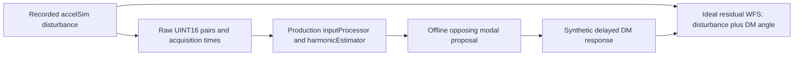

# accelFFCtrl non-actuating accelerometer observer

`accelFFCtrl` continuously reads raw accelerometer pairs, runs the existing
`accelFFCtrlDetail::harmonicEstimator`, and exposes predicted physical pointing
through diagnostic INDI properties. It has no DM publisher, correction enable,
gain, or actuator stream attachment. Input names beginning with `dm` are rejected
before a native open. Starting or stopping this application does not change a DM.

The engineering record is
[accelSim-28hz-feedforward-controller.md](../../agents/plans/2026-11/accelSim-28hz-feedforward-controller.md).
The existing simulator, its model/RNG/timing, and its DM injection are unchanged.

## Live architecture and stream retention

`accelFFCtrl.hpp` follows the normal `MagAOXApp<true>` lifecycle and `threadStart`
conventions; the `.cpp` contains only `main`. A single worker owns
`accelFFCtrlStream.hpp`'s existing-only mapping and
`accelFFCtrlInput.hpp`'s preallocated batch, cursor, clock mapping and estimator.
INDI callbacks enqueue coherent parameter revisions. The worker applies them
using `try_lock`, resets the fit, and publishes fixed-size value snapshots with
another `try_lock`. The ordinary app loop handles filesystem identity probes,
INDI formatting and communications. There is no simulator model in this path.

The existing `dev::shmimMonitor` consumes only the latest `cnt1` plane per wake;
it cannot recover an 8-kHz sample history. This app therefore uses native
ImageStreamIO attachment and semaphore claiming without changing that helper.
A semaphore wake is a notification, not an immutable sample. The worker uses
`cnt0` to enumerate available publications relative to the latest `cnt1`, and
checks each retained plane's `cntarray`, `atimearray` and `writetimearray`. It
copies owned pairs/metadata into bounded local storage, checking global write
state, geometry and counters around the copy. Inconsistent copies are retried
without advancing the cursor.

**A one-frame circular buffer cannot guarantee every-frame consumption.** Once
a pair is overwritten, semaphore counts or a consumer-side queue cannot restore
it. Depth-one input is supported for diagnosis; gaps are counted and reset the
fit by default. The optional single-frame policy below can preserve mature
history without recovering or concealing the missing sample.

For a frameGrabber producer, the operator can use its existing startup setting
`framegrabber.circBuffLength=256`: 32 ms retention at 8 kHz with per-plane
timestamps/counters. No producer code or synchronization change is needed.
The reader examines retained records in acquisition order in bounded batches.
Finite retention still permits overrun. A strict every-frame guarantee needs a
producer-supported acknowledged queue or equivalent transport in a later phase.
The [ImageStreamIO pointer/semaphore APIs](https://milk-org.github.io/milk-package/ImageStreamIO_8h.html)
provide neither a frame lease nor that guarantee.

Freshness is separate: with the default 2-ms maximum age, old retained records
are counted/discarded and clear the fit, never assigned fabricated receipt times.
Retention of 32 ms does not authorize 32-ms-old data. Initial attachment starts
at the newest completed pair; lifetime counters cover observed history from
that point. Every later coherent, fresh, consecutive pair is ingested once.

## Live clocks, cadence and recovery

Accepted input is CPU-resident UINT16 `(2,1)` or `(2,1,D)`, X followed by Y.
Depth >1 requires temporal per-plane timestamps/counters and the existing
frameGrabber publication contract. Codes above 4095 are invalid. The live app
fixes channel order to X/Y and positive sensor polarity; rotation is configurable.
ADC calibration is not carried in stream metadata.

Acquisition stamps must be positive, valid **CLOCK_REALTIME** values on the same
synchronized host clock as the controller. Zero, malformed, backwards, future,
stale, or write-before-acquisition stamps inhibit the fit. A post-copy clock
sample brackets realtime with two monotonic reads. Its integer epoch translation
is fixed until reattachment or a detected clock step. Excessive bracket
uncertainty/offset change clears the fit and reanchors on the next observation.
This does not synchronize an independent sensor clock or an unknown remote-host
clock offset. Every record retains its own acquisition time; a batch uses actual
post-copy receipt time for age validation.

Prediction is queried at 2 kHz by default with
`target = monotonic_now + prediction_horizon`. Phase advances by
`target - latest_acquisition`, including measurement age **once**. No extra
fixed window delay is added. INDI is a 5-Hz diagnostic snapshot, not a high-rate
prediction transport. The worker wakes on stream posts or a prediction deadline
and checks staleness even during input silence. glibc 2.30+ uses
`sem_clockwait(CLOCK_MONOTONIC)`; older platforms use `sem_trywait` and bounded
relative sleeps (up to 20 us requested). Neither relies on a realtime timeout;
OS scheduling can exceed requested delays.

Failed attachment retries once per second. The ordinary app loop checks backing
inode/device at telemetry cadence; the owner closes/reopens replacement mappings,
increments generation and resets. Counter rollback is checked against the last
stable snapshot, including any unconsumed batch tail, and increments generation
immediately. Known unconsumed records are counted as dropped when a generation
ends; records never observed before a restart cannot be counted. Gaps, bad samples/times, stale data, configuration and explicit
resets clear/re-warm observation automatically. The default resets on every gap;
the startup opt-in below is the sole qualified-gap exception. No old prediction is held ready;
supervision also checks a snapshot's age before sending it to INDI.

Steady processing uses fixed numerical state and startup-allocated batch storage,
bounded copying/semaphore draining, no blocking mutex acquisition, and no INDI,
filesystem probes or routine logging. Attachment/reconnection can allocate/do
I/O. Native library/producer publication ordering, semaphore behavior and safe
unlink/recreate semantics need Linux qualification; concurrent truncation of an
attached mapping is not a supported restart protocol.

## Configuration and INDI

`input.allowSingleFrameGap` is a startup-only option, default `false`. It accepts
only `true`, `false`, `1` or `0`; malformed text fails configuration. It is not
an INDI switch. Existing configuration files remain valid without this key.

[config/example.conf](config/example.conf) is observation-only. `[parameters]`
keys have same-named INDI properties with `current` (owner-applied) and `target`
(requested) elements:

| Property | Units | Default / example |
| --- | --- | --- |
| `frequency` | Hz | 28.5; use 28 for accelSim's unchanged default mode |
| `memory_time` | seconds, total mean memory | 0.1 |
| `lever_arm` | metres | 10, requiring physical calibration |
| `rotation` | degrees, sensor to pointing axes | 0 |
| `prediction_horizon` | ms beyond query time | 0 without config; example 1 |
| `adc_zero_x`, `adc_zero_y` | ADC counts | 2048 |
| `adc_volts_per_bit_x`, `adc_volts_per_bit_y` | volts/count | 0.0083799 |
| `adc_sensitivity_x`, `adc_sensitivity_y` | effective volts/(m/s²) | 1.02 |

Updates are finite/cross-validated as a complete candidate. Invalid edits preserve
accepted settings and mark that property Alert. Valid edits are Busy until
applied; each applied revision resets warmup. Requests can coalesce before an
owner iteration. `estimator_reset.request=On` requests a reset without parameter
changes and returns Off on acknowledgement. Observation runs continuously;
there is no actuator enable/disable control.

Startup-only `[input]` settings: `shmimName=acc000`, `threadPrio=2`, empty `cpuset`,
`maxBatch=256`, nominal `sampleRate=8000`, `predictionFps=2000`, `telemetryFps=5`,
`maxAge_us=2000`, `maxInterval_us=2000`, `maxPrediction_ms=50`, and
`clockTolerance_us=1000`. The last four are data/model-validity bounds, not
hardware limits. The prediction bound includes sample age. Clock tolerance is
an allowed mapping-error bound, not a phase-accuracy claim; use measured clock
performance to choose a tighter commissioning value when appropriate.

Read-only `input` text reports stream name, exact decimal counter/generation,
`mode=observation only`, and the last valid prediction's monotonic
`sample_time_ns` / `target_time_ns` (zero when invalid). `diagnostics` reports:

- `tip_x_mas`, `tilt_y_mas`: predicted rotated physical disturbance in mas at
  target, without opposing sign or DM calibration.
- `amplitude_x_ms2`, `amplitude_y_ms2`: peak acceleration in sensor axes;
  `phase_x_deg`, `phase_y_deg`: sensor harmonic phase at `sample_time_ns`.
- `ready`, `fit_state`, `stream_state`, `last_event`: validity/last reset cause.
  Invalid estimates are zero; zero alone does not imply readiness.
- `input_fps`: accepted throughput over 250-ms monotonic windows, including loss;
  `acquisition_fps`: smoothed rate within consecutive valid acquisition times.
- Lifetime `processed`, `dropped` (overwritten, rejected, or known records abandoned on restart), `invalid_frames`
  (subset of dropped), `restarts`, `resets`, `counter_rollbacks`; `empty_polls`,
  `busy_polls`, `copy_races`; and `retention_frames`.
- `sample_age_us`, `effective_horizon_us` (target minus sample),
  `producer_delay_us` (write minus acquisition), `service_us` (last prediction
  iteration's work excluding wait), and `applied_revision`.
- `gap_enabled`, `admitted_gaps`, `rejected_gaps`, `full_resets`: startup policy,
  retained counter-gap events, counter-gap events that required a full reset,
  and an alias of the existing `resets` counter. Rejections include gaps while
  the option is disabled. Full resets also include attachment/configuration and
  non-gap faults. An admitted gap can leave `last_event=overrun` with a ready fit.

`stream_state` / `last_event`: 0 disconnected, 1 waiting, 2 streaming,
3 incompatible, 4 overrun, 5 invalid time, 6 clock fault, 7 stale, 8 numerical.
`fit_state`: 0 warming, 1 ready, 2 invalid sample, 3 timing fault, 4 sequence
fault, 5 stale, 6 numerical fault, 7 invalid request. Automatic reset can clear
a fit fault before the next snapshot; counters and `last_event` retain evidence.
Default warmup requires 0.3 s of valid consecutive acquisition coverage.

## GCC 14 / C++20 compatibility with older Eigen

Older Eigen releases have a [C++20 array-comparison bug in LDLT](https://gitlab.com/libeigen/eigen/-/issues/2012).
It was reproduced locally with unmodified Eigen 3.3.7 and GCC 15: instantiating
the previous LDLT solve fails because a rewritten equality candidate does not
return `bool`. The exact installed exao2 Eigen version is still to be reported;
this is the failure family matching the reported LDLT comparison diagnostic.

The estimator now uses fixed-size `Eigen::LLT<Matrix3d>`. Valid output already
requires a positive-definite Gram matrix, which is the
[LLT contract](https://libeigen.gitlab.io/eigen/docs-3.3/classEigen_1_1LLT.html).
It solves the same `G2*C=Q2` equation with the same window, two right-hand sides,
conditioning/residual thresholds, units and prediction times. Failed
factorization is checked before `rcond()`, as required by LLT. Roundoff can
differ; bit-identical coefficients are not promised. No system Eigen headers,
repository-wide compiler settings or simulator/DM code are changed.

After applying the reviewed fix to the matching source checkout, a human
operator can run these commands from the checkout root on exao2. Set the compiler
to the same GCC 14 executable used for the original build (`g++` here):

```bash
set -euo pipefail
accff_cxx=g++
"$accff_cxx" --version
pkg-config --modversion eigen3
make -C apps/accelFFCtrl CXX="$accff_cxx" -W accelFFCtrlModel.hpp
accff_testbuild=$(mktemp -d /tmp/accelFFCtrl-eigen-fix-XXXXXX)
make -C apps/accelFFCtrl/tests CXX="$accff_cxx" \
  BUILD_DIR="$accff_testbuild" test benchmark
ASAN_OPTIONS=halt_on_error=1 UBSAN_OPTIONS=halt_on_error=1 \
  make -C apps/accelFFCtrl/tests CXX="$accff_cxx" \
  BUILD_DIR="${accff_testbuild}-asan" test \
  CXXFLAGS='-O1 -g -fsanitize=address,undefined -fno-omit-frame-pointer'
```

`-W` forces the app object to rebuild even if copied header timestamps were
preserved. These commands build/test only; they do not install, launch an app,
access INDI or open native streams. Preserve the full diagnostic if rebuilding
fails, and report the Eigen/compiler versions and test totals.

Local compatibility validation passed 18 offline cases / 3,359,793 assertions
with both Eigen 3.3.7/GCC 15 and Eigen 5.0.1/Clang, plus their sanitizer checks.
The combined current-Eigen sanitizer suite passed 52 cases / 3,596,391 assertions,
including existing simulator numerical regressions with mock sinks. Both
allocation-guarded benchmarks passed without allocations. See the engineering
plan for compiler-specific test details and numerical parity results; this does
not substitute for the GCC 14 Linux application rebuild above.

## Phase 3A: Linux build and private native validation

This phase builds/tests only. It does not install binaries, launch the observer,
attach to `acc000`, contact INDI, restart applications, or change exao2 settings.
The commands below are for a human operator; agents must not execute on exao2.
They can also be run on a configured non-instrument Linux development machine.

Use the same GCC >=14 compiler and dependencies as the working MagAO-X checkout.
The standalone test Makefile does not read `local/common.mk`; pass the same
compiler explicitly. The example below uses `g++`; change `accff_cxx` to the
actual configured compiler if necessary. Run from the checkout root, with the
reviewed Phase 3A changes present. Stop at the first failing step and preserve
its full output.

For an uncommitted review, create a source patch on the workstation:
`git diff --binary > /tmp/accelFFCtrl-phase3a.patch`. This excludes untracked
files: include any new test/scripts separately with their original relative paths.
Have the operator copy the reviewed source material
to exao2. In a matching Phase-2 source checkout on exao2, first run
`git apply --check /tmp/accelFFCtrl-phase3a.patch`, then
`git apply /tmp/accelFFCtrl-phase3a.patch`. Stop on conflicts; no merge or forced
overwrite is needed. This applies source/test/documentation changes only, not
operational configuration. The agent does not perform the remote copy/apply.

```bash
set -euo pipefail
accff_cxx=g++
accff_report=$(mktemp -d /tmp/accelFFCtrl-3a-report-XXXXXX)
printf 'Report directory: %s\n' "$accff_report"
uname -a | tee "$accff_report/platform.txt"
git branch --show-current | tee "$accff_report/branch.txt"
git rev-parse HEAD | tee "$accff_report/commit.txt"
git status --short | tee "$accff_report/worktree.txt"
"$accff_cxx" --version | tee "$accff_report/compiler.txt"
getconf GNU_LIBC_VERSION | tee "$accff_report/glibc.txt"
pkg-config --modversion mxlib eigen3 ImageStreamIO | tee "$accff_report/versions.txt"
pkg-config --cflags --libs ImageStreamIO | tee "$accff_report/isio-flags.txt"
pkg-config --variable=prefix ImageStreamIO | tee "$accff_report/isio-prefix.txt"

make -C apps/accelFFCtrl CXX="$accff_cxx -H" 2>&1 | tee "$accff_report/app-build.txt"
make -C tests -f Makefile.one CXX="$accff_cxx" \
  t=../apps/accelFFCtrl/tests/accelFFCtrl_test 2>&1 | tee "$accff_report/app-test-build.txt"
./apps/accelFFCtrl/tests/accelFFCtrl_test '[accelFFCtrl][app]' \
  2>&1 | tee "$accff_report/app-test.txt"
make -C apps/accelFFCtrl/tests CXX="$accff_cxx" \
  BUILD_DIR="$accff_report/bin" test benchmark \
  2>&1 | tee "$accff_report/numerics.txt"
make -C apps/accelFFCtrl/tests CXX="$accff_cxx -H" \
  BUILD_DIR="$accff_report/bin" native-test 2>&1 | tee "$accff_report/native.txt"
make -C apps/accelFFCtrl/tests CXX="$accff_cxx" \
  BUILD_DIR="$accff_report/bin" native-rate-test 2>&1 | tee "$accff_report/native-rate.txt"
ldd ./apps/accelFFCtrl/accelFFCtrl | tee "$accff_report/app-libraries.txt"
ldd "$accff_report/bin/accelFFCtrlStream_test" | tee "$accff_report/native-libraries.txt"
```

If `pkg-config` cannot locate ImageStreamIO, report that failure and the known
installed header/library locations. Do not install an upstream replacement or
assume a version from the source branch. The app uses the checkout's normal
include/library search paths and explicitly links ImageStreamIO/pthreads;
standalone native tests use `ImageStreamIO.pc`. Those must resolve to compatible
headers and the same installed library. `ISIO_CFLAGS` / `ISIO_LIBS` can be supplied
to the standalone Makefile when the actual installation lacks a `.pc` file, after
its paths are established. Do not change shared make configuration for this test.

`native-test` runs five deterministic cases in a newly created, verified private
namespace, using only synthetic `accff-private-*` names. It checks 2-D and 3-D
UINT16 pairs, depth one versus retention, 12,000 timestamped 8-kHz samples in
four-frame batches across many wraps, both channels' amplitude/prediction,
finite overrun and stale retained frames, bad metadata, reader-slot cleanup,
and same-name unlink/recreation. The fifth case exercises depth-one 4/8-kHz
inputs through both production policies on identical frozen native records:
single/clustered loss, writer busy, reader delay, invalid/stale stamps, silence,
rollback and replacement, with accounting and prediction-time assertions. It prints the library-written stream version
and header structure sizes. The native APIs and fields match the repository's
frameGrabber contract; installed ABI compatibility remains unverified until this
build and runtime test pass on the target installation.

`native-rate-test` is Linux-only and opt-in. It now runs eight private paced
fixtures: 4/8 kHz, depth one/256, and default/optional policies, five seconds each
(about 40 s total). Each forks its own synthetic producer, with absolute
monotonic deadlines, actual realtime acquisition/write stamps and nominal 2-kHz
queries. All published records must be accounted as processed or dropped, and
readiness must be observed. Output reports loss, invalids, races, full resets,
admitted/rejected gaps, executed-query availability and service work times.
These independent paced runs do not see identical scheduling; use deterministic
replays for paired policy comparisons. Executed-query availability excludes
missed query deadlines and is not wall-time availability. Catch assertions,
normal scheduling and service clock probes add overhead; this is not a hard
real-time or losslessness claim. The depth-256 fixture is historical transport
coverage only; it changes no producer configuration.

Report the directory contents above, especially the first compiler/linker error
and preceding command on failure, all test totals, the native ABI line, the
`Native 8k/2k` summary, and the ImageStreamIO paths from both `ldd` outputs.
The `-H` builds record the actual selected headers; include their ImageStreamIO
header paths and any precompiled-header indication in the report as well.
Do not report a Linux pass based on the existing macOS syntax checks. Physical
producer timestamp validity, real-host load and framework worker scheduling
remain separate qualifications. In particular, `mcp3208Ctrl` timer-mode
acquisition does not assign `m_currImageTimestamp` in this checkout; synchronized
acquisition does. Confirm the actual producer/mode before future observation.
ImageStreamIO's default `CLOCK_ISIO` may be TAI; the frameGrabber path explicitly
publishes realtime acquisition/write stamps. The controller requires that
contract and never substitutes creation time, TAI or receipt time for acquisition.

## Later operator deployment (outside Phase 3A)

The historical deployment procedure below is for a later approved observation
run after Phase 3A passes. Its install, launch, INDI and producer-configuration
steps are **not** part of the current build/private-validation task.

First use a configured MagAO-X Linux development checkout with the normal
compiler, mxlib/Eigen, libMagAOX, INDI and ImageStreamIO dependencies:

```sh
make -C apps/accelFFCtrl
make -C apps/accelFFCtrl/tests test benchmark native-test
make -C tests -f Makefile.one t=../apps/accelFFCtrl/tests/accelFFCtrl_test
./apps/accelFFCtrl/tests/accelFFCtrl_test '[accelFFCtrl][app]'
```

`native-test` launches a fresh process in an empty
`/tmp/accelFFCtrl-native-XXXXXX` namespace, creating only synthetic
`accff-private-*` streams. Its hidden tag must be selected explicitly; never
point it at the instrument namespace. Full app tests do not start a worker or
open streams.

These deployment commands are for a **human operator**. Per
[AGENTS.md](../../AGENTS.md), an agent must not execute on exao2 or through an
instrument INDI tunnel. Pass the Linux build/native tests and review the source
diff first. To transfer the reviewed working tree without a commit/push, on the
workstation from the checkout root:

```sh
git ls-files -z --cached --others --exclude-standard -- Makefile apps/accelFFCtrl \
  tests/Makefile.one tests/groups.dox tests/tests.list \
  agents/plans/2026-11/accelSim-28hz-feedforward-controller.md \
  | tar --null -czf /tmp/accelFFCtrl-live-source.tgz -T -
scp /tmp/accelFFCtrl-live-source.tgz exao2:/tmp/
```

The file list excludes ignored build products, so workstation binaries/objects
are not transferred. On exao2, verify the checkout/path and preserve local changes before extracting.
These commands assume `/opt/MagAOX/source/MagAOX`:

```sh
cd /opt/MagAOX/source/MagAOX
git branch --show-current
git status --short
tar -tzf /tmp/accelFFCtrl-live-source.tgz
tar -xzf /tmp/accelFFCtrl-live-source.tgz
make -C apps/accelFFCtrl
make -C apps/accelFFCtrl install
sudo install -m 0644 apps/accelFFCtrl/config/example.conf \
  /opt/MagAOX/config/accelFFCtrl-observe.conf
```

Confirm the **one existing** `acc000` producer publishes UINT16 X/Y pairs, valid
host realtime acquisition stamps, the intended rate, and matching calibration.
Set observer ADC/lever/frequency values accordingly. For an 8-kHz simulator test,
the operator can use existing `sim.fps=8000` and
`framegrabber.circBuffLength=256` settings on that producer, and
`parameters.frequency=28` on the observer. Do not start a second `acc000`
producer. Changing retention requires an owner-coordinated producer restart;
the observer never requests it. With depth one, record loss/warmup failures as
the expected transport limitation. This app does not arm or change the
simulator's separate DM injection.

In a dedicated operator terminal:

```sh
/opt/MagAOX/bin/accelFFCtrl -n accelFFCtrl-observe \
  -c /opt/MagAOX/config/accelFFCtrl-observe.conf
```

For an isolated INDI connection, choose an unused port (7625 here) and a new
symlink. Do not attach a second xindidriver to an already managed FIFO or restart
the production INDI server. In a second operator terminal:

```sh
ln -s /opt/MagAOX/bin/xindidriver /tmp/accelFFCtrl-observe
indiserver -p 7625 /tmp/accelFFCtrl-observe
```

In a third operator terminal:

```sh
getINDI -h localhost -p 7625 'accelFFCtrl-observe.input.*'
getINDI -h localhost -p 7625 'accelFFCtrl-observe.diagnostics.*'
setINDI -h localhost -p 7625 'accelFFCtrl-observe.estimator_reset.request=On'
```

Observe at least ten minutes under representative load. Record throughput,
acquisition rate, drops/invalids, races, resets, age, producer delay and service
time. A qualified retained-ring run should approach 8-kHz accepted throughput,
become ready after warmup, and remain fresh without gaps. Depth one cannot
establish every-frame consumption. Change frequency/memory through `.target`
and confirm owner-applied acknowledgement, cleared estimates, and warmup. Have
the producer owner exercise a controlled pause/restart only when appropriate;
confirm stale status, new generation and warmup. Stop the observer with Ctrl-C,
stop its isolated indiserver, and remove the temporary symlink. Existing
applications retain ownership of the ADC producer and all actuator streams.

## Numerical input, units, and timing

Pass **every available sample**, in acquisition order, to `consume(record, now)`.
The record contains exactly two `uint16_t` codes, the acquisition timestamp,
source sequence, and source generation. Querying at a lower cadence does not
decimate ingestion; the tests use 8000-Hz ingestion and 2000-Hz prediction.

For each selected sensor axis:

```text
a = polarity * (double(raw[channel]) - zero) * voltsPerBit / sensitivity  [m/s²]
```

Defaults match accelSim: zero 2048, volts/count 0.0083799, sensitivity 1.02.
Set both axes from the producer's actual configured values; they are not encoded
in `acc000`. Channel selection, polarity, offsets, and sensitivity can differ
between axes. Values above 4095 are invalid. Legal rail codes are accepted; this
numerical phase has no sustained-saturation policy or hardware displacement bound.

Acquisition time and `now` must be **nonnegative integer nanoseconds in one
monotonic domain**. A numerical epoch of zero is valid. The live adapter performs
realtime-to-monotonic mapping and stream-plane coherence checks; standalone
callers must supply them. The core reads no clocks or metadata itself. Subtract
integer timestamps before converting intervals to seconds, preserving precision
even at large epochs.

The first sample binds the source and uses `1/sampleRate` as its window interval.
Subsequent samples use their actual acquisition intervals. True duplicate records
return false without advancing state/count or refreshing freshness. Missing,
backwards, changed-generation or conflicting same-counter records latch a fault.
Invalid/backwards times, excessive intervals, stale input, nonfinite arithmetic,
or an ill-conditioned warmed fit also inhibit results until `reset()` or a valid
`configure()`. The caller should distinguish a duplicate from a fault using
`state()` and `samples()`.

Default maximum acquisition age and sample interval are each 2 ms; maximum target
distance from the newest sample is 50 ms. These configurable bounds express
numerical data/model validity. `predict()` checks freshness even without new
input, and invalid results contain zero estimates. A bad target request does not
destroy an otherwise valid fit. Changing configuration resets the fit; invalid
configuration throws before modifying the prior settings. No exceptions or
allocations are used for normal per-sample or prediction error handling.

## Harmonic fit and physical conversion

The initial frequency is 28.5 Hz and total mean memory T is 0.1 s. The simulator's
existing default target remains 28 Hz; set `m_frequency=28` when matching it.
The model is a nuisance offset plus one harmonic in each decoded sensor axis:

```text
u = [1, cos(phi), sin(phi)]^T
a_i(t) ~= d_i + A_i*cos(phi(t)) + B_i*sin(phi(t))
phi_n = wrap(phi_(n-1) + 2*pi*f0*dt)
beta = -expm1(-2*dt/T); lambda = 1-beta
G1 = lambda*G1 + beta*u*u^T
Q1 = lambda*Q1 + beta*u*[a_x,a_y]
G2 = lambda*G2 + beta*G1              # newly updated first stages
Q2 = lambda*Q2 + beta*Q1
G2*C = Q2                           # fixed 3x3 Cholesky LLT, two right-hand sides
```

Each stage has time constant T/2. For uniform intervals, weights are proportional
to `(k+1)*lambda^k`; this is a two-stage window, not ordinary single-exponential
RLS. Both Gram and data moments receive exactly the same window. An independent
weighted batch-QR test verifies the result for uniform and irregular timestamps.
The second stage improves rejection of strong high-frequency acceleration before
division by the target frequency squared.

Warmup requires `max(3/f0,3*T)` seconds of acquisition coverage. Prediction also
requires a positive, finite, sufficiently conditioned Gram matrix and a small
solve residual. The offset is excluded from vibration. The result reports peak
acceleration amplitude `hypot(A,B)` and phase at its `m_sampleTimeNs`, meaning
`amplitude*cos(2*pi*f0*dt + phase)`. Phase is undefined for zero amplitude; zero
is reported for that case. These fields remain in decoded sensor axes.

```text
a_hat_i(t_target) = A_i*cos(phi_target) + B_i*sin(phi_target)
theta_sensor = -a_hat / ((2*pi*f0)^2 * leverArm)             [rad]
theta_output = [[cos(alpha),-sin(alpha)],
                [sin(alpha), cos(alpha)]] * theta_sensor
```

The default lever arm is 10 m and rotation is 0 degrees. Rotation changes the
returned pointing axes only. Output is the physical disturbance: no correction
gain or opposing command sign is applied. The inverse includes no extra factor
of 9.81, reflection factor, or DM calibration.

Use `predict(now, target)` for an explicit future target, or `predict(now)` for
`now + m_predictionNs`. The phase advance always uses `target-last_sample`, so
sample/queue age is already included once. No fixed estimator delay is added to
the matched carrier. Detuned or changing envelopes retain window lag; prediction
does not eliminate that lag or infer unknown future stochastic innovations.

```cpp
using namespace MagAOX::app::accelFFCtrlDetail;
parameters settings;
settings.m_zero.fill(producerZero);
settings.m_voltsPerBit.fill(producerVoltsPerCount);
settings.m_sensitivity.fill(producerSensitivity);
settings.m_frequency = 28.5;
settings.m_predictionNs = 1000000;
harmonicEstimator estimator(settings);
// Pass each owned timestamped ADC record to estimator.consume(record, nowNs).
// Query estimator.predict(nowNs); use estimates only when m_state is ready.
```

## Validation and benchmark

From the repository root, with Eigen available through pkg-config:

```sh
make -C apps/accelFFCtrl/tests test
make -C apps/accelFFCtrl/tests benchmark
ASAN_OPTIONS=halt_on_error=1 UBSAN_OPTIONS=halt_on_error=1 \
  make -C apps/accelFFCtrl/tests test BUILD_DIR=/tmp/accelFFCtrl-asan \
  CXXFLAGS='-O1 -g -fsanitize=address,undefined -fno-omit-frame-pointer'
```

Build outputs go to `/tmp/accelFFCtrl-numerics` by default. The numerical/replay,
input, native, and full application suites are registered in `tests/tests.list`.
Fast-math is disabled. No full MagAO-X runtime or ImageStreamIO dependency is
needed for the standalone numerical tests.

The analytic suite checks calibrated ADC decoding, amplitude/phase accuracy,
coordinate rotation, latency prediction, weighted-QR equivalence, batching,
duplicate/gap/source/clock faults, weak-signal quantization, noise, and unwanted
frequency transmission. The separate replay suite generates an offline recording
using the unchanged accelSim model, then feeds **only** codes and timestamp/source
identity to the estimator. Model pointing is retained solely for later scoring.
No simulator symbol is included by the production estimator header.

The benchmark prepares all fixtures before timing and counts C++ `new` calls
while Eigen's runtime allocation guard is active. It reports ingestion and
prediction mean, p50, p99 and maximum, at 8-kHz input with both 2-kHz and 8-kHz
queries. Timing includes benchmark clocks and their resolution; it is numerical
workstation cost, not stream latency or a real-time scheduling guarantee.
The separate input benchmark also guards allocations while exercising decoding,
clock translation, discontinuity checks and 2-kHz prediction with a synthetic
source/clock. It excludes native memory mapping, clock syscalls and semaphore
wake/scheduler costs.

### Results on the implementation workstation (2026-11-05)

- Analytic/replay and live-input suites: 17 cases, 3,350,757 assertions passed.
  Seven input cases cover ordered retained batches, depth-one/finite overrun,
  torn/busy copies, timestamps/clock brackets, counter rollback/generation,
  configuration/reset, stale input and throughput accounting across loss.
- The existing numerical model and its two test files are unchanged. Combined
  AddressSanitizer/UndefinedBehaviorSanitizer validation passed 51 cases /
  3,587,355 assertions, including 34 existing accelSim model/disturbance/DM
  numerical regressions (mock sinks only). The four Python PSD tests also passed.
- Input benchmark: mean 122 ns/sample, p99 417 ns, observed maximum 49.5 us;
  zero C++ allocations and no Eigen allocations across 240,000 prepared samples.
  These measurements use synthetic transport/clocks. The 8-kHz acquisition
  period is 125 us and the default prediction period is 500 us; these are timing
  requirements to measure on Linux, not workstation worst-case guarantees.
- Full application and app-INDI tests cannot build on this macOS checkout:
  existing framework dependencies fail first (`timegm`, missing installed mxlib
  `mx/math/floatUtils.hpp`). Downloaded upstream ImageStreamIO 2.00.00 headers
  compile the native reader/test, but its library cannot build here due to GNU
  `strerror_r` and unavailable `sem_timedwait`/process-shared semaphore APIs.
  Native integration tests were added but **not executed**. Limited GCC syntax
  checks against the real base/INDI/native headers passed using temporary local
  compatibility declarations and omitting unused framework device helpers;
  this is not a full application build or runtime test. No dependency workaround
  was added to the repository. The Linux build/native/app tests above remain
  prerequisites for deployment.

## Offline end-to-end validation (2026-11-05)

The opt-in study uses the unchanged simulator and production `inputProcessor`
with a synthetic depth-one source. It opens no shared-memory stream or INDI
connection. Truth is recorded first; the observer receives only UINT16 pairs,
publication counters and acquisition/write/receipt timestamps. The full-population
28-Hz truth comes from that recording's actual mode state, not a separately
seeded single-mode simulation. Existing analytic/replay/input tests are retained.

From the checkout root, select an existing Python environment containing NumPy,
SciPy, pandas and Matplotlib, then run:

```bash
accff_python=python3
make -C apps/accelFFCtrl/tests PYTHON="$accff_python" validation \
  VALIDATION_SECONDS=60 VALIDATION_DIR=/tmp/accelFFCtrl-validation-60s
make -C apps/accelFFCtrl/tests test benchmark
"$accff_python" -m unittest discover -s apps/accelSim/tests -p test_validate_psd.py -v
```

`validation` first runs four independent Python scoring/window-oracle tests,
then the hidden Catch export case and analysis. A six-second smoke study can
use `VALIDATION_SECONDS=6` and a different directory. Output includes the actual
mode specifications, compiler/STL metadata, float64 truth/prediction recordings,
and `report/accuracy.csv`, `availability.csv`, `calibration.csv`,
`recovery_study.csv`, 500-Hz trace CSVs, full-resolution 2-kHz Welch PSD CSVs and
PNG prediction/residual/PSD/horizon/availability plots. Binary column definitions
are in `tests/validate_predictions.py`. To repeat just the analysis:

```bash
MPLCONFIGDIR=/tmp/accelFFCtrl-validation-60s/.matplotlib \
  "$accff_python" apps/accelFFCtrl/tests/validate_predictions.py \
  /tmp/accelFFCtrl-validation-60s
```

The 60-second study uses 8 kHz, seeds 42/123, 10 m, noise PSD `1e-8`, ADC
zero 2048, `0.0083799` V/count, sensitivity 1.02, estimator 28 Hz, 0.1-s memory,
zero rotation and a 1-ms query horizon. The common scoring interval is 4–60 s.
The query phase makes sample age exactly 125 us: the effective horizon is
**1.125 ms**, and truth is selected nine input samples ahead. Targets must lie
exactly on the truth grid; no interpolation, rounding or extra latency is added.

| Recording / axis | Target acceleration RMSE [m/s²] | Target pointing RMSE [mas] | NRMSE | Correlation |
| --- | ---: | ---: | ---: | ---: |
| Single 28 Hz / X | 0.0003090 | 0.2059 | 15.63% | 0.98782 |
| Single 28 Hz / Y | 0.0003202 | 0.2134 | 17.78% | 0.98422 |
| Full 214 modes / X | 0.0009306 | 0.6202 | 43.18% | 0.91798 |
| Full 214 modes / Y | 0.0009655 | 0.6434 | 49.20% | 0.89291 |

NRMSE is RMSE/RMS of the reference, retaining its mean. At the exact 28-Hz Welch
bin, gain error / phase error is -0.247% / -0.640° and -0.654% / -0.311° for
single-mode X/Y, and +1.010% / -1.691° and -1.221% / -0.941° for full-population
X/Y. The CSV also reports finite-record least-squares peak amplitude/phase;
these are different statistics for a stochastic envelope. Full-population
27–30-Hz target-component residual reductions are 10.04/9.35 dB. Comparing
against **all** physical pointing gives 1.913/1.550 mas RMSE: this observer
estimates a narrowband component, and the other modes remain in that reference.

Across the entire 60 s, nominal prediction-slot availability is 99.499% with
lossless ingestion, 93.990% when one sample is overwritten every 5 s, 69.950%
with one loss per second, and 0% with one loss every 100 ms. A 2-ms worker block
every 5 s loses 15 samples per event and gives 93.963% availability. A 125-us
block every second loses no samples and produces bit-identical predictions to
the ideal case. Incorrectly reading only at 2 kHz loses about 75% of frames and
never becomes ready; the app instead ingests on source wakes independently of
query cadence. One missed sample costs **300.375 ms** from overrun detection to
the first ready query. Resets/warmup remain unchanged.

The separate batch-QR recovery investigation finds that a 20-ms history already
has reciprocal condition number 0.0285, but full-population prediction NRMSE is
586%/544% at the sampled recovery epochs. Shorter windows can be numerically
solvable while rejecting interference poorly. Retaining a mature window across
one omitted record was well conditioned in these limited offline probes;
qualifying such a bounded-gap policy is a future task, not an implemented fix.
Keep the current cold-start gate. See the engineering plan's end-to-end section
for complete scheduling counts, biases, horizon sweeps, recovery results,
sanitizer commands and limitations.

This supports longer **observation-only** evaluation with attention to actual
dropped/reset/ready counters. It does not qualify native Linux scheduling,
sensor calibration, general gap recovery or physical correction. These offline
commands make no deployment or configuration changes.

## Offline frame-loss and rate comparison (2026-11-05)

This phase preserves the production reader/reset behavior and depth-one stream.
`tests/accelFFCtrlGap_test.hpp` is an **offline-only** prototype; the application
does not include it or expose a switch to activate it. See the engineering plan's
bounded-gap investigation for the complete source trace, scheduling tables,
phase/uncertainty results, safety cases and recommendation.

In production, `inputProcessor::drain` counts overwritten publications,
rejected frames and known abandoned records as `dropped`. A counter gap resets
the fit once per observed gap, regardless of its length. Invalid timestamps/data,
clock/source changes, explicit resets and configuration changes also clear it.
Staleness detected by `predict` inhibits immediately; reset is counted when
ingestion next clears that fault. Busy writes, torn snapshots and empty polls
do not immediately add drops/resets. They can delay copying until depth-one data
has been overwritten. Semaphore posts hold no old payloads; `maxBatch` cannot
recover history from a depth-one source. Worker ingestion runs on stream wakes,
independently of its 2-kHz prediction cadence.

The user reports 2,241 drops and 2,202 resets over 602 s at 8 kHz on exao2.
That is 3.723 drops/s and 3.658 resets/s, but these aggregate counts do not
identify each reset cause or determine readiness availability. The separate
live 4-kHz run has no supplied result. All results below are deterministic
workstation simulations, not measurements or predictions of that live run.

Select an existing Python environment with NumPy, SciPy, pandas and Matplotlib:

```bash
accff_python=python3
make -C apps/accelFFCtrl/tests PYTHON="$accff_python" gap-validation \
  BUILD_DIR=/tmp/accelFFCtrl-gap-build \
  VALIDATION_DIR=/tmp/accelFFCtrl-gap-60s VALIDATION_SECONDS=60
make -C apps/accelFFCtrl/tests BUILD_DIR=/tmp/accelFFCtrl-gap-build test benchmark
```

The same exporter/scorer utilities serve the original validation and this study.
Each of four source recordings (8/4 kHz, single/full population) is generated
once and replayed identically to production, `gap1` and `gap7` observers across
11 schedules. Model/ADC parameters match the previous phase. Poles retain the
same **per-sample** radii at both rates, so physical stochastic decay times and
the realized trajectories differ; this is not a matched-trajectory claim.

The prototype uses the unchanged production reader as a timestamp/data validation
gate, then passes original codes and mapped acquisition times to a separate,
unchanged harmonic estimator. Physical counters remain in diagnostics; an
accepted-record ordinal supplies the numerical kernel's consecutive sequence.
No missing records are filled in. A mature fit may retain one missing frame
(`gap1`) only with monotonic source identity/counters, acquisition interval
consistent within 5% of one nominal period, elapsed time <=1 ms, and at least
one memory time (0.1 s here) since another retained gap. `gap7` explores larger
bursts with the same elapsed-time and density bounds. Cold start, numerical
checks and the 2-ms freshness bound are unchanged. Every other fault resets.

| Rate / recording | Lossless NRMSE X/Y | `gap1`, one loss/s, NRMSE X/Y | `gap1` pointing RMSE X/Y [mas] |
| --- | ---: | ---: | ---: |
| 8 kHz / single | 15.63% / 17.78% | 15.63% / 17.78% | 0.2060 / 0.2133 |
| 8 kHz / full | 43.18% / 49.20% | 43.16% / 49.21% | 0.6200 / 0.6436 |
| 4 kHz / single | 14.27% / 16.16% | 14.26% / 16.17% | 0.1953 / 0.1968 |
| 4 kHz / full | 47.04% / 57.66% | 46.96% / 57.69% | 0.4434 / 0.5029 |

Both rates use 2-kHz queries and query+1 ms targets. The normal sample age is
125 us at 8 kHz and 250 us at 4 kHz, giving effective horizons 1.125/1.250 ms
and exact truth offsets of nine/five samples. Comparisons include actual sample
age once. Accuracy CSVs include both each policy's valid slots and a common
production-valid mask; invalid intervals are never scored as zero or hidden.

With one lost frame per second, both rates count 59 lost frames over 60 s.
Production makes 60 resets (including attachment) and is ready 69.95% of nominal
slots; `gap1` makes one initial reset and is ready 99.45%. Recovery from receipt
of the post-gap sample falls from 300.375 ms (8 kHz) / 300.250 ms (4 kHz) to
the first query at that receipt. Queries missed during the blackout remain
unavailable. Three closely spaced one-frame losses still trigger cold restart;
the prototype does not preserve history through unrestricted repeated loss.

Fixed 250-us blackouts lose one frame at 8 kHz and none at 4 kHz under the
specified phase. Fixed 500-us blackouts lose three/one, respectively. Thus
4 kHz improves timing headroom for these simulated blackouts, but the table
does not establish better full-population normalized prediction accuracy.
Freshness is independently checked: 3-ms reader-only delays produce 22 stale
queries per recording/policy, all inhibited. No stale prediction reports ready.

Reports under `VALIDATION_DIR/report` include `accuracy.csv`, `availability.csv`,
`fit_quality.csv`, version metadata and before/after pointing, residual and
availability plots. Raw data live under `<rate>/<policy>`; truth is shared per
rate. Gapped valid outputs are not concatenated into a fictitious uniform PSD.
The original `validation` target remains available for lossless PSD plots.

Regression checks passed: 21 controller cases, 55 combined simulator/controller
sanitizer cases, the 60-s export's 148,400,155 assertions, and eleven Python
tests including existing PSD checks. The original six-second export is
bit-identical to the previous phase. No production/configuration change or
instrument access occurred.

Recommendation: a separately reviewed implementation limited to isolated
single-frame gaps is justified for observation. Keep full resets for startup,
identity/clock/data faults, excessive/dense gaps and stale state. Qualify the
cadence guard against recorded acquisition jitter before deployment: the 5%
prototype bound can conservatively reject real irregular/phase-slewed input.
The prototype is not a production architecture or an actuation qualification;
its two-estimator validation scaffolding should not be copied into the live loop.

## Optional production single-frame policy (2026-11-06)

The current application implements `input.allowSingleFrameGap=false` by default.
The preceding gap-study section describes the historical offline prototypes;
the live application uses one numerical owner and includes none of their
two-estimator validation scaffolding. No DM path or new actuator control exists.

For a separately reviewed observation-test configuration, the opt-in is:

```ini
[input]
allowSingleFrameGap=true
sampleRate=4000
[parameters]
frequency=28
prediction_horizon=1
```

Use `sampleRate=8000` for an 8-kHz source. This snippet is not applied to any
configuration by the validation tools; omitting the opt-in retains the default.

When enabled, the reader may retain a mature fit across **exactly one** missing
publication at depth one. It requires successful prior numerical readiness,
ordered physical counters/timestamps in the same generation, current and prior
sample freshness, elapsed acquisition time <=1 ms and <=`maxInterval`, and at
least one memory time since another admitted gap. The cadence guard is
`abs(dt - 2e9/sampleRate) <= 0.05e9/sampleRate`. Actual acquisition times still
drive phase and window weights. No missing sample is filled in. ADC, stream,
clock, conditioning, freshness and horizon checks remain active.

The cadence guard applies only to gap retention. Valid ordinary jittered samples
are consumed normally. If the guard fails, the fit resets and the fresh record
is consumed from cold; it is not discarded merely for missing the cadence guard.
Timestamp/data faults still inhibit and discard invalid records. Dropped counts
remain physical source loss/rejection counts. Kernel ordinals are private;
published prediction identities remain physical source counters. An admitted
gap clears the cached result until the next successful query, preserving the
original cold-start coverage while avoiding publication of a pre-gap result.

The strict guard **can reject retention during normal phase slewing**. The
simulator permits a default 5% correction per interval; over two intervals this
can exceed the guard's 5%-of-one-period tolerance. Deterministic analytic tests
using actual irregular acquisition times found:

| Synthetic profile | Admitted / 48 warm single-gap probes, at each rate |
| --- | ---: |
| Uniform | 48 |
| Bounded three-phase jitter, ±2% of period | 48 |
| Bounded three-phase jitter, ±10% of period | 0 |
| Bounded phase slew, 2% per interval | 48 |
| Bounded phase slew, 5% per interval | 6 |

No valid records were discarded in these tests. Maximum retained analytic gain
error was 0.00361%, phase error 0.00191° (fine ADC calibration isolates timing).
These are synthetic qualifications, not a measured live timestamp distribution.
The supplied live 4-kHz result—602 s, 2,407,458 processed, zero drops and zero
additional resets—is consistent with reliable observation at that rate, but
contains no per-frame timing information and does not exercise gap admission.
No representative live timestamp recording was found in the repository or the
local accelFFCtrl validation artifact directories searched.

The extended 60-s study replays both single/full populations at 8/4 kHz through
the disabled and optional production paths, preserving the historical prototype
comparisons. With one loss/s, production availability improves **69.95% to
99.45%**, with 59 losses still counted, one initial full reset, and 59 admitted
gaps. Full-population optional NRMSE X/Y is **43.16%/49.21% at 8 kHz** and
**46.96%/57.69% at 4 kHz**, matching the offline prototype. Default reset recovery
is 300.375/300.250 ms; admission permits readiness at the first post-gap query.
Dense clusters and stale/integrity faults retain full reset behavior.

Additional stochastic cases inject bounded **timestamp-tag error** into the
unchanged nominal-grid recording. Their truth remains on its physical nominal
grid; these measure timestamp uncertainty, not a re-simulation at irregular
times. ±2% tag error admits all 59 isolated gaps; ±10% admits none and falls back
to 69.95% availability. All valid samples remain consumed. Separate analytic
tests above evaluate true irregular sampling at the correct target time.

Run the existing `gap-validation` command from the prior section to produce
208 replay summaries plus `timestamp_guard.csv`. Reports include the actual
`optional` production policy and rejected-gap/acceptance counts. The default
path matches all 92 archived prediction/history/truth binaries byte-for-byte;
an independent pre-change-reader comparison passed 66,002 exact prediction/status
checks, including fault and restart paths. Numerical and source model headers,
native stream code and configuration files are unchanged.

Before claiming live qualification, a human-provided recording must contain each
accepted stable-copy record's physical counter, generation/mapping identity,
two UINT16 codes, exact acquisition/write realtime ns, actual receipt monotonic
ns, and paired realtime/monotonic clock anchors with uncertainty. Include
nominal-rate/estimator settings and intervals covering steady operation,
phase slewing, losses, restarts and relevant producer skipped/late diagnostics.
Also retain rejected stable-copy candidates with validation/reset reasons. Exact
prediction replay additionally needs per-query now/target/sample ns, state,
physical sequence and predicted values; without those, qualify only timestamp
intervals rather than actual live prediction accuracy.
Aggregate counts or 5-Hz INDI snapshots cannot establish the guard distribution.
Capture overhead must be characterized; no instrument capture is performed here.

The core is ready for review and a controlled **observation-only** test after
Linux application/configuration tests pass. Keep the default disabled; the
successful lossless 4-kHz run does not require a policy change. A human can use
the following on a configured **non-instrument Linux development host** first:

```bash
make -C apps/accelFFCtrl CXX=g++ -W accelFFCtrlInput.hpp
make -C tests -f Makefile.one t=../apps/accelFFCtrl/tests/accelFFCtrl_test.cpp
apps/accelFFCtrl/tests/accelFFCtrl_test '[accelFFCtrl][app]'
make -C apps/accelFFCtrl/tests CXX=g++ test benchmark native-test
```

The full application tests could not compile locally because of existing macOS
`timegm` / installed mxlib `mx/math/floatUtils.hpp` dependencies. They include
new config/INDI assertions for the option and counters, but are not counted as
passing local tests. Local synthetic/sanitizer results do not replace that Linux
check or live jitter qualification. No system dependencies, instrument settings,
production configuration files, deployment, commit or push were changed.

## Limitations

- A sub-count sinusoid can vanish without noise/dither. Temporal estimation
  cannot recover information absent from the codes. The tests explicitly cover
  both a vanished undithered tone and the same tone with sensor noise.
- At T=0.1 s, 0.5-Hz detuning produces approximately 0.976 acceleration gain and
  17.9 degrees of phase error. The pointing conversion also has the separate
  `(f_actual/f0)^2` scale bias. Tune f0 to the signal rather than assuming accurate
  phase throughout 28–29 Hz at one fixed setting.
- Rejection of a pure unwanted tone does not guarantee that subtracting the
  estimate would improve every spectral line. The tests report hypothetical
  residuals without publishing them; at 25 Hz with default settings, subtraction
  can increase power by about 0.76 dB. A future correction stage still needs its
  own band/gain/phase acceptance, separate from numerical estimation validity.
- The complete stochastic simulator contains other modes, sensor noise and
  quantization; finite-record target SNR varies by seed and axis. One inverse at
  f0 is not the broadband inverse of all those modes. Longer memory trades
  tracking against rejection; replay results must qualify any suppression claim.
  In the tested 12-s recordings (common last 8 s scored), default-window
  target-band residual reductions range from **0.49 to 11.23 dB** for the complete
  population. They do **not** meet the earlier proposed 10-dB full-controller
  gate across all seeds/axes. Isolated 28.5-Hz stochastic-mode cases give
  **13.59–23.25 dB** with the same default window. The replay suite retains this
  distinction, plus 0.3/0.8-s memory sweeps; it does not claim physical correction.
  `accelSimDetail::accelerationFactor` weights each stochastic mode by its own nominal
  frequency squared, so tails of other modes near f0 and sensor noise are not
  exactly inverted by a single `1/omega0²` factor.
- Real accelerometer calibration, lever arm, physical registration, and eventual
  application latency remain external commissioning inputs. No physical DM
  correction or native live-stream timing has been tested on this workstation.
## Linux test preparation and timestamp recording (2026-11-06)

This phase changes tests, analysis tools and documentation only. Production
headers, configurations, simulator disturbance/synchronization and numerical
estimator remain unchanged. Depth one and `input.allowSingleFrameGap=false`
remain the operational defaults. No Linux runtime, VM/container tool or installed
ImageStreamIO library was found on the local macOS workstation. **Complete Linux
application builds, framework configuration/INDI tests, native tests and native
sanitizers remain unexecuted.** A macOS syntax check against cached upstream native headers is not Linux
validation. No representative live per-frame recordings were found locally.

### Reproducible build/private validation

On a configured **non-instrument Linux development host** with the same compiler,
mxlib/Eigen/ImageStreamIO installation and MagAO-X dependency versions as the
intended system, from the reviewed checkout root:

```bash
CXX=g++ PYTHON=python3 VALIDATION_SECONDS=60 \
  bash apps/accelFFCtrl/tests/validate_linux.sh /tmp/accelFFCtrl-linux-report
```

Choose a new report directory for each run and use the actual GCC 14 executable
and Python environment. The script refuses macOS and known instrument hostnames.
It builds both complete apps, runs the controller's framework configuration/INDI
tests without startup, numerical tests, both native targets, paired replay,
Python tests and numerical/native ASan+UBSan checks. It records exact commands,
compiler/glibc/pkg-config versions, header selection, linked libraries, source
revision/diff/untracked paths/hashes and test output. It never installs, launches
an application, contacts INDI or attaches an operational stream. Native fixtures
use the Makefile's fresh verified private namespace and synthetic names only.
Stop on the first failure and return the complete report; do not replace system
Eigen/ImageStreamIO or change shared compiler flags to make it pass.

### Recording contract for a future human-operated test

`acc000` is a UINT16 `(2,1)` or `(2,1,1)` latest-only image. A recorder must use
the same before/after write/counter/geometry consistency checks as
`adcStream`/`inputProcessor`. Copy codes and associated metadata into owned memory;
never queue borrowed stream pointers. At depth one use global `cnt0`, `atime`,
`writetime`; `cnt1` remains zero. Semaphore posts do not preserve overwritten
frames. A sidecar may miss different records than the controller: its gaps are
observer losses, not automatically controller losses. Do not flush/wait on a
semaphore claimed by the running application. The library can return an existing
slot for the same PID; an independent recorder needs its own process/slot.

The timing analyzer consumes integer-only CSV. One frame row is a stable copied
candidate, with `accepted=1` only if the controller actually consumed that record;
keep rejected candidates with `accepted=0`. Required columns are:

```text
generation,counter,acquired_ns,written_ns,receipt_mono_ns,clock_real_ns,clock_mono_ns,clock_uncertainty_ns,depth,accepted
```

All times/counters are exact decimal integers. `_ns` epochs must not pass through
floating-point seconds. Acquisition/write stamps are CLOCK_REALTIME; receipt is
the post-copy bracket's CLOCK_MONOTONIC midpoint, matching `clock_mono_ns`.
`clock_real_ns` and half-bracket `clock_uncertainty_ns` must be those actually used
by the controller. Preserve raw `acquired_sec,acquired_nsec,written_sec,written_nsec`
for malformed timespecs; the analyzer checks these optional fields too. Also
retain `adc_x,adc_y` (optional analyzer columns, mandatory for numerical replay),
mapping device/inode and creation identity, observed header counters/write state,
copy-race/busy events, exact validation/reset reasons and logger-overflow counts.
Keep nonnumeric metadata/reasons in a manifest or a separate event file.

Timing-query CSV requires `query_ns,target_ns,sample_ns,ready`; optional lifetime
columns `processed,dropped,resets,admitted_gaps,rejected_gaps` and `service_ns`
produce diagnostic summaries. Include unexecuted deadlines as `ready=0` to measure
scheduled availability. For full live replay also retain actual query execution,
fit/input states, source generation/counter, parameter revision, reset events and
predicted acceleration/pointing/amplitude/phase in a joined prediction record.
Record initial and final diagnostics explicitly: the last query may precede the
last consumed record. Split files across controller process runs/host reboots.

For `camwfs_sync`, capture the same stable metadata/clock/generation columns in
a separate file without ADC columns. Here `accepted` means a validated recorder
reference copy, rather than accelerometer-controller consumption. In this checkout,
`ocam2KCtrl::frameGrabberPostPublish` mirrors the parent camera's acquisition,
write and frame counter into a 1x1x1 UINT8 notification stream and then posts it.
Its write stamp is the parent's stamp, not the later sync-post time. Confirm the
actual producer/version and clock contract; a different producer cannot be
assumed equivalent. `accelSim::waitSync` feeds the observed counter and its own
monotonic semaphore-receipt time to `syncTiming`/`phaseClock::reference`; it does
not phase-lock directly to WFS `atime`. Exact synchronization reconstruction
therefore also needs simulator reference-arrival/counter, deadline, phase target,
applied slew, skipped ticks/discontinuities and timing/configuration revisions.
An external recorder cannot recover those internal events from stream stamps.
Model ticks can be skipped without a publication: `cnt0` is not model time.

The capture design should use preallocated bounded records and an asynchronous
writer; never add CSV/file I/O to the controller worker. Measure recording
overhead and report recorder loss separately. No instrument recorder or new
production telemetry path was implemented in this phase. Five-Hz diagnostics and
the successful 602-s zero-loss 4-kHz aggregate do not replace this recording.

### Offline timing analysis and paired replay

The new [analyze_timestamps.py](tests/analyze_timestamps.py) writes `summary.json`,
per-frame `frames.csv`, and optional timing plots. It measures cadence error,
counter-normalized period drift, clock-offset changes, acquisition/write/receipt
latencies, observed counter gaps/rollback/generation changes, and necessary
single-gap timing eligibility. It checks query freshness and
`target=query+horizon`; ready timing violations make its CLI fail. WFS alignment
is relative to the latest valid **observed** WFS receipt/acquisition, not the
simulator's unrecorded reference arrival. The analyzer does not reconstruct fit
maturity, numerical conditioning or the one-memory-time gap-spacing rule and
does not label timing eligibility as actual admission. Observed missing counts
are lower bounds from that recorder; actual controller loss comes from its
lifetime diagnostics.

```bash
python3 apps/accelFFCtrl/tests/analyze_timestamps.py /path/to/frames.csv \
  --sample-rate 4000 --queries /path/to/queries.csv --wfs /path/to/wfs.csv \
  --output /tmp/accelFFCtrl-timing-report --plots
```

Pass the actual `--max-age-ns`, `--max-interval-ns`, `--clock-tolerance-ns`,
`--horizon-ns` and `--max-prediction-ns` if different from the existing defaults.
WFS timing defaults to 2 kHz (`--wfs-rate` selects the actual reference rate);
acquisition phase alignment requires
both streams' acquisition stamps to obey the verified same-host realtime contract.
The manifest must include both rates, clock domains, image geometry/ABI, all
estimator/ADC controls, sync settings, source identity, versions and capture loss.

The existing end-to-end exporter now optionally writes timing CSV fixtures for
the actual default/optional production paths (single28, both rates, one loss/s,
uniform and ±2%/±10% timestamp-tag error). Enable with
`ACCELFFCTRL_TIMING_TRACE=1` before the existing `gap-validation` command; all
binary numerical schemas remain unchanged. The Linux runner analyzes these
automatically. These are synthetic replay fixtures, not instrument recordings.

The refreshed 60-s, 208-replay study reproduces 69.95% default / 99.45% optional
availability with one loss/s: 59 dropped in both, default 60 resets/59 rejected,
optional one reset/59 admitted. Full-mode optional NRMSE X/Y remains
43.159%/49.212% (8 kHz), 46.961%/57.694% (4 kHz). Synthetic traced cadence-error RMS is 3.535/7.070 us (8/4 kHz) for ±2% tags
and 17.677/35.352 us for ±10% tags; these are injected errors, not live jitter.
The earlier accuracy/recovery tables still apply. All 124 archived default prediction/history/truth binaries
(including the expanded timestamp scenarios) are byte-identical.

Local checks: 23 controller cases, 57 combined ASan/UBSan cases, 208 replay
comparisons and 18 Python tests pass. The allocation-guarded benchmark now feeds
identical one-loss/s sequences to both policies at both rates, with zero C++/Eigen
allocations. Approximate means per source opportunity: default/optional 104/126 ns
at 8 kHz, 158/200 ns at 4 kHz; p99 <=458 ns. Default resets spend more time warming;
the existing cost fixture uses 28.5 Hz. These exclude native mapping/waits/clock calls, INDI, capture I/O and scheduling,
and are not Linux latency guarantees.

### Remaining steps before observation-only deployment

1. Review the source and run the Linux script with the intended installed ABI;
   return every test summary, all eight paced summaries, selected header/library
   paths and first error if any. Resolve failures before proceeding.
2. Confirm the actual `acc000`/WFS producers, depth-one layouts and timestamp clock
   semantics. Match startup `input.sampleRate` to the actual 4000/8000-Hz source;
   a mismatch conservatively rejects gap retention. Review/qualify the capture design and its overhead on a development
   host. Obtain representative per-frame traces through a separately authorized
   human-operated observation, including steady operation, phase slewing and loss.
3. Analyze those traces and reconcile controller versus recorder loss, reset and
   readiness events. Keep conservative reset fallback; do not broaden the guard
   from synthetic results alone.
4. With those results reviewed, obtain approval for human installation/launch and
   a bounded observation-only comparison. Retain the default false configuration
   and depth one; any opt-in must be an explicit test-specific choice. No DM path
   exists in this controller. No deployment or activation was performed here.

## Offline feed-forward DM cancellation (2026-11-06)

This is an **offline simulation**, not a DM publisher or an on-instrument result.
The live application, its INDI controls/configurations and its default-disabled
single-gap policy are unchanged. New code in
[offline/accelFFCtrlCancellation.hpp](offline/accelFFCtrlCancellation.hpp) has no
stream, clock, INDI or actuator interface. Gain defaults to zero; finite modal
bounds default to zero and calibration must be supplied explicitly.



Only ADC codes enter the production input reader. At each 2-kHz query, the
newest consumed sample is 125 us old; the current 8-kHz measurement is consumed
**after** that query. Targets are query-now plus the configured horizon. Future
truth is used for scoring and a separately labelled perfect-prediction oracle
only. Two independent unchanged estimators target 28 and 56 Hz for the two-tone
case; their ready pointing predictions must share acquisition, source identity
and target. The live application remains a single-band observer.

### Units, calibration and plant equations

`prediction.m_pointing` is physical angular disturbance in radians, after the
configured sensor-to-pointing rotation. Each isolated harmonic obeys
`theta = -R*a_hat/(omega²*lever_arm)`. The offline proposal is:

```text
u[n] = -g * K * sum(theta_pred(query_time + horizon))
surface_um = B * u
residual_rad[n] = theta_disturbance[n] + A_true * x[n]
```

`K` has modal rows and pointing-axis columns [coefficient/rad]. Synthetic modes
have one micron surface RMS at coefficient one. The fixture supplies eight
circular-pupil quadrature points, diameter 6.5 m, and two orthogonal TT modes
rotated 30 degrees. It reuses `accelSimDetail::tipTiltProjection` to fit
`B*K = 0.5e6*[x,y]`; the reflection factor is applied once there. Analytically
`K=(6.5e6/8)*R(-30deg)` and the nominal synthetic response is `A=K^-1`.
These are explicit test definitions, not measured DM registration or calibration.
No real calibration file or physical actuator grid is opened.

With 125-us simulation period, pure delay `d` steps, and bandwidth `fc>0`:

```text
a = exp(-2*pi*fc*dt)
x[n] = a*x[n-1] + (1-a)*u[n-d-1]
```

The preceding-interval input is intentional: a command cannot affect an earlier
state. Bandwidth zero explicitly selects the separate ideal plant
`x[n]=u[n-d]`. Delay must be an integer simulation step; construction rejects
fractional steps and delay histories exceeding one million steps. Commands are
held between 2-kHz queries. Nominal experiments use 1-ms pure delay and 300-Hz
bandwidth; these are synthetic assumptions, not measured MagAO-X performance.

`correctionParameters` configures gain in [0,1], exact prediction horizon,
per-mode absolute bounds, sample age and maximum target interval. The constructor
requires an explicit finite rank-two mapping. Bound enforcement uses one common
scalar to preserve the proposed modal direction. The baseline bound is 0.1
coefficient/mode; a 0.001 case demonstrates clipping. These are offline experiment
controls, not proposed instrument hardware protection limits.

Every query returns a new proposal: state 0 disabled, 1 inhibited, 2 active or
3 limited. Nonready/nonfinite, stale, future, inconsistent-source or wrong-target
predictions return explicit zero, including when another harmonic is ready.
There is no held correction cache. Physical plant delay and natural settling of
previously issued commands remain in the residual; inhibition cannot retroactively
erase them. Configuring a prediction horizon does not add sample age a second time.

### Reproduction and outputs

Run from the checkout root on a workstation with the existing Eigen and scientific
Python environment (NumPy, SciPy, pandas, Matplotlib):

```bash
make -C apps/accelFFCtrl/tests BUILD_DIR=/tmp/accelFFCtrl-cancellation-build test benchmark
make -C apps/accelFFCtrl/tests BUILD_DIR=/tmp/accelFFCtrl-cancellation-build \
  PYTHON=python3 VALIDATION_DIR=/tmp/accelFFCtrl-cancellation-final-60s \
  VALIDATION_SECONDS=60 cancellation-validation
make -C apps/accelFFCtrl/tests PYTHON=python3 validation-test
python3 -m unittest discover -s apps/accelSim/tests -p test_validate_psd.py -v
```

Use `VALIDATION_SECONDS=8` for a smoke run. The exporter accepts integer durations
8–600 s and scores from 4 s onward. The 76 experiments include 0..1 gains in
0.1 steps, isolated/coincident 28/56-Hz modes, perfect-prediction oracles, horizon
changes, sign/latency/bandwidth/calibration errors, sensor noise, frame losses,
invalid/stale input, reset/restart and clipping. Main sources use unchanged
`accelSimDetail::model`: seed 42, modeSeed 123, 8000 Hz, lever 10 m, RMS acceleration
0.002 m/s² per mode/axis, pole 0.99999, coupling 1, ADC 2048/0.0083799/1.02,
noise PSD 1e-8. Coherent analytic checks use the existing ADC conversion with
volts-per-bit 1e-5 and noise 0 to isolate timing/calibration from coarse quantization.
They do not alter the deployed ADC configuration.

`summary.csv` records every run's full-rate RMS, variance reduction, coherent
28/56-Hz amplitudes/phases, prediction error, modal/surface amplitudes, loss and
reset accounting. Selected uniform 8-kHz float64 traces permit independent
scoring. `report/metrics.csv`, `spectral_suppression.csv` and per-axis PSD CSVs
contain the analysis; PNGs show original/residual time series and PSDs, modal
commands and readiness. `report/gain_sweep.png` compares causal gain sweeps with
perfect prediction through the same plant. The oracle curves use plant linearity
below the nonbinding baseline bounds. Metadata records compiler/STL/configuration;
C++ random distributions are not guaranteed identical across standard libraries.

### Sixty-second results

Nominal gain 1, 1-ms prediction horizon/delay and 300-Hz plant; scores include all
inhibited intervals after 4 s. RMS values are per-axis physical pointing [mas].

| Source | RMS before X/Y | RMS residual X/Y | Variance reduction X/Y | PSD-bin suppression X/Y |
| --- | ---: | ---: | ---: | ---: |
| 28 Hz | 1.3178 / 1.1999 | 0.2848 / 0.2703 | 95.33% / 94.93% | 16.37 / 16.67 dB at 28 |
| 56 Hz | 0.4453 / 0.2824 | 0.1296 / 0.0946 | 91.54% / 88.77% | 11.47 / 11.00 dB at 56 |
| 28+56 Hz | 1.2991 / 1.1752 | 0.2940 / 0.2821 | 94.88% / 94.24% | 16.70 / 16.77 dB at 28; 11.07 / 11.07 at 56 |

Welch PSDs use 8-s Hann segments, with exact 28/56-Hz bins. Integrated ±1-Hz
suppression is 15.03/14.96 dB (single 28), 11.16/10.50 dB (single 56), and
15.35/15.13 dB at 28 plus 10.82/10.75 dB at 56 (dual). Target prediction NRMSE is
15.63/17.78%, 11.96/19.31%, and 16.67/18.10%, respectively. The two-mode peak
synthetic surface contribution at the eight test points is 0.02521 micron; modal peaks are 0.01642/0.01224.
Residual phase/amplitude and opposing-correction phase/amplitude errors are
reported separately in the CSV; a deep residual null has an ill-defined phase.

Perfect prediction at the same 1-ms horizon leaves plant/ZOH error: variance
reduction 98.12% (28), 92.67% (56), 97.72/97.60% (dual). Using a 1.75-ms horizon
also compensates much of this synthetic plant's phase lag: causal reductions
97.54/96.83%, 98.56/96.29%, 97.20/96.70%; oracle reductions exceed 99.95%.
The analytic single-tone cases closely match their oracle; independent two-band
fits retain about 1.4% combined prediction error from cross-band leakage.
This is phase anticipation, not an inverse-bandwidth/gain compensator.

With dual modes and one lost ADC frame/s, queries continue at 2 kHz: default loss
accounting 59, full resets 60, availability 70.00%, variance reduction 66.12/65.99%;
optional admitted 59, dropped 59, resets 1, availability 99.499%, reduction 94.88/94.24%.
These availability values differ from the earlier 69.95/99.45% study because this
experiment omits ADC frames without also suppressing prediction deadlines.
Three-frame clusters are rejected by both policies (33 drops, 12 resets, 93.999%
availability). Invalid/stale predictions always produce zero proposals.

Wrong sign amplifies variance by roughly 290%; a 20-ms actual delay with a 1-ms
horizon amplifies it by 251–258%. A 5-ms delay retains only 18–21% reduction;
50-Hz bandwidth retains 66–67%; +20% calibration gain or 15-degree rotation errors
retain 88–90%. Increasing sensor PSD tenfold retains 79–81%. Removing sensor noise
with the same coarse ADC retains 65–77%, illustrating undithered quantization
bias rather than a recommendation to add hardware noise. All proposals remain
finite/bounded in these explicitly open-loop synthetic cases.

### Qualification boundary

28 controller cases (including five new cancellation cases), 62 combined
simulator/controller ASan+UBSan cases, 21 Python tests, the 76-run 60-s study and
the 76-run 8-s sanitizer study pass. Existing 208 gap replay comparisons pass;
production source/configuration files and simulator behavior remain unchanged.
Linux app/native validation is still pending and is not required for this offline
study. Nothing was installed, deployed, restarted or actuated.

The simulated WFS is an ideal linear physical tip/tilt sensor sampled at 8 kHz,
with unity coupling. It includes no optical propagation, WFS exposure/readout,
closed-loop AO response, DM resonances, hysteresis or DM-to-accelerometer feedback.
Real integration requires measured sensor/pupil/DM/WFS registration, approved
B/K calibration and units, end-to-end latency and frequency response, AO-channel
combination/gain/trigger behavior, exclusive writer ownership and fault/zero
semantics. The historical additive combiner contract is not a measured dynamic
plant. No physical suppression or real-system stability claim follows from these
results. Production integration requires a separate reviewed and approved phase.

## DM integration preparation and shadow commands (2026-11-06)

The detailed [integration report](offline/INTEGRATION.md) records the actual DM
code paths, calibration/evidence inventory, timestamp/sequence conventions,
synthetic AO-interaction results and future observation-only pass/fail protocol.
The tweeter is the source-supported candidate; no correction channel is assigned.
The earlier simulator assignment of channel 10 does not authorize correction to
share that channel. Full channel contributions replace their previous values;
`dm.deltaChannels` does not mean incremental writes.

New [offline/accelFFCtrlShadow.hpp](offline/accelFFCtrlShadow.hpp) wraps the existing
numerical proposer. Callers supply separate pointing-to-DM-pupil coordinate and
modal maps, a provenance identity and an explicit synthetic/archived-pupil-only
label. Gain and bounds default to zero. It returns host-memory absolute modal
records with exact query/acquisition/prediction/requested-target times, source
counter/generation, reset epoch, input revision, numerical validity and status.
A zero-bound numerical audit still records qualified prediction angles with gain
zero. This is not an enable or optical calibration certificate. It has no stream,
clock, file, channel or publication interface and is not included by the live app.

All invalid/stale/nonfinite proposals are zero. Generation changes, source-counter
rollback, inconsistent acquisition identity and query rollback latch inhibition
until reset. A reset requires a newer acquisition; it does not reuse a cached
ready proposal. Query-to-query counter advances of four are normal at 8/2 kHz and
are not treated as input loss. All configured prediction targets remain exactly
query plus the existing horizon. Reset epochs and actual configuration revisions
are separate; the unchanged study configuration retains revision zero.

The local archived TT pair/dmmask are available read-only. Their conditional
DM-pupil K agrees with the prior C++ projector and has relative fit errors about
8.5e-8; the new opt-in signed/order/scaling fixture passes. It is labelled
`archivedPupilOnly`: accelerometer-to-telescope/WFS registration, optical sign and
measured dynamic response remain missing. Synthetic 30-degree calibration,
1-ms delay and 300-Hz plant values are never substituted for those measurements.

The prior 76-run 60-s study is rerun with optional diagnostic logging. Twenty-two
logs cover 2,640,000 queries, including zero gain, losses, invalid/stale input and
reset/reattachment. Every shadow coefficient/state is checked against the original
proposer. Existing cancellation results remain unchanged. Logging is blocking
**offline** I/O; no real-time recorder or live-app hook was added.

A separate replay uses the recorded causal dual-band commands with the existing
synthetic DM response and a test-only AO integrator. AO-only versus shadow-only
AO commands/residuals match at every 8-kHz step. Illustrative AO gain 0.1 plus FF
reduces variance by 95.75/95.09%, versus 25.47/23.14% for AO alone. Duplicate FF
reduces only 20.17/17.22%; incorrect incremental semantics amplify variance by
1874–1994% and saturate the imposed modal headroom proxy. Extra delay and large
loop gain also produce poor clipped trajectories. These are sensitivity tests,
not measured AO settings, a hardware saturation model or closed-loop stability
qualification. The report explains POL/double-counting and offloader risks.

To reproduce on the workstation, using the existing scientific Python environment:

```bash
make -C apps/accelFFCtrl/tests BUILD_DIR=/tmp/accelFFCtrl-shadow-build test benchmark shadow-tools
ACCELFFCTRL_SHADOW_DIR=/tmp/accelFFCtrl-shadow-final-60s/logs \
  /tmp/accelFFCtrl-shadow-build/accelFFCtrlCancellation_export /tmp/accelFFCtrl-shadow-final-60s/cancellation 60
python3 apps/accelFFCtrl/tests/validate_cancellation.py /tmp/accelFFCtrl-shadow-final-60s/cancellation
python3 apps/accelFFCtrl/tests/validate_shadow.py --shadow-directory /tmp/accelFFCtrl-shadow-final-60s/logs \
  --output /tmp/accelFFCtrl-shadow-final-60s/report
/tmp/accelFFCtrl-shadow-build/accelFFCtrlAO_export \
  /tmp/accelFFCtrl-shadow-final-60s/cancellation/ar_2_gain10.bin /tmp/accelFFCtrl-shadow-final-60s/ao
python3 apps/accelFFCtrl/tests/validate_shadow.py --ao-directory /tmp/accelFFCtrl-shadow-final-60s/ao \
  --output /tmp/accelFFCtrl-shadow-final-60s/ao/report
```

The report includes the optional archived-FITS/C++ fixture commands and future
Linux/native requirements. All current runtime sources/configurations, depth-one
operation, observation-only behavior and default-disabled gap policy remain
unchanged. No instrument connection, real DM command, deployment or application
restart was performed. A live writer requires a separate explicit approval.
