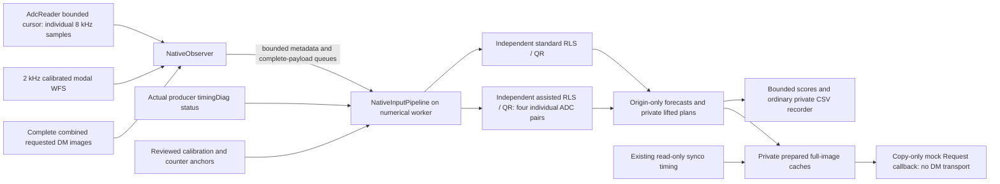

Current output/control milestone: [OPERATIONAL_DDSPC.md](OPERATIONAL_DDSPC.md). The report below describes the prior shadow-only profile; default builds remain strict shadow-only.

Current live path: [PHASE_DDSPC.md](PHASE_DDSPC.md) supersedes the WFS-origin-only preparation below with ADC-driven inference and WFS-driven phase identification. The existing producer API and output prohibitions remain unchanged.

# Native DDSPC inputs and the existing syncopation producer

2026-11-15. This completes the native binding described in `UPSTREAM_SHADOW.md`
and supersedes its remaining-bridge list. Acquisition synchronization belongs
to the upstream semaphore/delay controller. No exposure reconstruction, clock
mapping, new phase-lock loop or new publishing protocol is added here.

The application remains **compile-time shadow only**. It does not attach to
`dm10disp10_aux`, acquire its producer lock, create/update `_ready`, consume or
modify `_ack`, change its pixels/counters, or touch its semaphores. Even publishing
zero would change the operational channel and is deliberately absent.

## Actual upstream producer API

The two shared headers are backported from the locally available
`origin/jrmales/dm-syncopation` object
`bb5a5d89c594bc7949af2949f457a1520b7a3845`:

- `libMagAOX/app/dev/dmSyncopationProducer.hpp`
- `libMagAOX/app/dmSyncopationTiming.hpp`

Both files match that revision byte-for-byte. The interrupted implementation had
one indentation-only difference at the producer's `reset` condition, introduced
by clang-format; that unnecessary difference has been restored. Tests verify
the exact file hashes. The remaining application C++ changes are formatted.

Reference `apps/dmSpeckle/dmSpeckle.hpp` in that object uses the CRTP base,
`dmSyncopationProducerT` alias, friend declaration, configuration/shutdown macros
and `syncopationThreadExec()`. There is no separate INDI registration handshake:
synco's configured destination mapping establishes the auxiliary source and
acknowledgement stream; the producer attaches its CPU-backed 2-D FLOAT source.

| Actual helper operation | Semantics |
| --- | --- |
| `syncopationPoll(Request&, IMAGE&)` | Opens the schedule and sidecars, takes the lifetime cooperative `.producer` lock, adopts outstanding ownership, and returns a new usable immutable request. Polling itself can create `_ready`, so it is not observation-only. |
| `Request` | Exact epoch, generation, cycle, step, monotonic target and input-ready cutoff. Notifications only prompt a coherent reread; they are not a lossless count of slots. |
| `syncopationPublish(pixels, request, image)` | Waits to the configured lead, checks current identity/deadline and finite pixels, publishes the full source, then commits its exact payload identity in `_ready`. |
| Matching `_ack` | Frees the single source buffer after a private copy or discard. It does not prove a DM trigger, SDK success, mirror settling or optical application. |
| `syncopationClose()` | Releases this producer's mappings/lock; does not zero the destination or synthesize a DM trigger. |

`loPredCtrlAcc` inherits that same base, with the same alias/friend and
`DMSYNCOPATIONPRODUCER_*` lifecycle macros. Shadow mode **never calls poll or
publish**. Its separate existing-only schedule observer reuses the actual
`synco::readRecord`, without producer registration, sidecar creation or semaphore
acquisition. A busy/racing snapshot provides no new record; missing/replaced
transport provides an invalid marker. Old deadlines still expire normally.

## Output identity and four slots

`dm.channelName=dm10disp10_aux` is the configured future identity requested by
Jared. The naming convention feeds destination **`dm10disp10`**. The inspected
upstream production example instead maps `dm01disp07` through `dm01disp10` and
would therefore consume `dm01disp10_aux`, not `dm10disp10_aux`. No live mapping
was inspected or changed. The operator must confirm the actual destination and
exclusive channel ownership before any later active producer is enabled.
`native_shadow.dm_stream=dm01disp` remains a separate read-only combined-input
selection; it is not changed to the auxiliary output name.

At a 2-kHz main cadence the four opportunities include passive step 0 and three
auxiliary subdivisions. Step zero belongs to the next main cycle. Other targets
may move to a later period after completion, so numerical step order is not
chronological target order. The private cache maps **absolute advertised target
times**, with 125-us separation, into the native newest-first lifted plan. It
checks the exact current Request and rejects expired cutoffs, changed
epochs/generations, invalid values, unsupported cadence or missing model input.

`SyncoShadowPlans` renders full calibrated images ahead of time.
`SyncoShadowProducer::command()` supplies caller-owned pixels for the actual
base `Request`, without doing model work or publishing. Its `callback()` is the
observation-only mock poll path. Preparation and callback run on different
threads: work/current/preceding buffers exchange under a short try-lock, and the
callback copies one image without Eigen operations, allocation, waiting or I/O.
The preceding plan is retained for pending phases when a new WFS origin arrives.
Invalid/missing assisted payloads fall back to an eligible standard payload;
otherwise the request is skipped. Input-loss timestamps prevent queued older
origins from rearming payloads. No missed request is retagged for a later slot.

Only the numerical worker refreshes plans, normally at WFS origins; the payload
cadence may be 8 kHz. This is not an 8-kHz RLS update or phase-specific replanning
on every new ADC sample. No artificial 8-kHz WFS measurements are introduced.
Full producer finite checks, payload/commit ImageStreamIO calls, ownership and
SDK timing are **not** included in private callback timings.

## Connected native receiver



`NativeObserver::Impl::run()` now forwards each original complete DM payload
before its metadata, actual observer sampling ticks and optional coherent synco
records to `OnlineShadowWorker`. Its 8-kHz ADC forwarding API is unchanged.
Projection, record construction, RLS/QR, rank checks and plan rendering run on
the numerical thread. There is no new native application or producer.

`NativeInputPipeline` automatically binds observed WFS/DM source identities to a
supplied calibration and constructs the synchronized-input records. It uses:

- Actual `timingDiag.mode_code`, `delay_lock`, `local_frame_seq`,
  `sync_producer_frame_id`, `sync_frame_id_gap_count`, received through a read-only
  subscription to `native_inputs.sync_device`. Invalid/incomplete status revokes
  assistance. Counter regressions/gaps require reviewed new anchors; heartbeat
  history avoids using a newer status at an earlier queued data origin.
- Explicit upstream counter anchors: WFS counter `modal_anchor+k` associates
  with ADC counters `adc_anchor+4k` through `adc_anchor+4k+3`. All four values,
  generations, segments, source identity and local availability are checked.
  Default feature age is at most 1 ms, with eight valid recovery records.
- A **local observed-request sampling operator**: four actual observer ticks
  following modal availability, nominally 125 us apart. A missed opportunity
  beyond 100 us is rejected, not synthesized. The next actual modal frame closes
  the record. Only complete, contiguous original requests available at each
  cutoff are sampled; a static request can repeat. Missing WFS cadence beyond
  1 ms, source/counter discontinuities and queue losses break histories.

An incompatible WFS/DM layout is explicitly forwarded as an internal invalid-input
notification, not a source publication. In particular, an incompatible DM source
cannot remain a qualified held request. Its old request history is cleared and a
fresh coherent request is required. Transport diagnostics retain the actual
attached/incompatible state; the ADC-only journal schema is unchanged.

The local sampler is a definition of the requested-input diagnostic model. It
does not adjust ADC acquisition, estimate WFS exposures, imply physical DM holds,
or establish that these cutoffs equal synco copy/application phases. Its model
contains downstream command-path behavior. Its adequacy must be evaluated on
the controlled recording; physical command-phase identification remains separate.

Standard identification needs valid WFS and command records, not an ADC lock.
Assisted identification retains all eight ADC values per WFS block, without
averaging or decimation. Model coefficients, histories, rank, readiness and
forecasts remain independent. Only actual observed requests train the models;
private proposals and held-input prediction assumptions never enter training.
The rectangular lifted future block remains `Fm × (4Fm)` for four-slot models.

`standard_slots=1` preserves the previous single-rate causal-shadow convention
and admits only a held command across the four samples. Its hypothetical output
is repeated over four phases. `standard_slots=4` is the explicit matched lifted
WFS-only comparison. Neither is a claim of bitwise equivalence to operational
Legacy output; `apps/loPredCtrl` and the RLS/QR equations are unchanged.

## Required calibration and configuration

Use the updated `examples/loPredCtrlAcc-online-shadow.conf.example`. The installed
default keeps `online_shadow.enabled=false`, no recorder and no schedule reader,
preserving ADC-only operation. Merely selecting `ddspc_mode=accel_assisted` cannot
qualify inputs or grant output.

The reviewed calibration is plain text:

```text
DDSPC_MODAL_V1 <revision> <modes> <DM_pixels> <modal_index0> <modal_index1> <has_shapes> <WFS_units> <DM_units>
<P: modes rows, DM_pixels values per row>
<optional R: DM_pixels rows, modes values per row>
```

`u_modal=P*u_full` must describe the complete selected combined request, in the
selected calibrated WFS ordering/sign/units. It must come from the actual active
modal basis/DM calibration, not two DM pixels or a guessed identity map. Optional
`R` renders `aux_pixels=R*u_modal`; `P*R` is checked against identity within 0.001.
This algebraic check does not establish optical calibration or stroke limits.
Missing P inhibits training; missing R permits learning/forecasts but inhibits
private image preparation. Bounds are two modes and 4096 pixels. No valid
instrument calibration file has been supplied or invented in this checkout.

Supply:

```ini
[native_inputs]
calibration = /absolute/private/path/reviewed-modal-calibration.txt
sync_device = accelSim
sync_reference = camwfs_sync
sync_epoch = <reviewed-source-incarnation>
modal_anchor = <actual-reviewed-WFS-counter>
adc_anchor = <first-of-four-corresponding-ADC-counters>
synco_association = false
synco_cycle_offset = 0
```

Those placeholders are not runnable settings. The producer's actual reference
configuration and meaning of its sequence counters must support the anchors;
asynchronous status values alone do not define them. Rates alone do not prove
the contract. No independent clock/exposure reconstruction is required. Zero ADC
anchors keep assistance inhibited while allowing the standard fit. A source
restart/reconnection that changes the ADC incarnation requires a fresh reviewed
binding; it does not silently reuse old anchors. WFS/DM changes reset the common
binding and fits. Switching modes never grants readiness or resets a fit.

For private slot preparation also provide R, the existing
`syncopation.timingStream`, and the reviewed relation
`modal_counter + synco_cycle_offset == advertised_cycle + 1`; then opt into
`synco_association`. It only permits hypothetical image preparation for actual
advertised targets. It does not qualify command sampling, committed prefixes or
physical output. Schedule metadata may arrive after the frozen measurement
cutoff, but must be available before calculation and its actual target cutoff.
No later plant measurements or future command values enter origin-only forecasts.

## Recording and diagnostics

```ini
[online_shadow]
prediction_capacity = 32768
prediction_file = /absolute/private/new-directory/predictions.csv
prediction_max_rows = 2000000
```

Create the private directory yourself. The file must not exist; the app uses
exclusive creation, refuses final symlinks and canonical installation/shared
memory directories, and never truncates an existing recording. One ordinary
recorder thread owns the queue/file and drains all generated scores after the
numerical producer finishes. Rows are bounded; limit and I/O errors are explicit.
Both origin-only and auxiliary conditional forecasts are labelled, with identical
targets, axes, horizons, lateness and source/calibration tags. Future observed
commands appear only in the conditional metric. The primary forecast repeats the
last observed input **frame** (all four phases for a lifted model), not an assumed
physically applied constant. Actual request-sampler cutoffs remain in the qualified
in-memory records; the prediction CSV is not a complete qualified-input replay
archive. At F=2 there are at most 16,000
scalar rows/s for two modes/two models; F=8 needs a larger explicit row budget for
a full minute. A disabled recorder with an enabled undrained queue will report
diagnostic drops; these are not input losses.

The 60-element compact INDI schema and 250-ms refresh remain unchanged.
`ddspc_performance` reports origin-only counts/RMSE and numerical-job latency.
`buffers.online_queue` additionally reports the native admission reason, prepared
plans, private slot copies/misses, callback latency, trace rows/errors/limit.
`ddspc_control` distinguishes requested/effective mode and readiness;
`safety.dm_write_enabled` remains false. Camera clocks/exposures remain diagnostic,
not native training prerequisites. Full command images remain available through
the existing opt-in input journal.

## Offline validation and live admission

From a development workstation, with Eigen/mxlib development dependencies:

```sh
make -C apps/loPredCtrlAcc -f tests/Makefile.offline -j2 \
  BUILD_DIR=build/native-pipeline check-multirate
make -C apps/loPredCtrlAcc -f tests/Makefile.offline -j2 \
  BUILD_DIR=build/compact-regression check check-native-observation check-confirmed-replay check-shadow-only
make -C apps/loPredCtrlAcc -f tests/Makefile.offline -j2 \
  BUILD_DIR=build/native-pipeline-asan \
  CXXFLAGS='-O1 -g -std=c++20 -Wall -Wextra -fno-fast-math -fsanitize=address,undefined -fno-omit-frame-pointer' \
  check-multirate
```

These use actual native ADC processing, adapters, DDSPC learners and producer
Request/payload code, with stream-free framework/ImageStreamIO doubles. The
paced worker test supplies synthetic independently established timing and input
records at nominal 8/2 kHz. Optimized execution delivers at that rate; sanitizer
execution slows observer delivery by four while preserving nominal acquisition
timestamps/counters, explicitly testing data flow rather than sanitizer throughput.
Neither changes production budgets or interlocks. This is not live qualification.
The helper's real Linux poll/publish/ack transport is deliberately not exercised
by this shadow application.

### Completed workstation verification

2026-11-15, ASTR-LT-428.local, C++20/Clang and Eigen 5; no instrument access.
All commands above completed successfully. Additional `check-native-timing`
passed. Assertion counts can vary with the number of asynchronous diagnostic
scores present at shutdown; case counts and required bounds do not vary.

| Check | Result |
| --- | --- |
| Full offline `check` | 170 cases, 3,043,796 assertions passed |
| Focused `check-multirate`, including native receiver/producer/application | 45 cases, 781,001 assertions passed |
| `check-native-observation` | 58 C++ cases, 14,309 assertions; Python groups of 3, 28, 5 and 9 passed |
| `check-confirmed-replay` | 6 cases, 40,049 assertions passed |
| `check-shadow-only` | 22 cases, 10,364 assertions passed |
| `check-native-timing` | 49 Python checks passed, including four producer/source contracts |
| Focused ASan + UBSan | 45 cases, 781,001 assertions; no sanitizer findings |
| Report and producer Python checks, optimized and sanitizer runs | 3 + 4 passed in each run |
| Original `loPredCtrl` snapshot verification | All 15 digests match |

Both native RLS and QR variants learn and predict from synthetic, independently
declared input/timing evidence. Tests exercise four-slot indexing, model
independence, source loss/recovery, timer/unlocked acquisition, incompatible DM
payloads, missing/idle requests, dropped metadata without shifting subsequent
payload matches, restart, forecast recording, exact-target late/invalid rejection,
prepared-cache overlap/fallback and concurrent preparation/readout. Output API
sentinels remain zero. These tests are not live-telemetry qualification, nor is
ASan/UBSan a thread-race detector.

Representative optimized timing for the small H=2/F=2 native fixture:

| Measurement | Focused run | Full-regression run |
| --- | --- | --- |
| 2500-pixel complete-image receiver/model work, mean / observed maximum | 90.47 / 183.21 us | 91.04 / 245.13 us |
| Paced numerical worker peak jobs, two variants | 205 / 263 us | 2691 / 239 us |
| Private 2500-pixel payload callback, p50 / p99 / maximum | 0.334 / 0.833 / 1.917 us | 0.375 / 0.541 / 1.334 us |

The optimized worker receives nominal 8-kHz ADC / 2-kHz WFS records and processes
1799 complete WFS records; the deliberate metadata-loss variant processes 1798
and recovers. Its batching test allows 10 ms per job and is a dataflow test, not
qualification of the example's 500-us job budget. The 2691-us observed outlier
would trip that example budget. The real fail-closed budget is unchanged; do not
hide such faults by calling these timings a deadline pass. Sanitizer delivery is
slower as described above and proves no 2-kHz throughput bound. Numerical job
timings include host preemption and are neither WCET nor synco deadlines.

Compiler output also reports the existing unrelated
`INDI/libcommon/IndiProperty.hpp:99` temporary `c_str()` warning; that code is
unchanged. Full C++ formatting/whitespace checks pass, except that the two
upstream shared headers deliberately retain their exact upstream formatting.

Before controlled shadow deployment: obtain the actual P/calibration/selected
modes, producer reference/status/anchors, optional R/synco counter association,
and a fresh private Linux GCC14/C++20 build using actual ImageStreamIO and current
mxlib (including the upstream helper's `mx/math/floatUtils.hpp`). Verify requested
DM history coverage and excitation; held or correlated four-phase inputs may
leave the lifted model rank deficient. Do not waive that gate. Depth-1 DM/WFS
streams can still lose publications during scheduling delays; measure gaps.

Then, in a separately authorized window, acquire observation-only data first;
enable only the qualified shadow worker, record a common warm-up/evaluation
interval for both models, and follow `ACCELSIM_SHADOW_EXPERIMENT.md`. Preserve the
already validated disturbance path. No injection/service/install command is run
by these tools. Compare paired origin-only RMSE and error PSD near 28–29/56 Hz;
do not report residual suppression from unapplied DDSPC candidates.

Before physical corrections: qualify request sampling versus actual scheduled
input/response phases, committed prefixes and the active control law; establish
amplitude/slew/actuator limits, source ownership, real callback plus ImageStreamIO
commit timing, SDK/reader clearance and safe handover. Use only the existing
producer helper and advertised cutoffs. Approximately 110-us writes leave nominal
15-us slot slack, not a numerical-computation budget. Stopping a producer retains
its preceding contribution; an approved scheduled-zero/handover procedure will be
required. No change here can activate physical DDSPC output.

## Working-tree file inventory

This includes the retained interrupted upstream-input work and the completed
native/synco milestone; no changes were staged or committed. Paths below are
relative to `apps/loPredCtrlAcc` unless specified.

- Native runtime: `loPredCtrlAcc.hpp`, `native_pipeline.hpp/.cpp`,
  `synchronized_inputs.hpp/.cpp`, `synco_shadow.hpp/.cpp`,
  `native_observation.hpp/.cpp`, `native_observer.hpp/.cpp`,
  `online_shadow.hpp/.cpp`, `multirate_shadow.hpp/.cpp`,
  `shadow_controller.hpp/.cpp`.
- Unchanged upstream backports: repository paths
  `libMagAOX/app/dev/dmSyncopationProducer.hpp`,
  `libMagAOX/app/dmSyncopationTiming.hpp`.
- Build/configuration: `Makefile`, `loPredCtrlAcc.conf`,
  `examples/loPredCtrlAcc-online-shadow.conf.example`, `tests/Makefile.offline`,
  `tests/Makefile.replay`.
- Tests/tools: `tests/ddspc_native_pipeline_test.cpp`,
  `tests/ddspc_qualified_replay_test.cpp`, `tests/native_application_test.cpp`,
  `tests/native_producer_test.py`, `tests/native_deployment_test.py`,
  `tests/adc_transport_fixture.cpp`, `tests/app_test_support.hpp`,
  `tests/native_stubs/ImageStreamIO/ImageStreamIO.h`,
  `tests/native_stubs/mx/math/floatUtils.hpp`, `tests/qualified_shadow_main.cpp`,
  `tests/qualified_shadow_replay.hpp/.cpp`, `tests/qualified_shadow_report.py`,
  `tests/qualified_shadow_report_test.py`.
- Documentation: this file, `UPSTREAM_SHADOW.md`, `ACCELSIM_SHADOW_EXPERIMENT.md`,
  `ONLINE_SHADOW.md`, `NATIVE_DIAGNOSTICS.md`, `tests/README.md`, and repository
  plan `agents/plans/2026-11/accel-ddspc-upstream-shadow.md`.

`loPredCtrl`, `dmSpeckle`, `dmSyncopation`, accelSim, mcp3208Ctrl and ad7689Ctrl are
unchanged. No installed binary/configuration, operational channel, service or
historical tracked result was modified.
