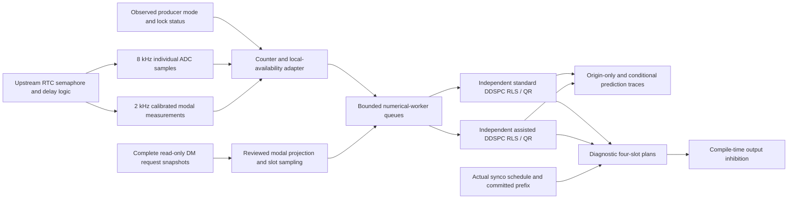

Current native implementation: [PHASE_DDSPC.md](PHASE_DDSPC.md). The numerical results below describe the preceding upstream-contract/WFS-origin milestone, not the new per-ADC phase predictor.

# Upstream-synchronized native DDSPC shadow inputs

2026-11-14. This supersedes the native-input qualification plan in
`ONLINE_SHADOW.md`. Jared's architecture clarification is the input contract:
the acquisition application owns RTC semaphore triggering and delay adjustment.
DDSPC responds to its synchronized 8-kHz ADC and 2-kHz WFS streams. It does not
implement another phase-lock loop or reconstruct physical WFS exposure windows.
The older strict exposure/physical-hold adapter remains for existing recorded-data
and numerical regression tests; the native worker now expects `upstream_sync=true`.

> 2026-11-15: the native binding and existing syncopation producer integration are now
> implemented. See [SYNCO_NATIVE.md](SYNCO_NATIVE.md) for current configuration,
> source evidence, safety and deployment requirements. Earlier numerical results below
> remain an offline qualification record.

## What changed

- Synchronized-mode training no longer requires `source_host_mapping_unqualified`
  to be cleared, physical exposure boundaries, or a reconstructed modal-camera
  parent relationship. The measured modal stream is the WFS indexing reference.
  Unknown camera/modal producer clocks remain diagnostic information.
- `UpstreamSyncContract` defines an incarnation, modal/ADC counter anchors,
  four samples per measured WFS frame, a status timeout, a **1-ms maximum local
  ADC receipt age at the origin**, and eight consecutive valid recovery frames.
  The anchors define the consumer's existing synchronized frame convention;
  they do not estimate clocks or adjust an acquisition delay.
- Every origin supplies actual producer synchronized/locked status and its local
  receipt. Configuring an expectation does not set either status true. The engine
  checks the original four consecutive ADC counters, source/generation/segment,
  finite values and receipt/availability before the frozen origin. No ADC averaging,
  decimation, WFS interpolation or producer-clock subtraction is performed.
- Complete observed command requests are a supported **explicit input domain**.
  They are not labelled physically applied commands. In this domain the model
  represents the request-to-measured-WFS system, including downstream behavior.
  Calibration, history completeness and the command sampling convention still
  require qualification. Physical-input certificates remain a distinct older path.
- Diagnostic WFS forecasts are independent of synco command eligibility. A queued
  forecast uses only data available at its labelled origin, is scored before
  learning its target, and is explicitly marked late if its diagnostic compute
  deadline is missed/unknown. It cannot become an eligible DM plan without real
  synco cutoffs and independently known immutable prefixes.

`DDSPC_SHADOW_ONLY` remains mandatory. Neither the new adapter, worker nor CLI
creates a DM stream, owns a physical interface or publishes a correction.
`loPredCtrl`, `mcp3208Ctrl`, `ad7689Ctrl` and `accelSim` are unchanged.

## The implemented receiver path



`synchronized_inputs.hpp/.cpp` implements production-linkable, platform-independent
record construction:

1. `synchronized_origin()` binds the actual modal snapshot, local availability,
   observed upstream status and expected four ADC counters. It creates no exposure
   times or camera parent ID. Missing ADCs or invalid lock stop only assistance;
   valid WFS and independent command histories can continue the standard fit.
   A zero ADC anchor explicitly leaves assistance unqualified and permits the
   standard model to start without an attached/qualified ADC source.
2. `project_request()` uses the **whole immutable DM image** and a supplied modal
   calibration matrix. It checks extent, source identity, finite values and the
   same FLOAT-bit digest used by `NativeObserver`. The digest does not replace a
   coherent snapshot or prove physical application.
3. `synchronized_commands()` selects original requests at four **actual supplied
   sampling cutoffs**. It rejects gaps, missing initial state, out-of-order data,
   future cutoffs and inconsistent snapshots. A static command can be held across
   all four slots. It waits for the actual next modal frame to close the input
   record. Neither zero inputs nor a controller's own proposals fill missing data.
4. `MultirateShadow::commands()` independently checks source/hash/counter/time
   bindings against retained raw observations, including whether a more recent
   request was already available at each cutoff. Both native models then consume
   the same confirmed **observed request** lift. Internal older field names such
   as `m_assistedAppliedCommand` do not promote request provenance to application.
5. `OnlineShadowWorker` owns the numerical state on its existing ordinary-priority
   bounded-duty thread. `processNativeCommands()` is the application adapter seam.
   The ADC acquisition worker performs no RLS/QR work.

All local receipt times above belong to the observer's monotonic epoch.
`InputStamp.m_clockEpoch` tags that local session in this convention; it is not a
claim that remote acquisition clocks have been mapped. Raw acquisition/publication
markers remain available for audit. The existing ADC transport still validates
its supported timestamp/encoding format; no AD7689 transport changes were made.

Native construction is not enabled by an INDI mode request. The native observer
now forwards original metadata, full request images and actual sampling ticks to
`NativeInputPipeline` on the numerical worker. With the reviewed calibration,
upstream status/reference and counter anchors supplied, it calls these same
factories automatically. Default acquisition remains unchanged and training is
inhibited when the required evidence/calibration is missing. See `SYNCO_NATIVE.md`.

## Native DDSPC mathematics and fair diagnostics

The existing RLS/QR recursions and DDSPC reference solve are unchanged. With `m`
measured modes, `N` WFS history frames, `F` future WFS frames and `Ha` ADC history
frames, the assisted input width is `nu=4m`. Each ADC block has eight values:
four distinct X/Y pairs, newest slot first. Future targets are measured WFS
vectors only, never invented 8-kHz WFS samples.

```text
Yf = A Yp + B Up + D Ap + C Uf
Yp : Nm                       Up : (N-1)nu
Ap : 8Ha                      Uf : Fnu
Yf : Fm                       C  : Fm × Fnu
Theta canonical = [A B D C]    internal = [C B D A]
```

Frame order and slot order are newest first in the numerical matrices. Native
adapters accept chronological slot-major commands and reverse them explicitly.
The regularized control solve remains
`(C^T C + lambda I) Uf = -C^T [A B D] x`, with immutable committed-prefix columns
handled separately. This is DDSPC, not EOF.

Two metrics are deliberately retained:

- **Primary origin-only forecast:** `[A B D]_origin x_origin + C_origin Uf_hold`,
  where `Uf_hold` repeats the last independently observed input frame. It is
  computed/frozen at the origin. No actual future commands or measurements enter
  it. Unknown future AO activity contributes to its error. The held input is an
  explicit diagnostic assumption, never a training input or actuator command.
- **Auxiliary conditional diagnostic:** frozen coefficients/state evaluated with
  the later observed `Uf_actual`. This remains useful for identification, but can
  benefit from future AO feedback embedded in those commands and must not be
  presented as an origin-available forecast.

Tests alter future WFS targets and actual future commands independently: past
origin-only forecasts stay bit-identical. Conditional forecasts are expected to
change when future inputs change. Native compact `standard_rmse` and
`assisted_rmse` now report the primary origin-only metric when available.

For a comparison differing only in ADC regressors, use `standard_slots=4` in the
explicit matched lifted baseline. `standard_slots=1` retains the existing
single-rate causal-shadow dimensions and admits only a constant input over the
four slots. It cannot silently average varying inputs. The operational Legacy
`loPredCtrl` algorithm/output is untouched; its known differences from the
pre-existing causal-shadow convention remain documented in `ONLINE_SHADOW.md`.

Empirical normalized-regressor rank and finite numerical checks remain required.
Four identical held 2-kHz input values cannot identify four independent slot
responses. Training updates may advance while a fit is still unexcited; readiness
and valid predictions are not fabricated. Observed-subspace prediction versus
independent 8-kHz control readiness would require a separately reviewed extension.

## Available upstream and DM evidence

Source review is local/read-only; it does not attest an installed executable:

| Evidence | Source | Interpretation |
| --- | --- | --- |
| Actual camera DMA marker | `libMagAOX/app/dev/edtCamera.hpp:549-558` | SDK `pdv_wait_last_image_timed`; not an exposure start/end marker. No longer required for the synchronized-modal training convention. |
| Camera publication/counters | `libMagAOX/app/dev/frameGrabber.hpp:1018-1041` | REALTIME publication, inherited acquisition marker, independent `cnt0`, circular-plane `cnt1`. |
| RTC notification | `apps/ocam2KCtrl/ocam2KCtrl.hpp:1716-1739` | `camwfs_sync` preserves camera timestamps/counter and posts a semaphore. Upstream acquisition owns its use and delay correction. |
| Modal producer | Reference CACAO `cacao-fpslistadd-MVMGPU_WFS2CMODEVAL:12-38`; MILK `MVMextractModes.c:958,1085` | Conventional `wfs2cmodeval / MVMmextrmodes` writes `aol1_modevalWFS`. DDSPC uses the measured modal counter; it need not infer camera parents to learn this measurement sequence. |
| Alternate reconstruction | `apps/nnReconstructor/nnReconstructor.hpp:702-706` | Callback REALTIME marker, not a camera exposure. Active producer and modal calibration still need correct identification. |
| Producer synchronized-mode status | `MagAOX@9d4c5a99:apps/accelSim/accelSim.hpp:80-103,641,735-763` | `timingDiag.mode_code=1` means semaphore mode; `delay_lock`, `local_frame_seq`, `sync_producer_frame_id`, gap/drop counts and `sim_diag.source_period_ratio` provide observable checks. Timer mode is `mode_code=0`. Do not set receiver status true from FPS alone. |
| Combined request path | Reference RTC `fpssetup.setval.tweeter-vispyr.conf:5-15` | DM combiner trigger/configuration, not proof of which installed writer or hardware update consumed each request. Record actual combined publications. |
| BMC limiting and submission | `apps/bmcCtrl/bmcCtrl.hpp:465-509` | Scaling/clipping/square-root voltage conversion; `m_outputShape.post()` occurs **before** `BMCSetArray`. Even a shape publication is not SDK success or physical settling. |
| Completion protocol | `libMagAOX/common/dmCompletion.hpp:38-80` | Input identity, MONOTONIC software/SDK endpoints; protocol expressly excludes physical mirror settling. Current checkpoint's BMC path does not provide these newer endpoints. |

Reference CACAO/MILK source revisions and immutable links are recorded in
`NATIVE_TIMESTAMP_PROVENANCE.md`. They are source evidence, not an installed-build
claim. The earlier proposed exposure/host reconstruction is not a prerequisite
for the upstream-synchronized DDSPC path.

## Synco remains a separate output interface

Locally available Git object `origin/jrmales/dm-syncopation` is
`bb5a5d89c594bc7949af2949f457a1520b7a3845`:

- `apps/dmSyncopation/dmSyncopation.hpp:2868-2905` advertises epoch/generation,
  reference cycle, expiry, individual targets and input-ready cutoffs. Read those
  immutable requests; do not infer readiness by subtracting 110 us from 125 us.
- `libMagAOX/app/dev/dmSyncopationProducer.hpp:124-140,473-532` defines `poll`,
  exact slot tagging, `_ready` commit and matching `_ack`. Acknowledgement releases
  buffer ownership after snapshot/discard, independently of physical consumption.
- Commands must be prepared before the **advertised input-ready cutoff**, tagged
  with the same schedule incarnation/cycle/step/target/cutoff, and never overwrite
  a committed payload before acknowledgement. Reset/expiry invalidates a pending
  plan. Approximately 15 us nominal write-slot slack is not a compute budget.

The subsequent native milestone in `SYNCO_NATIVE.md` includes the unchanged
producer base and its lifecycle/configuration macros, with no poll/publish calls
or auxiliary transport activation. It prepares private payloads for the actual
Requests. Future active integration must also match the trained command domain,
sampling phases, calibration and response delay to that scheduler. Requested-input
shadow fits do not qualify physically applied responses or authorize a control
handoff. Neither a queued forecast nor the development worker timing establishes
four 125-us output deadlines.

## Reproduce the offline native test

On a personal/development machine, from the repository root:

```sh
make -C apps/loPredCtrlAcc -f tests/Makefile.offline -j2 \
  BUILD_DIR=build/qualified-shadow check-multirate qualified-replay
python3 apps/loPredCtrlAcc/tests/qualified_shadow_report.py \
  --binary apps/loPredCtrlAcc/build/qualified-shadow/qualified-cli/ddspc_qualified_replay \
  --output apps/loPredCtrlAcc/build/qualified-shadow/my-upstream-report \
  --seeds 73 91 107 --horizons 1 2 4 8 --frames 5000 --warmup 1500
```

Output must be new. The report driver refuses numerical execution on `exao*`.
It uses the existing `SyntheticAdcSource` and actual `AdcCapture` calibration,
8-kHz raw UINT16 samples, a declared causal two-mode test system, measured 2-kHz
targets and independently generated limited four-slot command inputs. No model
proposal drives that system. Synthetic forcing is a software positive control,
not a replacement for accelSim and not an optical MagAO-X simulation.

Artifacts include per-axis/per-horizon `metrics.csv`, origin and conditional
`predictions.csv`, gap-aware Hann `psd.csv`, independent coefficients,
`compute.csv` with whole-frame/model-job timings and readiness/rank, and explicit
`synthetic_requested / live_qualified=false / deadline_qualified=false` summaries.
Spectral windows never cross missing forecast origins; the largest usable
power-of-two window up to 2048 is chosen, and insufficient coverage is reported.
Both models use exactly the same scored targets within each comparison.
Unrelated ADC runs retain bit-identical standard fits and WFS targets.

## Workstation validation results

All executions were local on `ASTR-LT-428.local`, with Eigen 5 and no live stream,
INDI server or native application. The application-header tests use explicit
framework/ImageStreamIO doubles and real INDI property implementations. This is
not a fresh Linux/ImageStreamIO executable build.

| Check | Result |
| --- | --- |
| Full numerical/application regression (`check`) | 155 cases, 3,044,306 assertions passed; historical `loPredCtrl` files match all 15 reference digests |
| Native observation/ADC/application guard suite | 57 cases, 14,297 assertions passed |
| Existing confirmed-input accelSim numerical replay | 6 cases, 40,049 assertions passed |
| Native tools/timing/deployment/Linux-build-tool Python tests | 45 distinct tests passed |
| AddressSanitizer + UndefinedBehaviorSanitizer, multirate/native-app subset | 29 cases, 779,787 assertions passed, no sanitizer findings |
| New report integrity tests | 3 Python tests passed |

The new cases include missing ADC anchors, producer timer mode, incorrect counter
phase, future ADC delivery, lock loss/recovery, incomplete command evidence,
deficient excitation, immutable forecasts under future-target/input changes and
bounded diagnostic overflow. Existing rectangular indexing, restart, nonfinite
input, model independence, switching and compile-time safety tests also pass.

The report under `build/qualified-shadow/upstream-report-final/` contains 48
synthetic runs: seeds 73/91/107, QR and covariance RLS, F=1/2/4/8, coherent and
unrelated ADCs, 5000 frames and 1500 warm-up origins. Both models reach full rank
in all positive/negative-control report runs; ADC and diagnostic losses are zero.
Below are means over the three seeds and two learners at the terminal horizon
`h=F`. Units are the declared synthetic modal units, not calibrated on-sky units.

| F | Axis | Standard origin-only RMSE | Assisted origin-only RMSE | MSE improvement | Unrelated-ADC MSE improvement |
| --- | --- | ---: | ---: | ---: | ---: |
| 1 | tip | 0.132701 | 0.123812 | 12.95% | -0.09% |
| 1 | tilt | 0.134605 | 0.124611 | 14.28% | +0.07% |
| 2 | tip | 0.167665 | 0.163626 | 4.76% | -0.03% |
| 2 | tilt | 0.168903 | 0.163822 | 5.93% | +0.11% |
| 4 | tip | 0.185275 | 0.182384 | 3.09% | -0.09% |
| 4 | tilt | 0.188342 | 0.184192 | 4.36% | +0.08% |
| 8 | tip | 0.190463 | 0.185877 | 4.74% | -0.29% |
| 8 | tilt | 0.197846 | 0.193346 | 4.46% | -0.05% |

At F=1, coherent-ADC origin-only error-band power decreases by about 99.0/99.7%
(tip/tilt) around 28.5 Hz and 99.3/99.0% around 56 Hz in this constructed system.
At F=8, the corresponding reductions are 61.1/40.1% and 46.1/11.3%. These are
**prediction-error** PSD comparisons, not corrected WFS residuals or telescope
vibration suppression. The unrelated controls show near-zero overall gain and
some local spectral worsening. A synthetic 56-Hz pass does not resolve earlier
56-Hz degradation in a different plant/model/tuning experiment.

Unpaced whole-frame mean times range from 16.8 to 201.5 us across report cases.
Model-job means range from 14.9 to 198.9 us; the largest case p99 is 247.4 us and
the observed maximum is 1928.7 us. These include native record/model work but
exclude operating-system acquisition scheduling and a live synco interface. They
are neither WCET nor a 125-us deadline qualification. The existing bounded worker
still inhibits on budget faults; its default 1-ms single-job budget would reject
such a tail. Authorised Linux profiling is needed before any cadence guarantee.
Offline trace retention is bounded by the declared frame count (largest report
allocation 15,360,000 bytes); the optional native scalar queue is independently
capped at 65,536 records and disabled by default.

Reproduce the acceptance and sanitizer suites without launching a native app:

```sh
make -C apps/loPredCtrlAcc -f tests/Makefile.offline -j2 \
  BUILD_DIR=build/compact-regression check check-native-observation check-confirmed-replay
make -C apps/loPredCtrlAcc -f tests/Makefile.offline -j2 \
  BUILD_DIR=build/upstream-shadow-asan \
  CXXFLAGS='-O1 -g -std=c++20 -Wall -Wextra -fno-fast-math -fsanitize=address,undefined -fno-omit-frame-pointer' \
  check-multirate
```

`check-confirmed-replay` reads the platform-independent simulator header in the
adjacent `../MagAOX` checkout; set `MAGAOX_REPO=/path/to/MagAOX` if necessary. It
does not start accelSim. Generated numerical artifacts stay under ignored `build/`.

## Remaining native bridge and experiment admission

The native receiver now calls the reusable factories automatically, without the
obsolete input clock/exposure requirements. Before qualifying **native** training,
supply and review:

1. The actual producer/reference identity and its synchronized/locked status,
   coherent source incarnations, and the consumer's four-to-one counter anchors.
   A rate near 8 kHz is insufficient by itself. Upstream delay/phase control stays
   entirely outside DDSPC; no mcp3208Ctrl/ad7689Ctrl change is requested here.
2. A reviewed full-DM-image to selected-WFS-mode projection, including units,
   signs and active modal indices. The repository does not identify the active
   exao2 calibration. Two DM pixels cannot stand in for this projection.
3. A complete observed command-history sampling operator with actual four slot
   cutoffs and original snapshot identities. Observer receipt is not physical
   application. Do not invent slot times from WFS exposure/publication markers.
4. An explicit choice of control-input versus externally injected disturbance
   channels, plus sufficient empirical excitation for the selected lifted model.
   See `ACCELSIM_SHADOW_EXPERIMENT.md` before interpreting an ADC benefit.

The live callback plumbing now supplies this bundle through `NativeInputPipeline`;
no application subclass or hand-injected origin packets are required. Actual
instrument calibration, reference/anchor provenance and input-domain choice still
must be supplied. Physical WFS exposure reconstruction and an independent ACC-WFS
synchronizer are not prerequisites. No install/restart/injection instruction is
executed by this work. A new Linux/GCC build and bounded authorized commissioning
remain necessary; see `SYNCO_NATIVE.md` for current readiness and validation.
