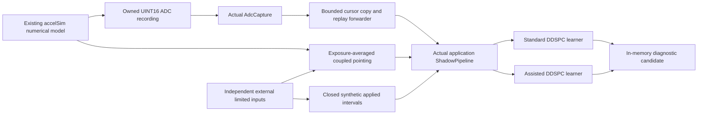

# Confirmed-input shadow replay

2026-11-13; branch `parkertjohnson1/accel_ddspc`, based on `c18b81c5`.
This stage proves the existing application's shadow learning/prediction path with
explicitly synthetic timing and applied-input evidence. It leaves native startup,
WFS callbacks, ADC calibration, Legacy dispatch and all DDSPC equations unchanged.
The reported lossless exao2 ADC test and repaired accelSim disturbance injection
remain the intended live sources. No replacement disturbance generator or AO
application is introduced.

## Smallest native integration and remaining evidence

| Path | Existing implementation | Minimum remaining work before native training |
|---|---|---|
| ADC capture | `AdcCapture` calibrates and retains timestamped samples; `AdcReader` owns/locks it. New [`copy_after()`](../adc_input.cpp#L348) copies bounded batches into caller storage. | A serialized, opt-in shadow frontend must pump the reader before a WFS origin, using an independently qualified clock/calibration contract. The offline adapter demonstrates this; native lifecycle wiring is deferred. |
| WFS | [`processShadowWfs()`](../loPredCtrlAcc.hpp#L1188) already accepts `TimedWfsRecord`. The [raw callback](../loPredCtrlAcc.hpp#L2116) deliberately invalidates models because timing/applied-input evidence is absent. | Identify the actual residual producer and calibrated tip/tilt ordering/units. Establish exposure start/end, association to its source counter, publication and local receipt, clock epoch and uncertainty. Take a stable owned payload/metadata snapshot. Freeze the decision at actual dispatch; never backdate it. |
| Applied input | [`processShadowApplied()`](../loPredCtrlAcc.hpp#L1202) feeds the existing builder. | Establish the combined input consumed by the driver, after channel combination, limiting and mapping; project it into the same residual modes/units/sign. Associate driver consumption/acknowledgment with the exact source frame. Independently bound the effective optical interval/response lag. A requested value or SDK acceptance alone does not certify application. |
| ADC feature/prediction | [`ShadowPipeline::push_wfs()`](../shadow_pipeline.cpp#L181) freezes the existing timestamp window, trains paired records, and predicts both models. | Reuse it unchanged. Do not route UINT16 into the older FLOAT accelerometer callback or supply fabricated prebuilt features. |
| Diagnostics | [`setupShadowINDI()`](../loPredCtrlAcc.hpp#L1352) already exposes each model's readiness, updates, rank, predictions/RMSE, input validity/provenance and requested/effective candidate state. | Later add bounded-forwarding copied/rejected/missing/pending counts and mapping identity/uncertainty to the private shadow instance. Keep original capture loss distinct. |

`dm10` is an injected contribution, not the sum actually applied to the DM.
[`dmRecon::processImage()`](../../dmRecon/dmRecon.hpp#L1008) projects a command image
into modes and timestamps its callback; that does not make it a timed optical WFS
residual. [`bmcCtrl::commandDM()`](../../bmcCtrl/bmcCtrl.hpp#L452) prepares/clips/maps
inputs and posts `_shape` at line 502 **before** calling `BMCSetArray()` at line 509.
That stream alone cannot be labeled `VerifiedApplied`.

The generic [`shmimMonitor`](../../../libMagAOX/app/dev/shmimMonitor.hpp#L715)
callback receives a payload pointer without a qualified exposure envelope. The
[`frameGrabber`](../../../libMagAOX/app/dev/frameGrabber.hpp#L1016) publishes
`atime`, `writetime`, `cnt0` and (for temporal cubes) per-plane arrays, but the
producer determines what acquisition time means. ADC [native capture](../adc_reader.cpp#L172)
preserves these counters/timestamps and maps REALTIME into MONOTONIC; it does not
establish a WFS exposure interval. `AdcSample` currently does not carry a
per-sample mapping epoch/error bound. A native adapter must propagate verified
mapping evidence or extend that metadata before qualifying it; the replay's
20-ns bound is synthetic and must never become a native default assertion.

[`CausalInputBuilder`](../causal_input.cpp#L187) requires closed, confirmed,
consecutive constant-input intervals. Its [pairing](../causal_input.cpp#L233)
requires complete coverage of the target exposure shifted by response lag and
expanded by uncertainty. It rejects ambiguous transitions and unsupported
latency. A hold ending after the decision cannot be certified in advance.
Qualified completed prefixes or a separately reviewed latency/availability
contract would be needed if native evidence cannot arrive before the next
origin. Do not infer consumption from matching publication counters.

## Implemented scope and data flow



Only four production source files change: additive cursor-copy declarations and
implementations in `adc_input.*` and `adc_reader.*`. No native code calls the new
API yet. [`AdcForwarder`](adc_forwarder.hpp) is replay-only, single-consumer, with
preallocated batches of 8 samples and at most 4 copies per dispatch (32 samples).
The reader lock is released before application/model locks are acquired. Normal
forwarding occurs once per 500-us WFS origin, with 4 new ADC samples per origin.

The copy preserves original raw codes, mapped and producer timestamps,
generation and segment. Its coherent status retains device/inode, geometry and
capture counters. A source change or unavailable history explicitly invalidates
assistance before delivering the new segment. `m_missing` counts unavailable
source counters only after a retained baseline in the same incarnation; startup
history and cross-restart loss are unknown. It can overlap decoder rejection or
source-loss counters, so do not sum them. Capture `overwrites` alone is normal
bounded retention and does not prove a consumer missed a sample.

Each cursor is bound to one capture/reader lifetime. Keep its next position even
for empty discontinuity batches. ADC-only loss invalidates assisted features;
common WFS/input loss invalidates both histories. Recovery uses the unchanged
readiness/rank gates and 10 consecutive qualified assisted decisions. Neither
model ready means no valid diagnostic candidate (`shadowCandidate()` returns
false/zeros); the policy bounds its internal continuity state. There is no
physical hold/zero command or actuator action.

## Synthetic recording and causality contract

[`record_accelsim()`](confirmed_replay.cpp#L65) includes only the real simulator's
platform-independent `accelSimModel.hpp`, from the separate simulator worktree.
It uses `accelSimDetail::model`, `referenceModes()` (all 214 modes),8-kHz sampling,
seed 721 and the unchanged `accelSim12` encoder. It does not link/start accelSim,
its DM interface or another native application. The simulator worktree used here
is `parkertjohnson1/accelSim` at `9d4c5a99`.

All ADC, WFS and input records are generated before callbacks. The generator has
only an input sink interface and cannot read a shadow proposal. The synthetic
optical input response is explicitly a fixed-gain modal response with 50-us lag,
not a model of tweeter dynamics or an on-instrument timing measurement. WFS is a
200-us zero-order-held exposure average of the same model's `m_wfsPointing`, plus
independent WFS noise and the consumed limited input. Its fixed normalization is
the configured 28-Hz oscillator's pointing RMS; it uses no future-data statistics.
ADC acceleration remains SI. No predictor receives latent pointing/model state.
Runs are deterministic for a fixed source/toolchain. For cross-compiler exact
comparisons, retain the raw records and source/library versions as well as seeds:
`std::normal_distribution` is implementation-dependent.

For WFS exposure start `s_i = 1e9 + i*500000` (ns):

| Event | Known synthetic time/value |
|---|---|
| ADC acquisition |125-us spacing, starting500us before first WFS exposure |
| ADC publication / decoder receipt | acquisition+1us / acquisition+3us |
| WFS exposure |`[s_i, s_i+200us)` |
| WFS publication / receipt / decision |`s_i+210us` / `s_i+220us` / `s_i+250us` |
| Independent external request |`s_i+50us`; Gaussian amplitude.6 in normalized units |
| Actual limited input `u_i` | request clipped to`[-.4,.4]`, effective`[s_i+150us,s_i+650us)` |
| Input certificate publication / receipt | hold end+10us / hold end+20us |
| Measured WFS residual `y_i` | exposure average +`u_(i-1)` + independent noise (zero prior input at first exposure) |

External requests may precede the shadow decision because they are independent
forcing, not shadow commands. The lag-adjusted target exposure for origin`i` is
`[s_i+450us,s_i+650us)`. Its consumed`u_i` is confirmed at`s_i+670us`, before the
next frozen origin at`s_i+750us`. Thus the builder can complete historical
`(y_i,u_i,a_i)` while predicting at the current origin, without using future
measurements. The final unclosed input is deliberately never admitted.

The existing ADC aggregation uses timestamp-defined 500-us windows, maximum gap
175 us and effective age 500 us. Frontend availability is the forwarding time,
separate from the original decoder receipt. Catch-up records cannot retroactively
qualify old origins. The 20-ms ADC transport freshness setting grants no
prediction validity. The regression suite also retains jitter, delivery-latency
and independent-cadence-drift tests from the existing infrastructure.

## Build and run locally

Dependencies are a C++20 compiler, existing Eigen/mxlib headers via `pkg-config`,
Python 3 and the read-only simulator worktree containing `accelSimModel.hpp`.
Build artifacts go only into the application's ignored `build/` tree. The tests
use actual INDI value classes, the actual application header/controller and
explicit stream-free lifecycle/ImageStreamIO API doubles; no server or native
shared-memory stream is needed. The ADC worker API-double tests use private
ordinary temporary files, not operational shared memory.

```bash
cd "$HOME/source/MagAOX-DDSPC/apps/loPredCtrlAcc"
make -f tests/Makefile.offline -j4 check-confirmed-replay \
    MAGAOX_REPO="$HOME/source/MagAOX"
make -f tests/Makefile.offline -j4 check-adc
make -f tests/Makefile.offline -j4 check
make -f tests/Makefile.adc-ddspc -j4 check

# Existing guarded app tests plus the new replay, in the same shadow-only binary:
build/offline/confirmed-replay/ddspc_offline_test \
    '[loPredCtrlAcc][app]~[legacy],[confirmed-replay]'

# Address/undefined and thread sanitizers use separate build directories.
make -f tests/Makefile.offline -j4 BUILD_DIR=build/confirmed-asan \
    CXXFLAGS='-O1 -g -std=c++20 -Wall -Wextra -fno-fast-math -fsanitize=address,undefined -fno-omit-frame-pointer' \
    check-adc check-confirmed-replay
build/confirmed-asan/confirmed-replay/ddspc_offline_test \
    '[loPredCtrlAcc][app]~[legacy],[confirmed-replay]'
make -f tests/Makefile.offline -j4 BUILD_DIR=build/confirmed-tsan \
    CXXFLAGS='-O1 -g -std=c++20 -Wall -Wextra -fno-fast-math -fsanitize=thread -fno-omit-frame-pointer' \
    check-adc check-confirmed-replay
build/confirmed-tsan/confirmed-replay/ddspc_offline_test \
    '[loPredCtrlAcc][app]~[legacy],[confirmed-replay]'
```

The optional replay target is separate so ordinary offline tests do not acquire
a dependency on another branch/worktree. The test source also refuses to compile
without `DDSPC_SHADOW_ONLY`. No install, native app launch or service action is
part of these commands.

## Validation results

Personal Mac `ASTR-LT-428.local`, Apple Clang, strict C++20, Eigen 5.0.1, mxlib 0.2.0.
This is not a native GCC 14/Eigen 3.4/ImageStreamIO integration qualification.

| Check | Result |
|---|---|
| Full existing offline regression including new ADC cursor tests | 116 cases;2,259,267 assertions; pass |
| Actual capture/worker/synthetic ADC tests | 15 cases; 448,098 assertions; pass |
| Dedicated ADC/DDSPC suite | 13 ADC + 25 numeric + 21 guarded app cases; 2 configuration + 2 CLI tests; pass |
| New confirmed-model replay | 6 cases; 40,049 assertions (multiple independent-switch/fault subscenarios); pass |
| Guarded existing app + new replay | 27 cases; 50,374 assertions; pass |
| Address/undefined sanitizers | ADC tests and guarded app/replay; pass, no sanitizer findings |
| Thread sanitizer | ADC worker/cursor and guarded app/replay including diagnostic-reader concurrency; pass, no sanitizer findings |
| Formatting / whitespace | clang-format on all touched C++;`git diff --check` clean |

New cases cover no/standard-only/assisted-only/both training, complete readiness
and prediction, bounded forwarding, retained-buffer catch-up, consumer overflow,
source replacement, invalid rails, late ADC, wrong clocks, WFS loss, rejected
prepared-input records, common-input recovery, and mutation of future records.
They check unconditional output rejection even with an inconsistent runtime
shadow flag, inactive Legacy/output helpers, source identity/timestamp retention,
and no input-candidate feedback.

An 800-frame nominal replay produced 3,202 accepted/forwarded ADC records at 8 kHz,
zero decoder drops/invalids/restarts, zero forwarding loss, 800 admitted WFS
records and 799 admitted closed input intervals. The 2-mode learners use history 4,
horizon 3, ADC history 3, QR, gamma .9995, prior .001 and command penalty .1.

| Evidence | WFS-only | Assisted |
|---|---:|---:|
| Identification updates | 793 | 793 |
| Final feature rank | 20/20 | 26/26 |
| Retrospective conditional forecast evaluations | 769 | 760 |
| Cumulative forecast RMSE (normalized modal units) | 0.229582 | 0.199657 |

There were 774 valid diagnostic candidates, 709 assisted. Readiness can decline
on individual rank-deficient windows even after training; tests preserve that
behavior. RMSE is the existing conditional forecast diagnostic, evaluated using
subsequently confirmed inputs, not an autonomous forecast or closed-loop result.
It does not establish vibration suppression or 56-Hz improvement.

ADC-only perturbations during learning leave the standard prediction matrix
bit-for-bit identical and change the assisted fit. With both fits frozen before
an ADC-only 3-count perturbation, standard candidates remain bit-for-bit
identical while assisted candidates differ (summed squared difference 0.0152043
over jointly qualified comparison frames). All altered samples pass through the
actual decoder; default replay never clips away source rail evidence.

An idle-workstation strict-build rerun measured 16.385 us mean, 19.041 us p99 and
32.624 us maximum callback work per nominal 500-us origin. This sums decoder,
forwarder, confirmation and WFS processing, including fixture observation copies.
It excludes record generation/startup, OS pacing and native I/O latency and is
not a real-time deadline qualification. The small test dimensions also do not
establish performance for a larger operational mode count.

## Before any native training proposal

1. Review the additive API and replay evidence. Preserve the validated ADC-only
   configuration and all compile-time output guards.
2. Establish the actual WFS stream's exposure/frame/units/clock contract and the
   independent combined-applied-input/optical-delay evidence described above.
   Obtain these through operator-supplied records; do not start instrument tools
   from this development environment.
3. Replay those owned records offline, including coverage/uncertainty and loss
   checks. Require both training counters, independent rank/readiness, origin
   freshness and candidate validity to advance; input-stream validity alone is
   insufficient. Repeat held-out sensor ablations and band-resolved diagnostics,
   especially 56 Hz, before interpreting any performance benefit.
4. Only after that review, extract the replay forwarding dispatch into a native
   input-only frontend behind the existing disabled-by-default shadow flag.
   Add bounded forwarding/mapping diagnostics and native lifecycle/shutdown tests.
   Rebuild privately against the target Linux dependencies and recheck guards.

## Changed files

All application paths below are relative to `apps/loPredCtrlAcc/`:

- `adc_input.hpp`, `adc_input.cpp`, `adc_reader.hpp`, `adc_reader.cpp`: additive bounded cursor-copy API.
- `tests/adc_forwarder.hpp`, `tests/adc_forwarder.cpp`: replay-only forwarding and loss/provenance diagnostics.
- `tests/confirmed_replay.hpp`, `tests/confirmed_replay.cpp`: actual accelSim-model recording and passive dispatch.
- `tests/confirmed_replay_test.cpp`: guarded application, ablation, causality and recovery tests.
- `tests/ddspc_adc_test.cpp`, `tests/ddspc_adc_transport_test.cpp`: capture and actual-worker cursor checks.
- `tests/shadow_app_test_support.hpp`: independent training-switch control, preserving the default both-enabled helper.
- `tests/Makefile.offline`: optional simulator-model replay target.
- `tests/CONFIRMED_REPLAY.md` and repository `agents/plans/2026-11/accel-ddspc-confirmed-replay.md`: review, commands and execution record.

No native WFS/applied-input adapter, operational configuration, installed binary,
producer, original `loPredCtrl`, numerical algorithm or tracked result is changed
by this work. No live stream, INDI server, DM or hardware service was contacted.
