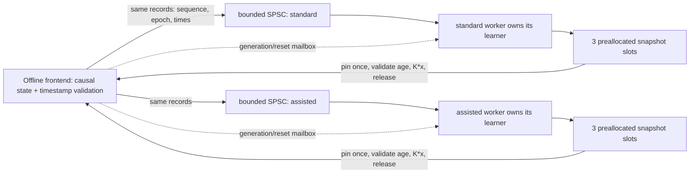
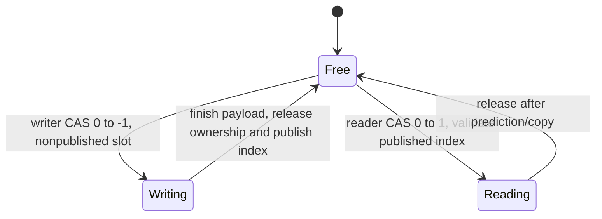

# Offline DDSPC validation

The normal installed executable now defaults to continuous native read-only input
acquisition with mandatory `DDSPC_SHADOW_ONLY` guards. See
[NATIVE_APPLICATION.md](../NATIVE_APPLICATION.md) for build, xctrl/INDI registration,
diagnostics, commissioning and qualification limits. Its focused local checks are:

```sh
make -C apps/loPredCtrlAcc -f tests/Makefile.offline -j2 \
  BUILD_DIR=build/native-app-integration check-native-observation
```

The numerical DDSPC implementations and historical Legacy test adapters are
preserved. The installed native entrypoint cannot activate Legacy, training or
physical output. Historical handoff/results descriptions below predate that
entrypoint change; their test counts are not current native acceptance results.

The reusable components and opt-in actual-application replay integration are
covered in [SHADOW_PIPELINE.md](../SHADOW_PIPELINE.md). The reusable base-class
pipeline remains opt-in; `parameters.shadow_pipeline` defaults false. Local tests
exercise actual app/model code using stream-free lifecycle doubles and independently
established synthetic applied-input intervals. The replay has no command writer.
Use `make -f tests/Makefile.replay check` from the application directory for the
2-kHz WFS/8-kHz ADC application-workload timing and shared allocation checks.
No native source/provenance adapter or real-time scheduling guarantee is implied.

For the self-contained current ADC-to-DDSPC path, use
[OFFLINE_ADC_DDSPC.md](../OFFLINE_ADC_DDSPC.md). It audits the existing boundaries
and provides the dedicated `tests/Makefile.adc-ddspc` target, synthetic 8-kHz raw
input, actual 2-kHz learners/plant experiment, safety checks and CSV diagnostics.
It requires no accelSim, external worktree, running server or native streams.
Leave accelSim disabled. Production behavior and tracked historical results are
unchanged by this test infrastructure.

The current offline fallback and timestamp-window implementation is described in
[OFFLINE_FALLBACK.md](../OFFLINE_FALLBACK.md). It adds requested/effective modes,
standard-model fallback, a bounded safe ramp, hysteresis and slew limits, plus a
24-scenario comparison target (`make -f tests/Makefile.adc-ddspc comparison` from
the app directory). Only test harnesses apply this policy; native behavior is
unchanged. CSV outputs record every decision and transition reason.

**Stage 1 native ADC capture:** see [ADC_INPUT.md](../ADC_INPUT.md) and the
[opt-in shadow ADC example](../examples/loPredCtrlAcc-adc-shadow.conf.example).
The existing-only UINT16 reader now provides calibrated, timestamped bounded
retention and ADC diagnostics. Safe local tests use an explicit ImageStreamIO
API double; no native application or instrument stream is launched. ADC health
never certifies WFS/applied-input timing or trains either model. The earlier
handoff/results below predate Stage 1 and remain historical evidence.

Run on a personal workstation or isolated development environment. Nothing here
requires instrument access, running the native application, or mounting DM streams.
The numerical executables link Eigen and the existing mxlib headers; application
tests use stream-free lifecycle doubles and real INDI property objects.

For the **manual exao2 handoff**, read [EXAO2_TESTING.md](../EXAO2_TESTING.md)
and the [attachment-only example](../examples/loPredCtrlAcc-shadow.conf.example).
**Live accelerometer-assisted prediction is blocked**: native shadow still has no
applied-command reader or exposure/clock adapter; Stage 1 adds ADC capture only. WFS
callbacks invalidate models rather than invent those records. The guide is a
conditional native-build/WFS-attachment procedure, not a DM enable procedure.

`DDSPC_SHADOW_ONLY=yes` adds a compile-time guard refusing missing/false shadow
configuration before helpers start and implies a strict shadow build. The Linux
build helper now stages this guarded profile and explicitly selects C++20;
actual Linux linking remains unverified here. Installed builds now force the guard
and native observation defaults described above. The optional `legacy_copy_gain_compat=false` fixes loading of
`copy_gain`; default true preserves existing Legacy output and old config behavior.

```sh
make -C apps/loPredCtrlAcc -f tests/Makefile.offline check
make -C apps/loPredCtrlAcc -f tests/Makefile.offline -j2 check-shadow-only
python3 -m unittest discover -s apps/loPredCtrlAcc/tests -p handoff_config_test.py -v
```

The current handoff adds four cases to the prior69: exact opt-in/default copy
loading and two-mode bypass output; compiled startup refusal; invalid WFS and
unsupported ADC input inhibition; and finite two-feature QR proposals at the
provided15/3 dimensions under the reference-law norm bound. Both strict compiler
suites and Clang ASan/UBSan pass73 cases; the separate guarded application
binaries pass7 cases per compiler. Eight build-orchestration tests and the
example-config test pass. The full31-case focused Python simulation/config suite
also passes with both local compiler libraries. Clang's nine historical fast-math
Legacy cases pass separately. No new ensemble experiment or
controller optimization was run. [Validation](results/exao2_handoff.json) records
the exact scope, hashes and native-build limitation.

For the **operational-parameter correspondence audit and paired baseline**, run:

```sh
python apps/loPredCtrlAcc/tests/operational_baseline.py
```

[Parameter meanings, results and operational limits](results/operational_baseline.md)
explain why the earlier short-history headless run is not an operational replay.
This offline-only profile uses WFS15, F3, two modes, QR, gamma1, information
prior1e-5, and a test-only adapter for Legacy's scaled regularization100 plus
additive .3 current-WFS feedback. `copy_gain` is inactive in prediction; its
existing clone loading discrepancy is characterized without a production fix.
The new law is opt-in via `LEGACY_LAW=1`; original numerical/production paths
and old simulation defaults are unchanged. Optional offline build flags are
`WFS_HISTORY`, `QR_GAMMA`, `CONTROL_PENALTY`, `FEEDBACK_GAIN`, alongside the prior
calibration/ADC-history/information-prior flags. Use separate build directories
for different flags, since Make does not track command-line flag changes.

The eight previously recorded source realizations, ADC0/1 encoding, calibration
0–4s, evaluation12–16s, synthetic positive plant and two-frame delay are preserved.
Future3 is a three-target horizon, not a three-frame DM delay. The excerpt omits
integration/runtime state and signed modal calibration; absolute commands and
integration off are labeled assumptions. Historical calculated-command indexing
is not copied into the corrected causal learner. No exact on-sky equivalence is
claimed. Diagnostic export of an unready fit is explicit opt-in and does not
bypass native correction gates.

After rebuilding the existing test libraries for the additional read-only history
metadata ABI, add `operational_baseline_test` to the focused command below:
**30 focused tests per compiler**, including native15-sample dimensions, law
exports, two-frame poles and rejected unready corrections. The **69-case strict
suite** adds three regressions covering actual pinned Legacy algebra, the
distinction between scaled/literal penalties and the real clone config loader.
Clang ASan/UBSan also passes the full69-case suite.
The provided INI is an offline fixture only; no operational configuration is read.

For the **eight independent-realization fixed-policy comparison**, run:

```sh
python apps/loPredCtrlAcc/tests/independent_realizations.py
```

Eight predefined source seeds vary initial phases/innovations. Each uses the same
four-second calibration and12–16s evaluation for no control, standard, H5 and H1.
Reference/100× cases retain the existing noise/encoding/plant/timing parameters.
No per-seed tuning. A recorded actual ADC0/1/pointing source bank allows GCC to
replay precisely the Clang inputs, separating compiler effects from seed variation.
[Results, paired statistics, intervals and time/PSD plots](results/independent_realizations.md)
show no reproducible total-RMS advantage: each assisted model wins1/8 high-signal
trials and worsens mean RMS. Secondary broadband/56-Hz gains do not remove the
vibration-line tradeoffs. No assisted configuration is recommended for integration.

Optional source/probe/WFS seeds in `simulation_demo.py` preserve previous defaults.
Five new tests verify seeded phase replay, unchanged default traces, spectral
integration and per-realization paired statistics. After the existing libraries
are built, all26 focused cases run with:

```sh
PYTHONPATH=apps/loPredCtrlAcc/tests python -m unittest \
  simulation_demo_test sim_shmim_test prediction_information_test \
  calibration_generalization_test independent_realizations_test -v
```

The linked report gives the matched-input GNU repeat. Bootstrap intervals resample
whole independent trials, not WFS frames; compiler/amplitude replays are not new
independent samples. No controller architecture, algorithm, operational path or
production configuration changes.

For the **small calibration/history/prior generalization comparison**, run:

```sh
python apps/loPredCtrlAcc/tests/calibration_generalization.py
```

This compares1/2/4-second fits ending at the same4-second point, H5/H3/H1 ADC
histories, and one existing initial-information adjustmentρ=.001→.01. WFS/DM
history, QR mathematics, timing, forgetting, control penalty and limits remain
unchanged. It uses actual decoded ADC0/1. Validation4.5–6.5s locks choices before
final12–16s samples are generated; all final results are retained without
reselection. [Protocol, tables, conditioning and RMS/PSD plots](results/calibration_generalization.md)
show improved generalization with longer calibration, but no consistent selected
accelerometer advantage. The selected H1 model fails to beat standard on the
later high-SNR closed-loop test; favorable unselected cases are not promoted.

Six test-only libraries use isolated end-aligned build names. Optional make flags
`TRAINING_START/END`, `ACCEL_HISTORY`, `QR_PRIOR` affect the offline simulation
configuration only; no learner/production path changes. Three additional tests
verify shortened-history native gains/dimensions, bit-exact independent standard
behavior, and pooled validation-only selection. After the experiment builds:

```sh
python -m unittest discover -s apps/loPredCtrlAcc/tests -p calibration_generalization_test.py -v
```

The prior18 cases below and these3 total21 focused cases per compiler. The linked
report supplies the GNU repeat and complete file/safety record. No native runtime,
instrument connection, physical DM command or production configuration is needed.

For the **fixed-fit ADC0/1 information, timing and prediction audit**, run:

```sh
python apps/loPredCtrlAcc/tests/prediction_information.py
```

This reuses the existing source/plant/frozen native QR controllers and exports
actual ready calibration snapshots for post-hoc scoring. It compares forecasts
on identical no-control and closed-loop state records, measures actual decoded
ADC/WFS peak coherence and phase, and plots prediction/residual RMS and peak PSDs.
No coefficient, controller law, alignment, default or simulation architecture is
changed. [Results and interpretation](results/prediction_information.md) identify
the main loss before control: calibration prediction improves with high-SNR ADC,
but held-out 28-Hz prediction worsens. Measurable conditional sensor information
does not imply that the current fixed fit exploits it successfully. No supported
timing fix or closed-loop improvement is claimed.

Four additional tests cover snapshot export, native gain/command agreement,
counterfactual forecast targets and measured phase. The information command builds
the fixed-fit library; also build the adaptive bridge for the prior connection tests:

```sh
make -C apps/loPredCtrlAcc -f tests/Makefile.sim BUILD_DIR=build/simulation-c++
PYTHONPATH=apps/loPredCtrlAcc/tests python -m unittest \
  simulation_demo_test sim_shmim_test prediction_information_test -v
```

This totals18 cases. The linked report gives the GNU repeat and preserves the
unfavorable results. The small earlier/later statistical information probe in
that report never produces commands or bypasses controller readiness gates.

For the **intended ADC channels 0/1 and late-suppression investigation**, run:

```sh
python apps/loPredCtrlAcc/tests/simulation_diagnose.py --run
```

This reproduces both unchanged adaptive training and an explicitly labeled
calibration-only fit, using the same source/plant/controller implementations.
It adds residual RMS versus time, a double-precision weighted-LS audit, consumed
command/delay checks and a single existing-probe contrast. No new controller law
or recovery framework is introduced. Channels 0/1 are the actual generated noisy
UINT16 X/Y acceleration words, **not angular tip/tilt or verified physical sensor
registration**. No ideal acceleration enters DDSPC.

[Results, all plots and exact development-host transport commands](results/channel01_validation.md)
document the important negative result: calibrated fitting substantially reduces
late degradation, but assistance is slightly worse than standard in that comparison.
Default adaptive behavior and the earlier unfavorable cases are preserved.
`--training-end 2400` is an optional test-only build using existing training controls;
current rank, validity and snapshot evidence checks continue. The unchanged
coefficient version and fresh validation sequence are recorded separately.

`simulation_demo.py --transport shmim` optionally uses `sim_shmim.py` with existing
ImageStreamIO/magaox.Image interfaces and fresh create-only `ddspc_sim_*` images.
It keeps injection/correction separate and feeds back actual consumed correction.
The same-process native transport **has not run on this Mac**; required runtime
modules are absent. No dependencies are installed. Its packet/ownership/busy/read
contracts and exact full-trace equivalence are tested with a fake runtime.
This is not yet native three-application integration or real-time qualification.

For the **cross-repository headless accelSim / aoSim / DDSPC connection**, run:

```sh
python apps/loPredCtrlAcc/tests/simulation_demo.py --magaox-repo ~/source/MagAOX
```

This compiles the actual other repository's `accelSimModel.hpp`, reuses the
unchanged `aoSim.update_dm()/update_wfs()` numerical methods, and closes three
local modal trajectories with the existing causal QR models. ADC and disturbance
come from the same producer sample; only ADC/WFS/consumed correction inputs enter
DDSPC. It writes results under `tests/results/simulation_connection/`.
The default reference-amplitude and explicit 100× cases retain the producer's
ADC settings; `--source-scales 1` runs only the reference case.

**The default uses memory-backed image boundaries, not application/shmim runtime.**
The required MagAO-X Python runtime dependencies are unavailable on this Mac.
[Interface findings, measured results and exact remaining application work](results/simulation_connection.md)
state the scope and timing. No native app, device stream or other-worktree edit
is involved. `--cxx g++-15 --output apps/loPredCtrlAcc/build/simulation-gcc-results`
captures a separate GNU repeat. After the diagnosis command builds adaptive and
calibrated libraries, run the 14 connection/adapter tests with:

```sh
python -m unittest discover -s apps/loPredCtrlAcc/tests -p '*sim*test.py' -v
```

For a different library/repository, tests accept `DDSPC_SIM_LIB`,
`DDSPC_SIM_FIXED_LIB` and `MAGAOX_REPO` (exact GNU commands are in the linked report).
The new test library cannot attach a stream or select a physical output device.
No new recovery policy, production flag or controller-law change is made.

For the minimal three-case **28 + 56 Hz vibration suppression demonstration**, run
this one command from the repository root:

```sh
python apps/loPredCtrlAcc/tests/vibration_demo.py
```

It builds/runs the existing strict QR harness, verifies causal inputs and the
applied-command plant response, and writes WFS time-series/PSD PNG/PDF plots,
metrics and a manifest to `tests/results/minimal_vibration_demo/`. It compares
no predictive control, independent standard WFS/DM-history DDSPC, and assisted
DDSPC. No new recovery policy or production change is involved. `python` needs
NumPy/SciPy/Matplotlib; C++ dependencies are the same as the existing harness.
Use `--cxx g++-15 --output apps/loPredCtrlAcc/build/minimal-vibration-gcc-results`
for a separate GNU capture on this Mac.

[Results and separate-repository accelSim inspection](results/minimal_vibration_demo.md)
document the measured benefit, synthetic assumptions, and minimum later local
simulation-stream connection. `accelSim` lives in `~/source/MagAOX`; the demo is
self-contained and does not run it, touch its worktree, or write any DM stream.

From the repository root:

```sh
make -C apps/loPredCtrlAcc -f tests/Makefile.offline -j3 check
make -C apps/loPredCtrlAcc -f tests/Makefile.offline check-legacy-fast
make -C apps/loPredCtrlAcc -f tests/Makefile.offline -j3 \
  BUILD_DIR=build/offline-sanitize \
  CXXFLAGS='-std=c++20 -O1 -g -Wall -Wextra -fno-fast-math -fsanitize=address,undefined -fno-omit-frame-pointer' check
apps/loPredCtrlAcc/build/offline/ddspc_offline_test '[.legacy-drift]'
apps/loPredCtrlAcc/build/offline/ddspc_offline_test '[.legacy-tiny-rotation]'
```

`prepare_legacy.py` verifies all 15 original `loPredCtrl` source files against the
pinned historical Git tree before building its independent replay. No branch
checkout, network fetch, commit or instrument command occurs. Preserve the
default bit-exact assertions. The optional drift diagnostic **does not accept**
clone drift: it measures it separately while requiring the original/restored
pair to agree. Phase 5's two strict GCC QR failures are corrected by dispatching
to separate compile-time Legacy/causal Givens kernels. The exact tests remain
unchanged; direct factor/gain/weight and single-rotation comparisons were added.
On GCC 15.2 AArch64, an inner runtime structural-zero branch changed the complex
loop vectorizer's operand/contraction order even when false. Keeping that branch
out of the Legacy loop restores the historical arithmetic. `-ffp-contract=off`
alone did not fix the old kernel; disabling loop vectorization did. No global
floating-point flags, Legacy indexing, cost, feedback or defaults were changed.

The GNU `-O3 -ffast-math` application replay still exposes an existing historical
QR failure: tiny rounding remnants cause reciprocal overflow in Givens rotations
and nonfinite learned coefficients. An exponent-bit oracle now detects this even
when `allFinite()` is optimized away by finite-only assumptions. Exact comparison
assertions remain. `-fno-reciprocal-math` makes the GNU fast suite pass in a separate
experiment; it is **not** added to production defaults. Original `loPredCtrl`
is unchanged. This issue and the native Linux build remain commissioning blockers.
Use a new `BUILD_DIR` when changing compilers or flags.

The hidden tiny-rotation case passes with the tested strict compilers and Clang
fast build, and deliberately fails the finite assertion with GNU default fast
flags. The test-only GNU workaround can be reproduced with:

```sh
make -C apps/loPredCtrlAcc -f tests/Makefile.offline -j3 \
  BUILD_DIR=build/offline-gcc-norecip CXX=g++-15 \
  LEGACY_FAST_FLAGS='-O3 -g -std=c++20 -Wall -Wextra -ffast-math -fno-reciprocal-math' check-legacy-fast
```

`g++-15` names this workstation's GNU compiler; use the approved compiler on the
development host. This command neither changes native build defaults nor runs
the native application.

`check` also runs seven Python build-tool tests. Their compiler/Git/make steps
are mocked; they verify orchestration and never establish native compilation.
Only the generated metadata-copy wrapper is actually executed in those tests.
Run them separately with:

```sh
make -C apps/loPredCtrlAcc -f tests/Makefile.offline check-build-tool
```

`comparison.cpp` uses the accelerometer-disabled clone's Legacy path (covered by
the pinned-source Clang replay) and generates deterministic two-mode plant trajectories with a
one-step synthetic held-input contract, 37/83/211-Hz components and independent
broadband innovations. It fits Legacy, corrected standard, and assisted models on
the same 1,800 records and mature update counts, then freezes all fits. Six
hundred held-out samples score forecasts conditioned on **actual future inputs**;
those future inputs are never decision features. Separate frozen-fit feedback
trajectories share the same exogenous realization, with clipping and periodic
holds. Their resulting commands and residuals naturally differ. Absolute modal
commands, zero added legacy feedback, and disabled app output accumulation are
explicit simulation conventions; these are not an on-sky configuration or an
optical/mechanical simulation. Sensor zero-coupling and unrelated-sensor negative
controls prevent a claim of universal accelerometer benefit. F=3 includes the
unmodified Legacy multichannel indexing defect and unpredictable future
disturbance innovations. The original app's scaled penalty is retained; corrected
models use literal lambda=0.3. Different costs are not tuned to equal command RMS.

Build and capture the strict-math component benchmark separately:

```sh
make -C apps/loPredCtrlAcc -f tests/Makefile.benchmark -j3
apps/loPredCtrlAcc/build/benchmark/ddspc_benchmark 2000 \
  > apps/loPredCtrlAcc/build/latency.csv \
  2> apps/loPredCtrlAcc/build/latency-environment.log
```

The benchmark covers two and ten modes, N=5, F=3, two sensor channels and Ha=20,
both RLS methods, isolated core work, the managed pair, and synchronized builder
with/without both models. It warms 512 records and times 2,000 more by default.
Phase 6 adds isolated history, reference-law and normalized pivoted-QR rank
workloads (the original 48 rows). Phase 7 retains those configurations and RNG
sequences and adds 44 rows for fixed workspaces, cached prediction and a paused
training pair, bringing the CSV to 92 rows. Rank-only cases use frozen independent
seeded matrices; they do not change the original full-workload input sequences.
They identify component costs without pretending to measure all pivot/conditioning
patterns. Every measured pair must reach readiness. CSV reports p50/p95/p99/p99.9/max and
counts records exceeding a **whole-frame** 500-us budget. Timings include
benchmark input assignment/generation where present and the allocation probe;
builder workloads use pre-generated immutable records. They exclude native
transports, exposure/actuation latency, app/INDI locks, scheduling and calibration.
No target-machine worst-case real-time guarantee follows from laptop timings.

`allocation_probe.hpp` observes Eigen's allocation permission checks, including
its direct-malloc path, and separately counts ordinary C++ new/new[] requests.
A known Eigen allocation and a C++ allocation must each count once before any
report is emitted. Eigen permission checks are allocation **requests**, not a
system allocator trace (zero-size requests can differ by Eigen version).
Reported C++ bytes exclude Eigen allocation sizes; C malloc outside Eigen,
aligned C++ allocation, peak live heap, and OS/library allocation are not measured.
This proves hot-path allocation and is not an allocation-free certification.
The probe is force-included only in the separate benchmark build.

## Phase 11 offline stability and recovery

See [Phase 11 evidence](results/phase11.md) for covariance replay, the complete
unfavorable cases, recovery timelines, acceptance limits and GNU disassembly.
Only offline test drivers change. The application, original estimators, Legacy
defaults and production flags remain untouched. These are simulated results in
synthetic units, with no Linux or instrument qualification.

`prepare_stability.py` pins Phase 10 commit
`2fcf61a108c8f3d9c3d237a053f4e0634f0f4e6f`, creates a separately named estimator
candidate, and appends `P=(P+P.transpose())/2` after its causal covariance update.
Original RLS/QR remain reference paths. The unchanged simulation path delegates
to a separately compiled verbatim Phase 10 loop. The new optional fourth CLI
argument enables 64 scenarios (32 per learner), without changing the original
52-case CLI. Primary strategies are `baseline`, `symmetric`, `recover` and
`symmetric_recover`; `neutral` and `guard` are explicitly limited ablations.

```sh
make -C apps/loPredCtrlAcc -f tests/Makefile.vibration -j2 \
  BUILD_DIR=build/phase11-vibration CXX=clang++
python3 apps/loPredCtrlAcc/tests/run_phase11.py \
  --binary apps/loPredCtrlAcc/build/phase11-vibration/ddspc_vibration \
  --output apps/loPredCtrlAcc/build/phase11-final-clang
make -C apps/loPredCtrlAcc -f tests/Makefile.vibration -j2 \
  BUILD_DIR=build/phase11-vibration-gcc CXX=g++-15
python3 apps/loPredCtrlAcc/tests/run_phase11.py \
  --binary apps/loPredCtrlAcc/build/phase11-vibration-gcc/ddspc_vibration \
  --output apps/loPredCtrlAcc/build/phase11-final-gcc \
  --strategies baseline symmetric symmetric_recover
make -C apps/loPredCtrlAcc -f tests/Makefile.stability -j2 \
  BUILD_DIR=build/phase11-diagnostics CXX=clang++
apps/loPredCtrlAcc/build/phase11-diagnostics/rls_diagnostics \
  apps/loPredCtrlAcc/build/phase11-final-clang/baseline/broadband.csv 4 \
  > apps/loPredCtrlAcc/build/phase11-replay-broadband-m4-gbase-pbase.csv
make -C apps/loPredCtrlAcc -f tests/Makefile.offline -j2 check
```

The replay accepts `TRACE MODEL [GAMMA [PRIOR]]` (models 3=standard, 4=assisted).
It compares original float RLS, covariance symmetrization, Joseph-form covariance,
double recursion and QR to independently accumulated double weighted least
squares, using **identical actual recorded applied inputs**. Changing gamma/prior
does not reproduce the original model and is labeled accordingly. Repeat with
`mixed.csv 3`, `28hz.csv 4`, `coherence_0.csv 4`, `broadband_qr.csv 4`, and broadband
gamma=1/.999 or prior=.1 for the documented sensitivity study. Default replay
checks the next-frame source coefficient norm exactly; it does not claim a
full coefficient byte comparison from CSV norms.

The full report generator requires the two raw trace matrices, diagnostic CSV
above, and the original **pre-change Phase 10** 52-case captures in
`build/phase11-before-{clang,gcc}`. These were captured using frozen committed
executables before changes. They are hashed in the report; do not replace them
with candidate output to obtain a passing reference check. The standalone unit
tests independently compile the pinned original loop and need no retained CSVs.

```sh
python apps/loPredCtrlAcc/tests/vibration_report.py --self-test
python apps/loPredCtrlAcc/tests/phase11_report.py \
  --clang apps/loPredCtrlAcc/build/phase11-final-clang \
  --gcc apps/loPredCtrlAcc/build/phase11-final-gcc \
  --build apps/loPredCtrlAcc/build --output apps/loPredCtrlAcc/tests/results
make -C apps/loPredCtrlAcc -f tests/Makefile.stability -j2 \
  PROGRAM=fast_math_probe BUILD_DIR=build/phase11-fast-gcc-fast CXX=g++-15 \
  CXXFLAGS='-O3 -g -std=c++20 -Wall -Wextra -ffast-math'
apps/loPredCtrlAcc/build/phase11-fast-gcc-fast/fast_math_probe
```

Repeat the **probe only** with strict `-fno-fast-math`, fast-math plus
`-fno-reciprocal-math`, `-fno-associative-math`, `-fno-finite-math-only` or
`-fno-unsafe-math-optimizations`, using separate build directories. It prints
expected failure evidence rather than returning failure for the original tiny
kernel. IEEE bit inspection bypasses finite-only optimizer assumptions. Local
no-reciprocal and double-normalization functions are experiments, not production
fixes. Keep running the existing `check-legacy-fast`: GNU's known failure must
remain visible. Do not use these experimental flags for production.

Use the full strict Clang/GCC and ASan/UBSan commands elsewhere in this README;
the new `[stability]` cases join the unchanged Phase 7–10 cases. For TSan, run
`'[async][threaded],[stability]'` on the thread-sanitized executable: the first
filter exercises actual concurrent snapshot reuse; virtual recovery cases use
manual service and make no new concurrency qualification claim.

Recovery actions are explicitly classified as hold, validated model, initial
calibration, neutral return or bounded retraining probe. Calibration-derived slew
limits, empirical matured-error confidence, finite probe budget and rank-sized
validation are **offline policies**, with no new production authority. Invalid
predictions never source a correction; neutral/probe actions have independent
provenance. Some variants worsen successful cases; consult the acceptance table
before considering adoption. No global stability or universal recovery is claimed.
Stop after Phase 11; another development phase requires approval.

## Phase 10 closed-loop vibration study

All commands below execute a numerical host-memory simulation. They do not link
the application, INDI, ImageStreamIO or a device library. Full findings, synthetic
units/timing, favorable and unfavorable results, plots and limitations are in
[Phase 10 evidence](results/phase10.md). Legacy/production source is unchanged.

```sh
make -C apps/loPredCtrlAcc -f tests/Makefile.vibration -j2 \
  BUILD_DIR=build/vibration-clang CXX=clang++
apps/loPredCtrlAcc/build/vibration-clang/ddspc_vibration \
  apps/loPredCtrlAcc/build/phase10-clang
make -C apps/loPredCtrlAcc -f tests/Makefile.vibration -j2 \
  BUILD_DIR=build/vibration-gcc CXX=g++
apps/loPredCtrlAcc/build/vibration-gcc/ddspc_vibration \
  apps/loPredCtrlAcc/build/phase10-gcc
python apps/loPredCtrlAcc/tests/vibration_report.py --self-test
python apps/loPredCtrlAcc/tests/vibration_report.py \
  apps/loPredCtrlAcc/build/phase10-clang apps/loPredCtrlAcc/build/phase10-report
```

`python` needs NumPy, SciPy and Matplotlib (tested here using the existing
`/opt/anaconda3/bin/python`, 2.3.5/1.16.3/3.10.6). It uses a writable temporary
Matplotlib cache and exports six standalone PNG/PDF plots, metrics, exact declared
configuration and source/raw-trace hashes. `--skip-plots` produces metrics and
manifests only, useful for a second compiler. The runner's optional final argument
selects a named scenario, or `quick` for a short two-case smoke run; quick output
is not the full plot/report dataset. GNU on this Mac is named `g++-15`.

The full matrix is 26 scenarios per learner, 52 total, each with five independent
trajectories: no control, perfect future-truth oracle, Legacy core, standard
causal and assisted causal. Each has 2,400 common calibration plus 8,000 control
frames at virtual 2 kHz. Names without a suffix use conventional RLS; `_qr`
variants use the existing corrected QR path. Pure 28/56 Hz, both peaks,
broadband/noisy/weak-coherence inputs, delays/jitter, missing data, gain/sign and
latency mismatch, clipping, zero gain, reset, queue saturation and publication
delay are retained, including unstable outcomes. The new tests run both learners
without changing any existing regression or readiness tolerance:

```sh
make -C apps/loPredCtrlAcc -f tests/Makefile.offline -j2 check
apps/loPredCtrlAcc/build/offline/ddspc_offline_test '[vibration]'
```

Use the existing full strict GCC/Clang and sanitizer commands above/below;
ThreadSanitizer filter `'[async],[phase9],[vibration]'` includes the new tests.
All Phase 7–9 committed-source tests remain. The historical GNU default-fast QR
failure remains separate and visible; production flags are not changed.

The synthetic plant uses absolute held modal input after clipping/transport,
with an additive positive DM-to-WFS matrix and one-frame response. Standard keeps
actual applied-DM history; assistance adds normalized sensor history. Calibration
and noise are identical across controllers, while closed-loop residual/command
histories necessarily differ. Legacy retains its scaled cost and requested-command
history; the simulator does not emulate unknown production accumulation/calibration.
Only the explicitly labeled oracle reads future disturbance truth. Post-hoc
prediction scores condition on actual future inputs after the run; these never
enter controller features. Faults reuse actual Phase 9 bounded queues, generation,
snapshot/readiness and evidence-age checks under virtual manual scheduling.

Invalid/stale models hold the previous request without new feedback or probing.
Recovery can fail for lack of excitation, and rank-ready finite models can still
amplify disturbances. QR results show sensor benefit in the coherent plant;
RLS failures are retained in the convergence plot and metrics. Neither virtual
suppression nor Phase 9 Mac throughput establishes physical or real-time readiness.
**Stop after offline Phase 10 validation; the next phase requires approval.**

## Phase 9 training profiles and sustained offline workers

The Phase 9 investigation corrects a **benchmark-only allocation probe** that
retained runtime assertion-string searches under GCC. It does not change the
estimator mathematics or production execution. Historical GCC timing and QR
observer effects, raw measurements, numerical checks and remaining blockers are
recorded in [Phase 9 evidence](results/phase9.md). Phase 8's instrumented GCC
throughput diagnosis below is superseded by that investigation; original captures
are retained. Native Linux performance remains unverified.

The probe still counts Eigen allocator checks and C++ requests and preserves
failed assertions. Check its classification, single evaluation and abort guards:

```sh
make -C apps/loPredCtrlAcc -f tests/Makefile.benchmark \
  BUILD_DIR=build/probe-gcc CXX=g++ check-probe
make -C apps/loPredCtrlAcc -f tests/Makefile.benchmark \
  BUILD_DIR=build/probe-clang CXX=clang++ check-probe
```

Build the normal paced benchmark separately for each compiler; default strict
math, original source configurations and the common overflow policy are retained:

```sh
make -C apps/loPredCtrlAcc -f tests/Makefile.async \
  BUILD_DIR=build/async-gcc CXX=g++
make -C apps/loPredCtrlAcc -f tests/Makefile.async \
  BUILD_DIR=build/async-clang CXX=clang++
apps/loPredCtrlAcc/build/async-gcc/ddspc_async_benchmark 2000 > gcc-paced.csv
apps/loPredCtrlAcc/build/async-clang/ddspc_async_benchmark 2000 > clang-paced.csv
apps/loPredCtrlAcc/build/async-gcc/ddspc_async_benchmark 2000 \
  --overflow independent > gcc-independent.csv
apps/loPredCtrlAcc/build/async-gcc/ddspc_async_benchmark --seconds 60 \
  --modes 10 --learner qr --sensor-hz 8000 --scenario normal \
  --overflow independent --no-reference > gcc-60s.csv
```

On Linux run **both** compiler binaries through the full matrix and representative
60-second/load-tested cases, outside compilation workloads. Use `--learner rls|qr`,
`--modes 2|10`, `--sensor-hz 4000|8000`, `--scenario normal|stress|assisted_stall`
and `--overflow common|independent`; omit filters for all original 16 scenarios.
Seconds are bounded to 1–120. `--no-reference` omits precomputing synchronous
proposals and reports `max_sync_proposal_difference=nan, reference_enabled=0`; it does not assert
numerical equality. Default runs keep that comparison. Quantiles include p50,
p95, p99, p99.9 and max. CSV appends per-lane admission/overflow and whole-worker
CPU/wall counters; unsupported utilization is NaN. Queue depth, trace loss,
record/publication age, availability, allocations and both execution/absolute
deadline misses must be inspected, not just median latency.

For independent overflow, call `submit_record()` and inspect **each** admission
bit. The old `submit()` returns false when either lane rejects, even when the
healthy lane accepted. Only queue overflow is isolated: malformed common
timestamps/provenance/gaps still invalidate both. Snapshot
`m_segmentFirstSequence` identifies the current contiguous evidence segment;
distinct accepted histories must not be labeled identical. Default common policy
and all age/reset/generation/readiness protections remain unchanged.

For inclusive CPU versus wall component profiles, run the deterministic manual
service executable (no worker scheduling delays):

```sh
make -C apps/loPredCtrlAcc -f tests/Makefile.async PROFILE=yes \
  BENCH_SOURCE=training_benchmark.cpp BUILD_DIR=build/profile-gcc CXX=g++
apps/loPredCtrlAcc/build/profile-gcc/ddspc_async_benchmark 300 trace.bin > profile.csv
make -C apps/loPredCtrlAcc -f tests/Makefile.async PROFILE=yes \
  BENCH_SOURCE=training_benchmark.cpp BUILD_DIR=build/profile-native CXX=g++ \
  ALLOCATION_PROBE="$PWD/apps/loPredCtrlAcc/tests/native_assert_probe.hpp"
apps/loPredCtrlAcc/build/profile-native/ddspc_async_benchmark 300 native.bin > native.csv
python3 apps/loPredCtrlAcc/tests/compare_profile_traces.py \
  trace.bin native.bin --require-exact
```

Profile hooks are absent from ordinary builds. Timers add overhead; inclusive
phase sums double count nested intervals. Native-assertion override is a diagnostic
control with counters disabled, never allocation evidence. `rank_probe.cpp` can
also be selected with `BENCH_SOURCE=rank_probe.cpp` in a separate build directory.
Preserve compiler-specific zero-tolerance references and inspect the raw trace
comparison when investigating instrumentation effects.

`Makefile.offline` now also extracts the committed Phase 8 implementation under
independent symbols and tests exact records, reset/age/gap/overflow semantics and
per-lane admitted-record replays. Run the strict GCC/Clang, ASan/UBSan and TSan
commands elsewhere in this README (TSan filter `'[async],[phase9]'`). The existing
GNU fast-math nonfinite failure remains visible; do not change production flags
or remove its assertion. Provisioned native Linux application checks still use
`native_linux_build.py` below. **Stop after offline validation. Production
asynchronous integration requires explicit approval.**

## Phase 8 experimental offline workers

Phase 8 adds an isolated prototype under `tests/async_shadow.hpp/.cpp`; the native
app does not compile or call it. Legacy defaults, operational mathematics, INDI,
output routing and production configuration are unchanged. The only production
header change is a narrowly scoped friend declaration so the offline worker can
deep-copy its own numerical state. It never exposes a learner to the frontend.
Phase 7 and earlier stop notes below describe those historical phases.



Each worker owns a separate Phase 7 `ShadowController`, with training enabled only
for its chosen model. Its unused half never fits or checks rank; the bounded
extra startup memory/history-copy work is included in measurements. This reuses
the exact established readiness, RLS/QR, reference and frozen-origin diagnostics
instead of duplicating those algorithms. Standard still has no sensor columns.

The frontend is one serialized producer/reader. It deep-copies a validated record
into both fixed SPSC queues only if both have room. Capacity includes in-flight
records; the consumer releases a slot only after processing/copying it. Overflow
drops the newest record from both queues and immediately increments both lane
generations. Workers discard invalidated queued prefixes and reacquire complete
histories/excitation while retaining learned coefficients, as with a history break.
Malformed/common timing, sequence gaps and source restarts invalidate both lanes;
bad/late/stale sensor data invalidate assistance alone. Full reset also clears
weights, on its owning worker. The full-reset mailbox identifies its generation;
a worker seeing the reset ticket before generation publication defers service,
so pre-reset queued records cannot contaminate the newly reset fit. Multiple
unserviced resets cannot cancel each other.

Snapshots include canonical coefficients, full reference gain, origin state and
proposal, exact status/RMSE, fit version, publication serial, source epoch, lane
generation/reset incarnation, evidence time, input availability and publication
preparation time. A release/acquire publication index exposes complete slots.
The writer claims only an unpinned, nonpublished slot; the reader tries one CAS
pin and rechecks the index. The writer cannot reuse a pinned slot. A busy/raced
pin returns unavailable without spinning, waiting or allocating.



`predict()` rejects unready, faulted, wrong-epoch, invalidated, nonfinite,
time-inconsistent or stale data. Age is **now minus evidence origin**, so late
publication cannot make old training appear fresh. A correctly shaped output is
zeroed on rejection. No prediction is a DM command and no fallback write exists.
The API assumes the caller supplies an actually synchronized canonical state;
timestamps cannot independently prove a physical command was applied.

`OfflineRecord` explicitly distinguishes exposure start/end, the synthetic
`u_i` hold's start/availability, sensor sample/availability, and common input
availability. The declared offline contract is `u_i` held over `[i,i+1)` beginning
at the WFS origin. This is an explicitly synthetic applied input, not a verified
instrument latency convention. Sensor age defaults to at most one 500-us period;
the sample must precede the origin and be available with the record. Source
incarnations may reset sequence numbers but all timestamps must remain in one
monotonic clock domain.

Run the separate benchmark (no application or device libraries):

```sh
make -C apps/loPredCtrlAcc -f tests/Makefile.async -j2
apps/loPredCtrlAcc/build/async/ddspc_async_benchmark 2000 \
  > apps/loPredCtrlAcc/build/phase8-async.csv \
  2> apps/loPredCtrlAcc/build/phase8-async-environment.log
```

It runs 16 paced scenarios (32 model rows): two/ten modes, RLS/QR, 4/8-kHz sensor
events, normal/stress. Each uses 512 warmup plus 2,000 timed 2-kHz frames, N=5,
F=3, Ha=20, two channels, gamma=1, prior=.1, lambda=.3. Sensor events have individual
timestamps; two/four samples are generated per frame and the latest causal sample
is selected. This simulates event timing in the producer, not an independently
scheduled live sensor transport or antialias/calibration pipeline.

The producer's `sleep_until()` pacing is outside measured execution. The timed
frame includes sample generation, causal state construction, fanout, both snapshot
queries and numeric comparison. No wait occurs in submit/predict. Stress uses
8/16-ms worker stalls, 90-us producer jitter, capacity eight instead of 32, a
WFS sequence gap, bad common timing, missing acceleration, independent resets
and source restart. Current-fit synchronous proposals are precomputed before
threads start. A delayed fit naturally gives another proposal; stress differences
also include discarded training prefixes/reset timing and are not algorithm drift.

CSV reports p50/p95/p99/p99.9/max for query, full frontend execution, scheduling
lateness, training, publication copying/handoff, record-to-publication and model
age; availability/stale/busy/unready/invalidated counts; queue occupancy, common
overflows, rejected inputs and discarded prefixes; model sequence lag, pending
work, trace drops; execution and absolute scheduled deadline misses; frontend/
worker allocation requests and current-fit proposal differences. Rejection counts
listed separately do not exhaust all unavailable causes (e.g. cold state/time
order). Training cohorts are processed records after warmup, including reacquisition;
unprocessed/discarded records are counted separately. Queue/drop counters include
warmup. Worker-only polling/control work appears in end-to-end delay, not the
isolated `manager.process()` training timer. Shutdown drain/join is outside frame
timing. All trace buffers are bounded and excess telemetry is counted/dropped.

The shared `allocation_new.cpp` preserves the original allocation probe for both
benchmarks. Counters are thread-local: frontend and worker requests are measured
separately. The threaded benchmark does **not** toggle Eigen's shared no-malloc
flag concurrently. The scope/coverage limitations described above still apply;
OS scheduling, faults, thread/runtime startup and arbitrary libc allocation are
not certified. Classical forgetting RLS retains its Phase 7 worker-side temporary;
prediction/publication memory is fixed.

Five new default tests use the actual committed Phase 7 implementation at
`6ae20f859ce308d1d5734154a7c3e5c280a7efb4`, extracted through `prepare_phase7.py` and
compiled under a separate namespace. Ordered manual service compares 4,800 records
at two/ten modes, both learners, gamma=1/.99 with exact theta, proposals, RMSE,
rank/readiness/status and reset/gap behavior. Other tests exercise saturation,
invalidated prefixes, independent resets, source restarts, stale/invalid queries,
sensor/applied availability and actual threaded snapshot reuse with backlogged,
repeated resets. Threaded assertion totals vary with observed publications.
The delayed-publication fixture reports zero difference against the same fit,
and a maximum 0.0352369 difference against the newest fit, explicitly separating
version lag from changed arithmetic. Existing numerical tolerances stay intact.

Benchmark tables, sanitizer/compiler results and platform limitations are in
[Phase 8 evidence](results/phase8.md) and the engineering plan. Native Linux is
unavailable here; macOS measurements do not establish Linux real-time readiness.
Use the exact offline qualification commands in that evidence document on an
approved non-instrument Linux host. **Stop after this prototype; integrating
workers into the production application requires explicit user approval.**

## Phase 7 performance and allocation checks

The causal manager now owns fixed history, learner, LDLT, rank-QR, forecast and
proposal workspaces. It prepares each training example once. The reference law,
newest-first horizon, normalized pivoted-QR rank threshold and every-record
readiness policy remain unchanged. Rank is reused only when the entire empirical
window is bit-identical; gain is reused only without coefficient updates, resets
or history breaks. Original Legacy APIs, arithmetic, default selection and output
routing are preserved. No threads, live adapters or publication routes were added.

`predict_cached()` is an offline, caller-serialized diagnostic API with pre-sized
state/output and explicit validation-snapshot frame-age gates. It does no fitting,
rank check or reference solve. Readiness belongs to the latest completed evidence
window; frame age is not a physical timestamp or deadline guarantee. It cannot be
called concurrently with the manager. An asynchronous handoff still needs coherent
versioned snapshots, verified state timing, overflow handling and bounded ownership.

```sh
make -C apps/loPredCtrlAcc -f tests/Makefile.benchmark check-allocations
make -C apps/loPredCtrlAcc -f tests/Makefile.offline -j3 \
  BUILD_DIR=build/offline-phase7-gcc CXX=g++-15 check
```

The allocation contract exercises cold history, 768 records, missing sensor/common
timing, reacquisition, invalid/stale cached queries, paused training and explicit
model resets at two/ten modes with both learners and gamma=1/0.99. Eigen's no-malloc
guard and both request counters require zero allocations for cached prediction,
paused training, resets, QR adaptation and classical RLS at gamma=1. Forgetting
classical RLS retains **one Eigen temporary per adapting model per record**: the
original `(_inverse_gamma*x).transpose()*P` expression must remain intact for exact
rounding. Pre-scaling a reusable vector caused a real exact-regression failure;
that change was rejected. Probe coverage limits above still apply.

`prepare_phase6.py` compiles the actual committed Phase 6 sources at
`352446f83737573023870096d2a5388859afcd3e` under a separate namespace, using local Git
objects without checking out a branch. Four new default cases compare the optimized
manager against that independent implementation, including 5,760 interrupted
records across two/ten modes, both learners and gamma=1/0.99, constant windows,
training pauses, independent reset, mode selection, sensor loss and frame gaps.
They require exact coefficients/proposals/RMSE and identical readiness/status.
Near-threshold excitation, stale workspace epochs and cached prediction gates have
separate tests. Strict Clang/GCC report zero maximum proposal and RMSE differences.
The original bit-exact historical tests and Phase 6 Givens specialization remain.

Final Phase 7 validation: strict Clang, strict GCC and Clang ASan/UBSan each pass
**333,616 assertions / 50 cases**; Clang fast Legacy and fast Legacy with
ASan/UBSan each pass **186,615 / 9**. Clang/GCC hidden historical drift reports
zero command/fit differences (**55,298 / 1** each); strict tiny-rotation probes
also pass. Seven Python build-tool tests pass. Normal/sanitized allocation
contracts and the sanitized **92-row x 100-record** benchmark pass without
findings. GNU default fast Legacy deliberately still fails **1/9 cases**, the
unchanged historical nonfinite QR fit at t=31 (**182,253/182,254 assertions pass**).
No tolerance or production flag was changed to hide that failure.

Full benchmark evidence and environment notes are in [results](results/README.md).
This Mac run uses 512 warmup + 2,000 timed records, strict Clang, Eigen and allocation
instrumentation. Latencies in microseconds are **before → after**:

| Managed training pair | Median | p95 | p99 | Maximum | Eigen requests/record |
| --- | ---: | ---: | ---: | ---: | ---: |
| 2 modes, RLS | 50.375 → 40.000 | 56.875 → 43.208 | 79.000 → 49.875 | 2799.500 → 92.042 | 106 → 0 |
| 2 modes, QR | 58.500 → 49.083 | 64.833 → 52.458 | 87.708 → 60.541 | 269.834 → 96.542 | 98 → 0 |
| 10 modes, RLS | 582.042 → 500.917 | 768.792 → 547.792 | 3369.000 → 569.375 | 9303.250 → 587.375 | 105.960 → 0 |
| 10 modes, QR | 681.667 → 566.292 | 997.458 → 593.042 | 4692.830 → 612.291 | 33855.900 → 665.875 | 97.960 → 0 |

Ten-mode training misses 1,094/2,000 (RLS) and 2,000/2,000 (QR) whole-frame budgets;
the two-mode pair has no misses in this run. Ten-mode frozen training still has
423.708/418.875-us medians and 610.000/607.708-us maxima: rank validation remains
expensive. Cached prediction alone has 0.041–0.167-us medians, zero allocations and
a measured maximum of 5.875 us. Timing resolution affects these small measurements;
canonical-state construction, transport and any future snapshot handoff are excluded.
Different scheduling/load between runs prevents attributing tail reductions solely
to the changes. Neither run is a real-time guarantee.

Priorities before eventual 2-kHz integration: verify the native Linux profiles and
target compiler/Eigen first; design bounded common-record fanout to independently
owned learners and versioned immutable prediction snapshots; measure sustained
throughput, age, overflow and deadline behavior under Linux load; preallocate the
still-allocating causal builder/result batch. One serial worker cannot absorb this
ten-mode pair at 2 kHz. Queue overflow or stale/invalid snapshots must invalidate
shadow diagnostics and break/reacquire history, never route a new DM command.
Neither training decimation nor another rank method is equivalent without further
numerical/readiness review. Verified applied-command provenance and physical WFS/
accelerometer timing are still absent. **Stop after Phase 7; instrument integration
requires further user approval.**

For a real Linux compile/link check, first provision the normal MagAO-X build
dependencies on an approved non-instrument development host. The existing
`.github/workflows/build-coverage.yml` identifies a development container image; no
container runtime is available on the present Mac. Then run:

```sh
python3 apps/loPredCtrlAcc/tests/native_linux_build.py \
  --build-root /tmp/ddspc-native-phase6 --cxx g++ --jobs 2
```

The new output directory must not exist. The script rejects macOS and `exao*`
hosts and output directories inside the source tree. It freezes versioned/nonignored
working source bytes once and copies that immutable snapshot into both profile trees.
It builds the real libraries, generated logger headers, PCH and app binary in
each. Legacy explicitly uses the normal `-ffast-math` default; shadow rebuilds everything
with `OPTIMIZE=-fno-fast-math`. The real Git-header generator captures original
source metadata once with optional index writes disabled; the profile wrappers
only copy that frozen header to confined staged paths. Both profiles therefore
use the same source and metadata even if the working tree changes during a build.
Compiler details, source/header hashes, command logs and linked binary hashes
remain in the output directory. Failure is recorded per profile and does not
skip the other attempt; a successful make without a binary is a failure.
Ignored local overrides and SDKs are not provisioned; source symlinks and Git
submodules require an explicit staging rule and are rejected. Inspect logs and
provide real dependencies instead of replacing real headers with test doubles. The script
does not install or execute the app, contact a host or change services. Its
Linux build path is **not yet validated**; seven offline orchestration/guard tests
pass, including source edits between profiles, injected failure, missing binaries,
and metadata confinement. Native Linux compatibility remains a blocker until both
real builds complete and their logs are reviewed.

The historical `testRLS` demos also run with `check-demos DEMO_NAMES=testRLS`.
The original/current `testPredCtrl` demos still have initialized variable-length
arrays rejected by this Clang C++20 compiler; they are not the application build
or the deterministic comparison oracle. Neither original source nor operational
controller code was changed to address that demonstration-only issue.
