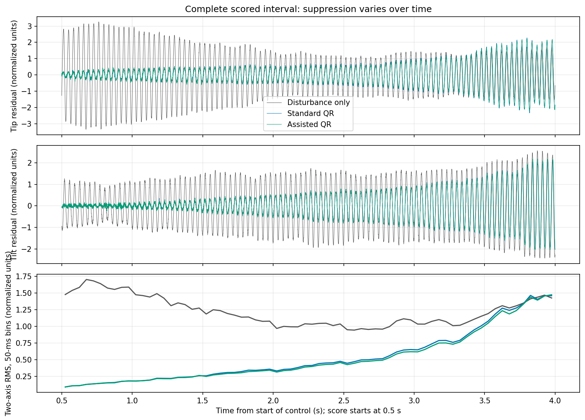
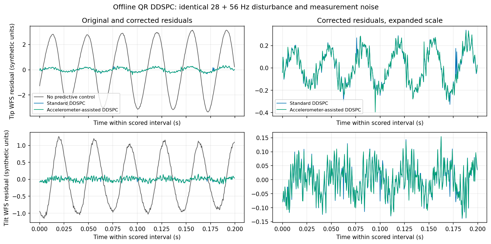
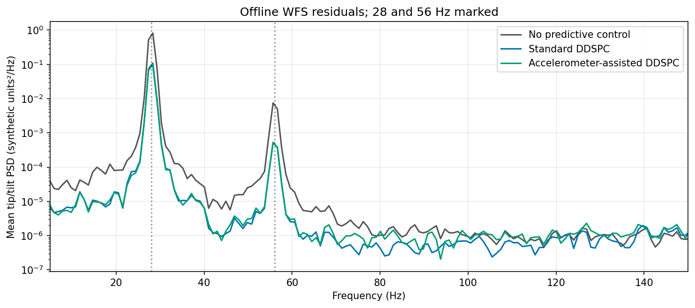
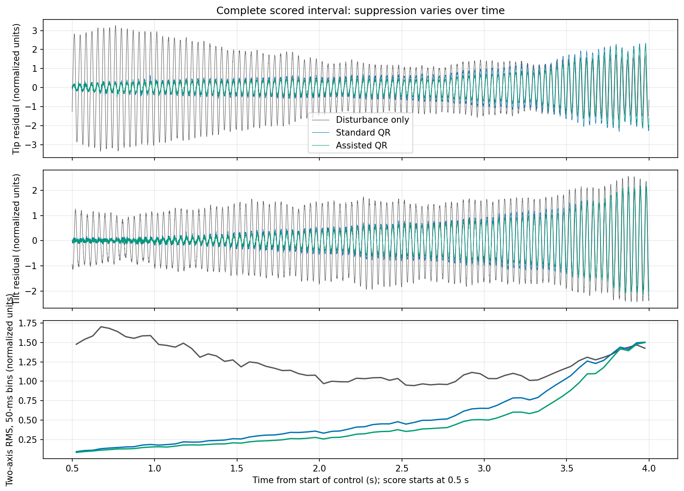
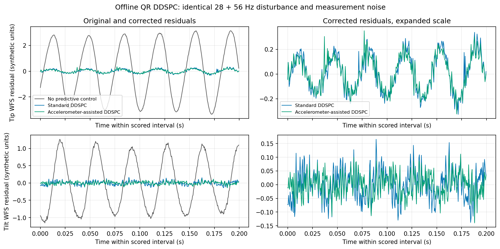
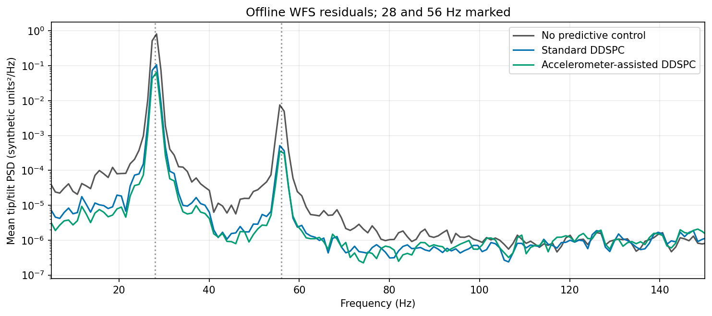

# accelSim → aoSim → DDSPC: simulation connection

**Transport: memory. Actual numerical implementations; no native application processes run.**

| Source amplitude | Case | WFS RMS | Variance reduction | 28 Hz dB | 56 Hz dB |
| --- | --- | ---: | ---: | ---: | ---: |
| 1× | Disturbance only | 1.24214 | 0.00% | 0.00 | 0.00 |
| 1× | Standard QR DDSPC | 0.66036 | 71.74% | 8.69 | 11.32 |
| 1× | Assisted QR DDSPC | 0.64274 | 73.22% | 9.09 | 11.37 |
| 100× | Disturbance only | 1.24214 | 0.00% | 0.00 | 0.00 |
| 100× | Standard QR DDSPC | 0.66055 | 71.72% | 8.72 | 11.46 |
| 100× | Assisted QR DDSPC | 0.57924 | 78.25% | 10.94 | 12.71 |

Variance reduction and line suppression are relative to disturbance-only within each amplitude.
RMS is normalized to the configured 28-Hz pointing RMS, recorded in manifest.json; amplitudes and the earlier harness have different units and are not absolute-RMS comparisons.

At 1×, RMS reduction from assistance relative to standard is **2.67%** (negative means worse).

At 100×, RMS reduction from assistance relative to standard is **12.31%** (negative means worse).

Adaptive training continues throughout control; late degradation is retained.
 Whole time series and first/last-second RMS are retained. No universal assisted-model benefit is claimed.

The 1× case retains reference mode amplitudes and default ADC/noise settings. The 100× case explicitly increases simulated mode amplitudes; ADC calibration/noise remain unchanged. WFS noise and input normalization retain the same relative scale. Neither is instrument calibration.

No generator pointing reaches DDSPC: only WFS, raw ADC and actually consumed correction inputs cross its interface. Disturbance and correction traverse separate aoSim DM delay channels.

See [interface findings and exact remaining application wiring](../simulation_connection.md).
