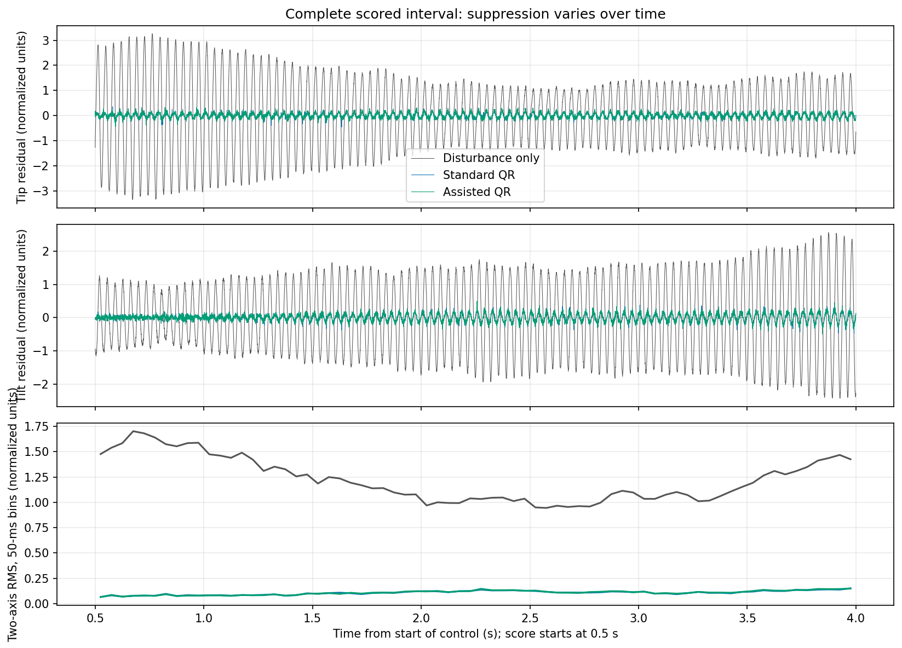
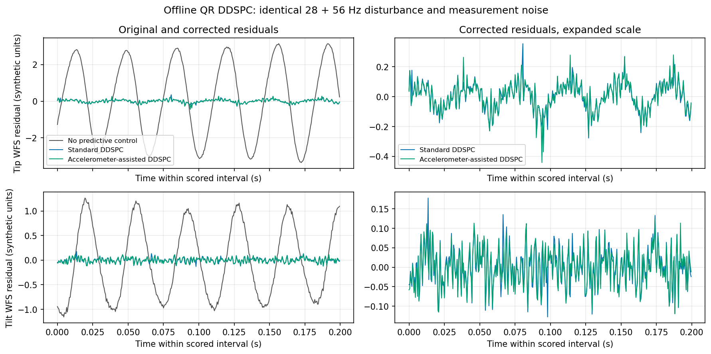
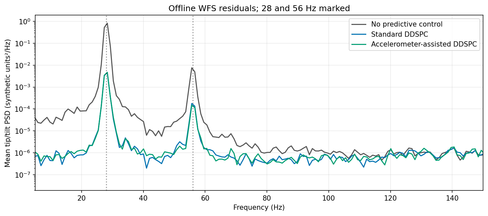
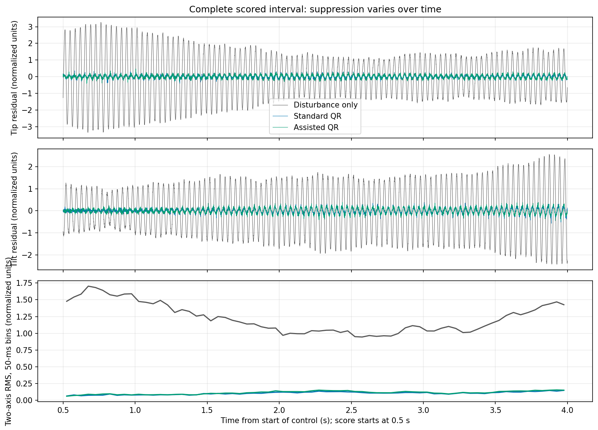
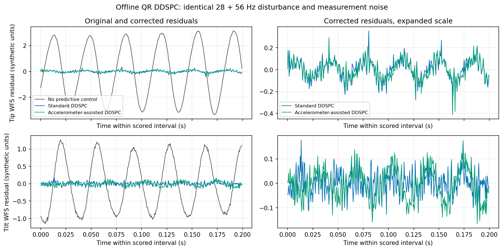
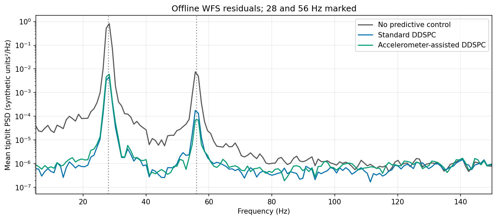

# accelSim → aoSim → DDSPC: simulation connection

**Transport: memory. Actual numerical implementations; no native application processes run.**

| Source amplitude | Case | WFS RMS | Variance reduction | 28 Hz dB | 56 Hz dB |
| --- | --- | ---: | ---: | ---: | ---: |
| 1× | Disturbance only | 1.24214 | 0.00% | 0.00 | 0.00 |
| 1× | Standard QR DDSPC | 0.10860 | 99.24% | 22.30 | 16.00 |
| 1× | Assisted QR DDSPC | 0.10989 | 99.22% | 22.17 | 16.74 |
| 100× | Disturbance only | 1.24214 | 0.00% | 0.00 | 0.00 |
| 100× | Standard QR DDSPC | 0.10853 | 99.24% | 22.31 | 16.03 |
| 100× | Assisted QR DDSPC | 0.11759 | 99.10% | 21.06 | 19.51 |

Variance reduction and line suppression are relative to disturbance-only within each amplitude.
RMS is normalized to the configured 28-Hz pointing RMS, recorded in manifest.json; amplitudes and the earlier harness have different units and are not absolute-RMS comparisons.

At 1×, RMS reduction from assistance relative to standard is **-1.19%** (negative means worse).

At 100×, RMS reduction from assistance relative to standard is **-8.34%** (negative means worse).

Coefficient updates stop at source frame 2400; fresh input, rank and model-age checks continue.
 Whole time series and first/last-second RMS are retained. No universal assisted-model benefit is claimed.

The 1× case retains reference mode amplitudes and default ADC/noise settings. The 100× case explicitly increases simulated mode amplitudes; ADC calibration/noise remain unchanged. WFS noise and input normalization retain the same relative scale. Neither is instrument calibration.

No generator pointing reaches DDSPC: only WFS, raw ADC and actually consumed correction inputs cross its interface. Disturbance and correction traverse separate aoSim DM delay channels.

See [interface findings and exact remaining application wiring](../simulation_connection.md).
