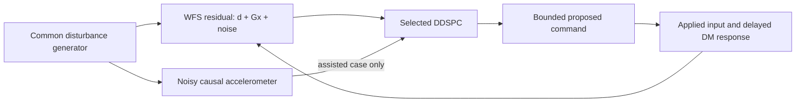

# Minimal end-to-end DDSPC vibration demonstration

This demonstration uses the **existing offline simulation and QR DDSPC**, with
no new controller, recovery mechanism, production change or shared-memory access.
Run from the `MagAOX-DDSPC` repository root:

```sh
python apps/loPredCtrlAcc/tests/vibration_demo.py
```

Dependencies are the existing C++20/Eigen/mxlib development environment and Python
with NumPy, SciPy and Matplotlib. Here `python` is the existing Anaconda Python;
the workstation's system `python3` does not contain these scientific packages.
The command builds only `tests/Makefile.vibration` with strict floating point,
runs the unchanged `mixed_qr` case, checks causality/plant response, and writes
[results and plots](minimal_vibration_demo/README.md). It does not require the
other repository at reproduction time. No application or instrument is launched.

## What runs

Three reported trajectories share the exact same disturbance, accelerometer
samples, WFS noise realization, timing, calibration inputs and synthetic DM plant:

1. No predictive control: zero command after common calibration.
2. Standard causal QR DDSPC: measured WFS and actual applied-command histories.
3. Assisted causal QR DDSPC: the same input types plus accelerometer history.

“WFS-only” means no accelerometer input; standard DDSPC still needs its historical
applied DM commands. Its independently trained model is not the assisted model
with D zeroed. The existing runner also computes Legacy/oracle reference
trajectories; these are excluded from this report and never supply controller
inputs to the three displayed cases.

The source is two deterministic 28/56-Hz oscillators per axis, with .8/.45-SU tip
amplitudes and .8 times those tilt amplitudes, different phases and seed=100.
Independent WFS/sensor noise amplitudes are .03 in their respective synthetic
units. Acceleration comes from current oscillator state/force, normalized by
.01 and mixed through `[[1,.2],[-.1,1]]`, before adding sensor noise. No future WFS
measurement or oscillator truth enters a learned controller.

Each case follows this loop in a separate plant instance:



`tests/vibration.cpp::vibration_source()` supplies both correlated physical
signals. `vibration_run()` uses the unchanged pinned Phase 10 loop. Both causal
models use `ShadowController`, corrected QR identification, and
`PredictiveController::get_reference_controller()`; no recovery policy is selected.
The general `[A B D C]` model has no built-in 28/56-Hz filter.

At 2 kHz, y_i is observed before selecting u_i. Actual bounded u_i is held for
the next response, `x_(i+1)=.1*x_i+.9*u_i`, and
`y_i=d_i+G*x_i+noise`, `G=[[1,.08],[-.05,.9]]`. The nominal control effect starts
one frame later (500 µs); no extra transport delay is selected. The sensor sample
is created 125 µs before WFS origin and available 1 µs later. One synchronized
sample per WFS frame is retained from that nominal 8-kHz grid, rather than
simulating a complete asynchronous 8-kHz acquisition stream.

Training uses 2,400 common calibration frames (1.2 s), then 8,000 control frames
(4 s). Scoring excludes the first 1,000 control frames, retaining all last 7,000
frames including holds/unready models. The small existing .005 evaluation
excitation remains with valid learned-model commands; no-control omits it. This
slightly disadvantages the learned controllers' residual noise comparison.
History=5, future=3, sensor history=5, gamma=.9995, prior=.001 and lambda=.02
are unchanged. No-control has no learned readiness requirement.

The wrapper reuses `vibration_report.py` RMS/variance and Hann/Welch PSD metrics.
Line suppression is integrated over fixed ±2-Hz bands. It checks identical source
columns/calibration, causal sequence/age/timestamps, bounds, invalid-prediction
holds and zero overflows. An independent reconstruction from **actual applied
commands** verifies every physical residual against the plant equation, allowing
only float32/serialized-CSV replay error. This verifies that correction commands
actually affect WFS residuals, rather than merely subtracting a prediction in a plot.

## Result

On this Mac with strict Apple Clang, assistance reduces measured residual RMS
from **.04621 to .03642 SU** relative to standard DDSPC: **21.17% lower RMS and
37.86% lower variance**. Relative to no predictive control (.58807 SU), variance
reduction is **99.38% standard / 99.62% assisted**. Suppression at 28/56 Hz is
**30.97/27.82 dB standard**, **33.67/34.54 dB assisted**. These are synthetic
results from one declared realization, not instrument or on-sky performance.

See [the generated table](minimal_vibration_demo/README.md),
[metrics](minimal_vibration_demo/metrics.csv),
[time series](minimal_vibration_demo/time_series.png),
[PSD](minimal_vibration_demo/residual_psd.png), and
[configuration/source/binary/trace hashes](minimal_vibration_demo/manifest.json).
PNG and PDF scientific artifacts are both provided. Raw five-reference traces
and build/execution logs remain under ignored `build/minimal-vibration-c++`.
The inherited metric named `measured_coherence` excludes the peak bands; it is
not an estimate of 28/56-Hz coherence for this pure-line case.

Validation on macOS: the one-command Clang run passes its analytic spectral,
causality and applied-plant checks; repeating it gives identical metrics and
complete raw-trace hashes. Strict GCC 15.2 also improves RMS, .04601 → .03641 SU
(20.86%); its [metrics](minimal_vibration_demo/metrics-gcc.csv) and
[manifest](minimal_vibration_demo/manifest-gcc.json) are retained separately.
Existing focused `[vibration]` regressions pass on Clang (4 cases, 417,999
assertions) and GCC (4 cases, 418,013 assertions). No numerical tolerance or C++
implementation changes were needed. This is host-memory validation, not a claim
of native application, Linux or real-time stream integration.

## Read-only inspection of the separate MagAOX repository

`~/source/MagAOX` is accessible. The inspected HEAD is
`79d927f4f7cc89dd87aab1639d0e4834ed8c256d`; its pre-existing unrelated work was
left intact. No file in that repository was modified and no app was run.
`accelSim` is **not inside MagAOX-DDSPC**. Relevant source locations there:

| Source / function | Finding |
| --- | --- |
| `apps/accelSim/accelSimModel.hpp:335`, `referenceModes()` | 14 prominent stochastic AR(2) modes, including 28 and 56 Hz, plus 200 weak modes at 100–900 Hz. Independent X/Y histories, stationary Gaussian initialization/innovations. |
| `oscillator::configure()/step()` | `phi1=2*r*cos(2*pi*f/fps)`, `phi2=-r*r`; radius r<1, rather than the demo's deterministic undamped two-line realization. |
| `accelerationFactor()` / `model::step()` | Mode acceleration is `-(2*pi*f)^2*leverArm*theta_rad`; sums all modes and then adds sensor noise. Default lever arm=10 m. Internal WFS-coupled pointing has per-mode couplings; it is not an output WFS stream. |
| `parameters`, `model::setRate()` | Default 6000 Hz, configurable up to 10000 Hz subject to mode Nyquist; intended DM-injection experiment is 8000 Hz. Noise sigma=`sqrt(noisePSD*fps/2)`, default PSD=1e-8. |
| `adcCounts()` | UINT16 container, 12-bit range 0–4095. Round/clamp `zero+a*sensitivity/voltsPerBit`; defaults 2048, 1.02, .0083799. Decode using the active configuration: `a=(counts-zero)*voltsPerBit/sensitivity`. Quantization and rail clipping matter. |
| `accelSim::configureAcquisition()/loadImageIntoStream()` | `acc000`, geometry 2×1, X then Y, simultaneous UINT16 pair. |
| `acquireAndCheckValid()`, frameGrabber publication | Absolute monotonic pacing; acquisition timestamp uses CLOCK_REALTIME and becomes `md.atime`. `md.writetime` is publication time; counters/availability are distinct. WFS notifications steer phase, not the number of sensor samples. |
| `model::advance()` | Up to eight missed ticks are advanced without publishing a burst; a larger gap redraws stationary histories. Rate/source discontinuities must invalidate alignment. |
| `frameGrabberPostPublish()`, `accelSimDM.hpp::dmInjection::service()` | Optional same-sample **unattenuated physical pointing** drives calibrated actuator disturbance after ADC publication. It does not use the internal WFS-coupled pointing. Injection is disabled/no channel by default; requires 8 kHz. ADC/DM publication is not atomic. |
| `apps/aoSim/xapp/aoSim/__init__.py::update_dm()/update_wfs()/update_disturbance()` | Existing modal streams are `aoSim_dm`, `aoSim_wfs`, `aoSim_disturbance`; WFS equals disturbance plus delayed command state plus noise. Its default disturbance is an independent sine, not accelSim. |

The demo and accelSim share correlated angular-motion/acceleration signals and
28/56-Hz content, **not identical waveforms, units, noise, ADC quantization or
full mode populations**. The present experiment neither decodes acc000 nor
establishes performance at its ADC resolution. No instrument calibration is
inferred from the demo's synthetic G, normalization or modal signs.

## Minimum subsequent simulation-stream connection

No cross-repository integration is implemented. The small missing pieces are:

1. **Use one disturbance realization for both outputs.** The current aoSim sine
   is independent of accelSim. Feed the same completed accelSim sample into a
   simulation-only modal disturbance input (plant only), or consume its calibrated
   actuator disturbance through a known simulated actuator-to-modal projection.
   The existing optional actuator image is 50×50 in surface microns; aoSim expects
   a modal vector, so they cannot be connected by renaming a stream. The controller
   must read only ADC/WFS measurements, never the generator's pointing state.
2. **Add the read-only sensor adapter.** Decode both `acc000` channels with active
   ADC parameters; retain acquisition/publication time, counter and source epoch.
   Keep a bounded history and select only samples available by each WFS decision.
   Explicitly handle clipping, gaps and restarts; do not assume a WFS callback
   means four fresh accelerometer samples arrived. Start with one causal feature
   per WFS frame, matching this successful experiment.
3. **Make the simulated timing/applied-input contract explicit.** Reuse
   `CausalInputBuilder` and the `loPredCtrlAcc::configureShadowInputs()`,
   `processShadowWfs()` and `processShadowApplied()` seams. The simulator should
   report the command actually consumed, its source identity and held interval,
   plus WFS sample/exposure times. Its current `_dt=.01` is a logical disturbance
   step; `_frequency` is used as a disturbance frequency, not a 2-kHz cadence.
   Its `lag+1` history buffer is read before roll/append, so lag=1 delays a command
   read in loop k until WFS loop k+2. Set/measure the intended timeline explicitly.
4. **Provide one simulation-only correction sink and close the measured loop.**
   Route fresh proposals from the existing current-state prediction seam to an
   explicitly owned local simulated correction channel, then have aoSim's plant
   consume it before producing subsequent WFS residuals. Preserve separate
   disturbance and correction contributions; certify the realized controllable
   input rather than treating a requested sum as applied history. The production
   app currently inhibits all shadow output and raw callbacks lack validated
   timing/applied-input adapters; changing an INDI mode alone cannot close this
   simulated loop. Keep Legacy/default and physical command routes unchanged.

The next useful step is that narrowly scoped **local simulation plumbing**, with
the same three-case metrics. No further recovery framework is needed to establish
the present suppression result. Native app builds, real stream delivery/latency,
ADC-resolution effects and a real 2-kHz runtime remain separate unverified work.
