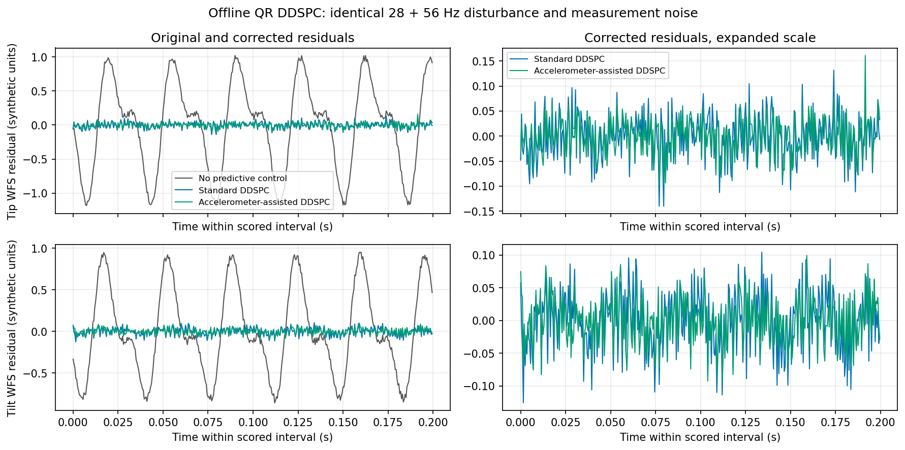
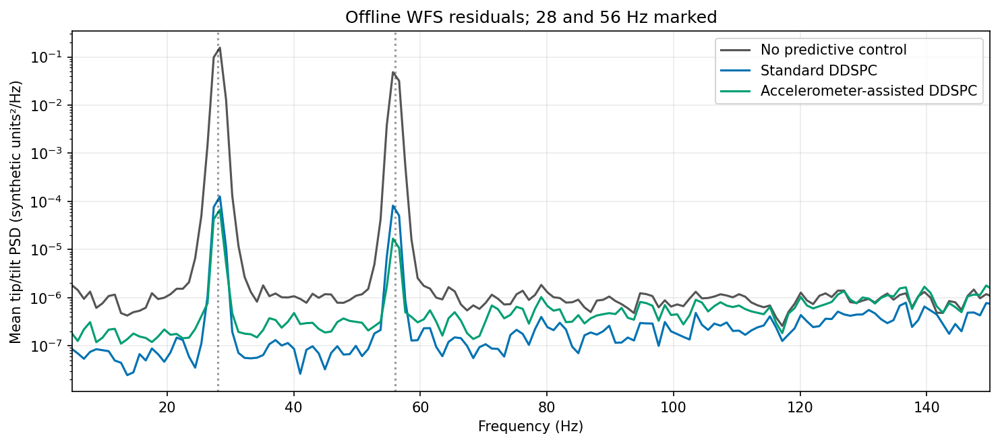

# Minimal offline vibration suppression demonstration

Synthetic 28 + 56 Hz, causal QR DDSPC; no instrument or shared-memory I/O.

| Case | WFS RMS | RMS reduction | Variance reduction | 28 Hz dB | 56 Hz dB |
| --- | ---: | ---: | ---: | ---: | ---: |
| No predictive control | 0.58807 | 0.00% | 0.00% | 0.00 | 0.00 |
| Standard DDSPC | 0.04621 | 92.14% | 99.38% | 30.97 | 27.82 |
| Accelerometer-assisted DDSPC | 0.03642 | 93.81% | 99.62% | 33.67 | 34.54 |

Accelerometer assistance improves standard DDSPC: **21.17% lower RMS**, **37.86% lower variance**.

Reductions in the table are relative to no predictive control. PSD suppression integrates ±2 Hz bands using the existing Hann/Welch metric. RMS is sqrt(mean((tip²+tilt²)/2)).

2 kHz WFS, 1.2 s common initial calibration, 4 s control; score the final 3.5 s, including invalid/held frames. Both learned controllers retain actual applied-command history; only the assisted model receives accelerometer histories. The runner also computes auxiliary Legacy/oracle trajectories; neither enters these three cases or their decision data. No recovery policy is used.

Synthetic plant: x[i+1]=.1*x[i]+.9*u[i], y[i]=d[i]+G*x[i]+noise, G=[[1,.08],[-.05,.9]]. Commands are bounded absolute inputs; their nominal effect is one WFS frame later. Sensor features are created 125 µs before WFS origin and available 1 µs later. This selects one synchronized feature per WFS frame; it is not a full 8-kHz acquisition or UINT16 ADC simulation. Noise amplitudes, gains and units are synthetic.

See [the demonstration notes](../minimal_vibration_demo.md) for accelSim inspection, causal conventions and the minimum later simulation-stream integration work.
