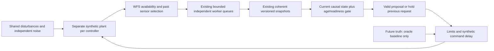

# Phase 10: offline vibration suppression

These are **synthetic numerical experiments, not on-sky or instrument results**.
Work started from clean `e80c92851303585e055b7ecaff285f908c5be981` on
`parkertjohnson1/accel_ddspc`, personal workstation `ASTR-LT-428.local`, macOS
26.3.2 arm64. No application, instrument host, service, shared-memory stream,
separate simulator worktree or physical DM was accessed. No production source,
Legacy default, compiler flag or controller mathematics was changed. No commit,
push, merge or deployment occurred.

## Finding

Accelerometer assistance improves **QR** DDSPC in this causal synthetic plant
when the sensor contains useful disturbance information. The broadband positive
control improves residual RMS by about 34%; the mixed 28/56-Hz case also improves.
The uncorrelated sensor gives essentially no improvement. Single-frequency
results are modest and do not uniformly improve the peak-band metric.

**This is not a general stability result.** Conventional single-precision RLS
produces poor closed-loop behavior in several cases despite passing rank and
finite/readiness checks. Wrong-sign/latency changes, unready models and persistent
holds can also yield large residuals. Every unfavorable case remains in the
metrics. No rank threshold, adaptation frequency or numerical test was relaxed.
Readiness establishes an identifiable finite model, not closed-loop stability.

Complete primary data: [metrics](phase10-metrics.csv),
[experiment configuration](phase10-config.json), [source/trace manifest](phase10-manifest.json).
GCC repeat: [metrics](phase10-metrics-gcc.csv), [compiler comparison](phase10-compiler-comparison.json).
Raw per-frame CSVs and execution logs remain under ignored
`apps/loPredCtrlAcc/build/phase10-*`; manifests hash them for audit/reproduction.

Primary **QR** results (measured two-axis RMS in SU; line suppression in dB):

| Scenario / controller | RMS | Variance reduction | 28 Hz dB | 56 Hz dB | Availability |
| --- | ---: | ---: | ---: | ---: | ---: |
| 28hz_qr / No control | 0.51297 | 0.00% | 0.00 | 0.00 | 0.00% |
| 28hz_qr / Perfect oracle | 0.03007 | 99.66% | 46.85 | 0.00 | 100.00% |
| 28hz_qr / Legacy core | 0.10846 | 95.53% | 25.30 | 5.23 | 100.00% |
| 28hz_qr / Standard causal | 0.03583 | 99.51% | 33.79 | 4.94 | 99.34% |
| 28hz_qr / Accel assisted | 0.03444 | 99.55% | 33.33 | 2.56 | 99.31% |
| 56hz_qr / No control | 0.28913 | 0.00% | 0.00 | 0.00 | 0.00% |
| 56hz_qr / Perfect oracle | 0.03007 | 98.92% | -0.00 | 44.46 | 100.00% |
| 56hz_qr / Legacy core | 0.07695 | 92.92% | 3.05 | 20.34 | 100.00% |
| 56hz_qr / Standard causal | 0.03553 | 98.49% | 2.39 | 33.27 | 99.67% |
| 56hz_qr / Accel assisted | 0.03155 | 98.81% | 0.99 | 33.29 | 99.44% |
| mixed_qr / No control | 0.58807 | 0.00% | 0.00 | 0.00 | 0.00% |
| mixed_qr / Perfect oracle | 0.03007 | 99.74% | 46.85 | 44.46 | 100.00% |
| mixed_qr / Legacy core | 0.25946 | 80.53% | 23.60 | 18.03 | 100.00% |
| mixed_qr / Standard causal | 0.04621 | 99.38% | 30.97 | 27.82 | 99.29% |
| mixed_qr / Accel assisted | 0.03642 | 99.62% | 33.67 | 34.54 | 99.00% |
| broadband_qr / No control | 0.59432 | 0.00% | 0.00 | 0.00 | 0.00% |
| broadband_qr / Perfect oracle | 0.03007 | 99.74% | 46.83 | 44.54 | 100.00% |
| broadband_qr / Legacy core | 0.09909 | 97.22% | 23.61 | 19.65 | 100.00% |
| broadband_qr / Standard causal | 0.07251 | 98.51% | 27.00 | 26.02 | 99.33% |
| broadband_qr / Accel assisted | 0.04797 | 99.35% | 35.58 | 30.81 | 99.20% |

No-control availability is inapplicable (reported zero); oracle availability is
by definition true. In a single-peak case, the other line band is only a
noise-floor comparison. No-control and oracle omit the small evaluation probe
present with valid learned-model commands.

| Broadband seed / QR model | RMS | Prediction RMSE | Applied command RMS |
| --- | ---: | ---: | ---: |
| broadband_qr / Standard causal | 0.07251 | 0.06093 | 0.58891 |
| broadband_qr / Accel assisted | 0.04797 | 0.05186 | 0.60164 |
| broadband_seed200_qr / Standard causal | 0.07342 | 0.06137 | 0.58789 |
| broadband_seed200_qr / Accel assisted | 0.04788 | 0.05245 | 0.60127 |
| broadband_seed300_qr / Standard causal | 0.07290 | 0.06117 | 0.59323 |
| broadband_seed300_qr / Accel assisted | 0.04756 | 0.05211 | 0.60679 |

Across the three seeds, assistance reduces QR RMS by **33.84–34.78%**.
At seed 100 its incremental 28/56-Hz suppression over standard is **8.59 / 4.79 dB**.
These three deterministic seeds are descriptive replicates, not a confidence
interval for on-sky performance.

| QR condition | Measured MSC | Standard RMS | Assisted RMS | Assisted availability |
| --- | ---: | ---: | ---: | ---: |
| coherence_0_qr | 0.084 | 0.07251 | 0.07262 | 99.06% |
| coherence_1_qr | 0.093 | 0.07251 | 0.07178 | 99.37% |
| coherence_2_qr | 0.121 | 0.07251 | 0.06965 | 99.14% |
| coherence_3_qr | 0.197 | 0.07251 | 0.06462 | 99.24% |
| broadband_qr | 0.889 | 0.07251 | 0.04797 | 99.20% |
| accel_noise_qr | 0.180 | 0.07251 | 0.06611 | 98.97% |
| delay_jitter_qr | 0.889 | 0.15255 | 0.13845 | 99.26% |
| missing_qr | nan | 0.07251 | 0.53541 | 42.56% |
| latency_1_qr | 0.889 | 0.10579 | 0.08872 | 99.30% |
| latency_2_qr | 0.889 | 0.15295 | 0.13853 | 99.24% |
| latency_3_qr | 0.889 | 0.20269 | 0.18317 | 99.56% |
| gain_low_qr | 0.889 | 0.09265 | 0.04908 | 99.11% |
| gain_high_qr | 0.889 | 0.07066 | 0.05069 | 99.21% |
| wrong_sign_qr | 0.889 | 3.93608 | 3.93608 | 0.00% |
| publication_1_qr | 0.889 | 0.07251 | 0.04797 | 99.20% |
| publication_3_qr | 0.889 | 0.07263 | 0.04807 | 99.19% |
| publication_6_qr | 0.889 | 0.61716 | 0.61716 | 0.00% |
| reset_qr | 0.889 | 0.49392 | 0.50126 | 42.53% |
| overflow_qr | 0.889 | 0.60156 | 0.59124 | 42.59% |

Weak-coherence results and fault holds are not filtered out. Six-frame model
publication delay always exceeds the 2-ms evidence-age limit; no learned model
serves a valid correction. Missing data/reset/overflow reduce availability and
can leave an unexcited held history. Transport/gain mismatch is not compensated
by a new control law. See the full CSV for command amplitudes and latency.

| Conventional RLS / condition | Legacy RMS | Standard RMS | Assisted RMS | Assisted max coefficient norm |
| --- | ---: | ---: | ---: | ---: |
| 28hz | 0.03673 | 0.06406 | 0.06880 | 1559.275 |
| 56hz | 0.03572 | 0.03557 | 0.04429 | 2313.956 |
| mixed | 0.04536 | 0.42870 | 0.06353 | 204.432 |
| broadband | 0.06773 | 0.07353 | 1.14049 | 27005.934 |
| coherence_0 | 0.06773 | 0.07353 | 1.15014 | 5112.737 |
| delay_jitter | 0.91085 | 0.15254 | 1.10853 | 14882.178 |
| missing | 0.06773 | 0.07353 | 0.67906 | 1394.028 |

The source model, hyperparameters and safety gates are the same; learner choice
alone can strongly change closed-loop behavior here. Coefficient growth and
poor residuals are observations; the exact conditioning/numerical/adaptation
cause is **not established** by this phase. No RLS algorithm fix is implemented.

The full GCC repeat also includes all 52 cases. Maximum RMS differences from Clang across all rows are 1.23416 SU (RLS) and 0.526994 SU (QR).
These closed-loop differences are not relaxed numerical tolerances: the actual
committed-reference exact tests pass under each compiler, and changing commands
can amplify tiny arithmetic differences into different fitted closed-loop data.
Among the new causal QR models alone, the maximum RMS discrepancy over all
nominal/fault cases is 0.0006971 SU; the larger 0.526994-SU QR discrepancy is the
Legacy baseline under gain mismatch. Both compilers reproduce the nominal
sensor benefit: broadband standard/assisted RMS is 0.072507/0.047970 SU (Clang)
and 0.072432/0.047838 SU (GNU). The compiler-comparison JSON lists every row. No cross-compiler bit-exact
closed-loop equivalence is claimed.

## Controller interface and coordinates

`ar_controller.hpp::PredictiveController` documents the two existing conventions.
`ar_controller.cpp::calculate_command()` returns a modal vector and records its
calculated/exploration input in Legacy history. `update_controller()` retains
the original inverse and `max(H11) * regularizationMatrix` penalty and its
additional feedback term. The simulation explicitly sets that feedback gain to
zero, relative penalty to .02, and uses absolute modal commands. These are
experimental settings, not claims about the on-sky configuration. Existing
Legacy startup/indexing and multichannel history defects are retained.
Legacy still records calculated requests internally; clipping, transport delay
and external gain changes can separate that history from the simulated applied
input. The causal models instead train on the actual held input. This difference
is exposed, not repaired by changing Legacy. Legacy command generation precedes
learning as in the original loop; its forecast coefficients/version are frozen
before that identification update, matching the gain used for the proposal.

`loPredCtrlAcc.hpp::processImage()` copies the first configured WFS modes and
either accumulates or replaces modal outputs; `loadImageIntoStream()` copies
those values without an additional sign reversal. Neither is called here.
`dmRecon.hpp::processImage()` projects masked command values through `m_PInv`
and replaces timing with callback time. Active optical/DM mode ordering,
normalization, global sign, command accumulation, physical units and exposure/
application latency cannot be established from these interfaces alone. They are
not invented for this experiment. Historical exact original/restored/clone
regressions remain the Legacy compatibility evidence.

Here, mode 0 is synthetic tip and mode 1 synthetic tilt; both WFS and command
vectors use that fixed order. Commands use arbitrary synthetic DM units (DU),
WFS residuals arbitrary synthetic displacement units (SU). Positive DM response
adds positive WFS displacement, so cancellation generally requires a negative
command. No radians, arcseconds, volts, actuator calibration, real spatial basis
or production stream identifier is assigned.

Standard causal DDSPC uses **WFS and applied-DM histories**. Assistance adds
accelerometer history; it is never implemented by zeroing an assisted fit.
For m=2, N=5, F=3, Ha=5 and two sensor channels:

| Quantity | Standard | Assisted |
| --- | --- | --- |
| A | 6 x 10 | 6 x 10 |
| B | 6 x 8 | 6 x 8 |
| D | 6 x 0 | 6 x 10 |
| C | 6 x 6 | 6 x 6 |
| Theta = [A B D C] | 6 x 24 | 6 x 34 |
| State = [y_p;u_p;a_p] | 18 x 1 | 28 x 1 |
| Full reference gain | 6 x 18 | 6 x 28 |

All blocks are newest-first, then modal/channel order. The nearest action is the
last two rows of the full gain, exactly as in Phase 7–9. The unchanged reference
law solves `(C^T C + lambda I) K = -C^T [A B D]`, lambda=.02. Both learners use
gamma=.9995 per update, prior information .001 (P0=I/.001), and the existing
normalized pivoted-QR rank threshold 1e-5. The Legacy relative penalty has the
same scalar but a different meaning; these are not cost-matched or command-RMS
matched controller designs.

## Synthetic plant and causal clock

`tests/vibration_source()` generates independent seeded streams for WFS noise,
sensor noise, unrelated sensor mixture, external excitation, process force and
timestamp/arrival jitter. The two oscillators have 28/56-Hz amplitudes .8/.45 SU,
tilt amplitude factor .8 and distinct phases. Each obeys
`d_(i+1)=2*cos(omega)*d_i-d_(i-1)`; optional independent broadband position obeys
`b_(i+1)=.88*b_i+.045*innovation_i`, with centered unit-variance uniform innovations.
Acceleration is calculated from **present position/velocity and present force**,
then integrated to the next position. The normalized acceleration is the sum of
second differences divided by .01, mixed through `[[1,.2],[-.1,1]]`. Thus a force
already measured at i can reveal an otherwise unpredictable next-step innovation.
The controllers receive that sensor measurement, not the simulated pointing
state or future disturbance truth. An independent equation test checks the
acceleration/position relationship.

Sensor mixture parameter c is a coefficient, **not measured coherence**:
`a = c*M*acceleration + 6*sqrt(1-c*c)*unrelated + sigma_a*sensor_noise`.
Default sigma_a=.03 normalized sensor units; default WFS noise=.03 SU per axis.
The source is sampled once per WFS step using a declared nominal 8-kHz-grid
sample 125 us before the WFS origin, with a nominal 1-us availability delay. This is
a synchronized feature experiment, not an independently scheduled 8-kHz stream
or a live `acc000` decoder. Sensor delay selects the newest sample with sample
time no later than the origin and availability no later than WFS delivery, with
an explicit 1.5-ms freshness cap. Missing/stale features are rejected; diagnostic
CSV fields are NaN and carry sample index -1, never silently fabricated samples.
The disturbance/force state clock ticks at nominal t_i minus 125 us: d_i and a_i
already exist then, and the disturbance position is held until the next tick.
The WFS at t_i reads that existing position; acceleration is not calculated from
an unavailable future WFS position. Jitter perturbs the **reported sensor tag**;
availability is conservatively the later of the physical sample tick and tag,
plus 1 us and the declared transport delay. A test ensures a negative timestamp
jitter never makes a payload available before its actual simulated creation.

At the 2-kHz grid origin t_i, the simulation measures a point WFS sample
`y_i=d_i+G*x_i+WFS_noise_i`, decides a request, and records the actual held
synthetic input `u_i` after the request queue and limit. Then
`x_(i+1)=p*x_i+(1-p)*u_i`, p=.1 and
`G=[[1,.08],[-.05,.9]]` SU/DU. Nominal u_i influences y_(i+1): one WFS frame
(500 us), not zero latency. Extra DM transport L applies request_(i-L).
The default limit is 4 DU per mode; .2-DU tests round the float bound inward so
the declared double limit is never exceeded. The first controller gain defaults
to one; the zero-gain case multiplies the complete feedback-plus-probe term by zero.

All five trajectories share exactly the same exogenous realizations and common
1.2-s calibration excitation (`.3*innovation`, bounded before application).
Every evaluated controller then sees its own resulting residual and actual
input, as a closed loop necessarily requires. Evaluation lasts 4 s. A small
`.005*innovation` excitation is included only with valid controller proposals
to support identification; no-control and oracle have no evaluation excitation.
Invalid predictions hold the previous request and generate no new correction or
probe. Pending commands admitted earlier may still reach the simulated DM.

At each decision the frontend builds an independent canonical state from only
delivered WFS, historical applied inputs and eligible sensor records. The actual
Phase 9 `OfflineAsyncShadow` queues, per-model ownership, snapshot pinning,
version, reset and age gates are reused through **deterministic manual service**.
The current origin's applied command is submitted only after it is determined;
a served snapshot always comes from an earlier source record. Worker service
consumes at most four queued entries per lane per frame; source provenance and
time ordering are validated before the experiment. This is virtual scheduling,
not an OS-throughput or real-time benchmark. The simulation itself intentionally
allocates finite trace/forecast arrays and is not a production prediction loop.

The no-control baseline stops excitation after calibration. The oracle alone
uses true future disturbance and true G to invert the DM response, including
already pending requests and L; it has the same command limit. It is an
idealized perfect-prediction reference, not an optimal constrained controller or
an achievable performance claim. With no clipping, independent tests verify
true oracle residuals below 1e-6 SU for L=0/1/3 and a changed response gain.

## Experiment matrix, latency and metrics

There are 26 scenarios for **each** learner, 52 total / 260 controller rows per
compiler. These include pure 28, pure 56, both, broadband plus peaks, noisy and
uncorrelated sensors, five mixture strengths, WFS/sensor delay and timestamp
jitter, a 20-frame missing-sensor block, L=1/2/3 transport mismatch, .7/1.3/-1
post-calibration gain/sign changes, zero gain, saturation, publication delays
1/3/6 frames, full reset, 32-frame worker stall/overflow, and broadband seeds
100/200/300. Configurations are preserved, including all failed-performance cases.

The transport/measurement-delay cases intentionally apply the unchanged nominal
reference law late. They do **not** solve a new constrained MPC problem for
already pending actions. WFS samples keep their physical origin; arrival jitter
is 0–30 us and sensor timestamp jitter ±30 us in the combined-delay case. On
the discrete decision grid positive arrival jitter can add another frame of
effective delay. A delayed forecast's post-hoc score is relative to its recorded
WFS origin, not a claim of a prospective forecast from the later decision time.
Command `origin_to_effect_ms` reports that logical age plus DM delay and the
one-step plant response. It is not a measured hardware or CPU latency.

RMS and variance use **all** measured WFS residuals, including invalid/held,
clipped and unstable periods. Principal summary metrics exclude the first
1,000 control frames (.5 s), retaining the subsequent 7,000 (3.5 s); the entire
calibration/control trajectory remains in the convergence plot and raw data.
RMS is `sqrt(mean(y_x²+y_y²)/2)`, including bias. Variance is demeaned per axis.
True residual RMS and request/applied command RMS/max are also reported.

Welch PSD uses Hann, 2,048 points, 50% overlap and per-segment mean removal;
two modal PSDs are averaged. Suppression is `10*log10(P_no_control/P_control)`
integrated in the predeclared ±2-Hz band around each line. An absent line is a
noise-floor comparison, not evidence of vibration suppression. Coherence is
mean diagonal MSC against no-control noisy WFS over 10–250 Hz excluding ±3 Hz
around the lines, using 1,024-point windows; finite-window MSC bias is retained.
The two-channel sensor and controller are MIMO, so this scalar MSC is a summary,
not an exact sufficient statistic or c squared.

Prediction error uses origin-frozen coefficients/state and actual future applied
inputs, scored **only after the simulation**. Those future inputs never enter a
controller decision. Scores cover valid forecasts and report target counts;
unavailable forecasts are not scored as zero. Legacy's canonical diagnostic
retains its historical indexing mismatch, so the score also measures that
compatibility convention. Availability/readiness, coefficient/D norms, model
versions, queue drops and exact data/proposal identities are retained separately.
Coefficient norms are captured only for valid, read snapshots; zero in an invalid
row denotes unobserved diagnostics, not zeroed learned coefficients.

## Figures

Each figure has a standalone PNG and PDF; all axes are synthetic units.

- [Original versus corrected tip series](phase10-timeseries.png) ([PDF](phase10-timeseries.pdf)).
- [Residual PSDs, all five controllers](phase10-psd.png) ([PDF](phase10-psd.pdf)).
- [28/56-Hz line suppression](phase10-suppression.png) ([PDF](phase10-suppression.pdf)).
- [Residual RMS versus measured coherence](phase10-coherence.png) ([PDF](phase10-coherence.pdf)).
- [Latency mismatch](phase10-latency.png) ([PDF](phase10-latency.pdf)).
- [Full training/control convergence and availability](phase10-convergence.png) ([PDF](phase10-convergence.pdf)).

The six principal figures use QR for the sensor-effect comparisons; convergence
explicitly overlays RLS to expose its failures. Both learners' full results are
in the tables, not discarded or tuned out of the comparison.

## Safety/regression validation and limitations

Environment: Apple LLVM 21.0.0 (`clang-2100.0.123.102`), GNU 15.2.0, Eigen
pkg-config 5.0.1/header macros 3.5.0, mxlib 0.2.0. Standalone simulation flags
are `-O3 -g -std=c++20 -Wall -Wextra -fno-fast-math`, Eigen single-threaded.
Full tests use the existing strict flags; sanitizer builds use `-O1 -g` plus
ASan/UBSan or TSan, not performance flags. Python 3.13.9, NumPy 2.3.5, SciPy
1.16.3 and Matplotlib 3.10.6 generated the figures. No new dependencies were
installed. Source hashes and exact detected Python/platform versions are in the
manifests. Full build/test logs are retained under ignored `build/phase10-*`.

| Check | Final result |
| --- | --- |
| Strict Clang | 1,592,619 assertions / 61 cases pass. |
| Strict GCC | 1,592,311 assertions / 61 cases pass. |
| Clang ASan + UBSan | 1,595,100 assertions / 61 cases pass. |
| Clang TSan async + Phase 9 + vibration | 1,266,371 assertions / 11 cases pass. |
| Clang Legacy fast | 186,615 assertions / 9 cases pass. |
| GNU default Legacy fast | 8/9 cases pass; the existing QR nonfinite assertion fails at record 31 (182,253 / 182,254 assertions pass). |
| New fixed coherent QR positive control | Learns D and reduces measured residual energy versus standard under the unchanged gates; passes both strict compilers and sanitizers. |
| Spectral/metric self-test | Parseval power, line band, two-axis normalization, 20-dB sign/scale and independent/coherent MSC controls pass. |
| Full experiment matrix | Clang and GCC each complete 52 cases / 260 controller rows, with zero invalid-prediction request changes. |
| Build helper guards | Seven existing mocked native-build tests pass per full check; no native app compilation or Linux claim. |
| Preservation/style | Original 15-file loPredCtrl tree and protected plan prefix are byte-identical; production source unchanged; C++ formatting, Python syntax and whitespace checks pass. |

Threaded assertion totals vary with observed publications. [Validation summary](phase10-validation.json)
records exact observed counts. TSan checks the existing actual concurrent protocol
tests as well as virtual simulation tests; virtual worker timing itself is not
OS-scheduler validation. The simulation is not a native application build.

The new tests independently check acceleration integration, oracle inversion,
zero gain, bounded commands, future-data prefix invariance, identical calibration,
strict repeated-run identity, causal sample availability, missing/stale state,
model reset, actual queue overflow and delayed/stale snapshots under both
learners. A fixed QR broadband positive control requires learned D and lower
actual measured residual energy than standard, with the existing validity gates.
The first limit test caught float(.2) rounding above double(.2); the simulation
was corrected to round inward, rather than relaxing the limit assertion.

Existing Phase 7–9 zero-tolerance coefficient/version/prediction comparisons,
original Legacy regressions and rank conditions remain unchanged. The historical
GNU production `-ffast-math` QR nonfinite failure is separate from strict-math
closed-loop RLS failures. Its original finite-bit assertion remains failing at
record 31; production flags are not changed. No new estimator correction is
silently introduced to obtain a favorable plot.

Reset or long sensor loss can leave the held-input history insufficiently
excited to regain readiness. Adding synthetic probes while a model is invalid
would contradict this experiment's hold gate. A separately authorized/calibrated
reacquisition policy is needed; readiness is not bypassed. Holding the last
command also does not guarantee a small residual or a neutral DM. Sign reversal
and delayed/stale models can remain at an undesirable bounded hold.

No continuous exposure integration, optical reconstruction, sensor transfer
calibration, command-channel arbitration, physical application readback or clock
mapping is established. Phase 9 laptop throughput/tails and unresolved Linux
qualification remain separate from these **virtual-clock** suppression results.
Conventional RLS's poor closed-loop behavior needs a dedicated offline estimator/
conditioning/stability investigation; the finite rank gate alone does not prevent
amplification. The selected gains and priors are experimental, not production
recommendations. QR success in this plant does not authorize DM correction.

Before observation-only integration: review actual WFS exposure/source identity,
confirmed applied-DM units/order/sign/time, sensor units/transfer and clock/latency,
bounded asynchronous CPU/memory capacity, staleness/recovery and publication-age
policies, and production single-frontend/lock ownership. Keep Legacy default and
all experimental outputs diagnostics-only. Observation-only data must be evaluated
without reading simulator pointing truth. Any correction route requires a later,
separate validation and approval.

Changed files are limited to new `tests/vibration.hpp/.cpp`, `vibration_main.cpp`,
`vibration_report.py`, `ddspc_vibration_test.cpp`, `Makefile.vibration`, the offline
test source list, README/results, and the engineering plan. Stop after Phase 10
validation and request approval before the next phase.
