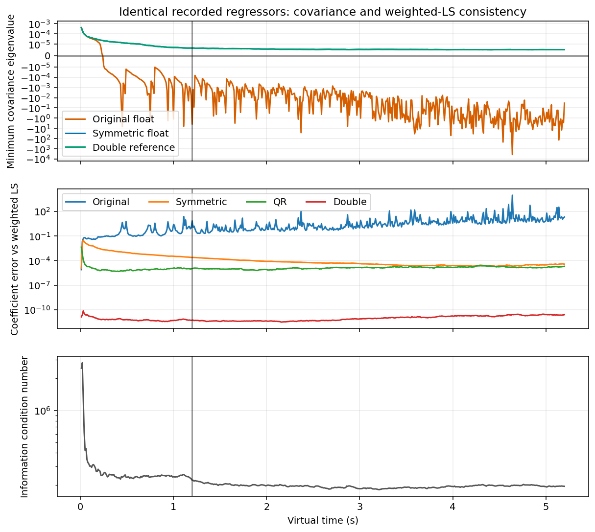
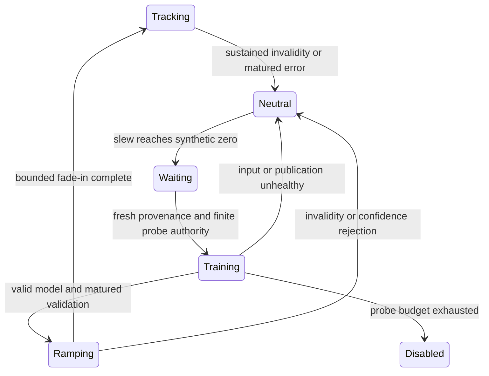
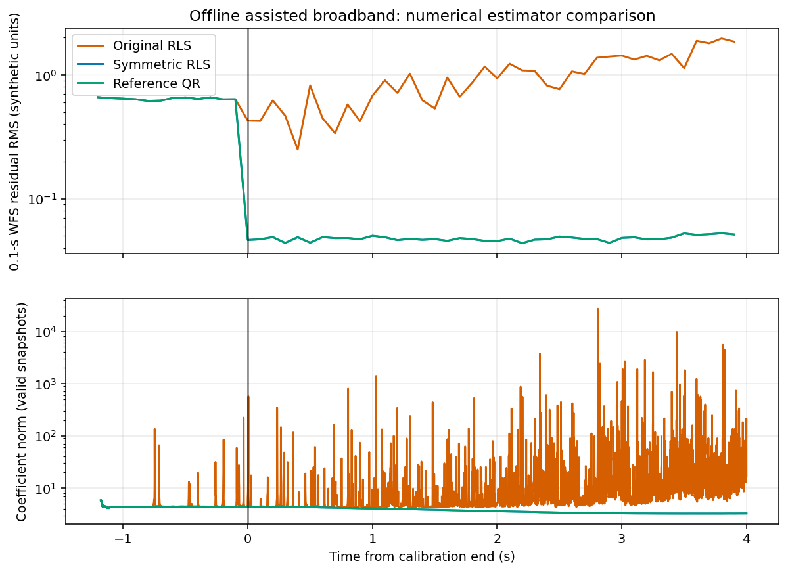
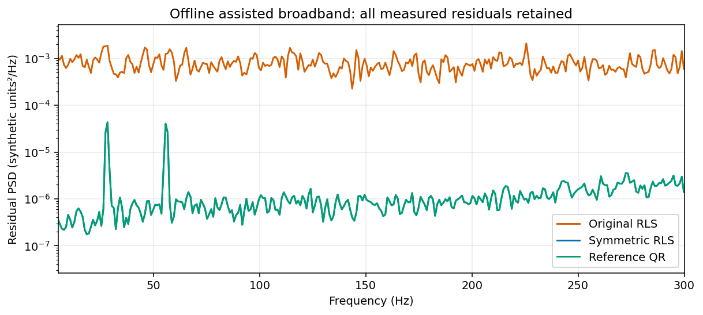
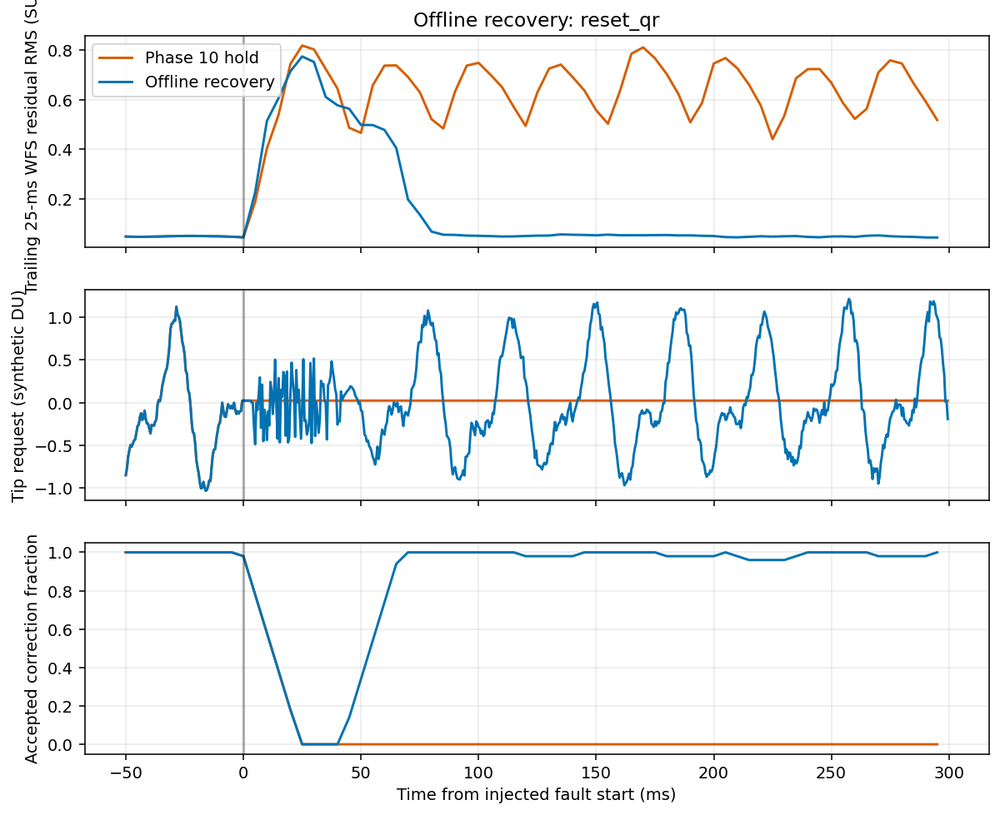
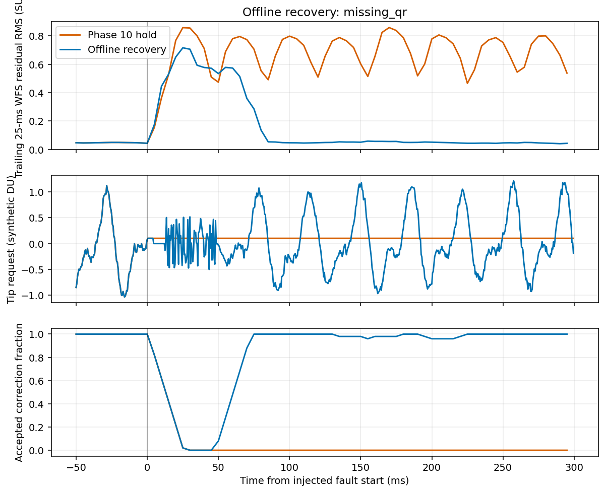
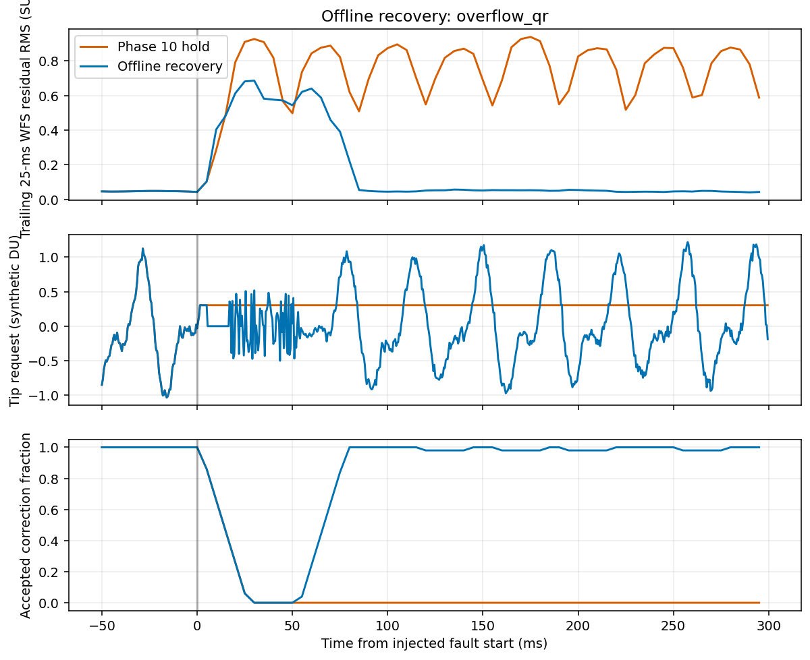
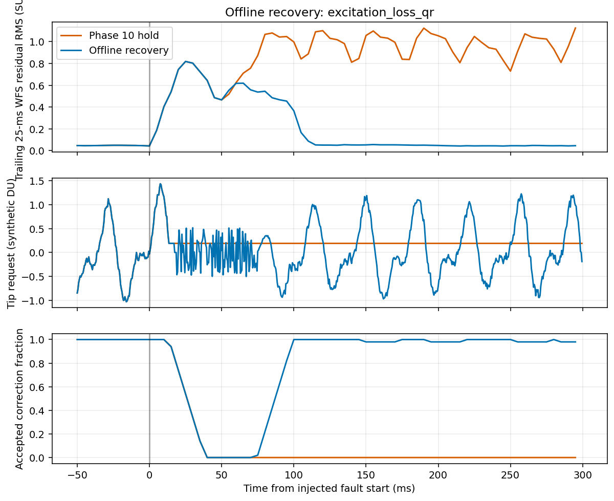

# Phase 11: offline stability, recovery and numerical robustness

These are **synthetic experiments, not on-sky performance or a stability proof**.
Work starts from committed Phase 10
`2fcf61a108c8f3d9c3d237a053f4e0634f0f4e6f`, on
`parkertjohnson1/accel_ddspc`. Host was checked before work:
`ASTR-LT-428.local`, personal macOS 26.3.2 arm64. Apple LLVM 21.0.0
(`clang-2100.0.123.102`), Homebrew GCC 15.2.0, Eigen pkg-config 5.0.1,
mxlib 0.2.0; Python 3.13.9, NumPy 2.3.5, SciPy 1.16.3, Matplotlib 3.10.6.
**No Linux machine is available.** No instrument, SSH, service, physical command,
shared-memory write, production integration, separate worktree, commit, push,
merge or deployment is involved. Original `loPredCtrl`, all production
`loPredCtrlAcc` sources, defaults, estimator arithmetic and flags remain unchanged.

## Outcome and acceptance decision

The conventional float RLS failures have a demonstrated numerical component:
its subtractive covariance update loses symmetry and positive definiteness on
identical recorded regressors, before feedback starts. A separately compiled
offline covariance-symmetry candidate restores weighted-LS consistency in the
tested envelope and brings nominal suppression close to QR. Rank/finite readiness
does not test covariance validity or certify physical closed-loop stability.

Recovery failures have another cause: holding a constant command can make the
command-history columns dependent, preventing rank recovery. A finite, explicitly
authorized synthetic retraining policy restores corrections in all 20 tested
transient fault/model trajectories per compiler. Returning to zero alone does
not recover full rank. These probes are **simulation-only**, never instrument
excitation or a correction sourced from an invalid prediction.

**The combined policy is not accepted for integration.** It worsens the successful
short-stall QR case: assisted Clang RMS 0.05203 → 0.09135 SU. It resets/retrains
too aggressively when the original queue could catch up without losing history.
The requested global “improve recovery without worsening successful QR cases”
criterion therefore fails. All such regressions remain in the acceptance data;
no tolerance or rank/readiness condition was relaxed. Keep QR as the validated
comparison baseline and Legacy as the unchanged production default.

Evidence:

- [Complete changed-file inventory](phase11-files.txt), including tests, tooling, documentation and scientific artifacts.
- [Clang complete metrics](phase11-metrics-clang.csv), [GCC complete metrics](phase11-metrics-gcc.csv): 1,380 / 960 rows, including every baseline and failed case.
- [Exact references and every candidate delta](phase11-acceptance.json), [declared configurations](phase11-config.json), [source/binary/trace manifest](phase11-manifest.json).
- [Validation summaries and initial failed assertions](phase11-validation.json), [GNU flag controls](phase11-fast-math.json), [GNU disassembly](phase11-fast-gcc-disassembly.txt).
- [Identical-record covariance replay](phase11-replay-broadband-m4-gbase-pbase.csv), [GCC replay](phase11-replay-gcc-broadband.csv); the other `phase11-replay-*.csv` files retain sensitivity and negative-control results.

Raw per-frame CSVs, frozen pre-change executables and full build/test logs remain
under ignored `apps/loPredCtrlAcc/build/phase11-*`. No residual rows are removed
because a model is unready or held. The report generator verifies bounded finite
requests and zero commands attributed to invalid predictions for all captures.

## Experimental contract and preservation

`tests/vibration.cpp::vibration_run()` preserves the original CLI/default path by
calling a separately compiled **verbatim pinned Phase 10 loop**.
`prepare_stability.py` obtains sources from the local committed Git object;
`Makefile.stability-model` renames the old loop symbols, without editing its body.
It separately compiles `DDSPCSymmetric` for the RLS candidate. The transformation
is exactly one operation after `update_preallocated()`'s covariance subtraction:

```cpp
P = (0.5f * (P + P.transpose())).eval();
```

The original QR/RLS classes, Legacy app, reference law, rank frequency,
column-normalized pivoted-QR threshold `1e-5`, history layouts and gates stay intact.
The default simulator and candidate-with-QR-no-op are verified against their
reference payloads; this is not a change in production execution.

The additional fourth CLI argument selects `baseline`, `symmetric`, `recover`,
`symmetric_recover`, `neutral` or `guard`. The four primary Clang matrices have
64 cases each; neutral/guard have 10 declared ablation cases each. GCC repeats
all 64 baseline, symmetric and combined cases. Original 52 cases are retained;
six additional conditions, each with RLS/QR, are temporary applied-input freeze,
recoverable worker stall, prior=.1, gamma=1, gamma=.999 and control lambda=.2.
Every case has no-control, labeled future-truth oracle, Legacy core, standard
causal and assisted causal trajectories. Counts are not independent statistical
replicates; there are three deterministic broadband seeds in the original matrix.

The Phase 10 plant, RNGs, initial calibration and causal timing are unchanged:
two synthetic modes, history=5, future=3, accelerometer history=5, 2,400 initial
calibration frames and 8,000 control frames at virtual 2 kHz. Standard has 24
features, assisted 34; both predict six future WFS scalars. Nominal
gamma=.9995, information prior=.001, absolute control lambda=.02. WFS/command
units are synthetic SU/DU. Actual bounded applied commands drive
`x_(i+1)=.1*x_i+.9*u_i`, `y_i=d_i+G*x_i+noise`,
`G=[[1,.08],[-.05,.9]]`. Delays, jitter, sensor availability and source identities
are explicit. Applied freeze lasts 100 frames; the extra worker stall lasts 16
frames with capacity 32 and no overflow. No callback ordering or instrument
calibration is inferred. Only the labeled oracle reads future disturbance truth.

The assisted sensor represents present force/state before the next position
integration, with the same source and freshness restrictions as Phase 10. This
is not live `acc000` ingestion or an independently scheduled 8-kHz decoder.
All candidates use actual synthetic applied histories, including transport,
clipping and freeze. Closed-loop residual/command histories differ because the
controllers differ; the **replay** comparisons use exactly identical regressors.

## RLS root cause: covariance, conditioning and feedback

`recursive_least_squares.cpp::update_preallocated()` computes the conventional
rank-one recursion. Writing `P` for inverse information, its exact arithmetic
requires symmetric positive definite `P`:

```text
Pminus = P/gamma
K = x' Pminus / (1 + x' Pminus x)
Wnew = W + (y-Wx) K
Pnew = Pminus - K' (x' Pminus)
```

The stored float outer product is not exactly symmetric. Once asymmetry exists,
subtracting the almost symmetric update does not remove it; forgetting amplifies
the antisymmetric component. Correlated regressors and P0=1000 magnify
subtractive cancellation. This is an inverse-information covariance, not an
extra controller-cost matrix. Its mathematical positivity is independent of the
normalized finite-window rank test used for model readiness.

`tests/rls_diagnostics.cpp` reconstructs the causal histories from persisted WFS,
actual applied input and sensor values. It runs original float RLS, symmetric
float RLS, Joseph-form float covariance, double conventional recursion and QR
on the same x/y. Independently it accumulates
`I_n=gamma*I_(n-1)+x*x'`, `H_n=gamma*H_(n-1)+y*x'`, with
`I_0=prior*Identity`, and solves `W=H*I^-1` in double. The prior decays under
forgetting; it is not a permanent ridge term. Eigenvalue/condition diagnostics
run every 20 frames and at the last frame, outside the controller.

| Identical-record replay | First sampled negative eigenvalue frame | Final original coefficient error | Final symmetric error |
| --- | ---: | ---: | ---: |
| Clang broadband assisted, default | 480 | 21.0515 | 3.67e-5 |
| GCC broadband assisted, default | 580 | 10.8565 | 2.66e-5 |
| Clang pure 28 Hz assisted | 8260 | .09483 | 3.44e-5 |
| Clang mixed standard | 7980 | .30328 | 1.51e-4 |
| Clang unrelated sensor assisted | 900 | 14.1119 | 1.79e-5 |
| Same Clang broadband records, gamma=1 | 880 | .74653 | 1.13e-4 |
| Same records, gamma=.999 | 520 | 17.4082 | 6.34e-5 |
| Same records, prior=.1 | 7280 | .05913 | 3.55e-5 |

Errors are coefficient Frobenius norms versus independent weighted LS, not new
acceptance tolerances. Negative eigenvalues are measured on `(P+P')/2`.
The default assisted broadband covariance becomes indefinite at 240 ms, long
before calibration ends at 1.2 s. Its final denominator is -5.6748 despite
readiness often passing. Relative asymmetry reaches .0222 and final covariance
error versus inverse information is 4.649. Final information condition is
1.94e5, with early values about 2.8e6. The same numerical failure occurs when
replaying the QR controller's otherwise successful recorded histories, which
separates estimator roundoff from bad RLS feedback trajectories.

On the default Clang broadband records, final errors are original=21.0515,
symmetric=3.67e-5, Joseph=1.05e-4, QR=1.99e-5, double=2.47e-11. All sampled
symmetric/Joseph/double covariances remain positive in this replay. Source
coefficient norms reproduce exactly in ordinary default original-RLS replays;
gamma/prior changes and QR-source comparisons are labeled nonmatching (NaN).
CSV norms alone do not assert full source-coefficient byte equivalence.

**Interpretation:** numerical corruption is demonstrated before plant feedback.
Closing the loop then changes regressors, worsens model error, generates large
commands and clipping, and can cause rank loss. Compiler rounding affects when
this unstable recursion diverges; it is not evidence that one compiler has a
different intended estimator. Even an accurate QR estimator can perform poorly
with wrong plant sign, delay mismatch, constrained authority, endogeneity/noise,
or inadequate excitation. These physical/control failures remain separate from
covariance invalidity. Finite/rank checks establish neither low forecast error
nor a stable closed-loop transfer function.



## Candidate evaluation and recovery design

| Approach | Evidence / decision |
| --- | --- |
| Restore float covariance symmetry | Minimal exact-arithmetic invariant restoration; strong independent weighted-LS agreement and nominal QR-like suppression. Offline candidate only; not a universal SPD guarantee. |
| Joseph-form covariance | Positive and accurate in replay, but extra dense products and no improvement over the simpler candidate in this evidence; not adopted as a closed-loop backend. |
| Double covariance/coefficients | Strong replay reference; precision/storage/performance change needs separate qualification. Not substituted into the original implementation. |
| Larger prior / less forgetting | Can postpone failure but do not eliminate it; all original failures retained. More forgetting accelerates degradation. |
| Larger control regularization | Bounds aggressiveness differently but cannot repair covariance; assisted original RLS still poor. No adaptive lambda policy is justified from this evidence. |
| Condition/eigenvalue monitoring | Diagnostic-only; no arbitrary condition cutoff, eigenspectrum clipping or reduced rank-check frequency introduced. |
| Coefficient clipping/update rejection | Not justified as the primary fix: it could conceal a corrupted covariance without restoring the RLS invariant. Not implemented. |
| Calibrated slew and common authority scaling | Explicit offline command supervisor. Limits preserve direction before final per-axis clipping and help avoid persistent clipped commands/rank loss. |
| Neutral return only | Reduces held bias but often leaves the model rank deficient; reset/dropout/overflow do not reacquire reliably. |
| Empirical forecast guard without retraining | Can reject the poor model and remain neutral; cannot manufacture excitation. Some previously favorable RLS cases worsen. |
| Finite retraining + validation + fade-in | Restores tested transient faults, with explicit model-independent probe provenance and budget. Overreacts to the short recoverable stall; not a generally accepted policy. |

`tests/stability.cpp::StabilityWorker` owns either the original or independently
compiled symmetric worker pair; no production worker is modified. It preserves
record identities/timestamps, per-lane overflow, generation invalidation,
snapshot coherence, age limits, readiness and invalid-enum protections.
`RecoverySupervisor` is used only by the experimental simulator:

1. Per-axis slew authority is the maximum **actual bounded initial calibration**
   command increment, with inward rounding. Amplitude limit is the declared
   synthetic plant limit, never an invented instrument value.
2. Confidence uses errors of frozen-origin forecasts **only after all targets
   have been delivered**, conditioned on their actual historical applied inputs.
   It uses no future truth. Initial calibration fits an empirical .99 error
   quantile from at most 1,000 matured forecasts. Current validation averages a
   full feature-count window (24/34). This quantile is an explicit experimental
   false-alarm design parameter, not a stability certificate or retuned rank rule.
3. Sustained invalidity for the existing history/horizon drain (8 frames), or
   poor matured forecast confidence, enters neutral return and requests one
   owner reset. The forecast epoch invalidates old pending evidence immediately.
4. At zero, wait for fresh input and current coherent publication evidence.
   Recovery does not inspect the future fault schedule or the stall injector.
   Freshness does not require readiness: that would deadlock reacquisition.
5. Only when explicitly authorized, issue bounded `.3*exploration` calibration
   probes from the existing independent seeded stream. Total probe frames over
   all episodes cannot exceed the initial calibration duration (2,400).
   Unhealthy input/publication returns to neutral; exhausted authority disables
   recovery rather than probing indefinitely.
6. Re-enable model corrections only after the unchanged backend validity/rank/
   freshness gates **and** a new full matured-error validation window pass.
   Ramp feedback over a feature-count window. Zero control gain disables
   auxiliary recovery/probes. Permanently stale publication never authorizes
   probes or a model correction.



Constant held commands make past/future command columns dependent, irrespective
of the WFS disturbance's richness. After reset or lost assisted history, holding
the last request prevents readiness, so no feedback or normal evaluation probe
returns: this is a feedback deadlock. The freeze test drives this using **actual
applied-input freeze**, not fabricated requested histories. Saturation can create
the same dependence. Neutral return changes bias briefly but eventually settles
to another constant; finite independent probes are what restore full input rank
in this experiment. That is not authorization to excite a physical instrument.

## Before/after suppression

Measured two-axis residual RMS in SU, using the unchanged Phase 10 score interval
(all final 7,000 evaluation frames, including invalid/held frames). Legacy uses
its original scaled cost/history semantics; it is not cost-matched to the causal
models. No-control and oracle also remain in the complete CSV.

| Scenario | Legacy RLS core | Original standard RLS | Original assisted RLS | Standard QR | Assisted QR | Symmetric standard RLS | Symmetric assisted RLS |
| --- | ---: | ---: | ---: | ---: | ---: | ---: | ---: |
| 28 Hz | .03673 | .06406 | .06880 | .03583 | .03444 | .03583 | .03445 |
| 56 Hz | .03572 | .03557 | .04429 | .03553 | .03155 | .03556 | .03151 |
| 28 + 56 Hz | .04536 | .42870 | .06353 | .04621 | .03642 | .04618 | .03632 |
| Broadband + peaks | .06773 | .07353 | 1.14049 | .07251 | .04797 | .07253 | .04797 |
| Noisy accelerometer | .06773 | .07353 | 1.40048 | .07251 | .06611 | .07253 | .06607 |
| Unrelated accelerometer | .06773 | .07353 | 1.15014 | .07251 | .07262 | .07253 | .07269 |
| Delay + timestamp jitter | .91085 | .15254 | 1.10853 | .15255 | .13845 | .15270 | .13833 |
| Prior=.1 | .06759 | .07253 | .08470 | .07251 | .04798 | .07251 | .04798 |
| Gamma=1 | .06723 | .06681 | .33748 | .06688 | .04735 | .06688 | .04733 |
| Gamma=.999 | .48477 | .41853 | 1.44849 | .12267 | .06199 | .12274 | .06203 |
| Lambda=.2 | .11053 | .16803 | 1.05919 | .16740 | .10695 | .16717 | .10670 |

Assisted broadband symmetry restores RMS 1.14049 → .04797, prediction RMSE
34.88781 → .05186, applied-command RMS 1.47433 → .60164 DU and peak requested
amplitude 4.0 → 1.31645 DU. Its 28/56-Hz suppression improves
16.23/12.66 → **35.58/30.81 dB**, compared to QR 35.58/30.81 dB. This agrees
with the sensor's predictive information, rather than a controller specialized
to either vibration frequency. The unrelated sensor still gives no meaningful
benefit. PSD peak suppression alone can look favorable while broadband residual
variance is poor (original mixed RLS); RMS, forecast error and command amplitude
must also be inspected.

| Assisted condition | Original RLS 28 / 56 dB | Symmetric RLS 28 / 56 dB | QR 28 / 56 dB |
| --- | ---: | ---: | ---: |
| 28 Hz | 33.23 / 2.40 | 33.31 / 2.61 | 33.33 / 2.56 |
| 56 Hz | .10 / 33.33 | .82 / 33.30 | .99 / 33.29 |
| Both peaks | 33.91 / 34.40 | 33.76 / 34.45 | 33.67 / 34.54 |
| Broadband | 16.23 / 12.66 | 35.58 / 30.81 | 35.58 / 30.81 |

An absent peak's band is only a noise-floor comparison. Original and candidate
RLS are not required to have identical closed-loop coefficients after the
intentional covariance correction changes the applied trajectory.




## Recovery, failures and unfavorable controls

Assisted QR trajectories isolate recovery from RLS numerical repair. Recovery
time is from fault **end** until a full 34-frame run of accepted corrections in
Tracking state completes; it includes validation and fade-in. It is not the
first finite forecast or a statistical settling-time estimate. Availability below
uses the entire 8,000-frame control interval, distinct from the settled-score
availability also retained in the CSV. Times are virtual, not measured CPU time.

| Fault/condition | Original hold RMS | Combined policy RMS | Model correction availability | Recovery ms | Probe frames |
| --- | ---: | ---: | ---: | ---: | ---: |
| Owner reset | .50126 | .09332 | 98.19% | 75.5 | 75 |
| Missing sensor frames | .53541 | .09450 | 98.09% | 72.0 | 72 |
| Worker overflow | .59124 | .09599 | 98.04% | 72.0 | 75 |
| Applied-input freeze / excitation loss | .76146 | .10901 | 97.68% | 58.5 | 112 |
| Short stale worker, no overflow | .05203 | .09135 | 98.21% | 69.5 | 69 |
| Sign reversal after calibration | 3.93608 | .06107 | 98.30% | n/a | 72 |
| Command limit=.2 DU | .61231 | .45988 | 99.79% | n/a | 0 |
| Permanent 6-frame publication delay | .61716 | .59432 | 0% | no authorization | 0 |

The short-stall original recovers in **18 ms** without probes; the candidate's
unnecessary neutral/reset/retrain episode takes 69.5 ms and worsens RMS. This is
a retained failure of the proposed policy. Capacity/provenance-aware recovery
states need further design before adopting it. Permanently stale publication
correctly remains neutral: .59432 is the no-control baseline, not recovery.
Under the .2-DU limit, physical correction authority is insufficient; improved
readiness does not remove the residual floor or change the imposed limit.

Neutral-only reset/dropout/overflow assisted RMS is about .4495–.4499 with no
reacquisition. Guard-only also remains neutral; original broadband RLS then has
.59432 RMS and essentially no corrections. Recovery without covariance repair
improves original broadband RLS to .17809 but needs 373 probe frames; symmetry
alone gives .04797 with no retraining. Guard-only worsens a favorable original
mixed assisted RLS case .06353 → .24026. These ablations demonstrate why neither
prediction gating nor fallback alone is a numerical cure.

Across both causal models and all 64 cases (128 trajectories per primary matrix):

| Compiler / policy | Variance above no control | Transient event trajectories | Unrecovered events |
| --- | ---: | ---: | ---: |
| Clang original | 33/128 | 20 | 14/20 |
| Clang symmetric only | 10/128 | 20 | 14/20 |
| Clang recovery only | 0/128 | 20 | 0/20 |
| Clang combined | 0/128 | 20 | 0/20 |
| GCC original | 29/128 | 20 | 14/20 |
| GCC symmetric only | 6/128 | 20 | 14/20 |
| GCC combined | 0/128 | 20 | 0/20 |

These are descriptive counts over the declared deterministic matrix, not
probabilistic failure rates. Zero variance amplification does **not** imply
unchanged or optimal successful-case performance. The acceptance JSON checks
every positive RMS delta without adding a tolerance. Combined policy worsens
2 successful QR model/cases in each compiler. Both compilers' largest
regression is the short stall. An initial experimental feedback expression omitted
Phase 10's materialized `.005*exploration` intermediate, allowing different GCC
multiply/add rounding. Restoring that `.eval()` checkpoint reduced GCC's positive
successful-QR deltas from 29 to **2**, both short-stall trajectories, matching
Clang's count. The original historical exact tests and tolerances remain unchanged.
[Selected matched-field checks](phase11-rounding-check.json) show zero command,
residual, coefficient-norm, validity, version and rank differences for mixed and
delay/jitter QR after the correction. Pre-correction GCC metrics are retained
[here](phase11-rounding-before-gcc.csv); they are superseded by the final metrics.
The symmetry-only QR path remains byte-exact for **all 32 QR
cases** in each compiler. Stronger global acceptance is **not met**.

Recovery plots show trailing 25-ms measured RMS/accepted fraction and the actual
tip request; probe intervals are not counted as model corrections:






## GNU fast-math: exact failing operation and controls

`tests/fast_math_probe.cpp` tests the original normalization and complete tiny
row-rotation kernel, independently checking IEEE exponent bits even when
finite-only compilation invalidates `std::isfinite` assumptions. Normalization
returns its coefficients by value: reference-argument aliasing in an initial
microprobe prevented the optimizer from sharing the reciprocal and masked the
failure, so that microprobe was corrected before final captures.

For `a=2^-140`, `b=-2*a`, float `h=hypot(a,b)=1.60448674165e-42` is nonzero.
Both `a/h` and `-b/h` should be finite, approximately .4472 and .8944. GNU
fast-math compiles them to `inv=1.f/h` and two multiplies. The reciprocal
overflows float although the ratios do not. Actual GCC 15 arm64 instructions:

```text
fmov  s2, #1.0
fdiv  s2, s2, s0     # shared single-precision reciprocal(h)
fmul  s1, s15, s2
fnmul s2, s2, s14
```

This is an unsafe reciprocal transformation in **Givens normalization**, not a
new DDSPC model-rank failure or a reason to drop a small nonzero rotation. The
real original tiny QR kernel also becomes nonfinite under default GNU fast-math.
No epsilon skip, altered estimator threshold or weakened finite-bit test is used.

| Compiler / diagnostic flags | Original normalization failures in exponent grid | Original tiny QR finite? |
| --- | --- | --- |
| GCC strict | none | yes |
| GCC fast-math | -140, -130 | no |
| GCC fast + no-reciprocal-math | none | yes |
| GCC fast + no-associative-math | -140, -130 | no |
| GCC fast + no-finite-math-only | -140, -130 | no |
| GCC fast + no-unsafe-math-optimizations | none | yes |
| Clang fast-math | none | yes |

The grid also includes -126, -100, -10, 0, 100 and 120. A GNU function-local
`optimize("no-reciprocal-math")` normalizer and a double hypot/division
normalizer remain finite in every tested build, including complete tiny row
rotations. Double can represent the reciprocal of a float subnormal; it does not
turn the two inputs into a different intended QR operation. Maximum wider
normalization unit-circle error in the grid is about 2.4e-8.

The full original Legacy fast suite still exposes its historical finite-bit
failure (QR callback t=31): **8/9 pass** under default GNU fast-math. The same
unmodified suite passes **9/9** in a separate GNU fast/no-reciprocal diagnostic
build and **9/9** with Clang fast-math. This supports the reciprocal diagnosis
without changing production flags. The local function/wider candidates are not
installed in either application. Whole-kernel code-generation, normal-input
rounding, historical compatibility and Linux/x86 subnormal behavior need a
separately approved portability fix; no general fast-math safety claim is made.

## Numerical and sanitizer validation

All existing Phase 7–10 tests are retained unchanged. New `[stability]` tests
cover independent weighted-LS replay, covariance symmetry/positive eigenvalues,
exact pinned default/QR equivalence, recovery bounds/provenance, transient and
permanent faults, zero-gain disabling, exact zero confidence bounds, invalid lane
IDs, reset epochs and future-prefix invariance. The tests preserve old failing
physical scenarios rather than asserting that every original controller succeeds.

| Build / check | Result |
| --- | --- |
| Strict Clang full offline suite | 66 cases, 1,766,353 assertions, pass |
| Strict GCC full offline suite | 66 cases, 1,765,794 assertions, pass |
| Clang ASan + UBSan full offline suite | 66 cases, 1,768,508 assertions, pass |
| Clang TSan actual threaded snapshot test + stability cases | 6 cases, 564,263 assertions, pass |
| Build-tool unittest / historical-source verification | pass through strict/sanitizer make checks |
| Original Clang fast Legacy subset | 9 cases, 186,615 assertions, pass |
| Original GCC default-fast subset | 8 passed / 1 known finite-bit failure; 182,253 successful assertions |
| Diagnostic GCC fast/no-reciprocal subset | 9 cases, 186,615 assertions, pass |
| Spectral/RMS/coherence analytic controls | pass |
| Default pre-change trace byte comparison | 2,704,000 old payload rows per compiler, identical |
| Symmetry-only unchanged QR comparison | 1,664,000 old payload rows per compiler, identical |

Threaded assertion counts vary with concurrent snapshot observations. TSan runs
the existing real threaded publication/reuse test plus virtual recovery cases;
it does not certify a new threaded recovery architecture. Source hashes and full
log hashes are retained. No native application is launched or linked by these
experiments.

An **initial new-test failure is retained** in validation summaries: at a
shortened 1,200-frame calibration, an arbitrary proposed “100x better” relative
error assertion failed on GCC and sanitizer builds (GCC .00094348 versus a
.00068998 bound). Existing numerical tests all passed. The new test was corrected
to use the actual Phase 10 **2,400-frame calibration**; the same .01 ratio and
all early covariance/symmetry checks remain. Short-transient behavior remains
visible in replay CSVs; this does not claim 100x improvement at every time.
No existing tolerance or failing input was removed. An optional Python bytecode
cache check could not write the macOS default cache; scripts themselves executed
successfully and no cache permission or system change was needed.

## Remaining risks and recommended next phase

1. **Continue offline acceptance work.** Separate short publication staleness
   with intact queued history from true discontinuity/owner reset/rank collapse.
   Use observable generation/queue/provenance information rather than an oracle
   of fault duration. Retain the short-stall regression and require no worse
   successful QR trajectories before recommending the supervisor.
2. **Qualify numerical bounds.** Symmetry is necessary, not sufficient for SPD
   under arbitrary conditioning. Test longer runs, larger modal dimensions,
   scaled/collinear regressors and drifting/noisy plants against square-root or
   double references. Evaluate monitoring/fail-closed behavior with explicit
   mathematical criteria. The candidate `.eval()` adds a training temporary;
   this phase makes no allocation or real-time qualification claim for it.
3. **Review recovery authority.** A finite calibration/probe policy is an offline
   way to demonstrate the excitation deadlock, not permission to excite an
   instrument. Establish whether safe existing operational excitation can support
   observation-only learning. Empirical confidence can be contaminated by bad
   initial calibration and is not a stability margin.
4. **Approve a narrow GNU portability experiment separately.** Local division
   control or wider normalization has evidence, but must preserve unchanged
   normal-input behavior and be tested in native Linux strict/production builds
   before any production source/flag decision. Do not mask the original failure.
5. **Retain physical and scheduling gates.** No Linux behavior is verified:
   GCC/Clang native linking, FMA/denormal policy, TSan/runtime, scheduling tails,
   worker capacity and sustained load are outstanding. Verified WFS exposure
   time, actual applied-DM identity, clocks/latency, sign/units/modal mapping,
   sensor transfer and command authority remain unavailable instrument contracts.
   Mac virtual experiments cannot establish them or real-time readiness.

**Stop after Phase 11.** Recommendation: a separately approved offline phase
for selective recovery and numerical portability qualification, retaining QR and
all negative controls. No production integration or live correction is recommended
from these results.
