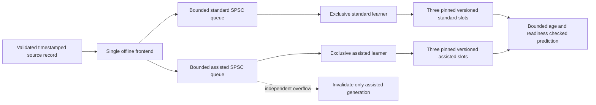

# Phase 9 training-throughput investigation

Offline validation on `ASTR-LT-428.local`, macOS 26.3.2 arm64, starting from
committed Phase 8 `bbe9ffc0365b8f246371de5af2b8b015a3f01183`. Apple LLVM 21.0.0
(`clang-2100.0.123.102`), Homebrew GCC 15.2.0, Eigen pkg-config 5.0.1/header
macros 3.5.0, mxlib 0.2.0. No instrument host, device stream, native application,
service, deployment or production configuration was accessed. Original
`loPredCtrl`, Legacy defaults and production execution are unchanged.

Raw captures:

- before/after/common/independent paced: [paced-after-clang](phase9-paced-after-clang.csv), [paced-after-gcc](phase9-paced-after-gcc.csv), [paced-before-clang](phase9-paced-before-clang.csv), [paced-before-gcc](phase9-paced-before-gcc.csv), [paced-independent-clang](phase9-paced-independent-clang.csv), [paced-independent-gcc](phase9-paced-independent-gcc.csv).
- isolated assisted overflow: [isolation-common-gcc](phase9-isolation-common-gcc.csv), [isolation-independent-gcc](phase9-isolation-independent-gcc.csv).
- 60-second runs: [sustained-clang-qr-stress](phase9-sustained-clang-qr-stress.csv), [sustained-gcc-qr-assisted_stall](phase9-sustained-gcc-qr-assisted_stall.csv), [sustained-gcc-qr-normal](phase9-sustained-gcc-qr-normal.csv), [sustained-gcc-rls-normal](phase9-sustained-gcc-rls-normal.csv).
- inclusive component CPU/wall: [profile-after-clang](phase9-profile-after-clang.csv), [profile-after-gcc](phase9-profile-after-gcc.csv), [profile-before-gcc](phase9-profile-before-gcc.csv), [profile-native-gcc](phase9-profile-native-gcc.csv).
- single-TU rank control: [rank-before-clang](phase9-rank-before-clang.csv), [rank-before-gcc](phase9-rank-before-gcc.csv).
- numerical byte-comparison summaries: [native-probe-comparison](phase9-native-probe-comparison.json), [old-probe-comparison](phase9-old-probe-comparison.json).

Raw binary traces and complete build/test stderr logs remain under ignored `build/phase9-*`; the summaries preserve per-profile counts, byte differences and numerical maxima.

## Root cause and scope of the correction

The dominant apparent GCC slowdown in the Phase 7/8 instrumented benchmarks was
caused by the **offline allocation probe**. Its generic `eigen_assert` wrapper
called `std::strstr` to classify every Eigen assertion while allocation counting
was enabled. GCC retained those calls in hot matrix kernels; Clang folded them
away. Mach-O undefined-symbol inspection finds `_strstr` in the original GCC
`shadow_controller.o`, and none in original Clang or corrected GCC objects.
Controlled replacement of just the probe removes this cost. This is stronger
evidence than attributing the difference to Eigen arithmetic, memory bandwidth
or the operating system without measurement.

`tests/allocation_probe.hpp` now classifies literal assertion text with a C++14
`constexpr` expression. Ordinary assertions retain the native `assert` expression;
only allocator assertions call the counter. Conditions are evaluated once, failed
assertions still abort, and the thread-local Eigen/C++ counters remain active.
Both compilers pass explicit classification, allocation-count, single-evaluation,
ordinary-assertion and forbidden-allocation subprocess tests. There is no change
to production flags, estimator arithmetic, rank frequency, rank threshold,
readiness, history layout or reference control law.

The old wrapper also changed GCC QR floating-point code generation. With the
same deterministic source records, old-probe versus corrected-probe maximum
absolute differences were:

| Modes / model | Learned coefficients | Origin proposal |
| --- | ---: | ---: |
| 2 / standard QR | 2.85357e-6 | 2.13832e-6 |
| 2 / assisted QR | 1.38879e-5 | 6.91414e-6 |
| 10 / standard QR | 2.40803e-5 | 2.64049e-5 |
| 10 / assisted QR | 3.58820e-5 | 4.27365e-5 |

RLS payloads were identical. The corrected probe and a native-assertion diagnostic
build match **every payload byte across 6,496 snapshots**: theta, full gain,
origin state, proposal and RMSE. Per-version diagnostic hashes match as well.
This observer effect is recorded separately from the strict uninstrumented
committed-reference regressions, which retain zero tolerance. Historical Phase
7/8 CSV files are preserved; their GCC training-capacity diagnosis must be read
with this correction. These differences are not new acceptance tolerances.

## Component profiles

`training_benchmark.cpp` manually services the two workers in order, without
producer sleeps, worker polling or contention. Each configuration has 512 warmup
and 300 measured records. Opt-in `training_profile.hpp` measures inclusive
monotonic wall time and thread CPU time around history construction, weight and
covariance updates, QR factor/solve, rank checks, reference solving, diagnostics,
snapshot copying/publication and queue service. Default application/test builds
compile the hooks away. The outer processing interval contains inner phases;
do not add inclusive columns together. Timer overhead and clock granularity are
included. Inactive phases have zero call counts; active sub-microsecond work can
round to zero in coarse wall-clock observations. CPU medians retain finer detail.

The single-translation-unit `rank_probe.cpp` separately measures the same pivoted
QR with counting off/on and hashes the raw factors. It confirms counting overhead
without arithmetic changes, but understates the whole-worker penalty because
compiler inlining/code generation depends on its surrounding translation unit.
No hardware-counter or cache-miss attribution is claimed.

Ten-mode standard-worker medians in microseconds (300 measured records):

| Fit / phase | Old GCC CPU | Corrected GCC CPU | Corrected Clang CPU | GCC corrected wall / p99 |
| --- | ---: | ---: | ---: | ---: |
| rls / history | 21.000 | 0.916 | 0.792 | 0.000 / 2.000 |
| rls / weights | 3.208 | 2.042 | 2.001 | 2.000 / 3.000 |
| rls / covariance | 9.333 | 6.251 | 6.084 | 6.000 / 7.000 |
| rls / rank | 905.459 | 137.667 | 135.916 | 137.000 / 152.000 |
| rls / reference | 266.417 | 23.250 | 22.917 | 23.000 / 27.000 |
| rls / diagnostics | 3.417 | 1.375 | 1.416 | 1.000 / 2.000 |
| rls / snapshot | 3.500 | 1.208 | 1.167 | 1.000 / 1.000 |
| rls / queue | 0.250 | 0.250 | 0.250 | 0.000 / 1.000 |
| rls / processing | 1219.000 | 174.917 | 172.666 | 175.000 / 194.000 |
| qr / qr_factor | 21.792 | 20.209 | 20.667 | 20.000 / 23.000 |
| qr / qr_solve | 15.958 | 16.083 | 11.541 | 16.000 / 21.000 |
| qr / rank | 916.000 | 137.834 | 135.750 | 138.000 / 152.000 |
| qr / reference | 272.167 | 23.333 | 22.833 | 23.000 / 32.000 |
| qr / processing | 1259.584 | 205.250 | 198.500 | 205.000 / 224.000 |

CPU and wall medians closely agree for the outer processing interval. The old
penalty is computation, rather than an unexplained scheduler/lock wait. Rank
checking remains the largest real compute cost after correction. Queue service
and snapshot publication are small; no new sharing or copy-elision scheme was
needed to cure throughput. Both models retain their own matrices/workspaces.

The allocation probe observes Eigen allocation-permission checks and ordinary
C++ `new`/`new[]`, rather than arbitrary libc/aligned allocation or OS/runtime
activity. Startup, shutdown and output formatting are outside frame timing.
Known-allocation self-tests run before benchmark capture. Paced workloads use
gamma=1; gamma=.99 conventional RLS retains the committed worker-only temporary
to preserve exact rounding. Zero frontend requests do not certify a complete
operating-system allocation bound.

## Paced and sustained observations

Each paced run uses both workers concurrently, a 500-us WFS period, the original
synthetic source/RNG, 512 warmup records and preallocated bounded traces. The
original 16 configurations (2/10 modes, RLS/QR, 4/8-kHz sensor, normal/stress)
retain 2,000 timed frames and synchronous comparison. Frozen committed Phase 8
binaries retain their original probe for the before capture. New columns expose
per-lane admissions/overflows and lifetime worker CPU utilization. Utilization
is thread CPU / thread lifetime (including polling, warmup and drain), expressed
as a percentage of one core; two workers can total more than 100%.

Sustained runs each measure 120,000 frames (60 seconds), plus warmup. They omit the
expensive precomputed synchronous oracle (`--no-reference`); `max_sync_proposal_difference` is
NaN and `reference_enabled=0`, rather than a false zero-error claim. Matched-version
numerical correctness is checked separately by deterministic tests. Not all 16
profiles were run for 60 seconds; the raw tables identify every duration.

Selected normal 8-kHz short runs (2,000 queries per model; microseconds):

| Compiler / modes / fit / model | Train p99 before → after | Valid before → after | Frontend p99 / max after | Queue high after |
| --- | ---: | ---: | ---: | ---: |
| gcc / 2 / rls / standard | 222.000 → 10.000 | 2000 → 2000 | 2.000 / 3.000 | 1 |
| gcc / 2 / rls / assisted | 508.000 → 45.000 | 1997 → 2000 | 2.000 / 3.000 | 1 |
| gcc / 2 / qr / standard | 224.000 → 12.000 | 2000 → 2000 | 2.000 / 5.000 | 3 |
| gcc / 2 / qr / assisted | 513.000 → 56.000 | 2000 → 2000 | 2.000 / 5.000 | 3 |
| gcc / 10 / rls / standard | 1182.000 → 206.000 | 11 → 2000 | 3.000 / 10.000 | 2 |
| gcc / 10 / rls / assisted | 45.000 → 383.000 | 0 → 1999 | 3.000 / 10.000 | 2 |
| gcc / 10 / qr / standard | 1206.000 → 217.000 | 11 → 2000 | 3.000 / 9.000 | 2 |
| gcc / 10 / qr / assisted | 102.000 → 420.000 | 0 → 1999 | 3.000 / 9.000 | 2 |
| clang / 2 / rls / standard | 9.584 → 9.250 | 2000 → 2000 | 2.084 / 18.584 | 1 |
| clang / 2 / rls / assisted | 45.500 → 43.459 | 2000 → 2000 | 2.084 / 18.584 | 1 |
| clang / 2 / qr / standard | 11.041 → 10.625 | 2000 → 2000 | 2.167 / 3.083 | 1 |
| clang / 2 / qr / assisted | 51.709 → 50.417 | 2000 → 2000 | 2.167 / 3.083 | 1 |
| clang / 10 / rls / standard | 188.167 → 185.542 | 2000 → 2000 | 2.583 / 23.125 | 1 |
| clang / 10 / rls / assisted | 361.750 → 354.875 | 1999 → 1999 | 2.583 / 23.125 | 1 |
| clang / 10 / qr / standard | 213.125 → 210.791 | 2000 → 2000 | 2.708 / 18.000 | 3 |
| clang / 10 / qr / assisted | 408.084 → 398.500 | 1999 → 1999 | 2.708 / 18.000 | 3 |

Old GCC assisted quantiles under overflow describe mostly unready work; they
cannot be compared as if they were ready-model rank workloads. Across all 16
corrected common-policy profiles, frontend execution maxima are 50 us (GCC) and
24.458 us (Clang), with zero measured execution-budget misses and zero frontend
Eigen/C++ allocation requests. GCC has **two absolute scheduled-deadline misses**
in the short fault matrix; Clang has zero. Scheduling delay is distinct from
frontend compute time. Normal GCC ten-mode 8-kHz assisted availability is
1,999/2,000 for both learners, with zero overflows. Full raw CSVs include 4-kHz,
stress, p95/p99.9, model age and allocation/queue counters.

All sustained cases are ten modes, two simultaneous workers, 120,000 measured
frames. Times are microseconds; CPU is percent of one core. RLS normal uses
4 kHz sensors, the other cases 8 kHz. QR normal uses common overflow; all other
sustained cases use independent overflow.

| Case / lane | Processed/s | CPU % | Train p50 / p99 / max | Valid % | Queue high / lane rejects | Age p99 / max |
| --- | ---: | ---: | ---: | ---: | ---: | ---: |
| gcc-qr-normal / standard | 2000.00 | 44.86 | 199.000 / 217.000 / 680.000 | 99.983 | 2 / 0 | 630.000 / 1278.000 |
| gcc-qr-normal / assisted | 2000.00 | 80.85 | 390.000 / 417.000 / 1084.000 | 99.920 | 6 / 0 | 1028.000 / 3119.000 |
| gcc-qr-assisted_stall / standard | 2000.00 | 45.36 | 199.000 / 366.000 / 1983.000 | 99.968 | 6 / 0 | 634.000 / 3129.000 |
| gcc-qr-assisted_stall / assisted | 1998.10 | 80.47 | 391.000 / 572.000 / 2263.000 | 97.168 | 8 / 36 | 2080.000 / 16606.000 |
| gcc-rls-normal / standard | 2000.00 | 39.97 | 170.000 / 194.000 / 517.000 | 99.983 | 3 / 0 | 630.000 / 1101.000 |
| gcc-rls-normal / assisted | 2000.00 | 71.60 | 338.000 / 373.000 / 1102.000 | 99.969 | 4 / 0 | 631.000 / 2114.000 |
| clang-qr-stress / standard | 1999.72 | 44.00 | 194.625 / 211.750 / 690.209 | 99.442 | 8 / 8 | 631.792 / 8608.333 |
| clang-qr-stress / assisted | 1999.43 | 78.25 | 378.667 / 405.334 / 890.500 | 99.019 | 8 / 25 | 1025.875 / 17023.333 |

Processed/s counts serviced records, including invalid/reacquisition states; it
is not the count of successful RLS updates or rank-ready predictions. Normal
GCC workers sustain all 120,000 records with zero overflow. Worker maxima exceed
500 us; the architecture absorbs bounded backlog and rejects stale snapshots
rather than promising synchronous worst-case completion. The isolated-stall run
also has incidental OS timing tails beyond its injected fault: assistance has
36 capacity rejections, compared with about 24–25 from the short planned stall.
Standard remains independently available for 99.968% of queries.

| Case | Frontend p50 / p95 / p99 / p99.9 / max | Execution misses | Absolute deadline misses |
| --- | ---: | ---: | ---: |
| gcc-qr-normal | 1.000 / 2.000 / 3.000 / 4.000 / 47.000 | 0 | 0 |
| gcc-qr-assisted_stall | 1.000 / 2.000 / 4.000 / 19.000 / 105.000 | 0 | 6 |
| gcc-rls-normal | 1.000 / 2.000 / 3.000 / 5.000 / 124.000 | 0 | 0 |
| clang-qr-stress | 1.417 / 2.041 / 2.750 / 4.417 / 26.166 | 0 | 4 |

The producer never waits for a learner. All sustained captures have zero
observed frontend and gamma=1 worker Eigen/C++ requests, zero execution-budget
misses, zero pending entries and zero lost trace events after coordinator drain.
Absolute-deadline misses (six in the stall case, four in stress) expose ordinary
OS scheduling delays even with short frontend execution; they are not waived.

| Case / lane | Publication p99 | Record-to-publication p99 |
| --- | ---: | ---: |
| gcc-qr-normal / standard | 2.000 | 362.000 |
| gcc-qr-normal / assisted | 2.000 | 561.000 |
| gcc-qr-assisted_stall / standard | 2.000 | 517.000 |
| gcc-qr-assisted_stall / assisted | 2.000 | 1623.000 |
| gcc-rls-normal / standard | 2.000 | 337.000 |
| gcc-rls-normal / assisted | 2.000 | 511.000 |
| clang-qr-stress / standard | 1.250 | 363.833 |
| clang-qr-stress / assisted | 1.708 | 556.208 |

Age tables include observed metadata even when the query is rejected. Published
evidence older than 2,000 us is not served as valid. Readiness, pin contention
and reset/gap/stall recovery also reduce availability. Raw CSVs include
training/publication/age p95, p99.9 and maxima and every rejection counter.

No affinity, real-time priority, memory locking, frequency or background-load
control was used. Captures are sequential after compilation. No other intentional
benchmark/compiler workload runs concurrently. Frontend timing includes synthetic
sample generation, causal history construction, both queues and queries; normal
short captures also include comparison to the synchronous oracle. Sensor events
are generated in batches by the producer, not by an independent acquisition
thread. Publication latency means payload-copy/release-publication duration;
record-to-publication includes queue residence and training. Model age is measured
from the evidence origin, never refreshed by publication. Execution-budget misses
and absolute scheduled-deadline misses are distinct columns.

## Independently bounded overflow experiment

The default `OfflineOverflowPolicy::Common` preserves Phase 8: a full lane rejects
both admissions and invalidates both histories. Opt-in `Independent` rejects and
invalidates only the full lane. Both still receive exactly the same source
record whenever accepted, with unchanged timestamp, provenance, gap and restart
validation. Malformed common timing/applied-input data still invalidates both.
Missing sensor data still affects only assistance. Reset/generation barriers,
slot pinning and age/readiness rejection remain unchanged.

Use `submit_record()` for the per-model admission mask. The compatibility `submit()`
returns true only when both accepted; in independent mode false can mean one
accepted. Healthy history is never silently fed a fabricated replacement for a
dropped record. The affected worker discards invalidated queued prefixes and
reacquires contiguous evidence while retaining learned weights on a history
break; full reset still clears its weights. Snapshots add
`m_segmentFirstSequence` to identify their current evidence segment. Distinct
admission masks/segments must not be presented as equal fitted training sets.

Deterministic RLS and QR tests stall only assistance, verify all 201 standard
records against the committed Phase 8 model, and compare assistance against its
actual sparse admitted-record replay. Assistance rejects 36 records and discards
four queued prefix records; standard rejects none and retains segment start 0;
assistance restarts at 140. A separate `assisted_stall` paced scenario isolates
this effect from common gaps and resets; the original stress scenario is kept.

Ten-mode GCC QR, 8 kHz, isolated 16-ms assisted stall (2,000 queries):

| Policy / lane | Valid | Lane overflow rejects | Queue high | Discarded prefix |
| --- | ---: | ---: | ---: | ---: |
| common / standard | 1849/2000 | 24 | 3 | 0 |
| common / assisted | 1788/2000 | 24 | 8 | 8 |
| independent / standard | 2000/2000 | 0 | 2 | 0 |
| independent / assisted | 1787/2000 | 25 | 8 | 8 |

The common-policy standard lane loses 151 valid queries even though it is not
full; independent admission preserves all 2,000. The affected lane still rejects
stale/unready snapshots and reacquires evidence. Overflow counts vary by one
between separately scheduled runs; they are not deterministic numerical oracles.
The default policy is not changed based on this experiment.

## Numerical, safety and portability results

| Check | Current-source result |
| --- | --- |
| Strict Clang | 1,173,990 assertions / 57 cases pass. |
| Strict GCC | 1,173,125 / 57 pass. |
| Clang ASan + UBSan | 1,177,364 / 57 pass, no reported findings. |
| Clang TSan async + Phase 9 | 846,639 / 7 pass, no reported races. |
| ASan + UBSan independent paced matrix | All 16 scenarios x 100 timed frames / 32 model rows pass; zero frontend allocation requests. |
| TSan independent assisted-stall paced case | Two-mode QR, 8 kHz, 100 frames pass, no reported races. |
| Clang Legacy fast | 186,615 / 9 pass. |
| GNU Legacy default fast | Historical failure retained: 8/9 cases pass, 182,253/182,254 assertions pass; nonfinite QR learned matrix at t=31. |
| GNU fast + diagnostic no-reciprocal flag | 186,615 / 9 pass; production flags unchanged. |
| Hidden tiny rotation | Strict Clang/GCC, Clang fast and GNU no-reciprocal pass; GNU default fast finite assertion still fails. |
| Hidden compiler drift | Both strict compilers pass without weakening exact historical comparisons. |
| Probe contract | Both compilers detect one allocation, evaluate ordinary assertion once, and retain both SIGABRT guards. |
| Original eight allocation profiles | Pass; all prediction requests zero; gamma=.99 conventional RLS retains worker-only temporary (1,466 counted requests in each 2/10-mode profile). |
| Corrected probe vs native assertions | All 6,496 raw numerical snapshot payloads byte-identical. |
| Mocked native-build orchestration | Seven Python tests pass in each full check; not native compilation evidence. |
| Preservation/style | Original 15-file loPredCtrl tree, protected plan prefix and branch preserved; C++ clang-format, Python syntax and diff whitespace checks pass. |

Threaded assertion counts vary with observed publications. Sanitized timing is
not performance evidence. [ASan matrix](phase9-async-sanitize.csv),
[TSan independent case](phase9-async-tsan.csv) and
[hidden-case exit summary](phase9-hidden-results.json) retain the extra checks.
One initial standalone sanitizer build command omitted `-std=c++20` from an
explicit `CXXFLAGS` override and failed to compile the existing lock-free-atomic
assertion. Its stale-binary capture was discarded. A fresh build directory with
the complete flags produced the validated ASan matrix above; the failed command
log is retained under `build/phase9-async-sanitize-build.log`.

The new fixture extracts the actual committed Phase 8 math and asynchronous
sources from local Git objects, without switching branches. Eight ordered
640-record replays cover 2/10 modes, RLS/QR, gamma=1/.99, missing sensors, timing
failure, sequence gaps, reset, assisted stall/common saturation, three staleness
thresholds, complete matrix payloads and diagnostics. Existing committed Phase
6/7 and original/restored Legacy tests are retained. No numerical tolerance is
weakened.

GNU production fast-math QR's historical nonfinite failure remains a separate
issue from this strict-math benchmark probe. Its failing regression is retained;
the diagnostic `-fno-reciprocal-math` experiment does not change production flags.
The current-source GNU fast replay reproduces the failure at QR record 31 in
both original and clone: their calculated commands still compare exactly, but
the independent exponent-bit finite check rejects the historical learned matrix.
Tiny Givens rotation remnants and reciprocal overflow are the documented cause;
changing allocation-probe classification does not repair that kernel/flag issue.

There is no available isolated native Linux runtime/VM/container here. Linux
build, scheduling, throughput and tails remain **unverified**. Reproduce on an
approved non-instrument Linux development system with GCC and Clang using the
README commands and provisioned dependencies. Native full application linking is
also still required with `native_linux_build.py`; no successful native application
build or real-time qualification is claimed by these offline macOS captures.

## Recommendation and remaining risks

Keep independent learner ownership, bounded SPSC fanout, fixed pinned snapshot
slots and the allocation-free bounded frontend. The apparent GCC deficit does
not justify changing rank frequency/thresholds or sharing estimator matrices.
Standard and assisted dimensions differ; after independent rejection their
fitted histories differ too. Sharing QR/covariance state would violate the
independent-model contract. Snapshot and queue costs are measured rather than
presumed dominant. Conventional forgetting RLS's worker-only allocation remains
reported; it is outside prediction, but is still a future bounded-latency risk.

Prioritize the next work as: (1) strict and production-flag native Linux
qualification, including fast QR; (2) sustained/load-tested scheduling, capacity
and age limits with dedicated worker resources; (3) physical input-clock and
single-frontend ownership review; (4) a separately approved non-actuating app
integration. The normal ten-mode QR workers together use about 126% of one core
on this Mac; moving work off the frontend still requires adequate independent CPU
capacity and bounded staleness policies.

Production integration is **not approved or ready**. Required next gates are
native Linux strict and production-flag linking, the unresolved GNU fast QR
failure, long/load-tested Linux latency and queue capacity, architecture/policy
review, production single-frontend/lock ownership, and independently verified
WFS/exposure/applied-command/sensor clocks and physical delays. Offline synthetic
applied commands establish no physical DM application. There is no live sensor
ingestion, production thread integration or new actuation in Phase 9. Request
approval before any production integration.

## Changed implementation and tooling files

- `apps/loPredCtrlAcc/{shadow_controller,recursive_least_squares,qrd_rls}.cpp`:
  profiling hooks only; new `training_profile.hpp` owns the opt-in counters.
- `apps/loPredCtrlAcc/tests/{async_shadow.hpp,async_shadow.cpp,async_benchmark.cpp}`:
  offline policy, provenance/CPU counters and paced/sustained scenarios.
- `tests/{allocation_probe.hpp,native_assert_probe.hpp,probe_test.cpp,probe_test.py}`:
  test-only instrumentation correction and controls.
- `tests/{training_benchmark.cpp,rank_probe.cpp,compare_profile_traces.py}`:
  component profiles and exact raw-payload comparison.
- `tests/{prepare_phase6.py,prepare_phase8.py,ddspc_phase9_test.cpp}`:
  pinned fixture extraction and exact policy/ordered-history regressions.
- `tests/{Makefile.async,Makefile.benchmark,Makefile.offline}`: offline build targets.
- `tests/README.md`, `tests/results/phase9*` (this report and all linked captures),
  and `agents/plans/2026-11/accel-ddspc-controller.md`: engineering record.

The abbreviated `tests/` paths in this list are relative to `apps/loPredCtrlAcc/`.
