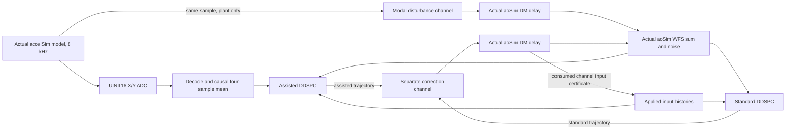

# accelSim / aoSim / DDSPC simulation-only connection

**Follow-up:** [channels 0/1, late-suppression diagnosis and minimum shmim adapter](channel01_validation.md)
supersedes the investigation/transport status below. The original adaptive run and
its unfavorable tail remain intact. A calibration-only fit greatly reduces that
loss but does **not** demonstrate additional ADC-assisted benefit. The optional
private-shmim adapter is contract-tested, not natively executed on this Mac.
This file and its original generated artifacts retain the initial connection record.

**Implemented and validated: a headless connection of the actual numerical
implementations across the two repositories. Full application/shmim integration
is not completed or claimed.** This personal Mac lacks `ImageStreamIOWrap`,
`magaox`, `purepyindi2` and `xconf`. No native application, INDI connection,
instrument host, service or shared-memory image was opened. There are no real DM
commands, production changes, deployment, commits or pushes.

The smallest working connection stays in `MagAOX-DDSPC/tests` and reads the other
repository's source without modifying it. Its existing unrelated edits remain
intact. No new vibration simulator, controller law or recovery framework is added.

## Reproduce

From `~/source/MagAOX-DDSPC`, using Python with NumPy/SciPy/Matplotlib and the
existing Eigen/mxlib C++ development dependencies:

```sh
python apps/loPredCtrlAcc/tests/simulation_demo.py --magaox-repo ~/source/MagAOX
```

The command builds only a test shared library with strict floating-point flags,
then runs three comparable trajectories at each of two explicitly declared
source amplitudes. [Results and plots](simulation_connection/README.md),
[metrics](simulation_connection/metrics.csv) and
[configuration/source/binary/trace hashes](simulation_connection/manifest.json)
are generated. The experiment advances a **virtual** 2-kHz WFS / 8-kHz sensor
clock; it is not wall-clock pacing or a real-time qualification.

## Existing interfaces and missing connections

All MagAOX paths below are in **`~/source/MagAOX`**, not this DDSPC worktree.

| Existing interface | Names, geometry/type, cadence and semantics | Missing connection |
| --- | --- | --- |
| `accelSim::configureAcquisition()/loadImageIntoStream()` | Default `acc000`: width 2 × height 1, UINT16, simultaneous X then Y in 0–4095. Code default 6 kHz; selectable 8 kHz. | A calibrated/time-tagged reader in the causal DDSPC path. |
| `accelSimModel.hpp::model::step()` | One same-sample ADC and physical pointing pair; 14 prominent/200 weak modes normally. Current experiment selects actual reference 28/56-Hz modes only, at 8 kHz. | Same realization must feed the simulated DM; do not run aoSim's independent sine. |
| `accelSim::frameGrabberPostPublish()`, `accelSimDM.hpp` | Optional same-sample physical-pointing injection, after ADC publication, at 8 kHz. Requires explicit existing 50×50 FLOAT surface-micron channel/calibration. Disabled/no channel by default. | That actuator image is not a two-element aoSim modal command. No physical channel was configured or used here. |
| `aoSim.setup()/update_dm()` | `aoSim_dm`, NumPy shape (2,1) FLOAT32 by default; absolute modal input, queued through `_lag+1` history before becoming DM state. | Separate disturbance/correction inputs and a confirmed consumed-input record. |
| `aoSim.update_wfs()` | `aoSim_wfs`, same modal shape/type; WFS = external disturbance + delayed DM state + noise. | Feed delayed contributions from the common source and the controller, with known signs/units. |
| `aoSim.update_disturbance()` | `aoSim_disturbance`, independent sine. `_frequency` is used as disturbance frequency; `_dt=.01` is logical time, not verified wall cadence. | This sine is deliberately not called in the connection. A real 2-kHz stream scheduler/clock contract remains. |
| `loPredCtrlAcc` native app | WFS name is configuration-selected by `shmimMonitor.shmimName`; no verified runtime WFS name supplied. Shadow expects FLOAT, height 1, width at least mode count. Legacy output name is configured by `framegrabber.shmimName`. | Raw callbacks intentionally cannot assert applied-input/exposure timing. |
| `loPredCtrlAcc::configureShadowInputs()/processShadowWfs()/processShadowApplied()` | Existing typed causal-input seams and independent models; shadow output is inhibited and shadow accelerometer stream attachment is rejected. | Native transport adapters, simulated applied-input certificates and a simulation-only output owner. Selecting an INDI model is insufficient. |

`accelSim` pacing uses a monotonic clock; its acquired image timestamp is
`CLOCK_REALTIME`, published as `md.atime` by frameGrabber, distinct from
`md.writetime` and `cnt0`. WFS notifications steer sensor phase, not sample count.
These facts do not establish physical exposure/application latency by callback
ordering. The headless experiment supplies its own explicit source/frame clock.

## Implemented connection



The diagram represents **separate plant trajectories**, not two controllers
simultaneously writing the same channel. Disturbance-only uses zero correction
after the same initial calibration. All three trajectories reuse one immutable
source/ADC realization and the same WFS-noise/calibration sequences.

- `tests/sim_bridge.cpp` includes the other repository's **unchanged
  `accelSimModel.hpp`**. Its source interface returns ADC/pointing from the very
  same `model::step()` call. It filters `referenceModes()` to28/56 Hz, retaining
  their stochastic AR(2) radii, innovations and physical acceleration relation.
- `tests/simulation_demo.py::aosim_methods()` AST-loads only the **verbatim
  `aoSim.update_dm()` and `update_wfs()` bodies**, with NumPy. It does not import
  XDevice, run setup/loop, create images, or execute the unrelated sine generator.
  Small named-in-code memory objects stand in for the images; their API has no
  stream name or ability to attach hardware. This is method-level reuse, not an
  application-level runtime test or a rewritten plant.
- Disturbance and correction have separate two-mode DM-input/history instances
  of the existing delay method. Their delayed states add at the existing WFS
  method. Modal units are declared arcsec with identity positive response, a
  **synthetic modal convention**, not the50×50 surface-micron injection calibration.
- The source produces four ADC pairs per WFS interval. The newest pointing is
  held on the modal disturbance input at 2 kHz. Intermediate 8-kHz pointing values
  remain in the source capture but are not all injected into this 2-kHz plant.
  This is explicitly different from runtime accelSim's optional 8-kHz actuator
  injection. No acceleration integration or separately invented sine is used.
- Only raw ADC, measured WFS and the **correction input actually read by
  `aoSim.update_dm()`** cross the DDSPC boundary. Pointing is exclusively a plant
  input. The native controller object has no pointer to the generator. ADC decode
  is `(counts-zero)*voltsPerCount/sensitivity`; active parameters are passed from
  the source interface. Four already available decoded samples are averaged.
  Standard does not use sensor words; assisted inputs retain their own histories.
- The C++ adapter manually services the existing independent QR workers and
  coherent snapshots, with unchanged rank/freshness/reference-law checks. It
  exposes only arrays, query diagnostics and consumed-input admission. No
  production app/output path, Legacy default or shared-memory interface changes.

## Timing and command meaning

At virtual time t_i, source samples cover `[t_i-500 us,t_i-125 us]` at 125-us
spacing and are available 1 us after their sample times. WFS y_i is read before
choosing a command. DDSPC sees y_i and past consumed corrections; the assisted
state additionally sees only that already available ADC history.

After the decision, both DM-input channels are written locally and the actual
`aoSim.update_dm()` method reads them. Its read value is certified and supplied
as u_i for training; it is **not silently replaced by the proposed command**.
The delayed optical DM state is recorded separately (`dm_x/y`), as is the delayed
disturbance state. This is a simulated consumed-input certificate, not physical
mirror readback. The discrete model includes the subsequent DM response delay.

With the explicitly selected test setting `lag=0`, read-before-roll plus
decision-after-WFS gives `y_i = d_(i-2) + u_(i-2) + noise_i`. An impulse test
verifies exactly two decision-to-WFS frames. With aoSim's original default
`lag=1`, that ordering gives three frames. No production default was changed.
Both channels have the same delay, so equal opposite inputs cancel after it.
No timestamp is inferred from a semaphore/callback order.

The new test configuration uses WFS history 6, five past consumed inputs, future 3,
sensor history 5. The extra input history retains the delayed plant contribution
alongside the two-source-mode disturbance history; the earlier harness used
history 5 and a different one-frame plant. A preliminary unchanged-history 5 run
gave weaker suppression and is retained in
[Clang](simulation_connection/metrics-history5-clang.csv) /
[GCC](simulation_connection/metrics-history5-gcc.csv) tables. The history change
is an explicit simulation-model configuration adjustment, not a replacement
control law or a relaxed numerical/rank tolerance. Gamma=.9995, prior=.001,
lambda=.02 and the existing general QR/control mathematics remain unchanged.

## Performance and comparison

Strict Clang, score window = last 7,000 of 8,000 control frames after 2,400 common
calibration frames. Held/unready rows are included. RMS uses fixed producer-derived
normalization: configured 28-Hz angular RMS per WFS/input unit. Line suppression
uses the existing ±2-Hz Hann/Welch metric.

| Mode amplitude | Controller | WFS RMS | Variance reduction | 28 Hz dB | 56 Hz dB |
| --- | --- | ---: | ---: | ---: | ---: |
| Reference 1× | Disturbance only | 1.24214 | 0% | 0 | 0 |
| Reference 1× | Standard QR | .66036 | 71.74% | 8.69 | 11.32 |
| Reference 1× | Assisted QR | .64274 | 73.22% | 9.09 | 11.37 |
| Explicit 100× | Disturbance only | 1.24214 | 0% | 0 | 0 |
| Explicit 100× | Standard QR | .66055 | 71.72% | 8.72 | 11.46 |
| Explicit 100× | Assisted QR | .57924 | 78.25% | 10.94 | 12.71 |

Assistance reduces RMS **2.67%** (variance 5.27%) at reference amplitude and
**12.31%** (variance 23.10%) in the explicitly scaled source case. GCC also shows
improvement: **2.66% / 12.77%**. Its
[metrics](simulation_connection/metrics-gcc.csv) and
[manifest](simulation_connection/manifest-gcc.json) are separate. Clang/GCC source
array hashes differ; Gaussian draw/library/code-generation differences mean their
realizations are not byte-identical. Within each compiler, every controller gets
the exact same source. These are individual deterministic experiments, not
statistical confidence intervals or universal superiority claims.

The 100× case multiplies simulated 28/56-Hz mode accelerations/pointing, leaving
ADC zero=2048, volts/count=.0083799, sensitivity=1.02 and sensor PSD=1e-8 unchanged.
WFS noise remains 3% of the fixed angular normalization and calibration inputs
scale with it. No normalization is estimated from future or complete-record
statistics. Reference28-Hz acceleration RMS=.002 m/s² is below the approximately
.00822-m/s² ADC count step; the noisy quantized sensor therefore provides a
smaller gain at reference amplitude. The larger-signal case demonstrates usable
information without hiding the reference ADC limitation. Neither source capture
has rail-clipped samples. It is not an instrument-amplitude recommendation.

The previous [offline harness](minimal_vibration_demo.md) improved RMS 21.17%
(.04621→.03642). Its deterministic normalized source, unquantized features,
different cross-coupled one-frame plant and history 5 are **not the same
experiment**. Absolute RMS values are not comparable across these units/plants;
the new smaller relative benefit must not be advertised as reproducing 21.17%.
Both report actual WFS response, rather than subtracting predicted vibration in
post-processing. Full source, consumed-input and delayed-state traces are under
ignored `build/simulation-{c++,g++-15}`.

Suppression is **not stationary over this short run**. Reference-amplitude assisted
RMS grows from .18621 in the first scored second to 1.07351 in the last second
(last-second disturbance-only RMS 1.21567). At 100×, assisted grows .15365→.98930.
The complete scored time-series/RMS plots and first/last-second CSV fields retain
this deterioration; the earlier 200-ms detail view alone would overstate sustained
performance. No recovery or numerical-robustness changes were added to conceal
it. This is a successful causal wiring/average-suppression demonstration, not a
production-ready controller or a sustained-stability result.

## Validation and unchanged behavior

- Six new connection tests pass with both strict Clang and GCC: measured impulse
  delay versus input consumption; exact cancellation/feedback sign; ADC inverse,
  shape and timestamp/order rejection; deterministic actual source; standard-model
  independence even with invalid ADC words; and future-prefix invariance.
- Unchanged strict full offline suites pass: Clang 66 cases/1,766,144 assertions;
  GCC 66/1,765,262. Threaded assertion counts may vary. Original historical
  numerical tests/tolerances remain unchanged. No application/core source changed.
- New bridge builds use `-fno-fast-math`; this work does not change production
  flags or resolve/reinvestigate the separately documented GNU fast-math failure.
- No source in `~/source/MagAOX`, original `loPredCtrl`, production controller,
  configuration, service or actuator route changed. All new code is test-only.

Run the new tests after the demonstration build:

```sh
python -m unittest discover -s apps/loPredCtrlAcc/tests -p simulation_demo_test.py -v
```

## Exact remaining application/shmim work

1. On an isolated development runtime with the actual dependencies, add a
   **simulation-only same-sample transport** from runtime accelSim's completed
   ADC/pointing sample: ADC to the sensor stream and pointing only to a local
   modal-disturbance input. Reuse `frameGrabberPostPublish` or a simulation-only
   source interface. Preserve sample counter/time/epoch across both payloads;
   two output publications are not atomic. Do not point its actuator publisher at
   any physical DM channel or blindly reinterpret 50×50 surface images as modes.
2. Give local aoSim inputs distinct disturbance/correction channels, using the
   same tested delay/sum semantics, and publish its **actually consumed correction**
   values/intervals and delayed state independently. Disable the unrelated sine
   for this test. Supply explicit virtual or real 2-kHz scheduling/timestamps and
   chosen lag; default `_dt`/INDI frequency do not establish this contract.
3. Implement ADC/WFS/consumed-input adapters into the existing causal controller
   seams, including frame width/height order, source epochs, availability and
   sample/exposure mapping. Verify the0–4095 UINT16 decode against active runtime
   ADC parameters. Reuse the tested past-input/current-state prediction ordering;
   do not drive the loop with an older paired-record proposal by accident.
4. Add an explicit **local simulation output owner** for fresh model proposals,
   with simulator-only names/shape checks and consumed-input acknowledgement.
   Existing production shadow mode intentionally inhibits output; merely selecting
   `ddspc_mode` must not enable it. Preserve Legacy and physical routes. Run the
   same three-case/impulse/cancellation reports through actual shmim transport.

No recovery framework or new robustness investigation is required for that
next connection. Native app linking, real transport/counter coherence, clock
mapping, exposure integration, 8-kHz disturbance delivery and sustained wall-clock
2-kHz scheduling remain unverified. This work stops at the tested headless
simulation-only interface and closes no physical loop.
